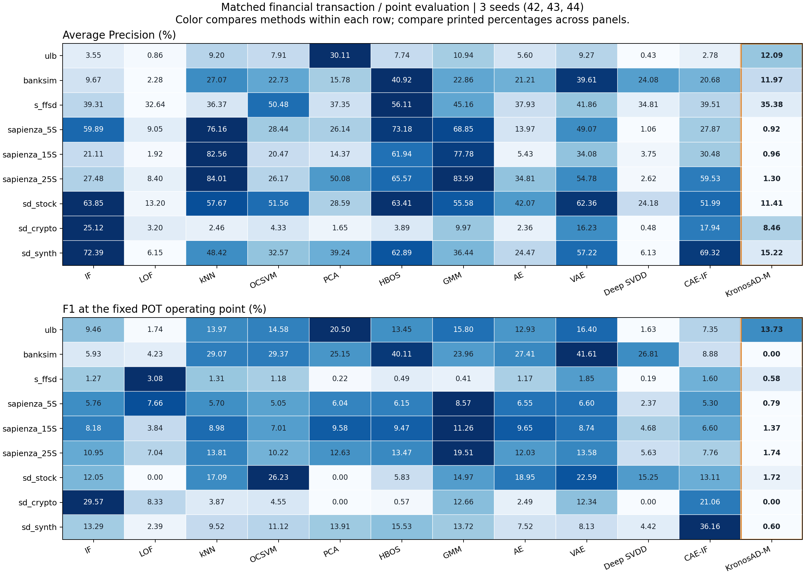
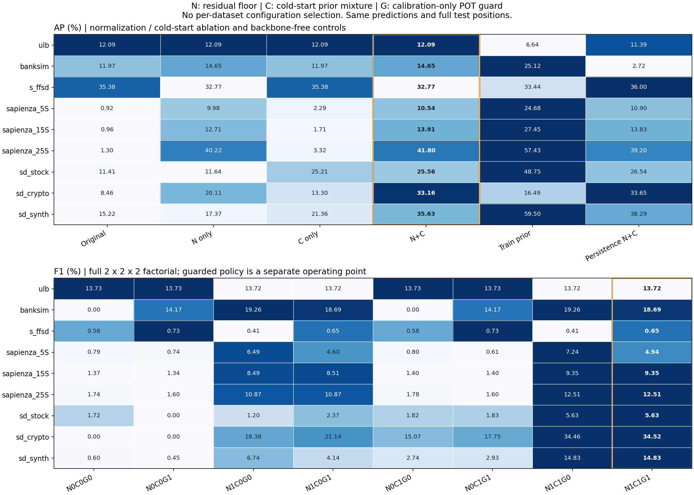

# 金融无监督异常检测综合对比报告

**最新角色／评分改进：** [HUGE与HIMVH新一轮144配置及中文报告](../results/roleweight_20261117/README_CN.md)，见第14节。旧报告及旧结果保留。

**最新修正与消融：** [三方法审计修正、174组配置与完整中文报告](../results/recent_repair_20261117/README_CN.md)。新主榜见第13节；前文保留历史结果。

**同日上轮扩展（历史记录）：** [HUGE、HIMVH-Zero、SD-FMM-Zero完整中文报告](../results/recent_zero_20261117/README_CN.md)。该轮结果见第12节及该报告；下文11月16日和此前表格保留为历史结果。

整理日期：2026-11-16；包含历史基线、原Kronos同协议结果及稳定评分／冷启动／POT护栏新消融。本文保留此前真实冻结推理，新增本轮缓存预测上的评分与阈值消融；本轮不重新推理。新参数在本轮评价前固定，但其开发使用了上轮测试诊断。**交易／行情点级检测与账户图检测分别比较，不能混为一个排行榜。**

**11月15日原Kronos同协议全量结果：** [27次运行与逐种子指标](../results/kronos_matched_20261115/README_CN.md)。交易主表已包含KronosAD-M；第7节是旧协议历史参考，账户图结果仍独立。

**最新改进与消融：** [KronosAD-S完整结果、2×2×2消融及无骨干对照](../results/kronos_stable_20261116/README_CN.md)。第2节更新为15法共同操作点；护栏G另列，不混入经典原POT排名。**本轮是同一已查看测试集上的回顾性开发评估。**

## 主要发现

- **稳定评分与冷启动消融完成。** 相对原Kronos-M，N+C的AP在7/9任务提高、共同原POT F1在7/9任务提高；15法中AP最高0/9、共同POT F1最高1/9。训练先验与持续值对照一并纳入，不能将评分改善全部归功于预训练骨干。第11节给出完整边界。

- **KronosAD同协议全量重跑已加入交易主表。** 完成27次运行，最终标量POT拟合成功27/27，但拟合成功不等于有效检测；在11月15日当时12种方法中AP最高0/9、POT F1最高0/9。完整测试对象、输入缓存和评价规则已配对核验。第7节仅保留旧协议历史参考，不纳入当前排名。

- **最佳方法依赖数据集及指标。** 包含新Kronos评分与两个无骨干对照的15法完整最高名单见第2.3节，分别列出AP、共同POT F1和99%分位F1；不能用一种指标的第一名代表所有检测能力。
- **CAE-IF不是全面失效。** 它的AP在9个任务中有4个高于IF；在SD-FMM合成任务的POT F1为36.16%，超过此前其余10种经典基线，但AP仍低于IF；加入Kronos后的当前最高方法见第2.3节。
- **EB-GAD在BankSim账户图上的排序较好，报警误报很高。** AP为61.25%、ROC-AUC为89.85%、POT F1为49.60%，同时正常账户误报率为36.49%；不能只凭F1最高判断适合部署。
- **Audit-HCL在S-FFSD账户图上领先本轮比较器，但分辨能力和稳定性仍有限。** AP为90.38%，而已知账户异常占比为87.48%；ROC-AUC仅58.17%。POT F1为15.63%，99%分位阈值F1为47.78%。

## 1. 数据、评价标准与比较边界

### 1.1 汇总了哪些方法

经典方法共10种：Isolation Forest（IF）、LOF、kNN、One-Class SVM（OCSVM）、PCA-SPE、HBOS、GMM、AE、VAE、Deep SVDD。新增方法为CAE-IF核心适配、EB-GAD作者发布版零标签设置、Audit-HCL零标签适配，以及本轮真实冻结Kronos-mini的KronosAD-M代理适配。

交易／点级轨道有9个共同任务，当前第2节比较10种经典方法、CAE-IF、原Kronos-M、新Kronos-S及训练先验／持续值两个对照，共15种评分／方法。账户图轨道仅有BankSim、S-FFSD，实际运行IF、AE、PCA、CAE-IF、EB-GAD、Audit-HCL六种方法。其余经典方法尚未运行账户图实验，不能将它们此前的逐笔交易成绩当作账户图成绩。

### 1.2 来源和跨轮可比性

- 经典结果固定于[前轮360次实验报告](https://github.com/SansaZheng/Financial_unsuperviesdAD/blob/bd9c5e85846e4a6b43bc9f8ca0ef386e0ff96f4d/results/data_2026/README_CN.md)，提交`bd9c5e85846e4a6b43bc9f8ca0ef386e0ff96f4d`。
- 11月14日的CAE-IF、EB-GAD、Audit-HCL及IF／AE／PCA采用[144条运行记录](../results/zero_label_20261114/README_CN.md)，结果发布提交`260cc2bdc95e8f36caccadb5e549335e1d640b61`，正式拟合源提交`847238664dc06077271e06430e5ef7ac8b2e9cfd`。不从两轮相同方法中挑较高成绩。
- **两轮共同使用的81个缓存文件逐一核验，哈希及大小全部一致。** 包含分区输入、标签和清单；使用相同种子42／43／44、训练抽样规则、训练最多8192行、校准最多100000行及全量测试分区。共同预处理为仅在训练特征拟合的鲁棒缩放。
- **11月15日Kronos完成27次真实推理。** 推理源`782ff9d`、主评分源`762acfd`，相同81个缓存、训练／校准抽样索引和完整测试索引均独立复算；每个种子评分742915行、已知733498行。它使用冻结外部预训练与过去32步上下文，不声称与逐行基线具有相同预训练或历史信息预算。详细源码及环境见[新运行清单](../results/kronos_matched_20261115/run_manifest.json)。
- 早期神经网络运行于CPU，最新CAE-IF／AE及Audit-HCL使用CUDA；IF／PCA等仍使用CPU。跨设备及浮点差异可能影响数值，本表是跨轮汇总，不声称同硬件严格配对或统计显著胜出，不比较运行速度。
- 9个任务来自ULB、BankSim、S-FFSD、Sapienza、SD-FMM这5种来源，并非9份独立原始数据。CardSim、TSTR、Elliptic、PaySim等不属于本轮全部方法共同覆盖的9个任务，不补造缺失成绩。

缓存核验、来源提交及合并规则见[汇总溯源记录](../results/comparison_20261114/provenance.json)。本轮所称“零标签”是训练、校准及超参数选择不使用标签，**不是训练数据中绝无异常**。标签只用于最终评价。

新增评分源提交`8b7e5d68764a61cb8afd523f6846be21d99798eb`及[固定方案](kronos_stable_protocol_CN.md)在本轮新结果评价前发布，但设计利用了上轮已查看的测试诊断，因此本轮不是独立验证。相同划分与零标签拟合不消除这种回顾性开发偏差。

### 1.3 如何理解指标

- **AP（Average Precision）**：异常是否优先排在前面，不依赖固定阈值。与梯形PR-AUC分列，二者不能混称。常数评分的AP等于评价集合的异常占比，因此不能跨数据集直接比较AP绝对值。
- **ROC-AUC**：正常与异常的整体排序能力。0.5约对应随机排序，低于0.5说明当前“越高越异常”的分数在该测试集上排序不佳；没有用测试标签反转分数方向。
- **Precision／Recall／F1／FPR**：分别表示报警中有多少正确、异常中找出多少、两者综合以及正常样本误报比例。FPR越低越好，但完全不报警也会使FPR为0，必须结合召回和F1解读。
- **POT操作点**：初始分位数0.85、risk=0.01、至少20个非退化超额样本；另一套是独立的99%校准分位阈值。两者预先规定、并行报告，不按测试标签选择较好的一个。报警条件为`score >= threshold`，无点调整，无测试最优阈值搜索。

所有表格数值为百分数、三个种子的均值（第7节Kronos历史参考为单seed=42，另行标明）；粗体表示该表该指标的最高均值，**不是显著性结论**。标准差保留在CSV。EB-GAD为确定性过程，三种子记录复用同一组图分数，不能把零标准差当作三次独立拟合的证据。新方法的VUS、PATE等序列指标本轮未计算，不与前轮这些指标混排。

## 2. 交易检测／行情点级检测

检测对象为一笔交易或序列数据点。以下15法表保留相同输入、测试对象及最终原POT／99%分位标准。Kronos-S使用稳定分母与冷启动先验混合；完整方案的护栏G另报，不能把新护栏F1当作本表原POT成绩。两个无骨干对照与其他方法同时参与最高均值判断。

### 2.1 固定POT阈值下的F1

| 数据集 | IF | LOF | kNN | OCSVM | PCA-SPE | HBOS | GMM | AE | VAE | Deep SVDD | CAE-IF | Kronos-M | Kronos-S | 训练先验 | 持续值 |
|---|---:|---:|---:|---:|---:|---:|---:|---:|---:|---:|---:|---:|---:|---:|---:|
| ULB信用卡 | 9.46 | 1.74 | 13.97 | 14.58 | **20.50** | 13.45 | 15.80 | 12.93 | 16.40 | 1.63 | 7.35 | 13.73 | 13.72 | 12.17 | 13.06 |
| BankSim | 5.93 | 4.23 | 29.07 | 29.37 | 25.15 | 40.11 | 23.96 | 27.41 | **41.61** | 26.81 | 8.88 | 0.00 | 19.26 | 22.80 | 0.00 |
| S-FFSD | 1.27 | **3.08** | 1.31 | 1.18 | 0.22 | 0.49 | 0.41 | 1.17 | 1.85 | 0.19 | 1.60 | 0.58 | 0.41 | 0.24 | 0.49 |
| Sapienza 5S | 5.76 | 7.66 | 5.70 | 5.05 | 6.04 | 6.15 | **8.57** | 6.55 | 6.60 | 2.37 | 5.30 | 0.79 | 7.24 | 7.56 | 6.79 |
| Sapienza 15S | 8.18 | 3.84 | 8.98 | 7.01 | 9.58 | 9.47 | **11.26** | 9.65 | 8.74 | 4.68 | 6.60 | 1.37 | 9.35 | 7.29 | 9.92 |
| Sapienza 25S | 10.95 | 7.04 | 13.81 | 10.22 | 12.63 | 13.47 | **19.51** | 12.03 | 13.58 | 5.63 | 7.76 | 1.74 | 12.51 | 10.74 | 13.57 |
| SD-FMM股票 | 12.05 | 0.00 | 17.09 | **26.23** | 0.00 | 5.83 | 14.97 | 18.95 | 22.59 | 15.25 | 13.11 | 1.72 | 5.63 | 11.21 | 3.77 |
| SD-FMM加密货币 | 29.57 | 8.33 | 3.87 | 4.55 | 0.00 | 0.57 | 12.66 | 2.49 | 12.34 | 0.00 | 21.06 | 0.00 | **34.46** | 0.00 | 33.84 |
| SD-FMM合成 | 13.29 | 2.39 | 9.52 | 11.12 | 13.91 | 15.53 | 13.72 | 7.52 | 8.13 | 4.42 | **36.16** | 0.60 | 14.83 | 6.46 | 14.29 |

### 2.2 不依赖阈值的排序能力：AP

| 数据集 | IF | LOF | kNN | OCSVM | PCA-SPE | HBOS | GMM | AE | VAE | Deep SVDD | CAE-IF | Kronos-M | Kronos-S | 训练先验 | 持续值 |
|---|---:|---:|---:|---:|---:|---:|---:|---:|---:|---:|---:|---:|---:|---:|---:|
| ULB信用卡 | 3.55 | 0.86 | 9.20 | 7.91 | **30.11** | 7.74 | 10.94 | 5.60 | 9.27 | 0.43 | 2.78 | 12.09 | 12.09 | 6.64 | 11.39 |
| BankSim | 9.67 | 2.28 | 27.07 | 22.73 | 15.78 | **40.92** | 22.86 | 21.21 | 39.61 | 24.08 | 20.68 | 11.97 | 14.65 | 25.12 | 2.72 |
| S-FFSD | 39.31 | 32.64 | 36.37 | 50.48 | 37.35 | **56.11** | 45.16 | 37.93 | 41.86 | 34.81 | 39.51 | 35.38 | 32.77 | 33.44 | 36.00 |
| Sapienza 5S | 59.89 | 9.05 | **76.16** | 28.44 | 26.14 | 73.18 | 68.85 | 13.97 | 49.07 | 1.06 | 27.87 | 0.92 | 10.54 | 24.68 | 10.90 |
| Sapienza 15S | 21.11 | 1.92 | **82.56** | 20.47 | 14.37 | 61.94 | 77.78 | 5.43 | 34.08 | 3.75 | 30.48 | 0.96 | 13.91 | 27.45 | 13.83 |
| Sapienza 25S | 27.48 | 8.40 | **84.01** | 26.17 | 50.08 | 65.57 | 83.59 | 34.81 | 54.78 | 2.62 | 59.53 | 1.30 | 41.80 | 57.43 | 39.20 |
| SD-FMM股票 | **63.85** | 13.20 | 57.67 | 51.56 | 28.59 | 63.41 | 55.58 | 42.07 | 62.36 | 24.18 | 51.99 | 11.41 | 25.56 | 48.75 | 26.54 |
| SD-FMM加密货币 | 25.12 | 3.20 | 2.46 | 4.33 | 1.65 | 3.89 | 9.97 | 2.36 | 16.23 | 0.48 | 17.94 | 8.46 | 33.16 | 16.49 | **33.65** |
| SD-FMM合成 | **72.39** | 6.15 | 48.42 | 32.57 | 39.24 | 62.89 | 36.44 | 24.47 | 57.22 | 6.13 | 69.32 | 15.22 | 35.63 | 59.50 | 38.29 |

### 2.3 每个数据集的最佳方法

| 数据集 | AP最高 | POT F1最高 | 99%分位F1最高 |
|---|---|---|---|
| ULB信用卡 | PCA-SPE：30.11 | PCA-SPE：20.50 | PCA-SPE：17.26 |
| BankSim | HBOS：40.92 | VAE：41.61 | HBOS：48.89 |
| S-FFSD | HBOS：56.11 | LOF：3.08 | VAE：1.85 |
| Sapienza 5S | kNN：76.16 | GMM：8.57 | AE：7.12 |
| Sapienza 15S | kNN：82.56 | GMM：11.26 | 训练先验：10.37 |
| Sapienza 25S | kNN：84.01 | GMM：19.51 | 训练先验：14.43 |
| SD-FMM股票 | IF：63.85 | OCSVM：26.23 | OCSVM：26.23 |
| SD-FMM加密货币 | 持续值：33.65 | Kronos-S：34.46 | 持续值：34.66 |
| SD-FMM合成 | IF：72.39 | CAE-IF：36.16 | 训练先验：42.20 |

“最佳”指当前15种评分／方法相应指标的最高均值，不是显著性结论。候选包含两个无Kronos对照；新护栏不是共同原POT操作点，单独见第11节。九任务来自五来源，不把不同粒度算作独立验证。

完整均值、标准差及来源见[270条共同操作点汇总](../results/kronos_stable_20261116/combined_transaction_summary.csv)；RGLD-ID／RTTAD-TTA仍不在此15法集合，旧轮成绩继续单独保留。

## 3. 账户图检测

### 3.1 检测单位及信息范围

每阶段按固定哈希规则选取最多4096个付款账户，保留其全部阶段交易及所有收款方，分成4个时间快照。只评价这些付款账户，不代表对全部原始账户做了完整谱实验。

账户标签在特征和边固定后由阶段内交易标签聚合：任一已知欺诈交易则记异常；无欺诈但含未知交易则记未知；全部已知正常才记正常。**这是账户异常的代理标签，不等于司法认定的非法账户。** 未知账户参与无标签特征建模，在最终指标中排除。

IF、AE、PCA、CAE-IF使用相同的账户统计特征；Audit-HCL额外使用训练图关系和时间信息；EB-GAD在校准图和测试图分别进行无标签转导拟合，额外可见各评估图的特征及拓扑。虽然评价账户相同，信息预算不同。共同缩放器只在训练图拟合，不意味着EB-GAD内部的评估图均值／标准差标准化也只使用训练图。

### 3.2 BankSim账户图

| 方法 | AP ↑ | ROC-AUC ↑ | POT F1 ↑ | 99%分位F1 ↑ | POT误报率 ↓ |
|---|---:|---:|---:|---:|---:|
| IF | 37.05 | 72.36 | 3.39 | 4.16 | 0.23 |
| AE | 55.02 | 79.80 | 12.61 | 13.59 | 0.03 |
| PCA-SPE | 26.73 | 66.22 | 7.79 | 8.55 | 1.25 |
| CAE-IF | 37.32 | 69.02 | 5.46 | 6.38 | 0.41 |
| EB-GAD | **61.25** | **89.85** | **49.60** | **46.96** | 36.49 |
| Audit-HCL | 29.97 | 61.04 | 0.00 | 4.19 | 0.00 |

**最高排序与POT F1：EB-GAD。** 但它以36.49%的正常账户误报率换取96.76%的召回率。校准图选择原始统计量`D@0.01`，测试图选择`P`，跨阶段评分标尺并不相同，不能直接将这个操作点解释为可靠的跨图阈值校准。

AE的误报率约0.03%，但召回率只有6.74%，会漏掉大量异常。Audit-HCL的POT F1与误报率均为0，是因为没有产生报警，不代表安全地识别了所有正常账户。没有预先确定业务误报／漏报成本时，现有表格无法选出业务最优方法。

### 3.3 S-FFSD账户图

| 方法 | AP ↑ | ROC-AUC ↑ | POT F1 ↑ | 99%分位F1 ↑ | POT误报率 ↓ |
|---|---:|---:|---:|---:|---:|
| IF | 82.75 | 37.12 | 3.48 | 3.21 | 2.74 |
| AE | 86.03 | 51.29 | 4.30 | 4.24 | 2.49 |
| PCA-SPE | 85.86 | 50.26 | 3.97 | 3.97 | 2.24 |
| CAE-IF | 84.03 | 40.73 | 2.67 | 3.22 | 1.24 |
| EB-GAD | 77.59 | 16.18 | 8.72 | 9.26 | 5.22 |
| Audit-HCL | **90.38** | **58.17** | **15.63** | **47.78** | 3.23 |

**本表最高AP、ROC-AUC及两套阈值F1：Audit-HCL。** 但排除3026个未知账户后，剩余1070个账户中有936个异常，异常占比达87.48%，常数评分的AP已为87.48%。因此90.38%的AP不能单独证明分辨能力很强；ROC-AUC仅58.17%，三个种子的标准差为11.76个百分点。

Audit-HCL的POT F1为15.63% ± 27.07%，99%分位阈值F1为47.78% ± 0.91%。这说明当前POT操作点非常不稳定，不应只报告较好的分位阈值并隐去POT结果。EB-GAD的ROC-AUC为16.18%，其问题同时包含评分排序失效，不能只归咎于阈值。

完整共同指标及标准差见[账户图汇总CSV](../results/comparison_20261114/account_graph_summary.csv)。交易与账户的标签、样本集合、异常占比和信息预算不同，不计算混合总分。

## 4. 新方法效果不佳的原因

本节将**已经确认的实验事实**与**尚需消融验证的机制解释**分开。没有充分消融证据时，不宣称已确定因果，也不保证增加训练或改动某模块就一定提升。

| 方法 | 已确认的事实 | 对结果的解释及证据边界 |
|---|---|---|
| CAE-IF | 在固定顺序的工程特征轴上做卷积；特征并无天然空间邻接；压缩后再拟合IF。ULB的AP为2.78%，低于IF的3.55%和PCA的30.11%。 | 卷积局部关系假设可能不适合匿名化金融表格；重构与压缩可能丢失少数关键异常信号。属于待验证的机制，需要无卷积编码器、无瓶颈和原始特征IF对照才能确定。 |
| CAE-IF | SD-FMM合成任务POT F1为36.16%，但AP为69.32%，低于IF的72.39%。 | 该任务的优势体现在当前阈值的报警操作点，不能扩展成所有数据上的排序优势。方法并非全面无效。 |
| EB-GAD | BankSim校准／测试分别选中`D@0.01`／`P`，POT误报率36.49%。 | 两个阶段的原始统计量改变，是绝对阈值迁移不可靠的直接证据；排序好不意味着校准阈值可直接迁移。选择明细已保存，尚不能量化统计量切换单独造成了多少性能变化。 |
| EB-GAD | S-FFSD的ROC-AUC为16.18%，校准和测试均选择`J*`。 | 同一统计量下也会排序失效，说明“只修阈值”不足以解决这一数据的问题。图统计假设、特征与聚合标签不匹配是可能解释，需要候选统计量和谱参数消融验证。 |
| Audit-HCL | 原金融审计中的设备／所有权关系不可得；本轮使用支付、共享收款方、共享付款方关系；预算为200次更新，而非原文200个epoch。 | 图模式和训练预算发生变化，可能削弱结构和时间表示。不能将本轮适配成绩当作原论文在原数据上的失败证据，也不能断言仅增加预算即可解决。 |
| Audit-HCL | BankSim的POT阈值没有报警；S-FFSD的POT F1波动很大；分位阈值下结果不同。 | 阈值校准与跨期分布变化确实影响操作点。结构／时间一致性学习目标与“阶段内任一交易异常”的账户标签可能不一致，后者尚需目标函数和标签聚合消融验证。 |

### 4.1 共同影响因素

1. **训练数据有污染。** 零标签意味着没有利用标签剔除异常，并非先获得纯正常训练集；常见模式中可能已包含异常行为。
2. **学习目标未必等于异常识别目标。** 重构好、结构一致或时间变化平稳，不必然与交易欺诈或账户代理标签一致；这是机制假设，不能替代实验证据。
3. **校准期与测试期存在变化风险。** POT与99%阈值均依赖校准分数。分数并列、尾部拟合和跨阶段尺度变化都会影响报警比例；未通过时间漂移消融定量归因。
4. **标签覆盖及粒度影响评价。** S-FFSD大量未知标签被屏蔽，已知样本不一定代表总体。把逐笔异常合并为账户异常后，问题与异常占比都发生变化。
5. **复现信息与预算有限。** CAE-IF只有可访问的公开摘要，未取得完整原架构；Audit-HCL是公式与数据模式适配；EB-GAD使用作者发布选择器，与论文附录有序规则不同。结果只支持当前实现及协议下的比较。

具体来源、公式映射、预算和歧义选择见[零标签复现协议](zero_label_protocol_CN.md)。上述解释不用于事后选择更高测试成绩或修改本报告阈值。

## 5. 样本组成与标签覆盖

| 轨道 | 数据集 | 测试总数 | 已知正常 | 已知异常 | 排除未知 | 已知异常占比 |
|---|---|---:|---:|---:|---:|---:|
| 交易／点级 | ULB信用卡 | 92575 | 92460 | 115 | 0 | 0.1242% |
| 交易／点级 | BankSim | 118638 | 117358 | 1280 | 0 | 1.0789% |
| 交易／点级 | S-FFSD | 15576 | 3765 | 2394 | 9417 | 38.8699% |
| 交易／点级 | Sapienza 5S | 207267 | 207190 | 77 | 0 | 0.0372% |
| 交易／点级 | Sapienza 15S | 145550 | 145473 | 77 | 0 | 0.0529% |
| 交易／点级 | Sapienza 25S | 119469 | 119392 | 77 | 0 | 0.0645% |
| 交易／点级 | SD-FMM股票 | 960 | 861 | 99 | 0 | 10.3125% |
| 交易／点级 | SD-FMM加密货币 | 10880 | 10812 | 68 | 0 | 0.6250% |
| 交易／点级 | SD-FMM合成 | 32000 | 30411 | 1589 | 0 | 4.9656% |
| 账户图 | BankSim | 4082 | 3434 | 648 | 0 | 15.8746% |
| 账户图 | S-FFSD | 4096 | 134 | 936 | 3026 | 87.4766% |

Sapienza属于操纵事件附近的点级任务，SD-FMM使用发布者已处理序列；部分数据是合成的，不能把所有任务解释为真实、实时金融风控验证。不同任务不做AP或F1的简单跨数据集总平均排名。

## 6. 可追溯文件及核验范围

本节原链接保留11月14日的11法基线；当前15法[270条统一交易汇总](../results/kronos_stable_20261116/combined_transaction_summary.csv)、[最佳方法](../results/kronos_stable_20261116/best_methods.csv)及[162配置复算证据](../results/kronos_stable_20261116/verification.json)在11月16日目录，不能把旧11法或12法CSV误认为当前名单。

- [交易汇总CSV](../results/comparison_20261114/transaction_summary.csv)：198行，即9任务×11方法×2套操作点。
- [账户图汇总CSV](../results/comparison_20261114/account_graph_summary.csv)：24行，即2任务×6方法×2套操作点。
- [逐任务最佳方法CSV](../results/comparison_20261114/best_methods.csv)：AP、ROC-AUC、POT F1、99%分位F1分别选出最高均值；没有合成一个总分，若并列则全部保留。
- [溯源和输入一致性](../results/comparison_20261114/provenance.json)：不可变来源提交、来源CSV哈希、81个共同缓存文件与固定合并规则。
- [原始144条配置及结果](../results/zero_label_20261114/per_seed.json)、[288条逐种子操作点](../results/zero_label_20261114/metrics.csv)、[独立指标复算](../results/zero_label_20261114/verification.json)、[共同缩放器与配对样本核验](../results/zero_label_20261114/cohort_verification.json)。这些核验覆盖新增轮，不能误称为对历史全部方法重新训练核验。

11月14日的11法汇总仅整理既有结果；本轮另有真实Kronos全量冻结推理及无标签评分，详见第10节，不覆盖任何历史实验、原始数据或原阈值。全部方法的超参数在对应实验前固定；本报告用测试标签事后描述哪些均值较高，不代表提前选定方法或获得独立外部测试验证。

## 7. 历史参考：KronosAnomalyDetection旧协议结果（2026-11-15）

**本节保留旧Proxy与11月14日主表的历史参考，表中原11种方法的范围不随新轮更新；当前同输入／同测试位置Kronos结果已加入第2节，完整说明见第10节。**

本节将[KronosAnomalyDetection固定版本](https://github.com/SansaZheng/KronosAnomalyDetection/tree/33d8a376aa2bd83725f75d74329cb3c5fa669f1c)的实际已发布结果加入报告。**本节保留当时不同协议的历史参考，不参与当前第2节12法排名。** 当时的参考整理没有重新调用Kronos推理；本轮第10节已实际重跑，仍没有在独立新时期获得前瞻验证。

### 7.1 三类结果的含义

| 结果类型 | 输入及评分 | 标签使用 | 如何纳入本报告 |
|---|---|---|---|
| 原生Kronos-mini | 真实OHLCVA；单步预测残差、逐维POT后取或 | 标签仅用于最终弱标注评价 | 单独报告一个BRD/BTC历史案例，不与信用卡或账户图混排 |
| 原Kronos-Proxy | 每个数值特征复制到OHLC槽，量额槽置零；冻结Kronos逐特征预测；逐维POT后取或 | 无标签训练／校准 | 单seed、有限点位的域外数值适配参考 |
| 固定联合无监督Proxy | 复用原预测；残差尺度下限、偏差修正、top3联合分数、经验次序统计阈值 | 固定配置，不使用标签 | 与原Proxy相同测试点作评分管线对照；不是POT方法，也不是新增推理 |
| 验证选参Proxy | 复用原预测，在108个名义配置中按验证指标选参；样本不足则回退固定配置 | 部分数据实际使用验证标签 | 单独列出标签使用情况，不纳入零标签方法排名 |

Proxy是数值代理，不是真实金融K线。它没有把支付特征变成真实OHLCVA，也没有学习这些维度之间的交易关联。冻结模型为Kronos-mini与Tokenizer-2k，原官方源码提交及权重SHA256见[模型输入清单](https://github.com/SansaZheng/KronosAnomalyDetection/blob/33d8a376aa2bd83725f75d74329cb3c5fa669f1c/results/2026-11-06/input_manifest.json)。

### 7.2 为什么旧Proxy不能直接并入交易主表排名

| 条件 | 现有交易／点级主表 | 已发布Kronos-Proxy |
|---|---|---|
| 测试覆盖 | 完整测试分区，9任务；未知标签只在评价排除 | 每版本最多1024个等距选中有效位置；案例开头32步为预热 |
| 校准覆盖 | 最多100000行 | 原方法最多512点；联合版本再按顺序分成拟合／验证部分，并剔除跨边界分组 |
| 划分 | 以本仓库固定缓存为准 | 另一个仓库的划分；ULB为全Time分组60／20／20，而主表按日切分；其他版本也未证明相同 |
| 特征／处理 | 如ULB的log金额、BankSim的61维工程特征、训练拟合鲁棒缩放 | ULB保留原Amount，BankSim为6维频率编码等特征；参考期median/std及逐窗口标准差处理 |
| 时间与上下文 | 大多数经典方法为逐行表格评分 | 回看32条历史；按事件／案例重置；使用人工分钟序号作为模型日历输入 |
| 阈值 | 标量POT：初始q=.85、risk=.01；另报99%分位 | 原Proxy逐维POT：q=.90、risk=.01，再取或；联合版本为经验次序统计阈值、严格大于 |
| 重复性 | 42／43／44三个种子 | 单seed=42、MPS；每特征预测采样1次 |
| 权重信息 | 经典方法在本次训练分区拟合 | 冻结预训练模型；其预训练数据与历史评估行情是否重叠未证实 |

第1.2节的“81个缓存一致”仅适用于此前经典实验与最新零标签轮，**不包括旧Kronos仓库的缓存**；第10节新增KronosAD-M已另行核对相同81个输入文件。因此同名数据版本也不能认定测试对象、异常占比和信息预算一致。公平胜负判断需要事先固定共同分区、特征、测试位置、标签与评价规则后重新比较；本节不把这些旧成绩写成公平比较结论；该共同协议实验现已在第10节实际完成。

### 7.3 原生OHLCVA：BRD/BTC历史案例

原生输入为2018年12月BRD/BTC五分钟K线。窗口64、每次3个预测采样、seed42、MPS；校准1728根，测试1152根，触发54根统计告警，整体报警率4.69%。**54根告警不等于确诊54次欺诈。**

| 测试K线 | 有弱标签评价数 | 正常／异常／未知 | AP | ROC-AUC | Precision | Recall | F1 | 已知正常误报率 |
|---:|---:|---|---:|---:|---:|---:|---:|---:|
| 1152 | 396 | 395／1／756 | 50.00 | 99.75 | 6.25 | 100.00 | 11.76 | 3.80 |

在已知标签子集上为TP=1、FP=15、FN=0、TN=380；其余未知K线不能当作正常。标签由发布的25秒特征块映射，是单一回顾性弱标注案例，只有1个已知正例；高ROC-AUC和100%召回都不构成可靠泛化证据。预训练权重可能见过2018年行情。原始统计与警告见[原生summary.json](https://github.com/SansaZheng/KronosAnomalyDetection/blob/33d8a376aa2bd83725f75d74329cb3c5fa669f1c/results/2026-11-06/kronos/summary.json)。

### 7.4 原Kronos-Proxy逐数据版本结果

**此处是旧协议小样本历史结果。原Kronos的[27次同协议运行](../results/kronos_matched_20261115/README_CN.md)见第10节；最新[改进与完整消融](../results/kronos_stable_20261116/README_CN.md)见第11节，当前15法名单在第2节。**

以下为单seed、原逐维POT方案；所有指标为百分数。误报率的分母是已知正常样本，报警率的分母则包含全部已评分位置，两者不能互换。

| 数据版本 | 已评分／已知标签／异常数 | AP | ROC-AUC | Precision | Recall | F1 | 误报率 |
|---|---:|---:|---:|---:|---:|---:|---:|
| ULB信用卡 | 1024／1024／3 | 10.37 | 95.66 | 1.38 | 100.00 | 2.71 | 21.06 |
| BankSim | 1024／1024／17 | 13.73 | 77.55 | 21.74 | 29.41 | 25.00 | 1.79 |
| S-FFSD | 1024／391／154 | 30.50 | 35.07 | 22.22 | 1.30 | 2.45 | 2.95 |
| Sapienza 5S | 1024／1024／0 | N/A | N/A | 0.00 | N/A | N/A | 5.47 |
| Sapienza 15S | 1024／1024／0 | N/A | N/A | 0.00 | N/A | N/A | 8.40 |
| Sapienza 25S | 1024／1024／2 | 5.70 | 97.65 | 2.00 | 100.00 | 3.92 | 9.59 |
| SD-FMM股票 | 768／768／83 | 11.77 | 55.39 | 0.00 | 0.00 | 0.00 | 0.44 |
| SD-FMM加密货币 | 1024／1024／3 | 9.20 | 94.09 | 9.09 | 33.33 | 14.29 | 0.98 |
| SD-FMM合成 | 1024／1024／48 | 29.25 | 78.45 | 66.67 | 16.67 | 26.67 | 0.41 |
| SD-FMM prices（额外版本） | 512／512／76 | 25.67 | 65.39 | 50.00 | 6.58 | 11.63 | 1.15 |

Sapienza 5S和15S选中测试点中没有正例，AP／ROC-AUC／Recall／F1记N/A。不能把源JSON在zero_division=0约定下的F1=0当作检验过漏报能力；也不能将N/A当作模型已经失败。SD-prices是该仓库额外版本，不是当前9任务主表中的股票或合成数据，保留原名，不强行映射。S-FFSD评分1024个位置，其中633个未知，实际评价391个。

### 7.5 相同Proxy测试位置下的评分方案对比

**此处是旧协议小样本历史结果。原Kronos的[27次同协议运行](../results/kronos_matched_20261115/README_CN.md)见第10节；最新[改进与完整消融](../results/kronos_stable_20261116/README_CN.md)见第11节，当前15法名单在第2节。**

这一小节可比较的是同一批Proxy测试位置上的不同评分管线，仍属于已查看测试结果后的回顾性实验。原POT使用原校准点，联合版本只用分割后的前半拟合，故同时改变了评分、校准数据量和阈值规则，不能归因为单一模块的因果效果。

| 数据版本 | 原逐维POT F1 | 固定联合无监督 F1 | 验证选参流程 F1 | 此行实际用验证标签 |
|---|---:|---:|---:|---|
| ULB信用卡 | 2.71 | 0.00 | 0.00 | 否，回退固定配置 |
| BankSim | 25.00 | 9.52 | 9.52 | 否，回退固定配置 |
| S-FFSD | 2.45 | 0.00 | 3.23 | 是 |
| Sapienza 5S | N/A | N/A | N/A | 否，回退固定配置 |
| Sapienza 15S | N/A | N/A | N/A | 否，回退固定配置 |
| Sapienza 25S | 3.92 | 40.00 | 40.00 | 否，回退固定配置 |
| SD-FMM股票 | 0.00 | 0.00 | 19.15 | 是 |
| SD-FMM加密货币 | 14.29 | 0.00 | 0.00 | 否，回退固定配置 |
| SD-FMM合成 | 26.67 | 11.76 | 23.49 | 是 |
| SD-FMM prices（额外版本） | 11.63 | 14.95 | 15.13 | 是 |

固定联合配置为floor=.1、top3、偏差修正、risk=.01，未使用标签。其作用不是各处都提升：Sapienza 25S的F1从3.92%升到40.00%，但只有2个正例；ULB、BankSim、S-FFSD、SD-crypto和SD-synthetic的F1下降，SD-stock保持0。验证选参流程在S-FFSD、SD-stock、SD-prices、SD-synthetic实际使用标签，其余6个版本因验证样本不足回退固定配置；不把整组都称为完全无监督。

所有配置复用旧预测，相关测试位置之前已经查看；没有因本次报告重新选择哪个版本作为“主方法”。完整AP、ROC-AUC、P／R／F1／FPR和标签使用布尔值见[31条Kronos汇总记录](../results/kronos_comparison_20261115/kronos_summary.csv)。

### 7.6 与经典方法及CAE-IF并排参考

**此处是旧协议小样本历史结果。原Kronos的[27次同协议运行](../results/kronos_matched_20261115/README_CN.md)见第10节；最新[改进与完整消融](../results/kronos_stable_20261116/README_CN.md)见第11节，当前15法名单在第2节。**

**下表左右两侧的测试集合不同，没有跨协议最佳标记。** 此历史表左侧最高方法仅在原11种方法内选出，当前15法名单见第2.3节；旧Proxy的F1是原逐维POT或固定联合经验阈值下的单次结果，不能视为与主表共用的POT操作点。

| 数据集 | 旧11法评价数／异常数 | 旧11法POT F1最高方法 | CAE-IF POT F1 | Proxy评价数／异常数 | 原Proxy F1 | 固定联合Proxy F1 |
|---|---:|---|---:|---:|---:|---:|
| ULB信用卡 | 92575／115 | PCA-SPE：20.50 | 7.35 | 1024／3 | 2.71 | 0.00 |
| BankSim | 118638／1280 | VAE：41.61 | 8.88 | 1024／17 | 25.00 | 9.52 |
| S-FFSD | 6159／2394 | LOF：3.08 | 1.60 | 391／154 | 2.45 | 0.00 |
| Sapienza 5S | 207267／77 | GMM：8.57 | 5.30 | 1024／0 | N/A | N/A |
| Sapienza 15S | 145550／77 | GMM：11.26 | 6.60 | 1024／0 | N/A | N/A |
| Sapienza 25S | 119469／77 | GMM：19.51 | 7.76 | 1024／2 | 3.92 | 40.00 |
| SD-FMM股票 | 960／99 | OCSVM：26.23 | 13.11 | 768／83 | 0.00 | 0.00 |
| SD-FMM加密货币 | 10880／68 | IF：29.57 | 21.06 | 1024／3 | 14.29 | 0.00 |
| SD-FMM合成 | 32000／1589 | CAE-IF：36.16 | 36.16 | 1024／48 | 26.67 | 11.76 |

例如，Sapienza 25S固定联合Proxy的40.00% F1高于主表GMM的19.51%，但前者只评价2个异常点，主表有77个异常点且测试分区不同，不能据此宣布Kronos胜出。反过来，也不能仅凭ULB原Proxy F1=2.71%低于PCA的20.50%就给出公平失败结论。该历史参考表只揭示旧结果及覆盖差异；第2.3节当前名单结合第10、11节的匹配结果更新。

**账户图轨道未加入Kronos成绩。** 该源仓库没有BankSim或S-FFSD的账户图检测实验；逐笔Proxy预测不能当作账户图方法。第3节的六方法表和账户最佳结论保持原范围。

## 8. 旧协议Kronos结果的解释与风险

| 已确认事实 | 可支持的解释及边界 |
|---|---|
| 用工程特征的代理值复制到OHLC槽，量额为占位零值；每特征独立预测，人工日历。 | 与K线预训练域明显不同，且未利用跨特征／账户关系。域偏移可能削弱性能，但没有完成表示或时间编码消融，不能定量归因。 |
| 原Proxy的ULB召回100%，Precision仅1.38%，正常误报率21.06%。 | 低F1主要表现为误报多；逐维POT取或的联合风险不等于每维risk=.01。窗口波动过小会放大标准化残差，这是可能机制，需分母和聚合消融。 |
| 固定联合评分显著改变报警率，但多个版本F1下降。 | 控制报警并不保证异常召回；评分、校准分区与阈值规则同时变化，不能称统一改进，也不能把联合经验阈值冒充POT。 |
| 每版本校准最多512点，Sapienza 5S／15S抽样测试无正例，25S只有2个正例。 | 尾部估计和排名对少量样本敏感，覆盖不足限制结论；未评分位置不是正常，零正例子集不支持异常识别能力判断。 |
| 原生BRD/BTC只有1个已知正例，未知占756／1152；预训练交叉未排除。 | 这是单一弱标注案例，无法据此证明真实市场操纵检测有效或优于其他方法。 |
| 验证选参部分使用标签，全部评分调整复用已查看过的测试集。 | 成绩属于不同监督信息预算及回顾性证据；不能混入零标签主排名，也不是独立前瞻验证。 |

本节对Kronos的解释与第4节一致：确认事实和机制推测分开，不把不同协议上的数字差异当作因果证明。预训练预测模型、代理适配和下游异常阈值管线各有边界，不能从其中一个适配实验直接推断原始Kronos模型本身无效。

## 9. 旧协议Kronos参考的溯源与核验

- 来源固定提交：`33d8a376aa2bd83725f75d74329cb3c5fa669f1c`。原[Proxy说明](https://github.com/SansaZheng/KronosAnomalyDetection/blob/33d8a376aa2bd83725f75d74329cb3c5fa669f1c/results/2026-11-06/kronos_proxy/README.md)与[调整说明](https://github.com/SansaZheng/KronosAnomalyDetection/blob/33d8a376aa2bd83725f75d74329cb3c5fa669f1c/results/2026-11-06/kronos_tuning/README.md)分别记录协议与限制。
- [Kronos汇总CSV](../results/kronos_comparison_20261115/kronos_summary.csv)：10条原Proxy、10条固定联合、10条验证选参及1条原生案例，共31条，保留原始比例、混淆矩阵和标签使用状态。
- [与主表并排参考CSV](../results/kronos_comparison_20261115/reference_vs_main.csv)：9个可按数据家族对照的版本，所有记录均标明不具备主表排名资格；别名对应不等于输入或划分一致。
- [来源及核验记录](../results/kronos_comparison_20261115/provenance.json)：固定来源文件SHA256、源链接、31条混淆矩阵派生指标核对和比较边界。P／R／F1／FPR及样本计数已从已发布TP／FP／FN／TN复算；AP／ROC-AUC来自固定源记录，本次未下载全部逐点分数重放，也未重新运行模型。此核验不冒充新的全流程独立复现。

本节所述历史补充仅整理聚合参考数据；当前第2节排名已根据第10、11节的匹配结果更新，账户图结果、原始数据及历史实验保留。

## 10. 11月15日原KronosAD-M同协议重跑（历史12法）

**本节保留当时12法集合的原版结果与解释。当前第2节已加入新评分和两个对照，改进实验见第11节；本节旧排名不随新候选集合改变。**

本节替代“只有不同协议历史参考”的状态，使用与基线完全相同的9任务缓存、特征、划分、种子、校准抽样和全部测试位置，实际完成27次真实冻结模型推理运行。当时的AP／POT F1及最佳方法表包含KronosAD-M；当前表还包括第11节的新评分与对照。 旧第7节的数据不被混入。

| 数据集 | 全量已知评价数／异常数（占比） | AP | ROC-AUC | POT F1 | 99%分位F1 | POT FPR |
|---|---:|---:|---:|---:|---:|---:|
| ULB信用卡 | 92575／115（0.12%） | 12.09 ± 0.32 | 91.24 ± 0.64 | 13.73 ± 0.50 | 14.23 ± 0.64 | 0.80 ± 0.02 |
| BankSim | 118638／1280（1.08%） | 11.97 ± 0.41 | 76.73 ± 0.41 | 0.00 ± 0.00 | 14.17 ± 0.00 | 0.00 ± 0.00 |
| S-FFSD | 6159／2394（38.87%） | 35.38 ± 0.14 | 48.60 ± 0.21 | 0.58 ± 0.00 | 0.73 ± 0.00 | 0.53 ± 0.00 |
| Sapienza 5S | 207267／77（0.04%） | 0.92 ± 0.26 | 95.00 ± 1.11 | 0.79 ± 0.00 | 0.74 ± 0.32 | 2.29 ± 0.00 |
| Sapienza 15S | 145550／77（0.05%） | 0.96 ± 0.03 | 94.60 ± 0.59 | 1.37 ± 0.06 | 1.34 ± 0.03 | 2.74 ± 0.13 |
| Sapienza 25S | 119469／77（0.06%） | 1.30 ± 0.08 | 96.18 ± 0.64 | 1.74 ± 0.19 | 1.60 ± 0.00 | 2.63 ± 0.28 |
| SD-FMM股票 | 960／99（10.31%） | 11.41 ± 0.29 | 51.78 ± 1.70 | 1.72 ± 0.00 | 0.00 ± 0.00 | 1.86 ± 0.00 |
| SD-FMM加密货币 | 10880／68（0.62%） | 8.46 ± 0.21 | 94.75 ± 0.36 | 0.00 ± 0.00 | 0.00 ± 0.00 | 1.31 ± 0.00 |
| SD-FMM合成 | 32000／1589（4.97%） | 15.22 ± 0.12 | 78.85 ± 0.35 | 0.60 ± 0.00 | 0.45 ± 0.06 | 1.30 ± 0.00 |

KronosAD-M的全名为KronosAD-Proxy-Matched（`kronos_potratio_matched`）。为统一阈值规则，保留源方法的逐维POT阈值比值最大聚合，内部标尺只在配对校准位置拟合（q=.90、risk=.01、至少30个超额），然后调用与基线相同的标量POT（q=.85、risk=.01、至少20个超额）及99%分位函数。源默认比值阈值1另列补充，不用于共同排名；首版最大误差保留消融，不按成绩择优。冷启动按预先规定左填训练中位数，所有序列开头位置均评分；按事件／案例重置历史，严格不含当前或未来观测。没有标签训练、验证选参或测试最优阈值搜索。

本轮统一的是输入和评价对象／规则。Kronos仍有外部预训练和历史上下文信息，其他方法也有各自训练目标与信息范围；不能据此声称训练语料、计算量和所有信息预算相同。单一指标的最高均值不等于显著提升或部署有效。完整协议、冷启动统计、逐种子指标和独立复算见[27次运行报告](../results/kronos_matched_20261115/README_CN.md)及[固定协议](kronos_matched_protocol_CN.md)。账户图六方法表没有新增虚构Kronos图结果。

### 10.1 各数据集的结果如何理解

| 数据集 | 这轮实际观察 | 如何理解 |
|---|---|---|
| ULB信用卡 | AP 12.09%，在12法中排第2；POT召回54.78%、精确率7.85%、F1 13.73%。PCA-SPE的AP／F1为30.11%／20.50%。 | 有排序信号，不能概括成完全无效；但在极低异常占比下，约740个正常误报对应约63个检出异常，报警精确率仍低。这里只是三种子平均计数，不代表单次整数混淆矩阵。 |
| BankSim | AP 11.97%，POT的TP、FP均为0；99%分位F1为14.17%。POT阈值是测试最大分数的321～784倍。 | 此处F1和FPR同时为0的直接原因是完全不报警。GPD尾部外推失效于实用检测，而不是拟合函数报错；也不是单靠换阈值就能追上HBOS的AP 40.92%。 |
| S-FFSD | AP 35.38%低于该已知子集的常数AP参照38.87%，ROC-AUC 48.60%；每种子仅检出7／2394个异常，误报20个。 | 当前分数的整体排序也不理想，不只是阈值太高。9417个未知标签未当正常，结论只针对6159个已知标签样本。 |
| Sapienza 5S | AP 0.92%、ROC-AUC 95.00%；每种子检出19／77个异常，平均约4744个误报，精确率0.40%。 | 大量普通点排在异常后面，所以ROC-AUC很高；但极端高分区有大量正常点，导致AP和报警精确率很低。对应kNN的AP为76.16%，GMM的POT F1为8.57%。 |
| Sapienza 15S | AP 0.96%、ROC-AUC 94.60%；检出28／77，平均约3985个误报，精确率0.70%。 | 共同POT F1仅1.37%，并非可靠检测；该任务的异常占比约0.053%，2.74%的正常误报率已足以淹没正确报警。 |
| Sapienza 25S | AP 1.30%、ROC-AUC 96.18%；检出28／77，平均3136个误报，精确率0.89%。 | 与前两种粒度相同，整体排序和最前端报警质量分离。完整测试有77个正例，不能再用旧小样本仅2个正例的40% F1替代。 |
| SD-FMM股票 | AP 11.41%，异常占比10.31%，ROC-AUC 51.78%；每种子只检出1／99，误报16个。 | 排序接近随机，不能全部归因于POT。测试仅6条序列、960个点，前32步共192点也全部评价；小案例数限制泛化判断。 |
| SD-FMM加密货币 | AP 8.46%、ROC-AUC 94.75%，但每种子POT报警142个，全部为正常，68个异常均漏掉；99%分位也未检出异常。 | 与BankSim的“没有报警”不同，这里是“报警全错”。每种子137／142个POT误报位于冷启动区；这说明最高分位置与任务标签不一致。 |
| SD-FMM合成 | AP 15.22%，低于IF的72.39%；每种子POT检出6／1589，平均396个误报，召回0.38%、F1 0.60%。 | 预设阈值主要选中启动附近的极端残差。固定阈值下热启动部分的TP均为0；不能把预测困难等同于标签异常。 |

上述均为固定协议下的描述，不是显著性检验；均值计数可能非整数。所有逐种子混淆矩阵、Precision／Recall／FPR均在结果CSV中。

### 10.2 本轮表现不佳的证据与待验证机制

**已确认的数值现象与尚未证明的原因分开：**

1. **BankSim的尾部外推过高，有直接证据。** 三种子的GPD形状参数为15.39～16.04，最终阈值为9.44×10^18～2.01×10^19，而测试最大分数只有2.27×10^16～2.94×10^16。校准／测试的99%分位及最大值相近，因此本轮不能主要归咎于已证明的整体分布漂移。逐维标尺有54～56／61维拟合成功，失败维度和原因全部保留；没有按标签删除特征。
2. **近恒定历史与误报高度关联。** 标准化残差除以`past_std+1e-6`，当历史近恒定时，小变化也可能成为极端分数。S-FFSD、Sapienza三任务和SD股票的共同POT误报中，主导分数维度的历史标准差均≤1e-8；加密货币为98.59%，合成为66.67%，ULB仅0.14%。BankSim的99%分位误报则为100%。这是已保存分数的驱动因素诊断，不是已完成分母下限消融，不能说某个修改一定会改善。
3. **冷启动有影响，但不能解释全部差距。** SD三个任务均有20%测试点不足32步历史；Sapienza约1.2%～2.1%。加密货币的2176个冷启动点全部正常、仍全部纳入主评价。作为事后子集描述，仅看热启动时其AP均值为27.55%，但固定POT F1仍为0；不能把这个新子集的AP拿去与全量IF的25.12%争第一。Sapienza在排除启动子集后仍有大量误报；BankSim完全没有冷启动测试点。完整测试主表始终保留全部位置。
4. **聚合方式的作用并不单向。** 共用相同冻结预测的最大误差消融，在Sapienza的AP为2.55%／4.61%／6.45%，高于主方法0.92%／0.96%／1.30%，但仍低于经典最好；ULB和BankSim则是主方法比最大误差版更高。不能把全部差距归因于一个组件，更不能按数据集选择较好的版本替换主结果。
5. **域与目标不匹配是待验证机制。** 把匿名化、类别哈希或工程统计数值复制成OHLC，并使用人工分钟日历，未获得真实K线的结构；逐特征独立预测也没有学习跨特征、账户或资金关系。可预测性、交易欺诈和事件标签未必一致。这些实现事实支持进一步做表示、日历、联合建模及稳定分母消融，但本轮没有这些因果实验，也没有运行新的JointResidualCalibrator。原始Kronos模型本身是否有效，不能由这一个代理适配直接定论。

### 10.3 证据、图表与复现

颜色仅表示同一数据集行内的相对表现，数值为实际百分数。源码、两个评分方案的全部逐种子指标、POT失败维度、阈值外推诊断和复现命令集中在[完整Kronos报告](../results/kronos_matched_20261115/README_CN.md)；[报告核验](../results/kronos_matched_20261115/report_validation.json)独立复核均值、标准差、排名与主表数值。

本轮新增的是Kronos的真实推理与匹配评价；经典及CAE-IF采用此前同缓存已完成结果，账户图原结果不改动。初始最大误差与主POT比值两版共用87130386个已保存预测，不是54次独立GPU运行。真实模型资格检查、输入压缩归档哈希、远端及本地分数／指标复算记录均已保留。外部预训练重叠、人工日历、域外特征以及仅固定时期测试的边界仍适用，当前成绩不能直接当作生产交易监控效果。

## 11. KronosAD稳定评分、冷启动与POT护栏改进（2026-11-16）

**这是同一已查看测试集上的回顾性开发评估。** 改进来自11月15日的诊断；本轮参数和完整消融先提交后评价，但不能据此称为新的独立验证。九任务来自五种数据来源，三种Sapienza粒度不是三份独立原始数据。

已完成162条评分配置、486条操作点记录及独立复算。沿用相同81个缓存、42/43/44种子、训练／校准抽样和完整测试位置；不删除冷启动点。真实冻结骨干预测来自上一轮27条缓存、共87130386个逐特征预测，不重新推理或随机采样。

完整方案为 **KronosAD-S：N+C评分，加G阈值护栏**。N给局部残差分母加训练尺度下限；C按有效历史数混合训练先验；G只检查校准POT并显式回退分位阈值。固定公式及实验矩阵见[方案](kronos_stable_protocol_CN.md)。与经典方法的15法排名使用原共同POT／99%分位，护栏G另列，避免比较不同阈值政策。

相对原KronosAD-M，N+C评分的AP在7/9个任务提高，**相同原POT操作点**F1在7/9个任务提高；这些是均值变化，不是统计显著性结论。在含两个无骨干对照的15法集合中，新评分AP最高0/9、共同POT F1最高1/9。

### 完整改进方案结果

百分数，三个种子均值±样本标准差。护栏改变操作点，不改变AP；CSV另有全部P/R/F1/FPR和混淆矩阵。分位回退是公开规则，不能把它计作原POT拟合成功。

| 数据集 | AP | ROC-AUC | 原POT F1 | 护栏G F1 | 99%分位F1 | 原POT FPR |
|---|---:|---:|---:|---:|---:|---:|
| ULB信用卡 | 12.09 ± 0.32 | 91.24 ± 0.64 | 13.72 ± 0.52 | 13.72 ± 0.52 | 14.23 ± 0.64 | 0.80 ± 0.02 |
| BankSim | 14.65 ± 1.09 | 81.94 ± 0.39 | 19.26 ± 1.30 | 18.69 ± 0.69 | 18.69 ± 0.69 | 0.27 ± 0.05 |
| S-FFSD | 32.77 ± 0.16 | 43.84 ± 0.36 | 0.41 ± 0.08 | 0.65 ± 0.00 | 0.65 ± 0.00 | 0.67 ± 0.16 |
| Sapienza 5S | 10.54 ± 6.66 | 97.20 ± 1.07 | 7.24 ± 1.53 | 4.94 ± 0.64 | 4.94 ± 0.64 | 0.57 ± 0.02 |
| Sapienza 15S | 13.91 ± 4.87 | 97.60 ± 0.09 | 9.35 ± 0.87 | 9.35 ± 0.87 | 7.71 ± 0.55 | 0.67 ± 0.07 |
| Sapienza 25S | 41.80 ± 18.89 | 99.04 ± 0.33 | 12.51 ± 0.96 | 12.51 ± 0.96 | 12.18 ± 0.60 | 0.74 ± 0.03 |
| SD-FMM股票 | 25.56 ± 0.20 | 67.71 ± 0.66 | 5.63 ± 0.03 | 5.63 ± 0.03 | 5.64 ± 0.03 | 0.54 ± 0.07 |
| SD-FMM加密货币 | 33.16 ± 0.94 | 96.65 ± 0.46 | 34.46 ± 1.09 | 34.52 ± 1.55 | 34.52 ± 1.55 | 0.59 ± 0.02 |
| SD-FMM合成 | 35.63 ± 0.18 | 85.44 ± 0.36 | 14.83 ± 0.45 | 14.83 ± 0.45 | 14.71 ± 0.35 | 0.44 ± 0.00 |

### 消融：残差与冷启动对AP的影响

N0C0为原版，N为稳定分母，C为冷启动先验混合。下表为AP均值，标准差和逐种子结果保留在CSV。两个对照均无Kronos骨干。

| 数据集 | 原版 | 仅N | 仅C | N+C | 训练先验 | 持续值N+C |
|---|---:|---:|---:|---:|---:|---:|
| ULB信用卡 | 12.09 | 12.09 | 12.09 | 12.09 | 6.64 | 11.39 |
| BankSim | 11.97 | 14.65 | 11.97 | 14.65 | 25.12 | 2.72 |
| S-FFSD | 35.38 | 32.77 | 35.38 | 32.77 | 33.44 | 36.00 |
| Sapienza 5S | 0.92 | 9.98 | 2.29 | 10.54 | 24.68 | 10.90 |
| Sapienza 15S | 0.96 | 12.71 | 1.71 | 13.91 | 27.45 | 13.83 |
| Sapienza 25S | 1.30 | 40.22 | 3.32 | 41.80 | 57.43 | 39.20 |
| SD-FMM股票 | 11.41 | 11.64 | 25.21 | 25.56 | 48.75 | 26.54 |
| SD-FMM加密货币 | 8.46 | 20.11 | 13.30 | 33.16 | 16.49 | 33.65 |
| SD-FMM合成 | 15.22 | 17.37 | 21.36 | 35.63 | 59.50 | 38.29 |

### 消融：完整2×2×2组合的F1

G0使用共同原POT；G1使用护栏。每行同一N/C的两列完全共用分数。不得把每行最好配置选为方法成绩，主方案固定为N1C1G1。

| 数据集 | N0C0G0 | N0C0G1 | N1C0G0 | N1C0G1 | N0C1G0 | N0C1G1 | N1C1G0 | N1C1G1 |
|---|---:|---:|---:|---:|---:|---:|---:|---:|
| ULB信用卡 | 13.73 | 13.73 | 13.72 | 13.72 | 13.73 | 13.73 | 13.72 | 13.72 |
| BankSim | 0.00 | 14.17 | 19.26 | 18.69 | 0.00 | 14.17 | 19.26 | 18.69 |
| S-FFSD | 0.58 | 0.73 | 0.41 | 0.65 | 0.58 | 0.73 | 0.41 | 0.65 |
| Sapienza 5S | 0.79 | 0.74 | 6.49 | 4.60 | 0.80 | 0.61 | 7.24 | 4.94 |
| Sapienza 15S | 1.37 | 1.34 | 8.49 | 8.51 | 1.40 | 1.40 | 9.35 | 9.35 |
| Sapienza 25S | 1.74 | 1.60 | 10.87 | 10.87 | 1.78 | 1.60 | 12.51 | 12.51 |
| SD-FMM股票 | 1.72 | 0.00 | 1.20 | 2.37 | 1.82 | 1.83 | 5.63 | 5.63 |
| SD-FMM加密货币 | 0.00 | 0.00 | 18.38 | 21.14 | 15.07 | 17.75 | 34.46 | 34.52 |
| SD-FMM合成 | 0.60 | 0.45 | 6.74 | 4.14 | 2.74 | 2.93 | 14.83 | 14.83 |

### 15法共同原POT F1

原Kronos-M、新Kronos-S和两个无骨干对照均使用与经典方法相同的最终原POT；该表没有把护栏成绩混入。粗体仅为该指标最高均值。

| 数据集 | IF | LOF | kNN | OCSVM | PCA-SPE | HBOS | GMM | AE | VAE | Deep SVDD | CAE-IF | Kronos-M | Kronos-S | 训练先验 | 持续值 |
|---|---:|---:|---:|---:|---:|---:|---:|---:|---:|---:|---:|---:|---:|---:|---:|
| ULB信用卡 | 9.46 | 1.74 | 13.97 | 14.58 | **20.50** | 13.45 | 15.80 | 12.93 | 16.40 | 1.63 | 7.35 | 13.73 | 13.72 | 12.17 | 13.06 |
| BankSim | 5.93 | 4.23 | 29.07 | 29.37 | 25.15 | 40.11 | 23.96 | 27.41 | **41.61** | 26.81 | 8.88 | 0.00 | 19.26 | 22.80 | 0.00 |
| S-FFSD | 1.27 | **3.08** | 1.31 | 1.18 | 0.22 | 0.49 | 0.41 | 1.17 | 1.85 | 0.19 | 1.60 | 0.58 | 0.41 | 0.24 | 0.49 |
| Sapienza 5S | 5.76 | 7.66 | 5.70 | 5.05 | 6.04 | 6.15 | **8.57** | 6.55 | 6.60 | 2.37 | 5.30 | 0.79 | 7.24 | 7.56 | 6.79 |
| Sapienza 15S | 8.18 | 3.84 | 8.98 | 7.01 | 9.58 | 9.47 | **11.26** | 9.65 | 8.74 | 4.68 | 6.60 | 1.37 | 9.35 | 7.29 | 9.92 |
| Sapienza 25S | 10.95 | 7.04 | 13.81 | 10.22 | 12.63 | 13.47 | **19.51** | 12.03 | 13.58 | 5.63 | 7.76 | 1.74 | 12.51 | 10.74 | 13.57 |
| SD-FMM股票 | 12.05 | 0.00 | 17.09 | **26.23** | 0.00 | 5.83 | 14.97 | 18.95 | 22.59 | 15.25 | 13.11 | 1.72 | 5.63 | 11.21 | 3.77 |
| SD-FMM加密货币 | 29.57 | 8.33 | 3.87 | 4.55 | 0.00 | 0.57 | 12.66 | 2.49 | 12.34 | 0.00 | 21.06 | 0.00 | **34.46** | 0.00 | 33.84 |
| SD-FMM合成 | 13.29 | 2.39 | 9.52 | 11.12 | 13.91 | 15.53 | 13.72 | 7.52 | 8.13 | 4.42 | **36.16** | 0.60 | 14.83 | 6.46 | 14.29 |

### 15法AP

| 数据集 | IF | LOF | kNN | OCSVM | PCA-SPE | HBOS | GMM | AE | VAE | Deep SVDD | CAE-IF | Kronos-M | Kronos-S | 训练先验 | 持续值 |
|---|---:|---:|---:|---:|---:|---:|---:|---:|---:|---:|---:|---:|---:|---:|---:|
| ULB信用卡 | 3.55 | 0.86 | 9.20 | 7.91 | **30.11** | 7.74 | 10.94 | 5.60 | 9.27 | 0.43 | 2.78 | 12.09 | 12.09 | 6.64 | 11.39 |
| BankSim | 9.67 | 2.28 | 27.07 | 22.73 | 15.78 | **40.92** | 22.86 | 21.21 | 39.61 | 24.08 | 20.68 | 11.97 | 14.65 | 25.12 | 2.72 |
| S-FFSD | 39.31 | 32.64 | 36.37 | 50.48 | 37.35 | **56.11** | 45.16 | 37.93 | 41.86 | 34.81 | 39.51 | 35.38 | 32.77 | 33.44 | 36.00 |
| Sapienza 5S | 59.89 | 9.05 | **76.16** | 28.44 | 26.14 | 73.18 | 68.85 | 13.97 | 49.07 | 1.06 | 27.87 | 0.92 | 10.54 | 24.68 | 10.90 |
| Sapienza 15S | 21.11 | 1.92 | **82.56** | 20.47 | 14.37 | 61.94 | 77.78 | 5.43 | 34.08 | 3.75 | 30.48 | 0.96 | 13.91 | 27.45 | 13.83 |
| Sapienza 25S | 27.48 | 8.40 | **84.01** | 26.17 | 50.08 | 65.57 | 83.59 | 34.81 | 54.78 | 2.62 | 59.53 | 1.30 | 41.80 | 57.43 | 39.20 |
| SD-FMM股票 | **63.85** | 13.20 | 57.67 | 51.56 | 28.59 | 63.41 | 55.58 | 42.07 | 62.36 | 24.18 | 51.99 | 11.41 | 25.56 | 48.75 | 26.54 |
| SD-FMM加密货币 | 25.12 | 3.20 | 2.46 | 4.33 | 1.65 | 3.89 | 9.97 | 2.36 | 16.23 | 0.48 | 17.94 | 8.46 | 33.16 | 16.49 | **33.65** |
| SD-FMM合成 | **72.39** | 6.15 | 48.42 | 32.57 | 39.24 | 62.89 | 36.44 | 24.47 | 57.22 | 6.13 | 69.32 | 15.22 | 35.63 | 59.50 | 38.29 |

### 各数据集最佳方法

候选集合包含10种经典方法、CAE-IF、Kronos-M、Kronos-S及训练先验／持续值两个对照；不同指标分别选最高均值，不做混合总分。

| 数据集 | AP最高 | POT F1最高 | 99%分位F1最高 |
|---|---|---|---|
| ULB信用卡 | PCA-SPE：30.11 | PCA-SPE：20.50 | PCA-SPE：17.26 |
| BankSim | HBOS：40.92 | VAE：41.61 | HBOS：48.89 |
| S-FFSD | HBOS：56.11 | LOF：3.08 | VAE：1.85 |
| Sapienza 5S | kNN：76.16 | GMM：8.57 | AE：7.12 |
| Sapienza 15S | kNN：82.56 | GMM：11.26 | 训练先验：10.37 |
| Sapienza 25S | kNN：84.01 | GMM：19.51 | 训练先验：14.43 |
| SD-FMM股票 | IF：63.85 | OCSVM：26.23 | OCSVM：26.23 |
| SD-FMM加密货币 | 持续值：33.65 | Kronos-S：34.46 | 持续值：34.66 |
| SD-FMM合成 | IF：72.39 | CAE-IF：36.16 | 训练先验：42.20 |

完整逐种子指标、护栏回退审计、训练先验参数、冷／热启动诊断、独立复算及复现命令见[改进与消融中文报告](../results/kronos_stable_20261116/README_CN.md)。原数据、原实验目录和账户图六方法结果保持不变。

### 本轮改进的作用与局限

**七个任务的均值改善，不能写成七个独立数据集的显著提升。** “稳定”指分母与阈值的工程处理，不代表跨种子或数据均稳定获益。ULB基本不变：AP差约−0.00032个百分点，POT F1差约−0.0144个百分点；S-FFSD则确实退步。

| 数据集 | 观察与解释 |
|---|---|
| ULB | AP仍约12.09%、POT F1从13.73%到13.72%，不是有效提升。该流的校准／测试没有冷启动，C单独应保持原结果；多数分母本来有充分变化，N基本无收益。不能为了计数把四舍五入相同写成进步。 |
| BankSim | AP 11.97%→14.65%，原POT F1 0→19.26%；平均检出0→170.7个异常，同时新增318.3个正常误报。N缓解了局部零方差导致的分数极端尺度，但仍仅召回13.33%。C在本任务无作用；训练先验AP为25.12%，高于新Kronos，骨干价值尚不充分。 |
| S-FFSD | AP 35.38%→32.77%，POT F1 0.58%→0.41%；检出7→5个，误报20→25.3个。新AP仍低于已知子集常数AP参照38.87%，ROC-AUC降至43.84%。固定尺度下限并非适合所有类别／金额特征，不能以其他任务改善掩盖本例失败；未为此重选0.1或翻转分数。 |
| Sapienza 5S | AP 0.92%→10.54%，POT F1 0.79%→7.24%。N单独AP 9.98%为主要改善，C单独仅2.29%。误报显著减少且检出增加，但新AP标准差6.66个百分点、依然远低于kNN的76.16%；G回退后F1反而降至4.94%。 |
| Sapienza 15S | AP 0.96%→13.91%，POT F1 1.37%→9.35%；N单独AP为12.71%，C单独1.71%，说明分母修正比单独处理开头更重要。仍低于kNN的AP 82.56%和GMM的POT F1 11.26%。 |
| Sapienza 25S | AP 1.30%→41.80%，POT F1 1.74%→12.51%；N单独已到40.22%，C再补充少量提升。AP标准差18.89个百分点，三种子差异较大，不能宣布稳健胜出。训练先验AP 57.43%、kNN 84.01%，都高于新Kronos。 |
| SD-FMM股票 | AP 11.41%→25.56%；C单独即25.21%，N单独11.64%，该任务主要受益于启动处理。POT仍只检出3／99个异常，F1仅5.63%；冷启动误报由12降至0，但并非所有漏报都得到解决。只有6个测试案例。 |
| SD-FMM加密货币 | AP 8.46%→33.16%，原POT F1 0→34.46%，冷启动误报平均137→1.3个，检出0→27.3／68个。单独N、C的F1为18.38%、15.07%，联合效果更好。新评分在15法中取得最高POT F1均值；但持续值对照AP 33.65%略高于Kronos 33.16%，且F1差距与种子波动相近，未做显著性胜出主张。 |
| SD-FMM合成 | AP 15.22%→35.63%，POT F1 0.60%→14.83%；冷启动误报390.7→9.7，暖启动检出0→90个。N与C单独AP仅17.37%、21.36%，显示该固定管线中二者有交互作用。总体召回仍仅8.68%；训练先验AP 59.50%、IF 72.39%，不能认为已达到最好。 |

#### 三个因素分别解决了什么

**N修正了分数尺度，并未训练出新的表征。** 在Sapienza与加密货币上，N单独已提高排序和共同POT检出；但在S-FFSD降低AP。在同一冻结预测、同一数据和完整测试上的受控改变，支持将这些管线差异归于N及其随后重拟合的校准标尺；不能进一步推断其他未测数据的收益。

**C降低了大量启动误报，保留全部启动点。** 股票与加密货币的启动误报明显减少；合成数据仍检出启动异常，未通过删除该子集获得高分。C在三个非重置交易流上没有作用，与其校准／测试历史已充足的条件一致。C也会改变自身校准分布及逐维标尺，不能把其全部标量排序变化只归于启动点本身。

**G阻止特定极端外推，但不保证更高F1。** 原版27个标量POT拟合都成功，护栏仍拒绝24个；N+C也27个成功，护栏拒绝12个，全部公开回退到原99%分位。原版BankSim通过G从零报警恢复到F1 14.17%，但在新N+C上，G将BankSim F1从19.26%降至18.69%，将Sapienza 5S从7.24%降至4.94%。G在加密货币只带来34.46%→34.52%的小变化。因此主表继续使用共同原POT，部署用完整N1C1G1如实保留，不能逐数据集选择较好的G0或G1。

**ξ<1是保守工程选择，不是POT数学合法性的必要条件。** ξ≥1的GPD仍可合法定义，高分位也可存在；护栏只是拒绝无有限均值的尾型及校准报警比例偏离，避免把这类外推直接当作可信工作阈值。额外检查未提供有限样本或分布漂移下的FPR保证。[SciPy的GPD定义](https://docs.scipy.org/doc/scipy/reference/generated/scipy.stats.genpareto.html)

#### 改善是否确实需要Kronos

训练先验AP在7／9个任务高于新Kronos，持续值AP在5／9个任务高于新Kronos。尤其加密货币的持续值AP成为15法最高，合成数据的先验99%分位F1达到42.20%，高于此前CAE-IF的29.12%。这些对照说明稳定评分与阈值选择可以产生大量收益，不能全部归功于金融预训练模型。

对照比较的是整个预测器与其配套无标签标尺，未单独隔离网络架构和预训练的作用。当前证据支持“修复了若干评分管线问题，取得局部改善”；不足以支持“预训练骨干普遍优于简单方法”或跨时期部署有效。后续若继续优化，应在新时期／独立来源上确认，不能反复利用本次测试集调参后仍称独立验证。

#### 原POT下的检出和误报

三个种子平均计数；新列为固定N+C共同原POT。所有冷启动点均保留。

| 数据集 | TP：原→新 | FP：原→新 | 冷启动FP：原→新 |
|---|---:|---:|---:|
| ULB信用卡 | 63 → 63 | 739.7 → 740.7 | 0 → 0 |
| BankSim | 0 → 170.7 | 0 → 318.3 | 0 → 0 |
| S-FFSD | 7 → 5 | 20 → 25.3 | 0 → 0 |
| Sapienza 5S | 19 → 46.7 | 4743.7 → 1171 | 329 → 29.7 |
| Sapienza 15S | 28 → 51.7 | 3985.3 → 980.7 | 311.3 → 20 |
| Sapienza 25S | 28 → 64.3 | 3136 → 889 | 292.7 → 18.3 |
| SD-FMM股票 | 1 → 3 | 16 → 4.7 | 12 → 0 |
| SD-FMM加密货币 | 0 → 27.3 | 142 → 63.3 | 137 → 1.3 |
| SD-FMM合成 | 6 → 138 | 396 → 134 | 390.7 → 9.7 |

[封存哈希](../results/kronos_stable_20261116/scoring_seal.json)、[执行与资格记录](../results/kronos_stable_20261116/execution_record.json)、[报告核验](../results/kronos_stable_20261116/report_validation.json)提供完整追溯。

## 12. HUGE、HIMVH-Zero、SD-FMM-Zero 同划分零标签扩展（2026-11-17）

全部30次正式运行和60条操作点指标已完成并独立核验。HUGE在2组账户图运行；HIMVH-Zero在2组交易数据运行；SD-FMM-Zero在6组行情时序运行，各3种子。原81个交易缓存及20个正式图输入、抽样／测试对象／共同缩放器均核对，未知标签只在评价排除。

**HIMVH与SD-FMM是显式零标签适配，不能称原论文监督结果复现。** HUGE为跨阶段归纳端口；上下文信息、预训练和计算量不同，不声称完全等信息预算。本轮仍用共同原POT与独立q99，POT失败N/A。前述第2节保留11月16日15方法历史表，最新排名以本节链接为准。

[最新完整中文报告、交易与账户图对比、各数据集最佳方法及原因分析](../results/recent_zero_20261117/README_CN.md)。

| 轨道 | 数据集 | 新方法 | AP | 旧最佳AP | 差值（百分点） |
|---|---|---|---:|---:|---:|
| graph | BankSim | HUGE金融归纳端口 | 39.48 | EB-GAD发布版零标签 61.25 | -21.77 |
| graph | S-FFSD | HUGE金融归纳端口 | 84.13 | Audit-HCL零标签适配 90.38 | -6.25 |
| tabular | BankSim | HIMVH-Zero | 9.90 | HBOS 40.92 | -31.02 |
| tabular | S-FFSD | HIMVH-Zero | 36.03 | HBOS 56.11 | -20.08 |
| tabular | Sapienza 15S | SD-FMM-Zero | 0.10 | kNN 82.56 | -82.46 |
| tabular | Sapienza 25S | SD-FMM-Zero | 0.14 | kNN 84.01 | -83.88 |
| tabular | Sapienza 5S | SD-FMM-Zero | 0.18 | kNN 76.16 | -75.97 |
| tabular | SD-FMM加密货币 | SD-FMM-Zero | 0.44 | 持续值残差对照（N+C） 33.65 | -33.21 |
| tabular | SD-FMM股票 | SD-FMM-Zero | 6.68 | Isolation Forest 63.85 | -57.17 |
| tabular | SD-FMM合成 | SD-FMM-Zero | 2.85 | RGLD-ID 77.14 | -74.29 |

## 13. 三方法审计修正与消融（2026-11-17）

确认适配风险与目标缺陷后，原划分重跑30条旧配置，并完成主版本及全部消融，共174条配置、348条操作点、156次拟合。全部预先登记配置均保留；采用已有测试诊断设计，属于回顾性开发。主版本固定为HUGE-role、HIMVH-cm、SD-FMM-ge，未按各数据集挑选消融。

[完整对比、配对效应、最佳方法与局限](../results/recent_repair_20261117/README_CN.md)。

- HUGE：AP较旧复跑改善1/2任务；AP均值最高0、原POT F1最高0、q99 F1最高0。

- HIMVH：AP较旧复跑改善0/2任务；AP均值最高0、原POT F1最高0、q99 F1最高0。

- SD-FMM：AP较旧复跑改善5/6任务；AP均值最高0、原POT F1最高0、q99 F1最高0。

## 14. 角色通道与字段评分改进（2026-11-17）

固定主方案HUGE-dual和HIMVH-cm-tail，在相同划分和评价规则下完成48次HUGE新拟合及96组HIM冻结模型重评分。144配置、288条操作点全部保留；没有真实标签训练或阈值调参。旧测试已用于诊断，属于回顾性评估。

[最新完整中文报告、消融、378条主榜汇总与最佳方法](../results/roleweight_20261117/README_CN.md)。

- HUGE：较上轮主方案AP改善0/2；AP均值最高0/2、POT F1最高0/2、q99 F1最高0/2。

- HIMVH：较上轮主方案AP改善2/2；AP均值最高0/2、POT F1最高0/2、q99 F1最高0/2。
