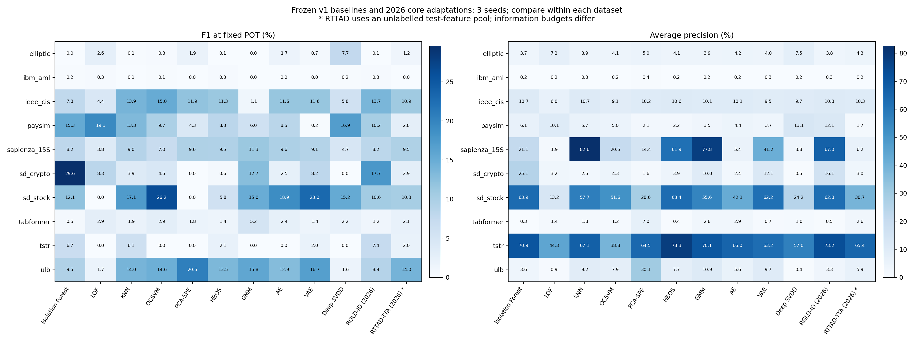

# 与原 10 种经典方法的对照

保留原 300 次实验，新增 60 次，共 360 次记录／720 套阈值操作点。已核对新旧数据清单哈希、划分、测试对象和共同预算参数一致。原方法不重新拟合、不覆盖原结果。

**RGLD-ID 为归纳适配；RTTAD-TTA 读取了无标签测试特征进行自适应。后者与原方法的信息预算不同，不能把图表当作同信息预算的公平总排名。** 不做跨数据集混合平均。

RTTAD 的 30 次运行中，有 **14 次实际更新轮数为 0**；详细原因见 [自适应核验](adaptation_audit.csv)。这些运行保留训练后的基础网络评分，不伪称成功自适应、不丢弃失败种子。GammaGMM 失败与 POT 拟合失败是两回事，分别记录。

[全部逐种子对照](combined_metrics.csv) · [均值与标准差](combined_summary.csv) · [新方法独立结果](README_CN.md) · [方法与适配边界](../../docs/METHODS_2026_CN.md)

| 任务 | 种子 | 实际更新轮数 | 最后置信选择状态 |
| --- | ---: | ---: | --- |
| elliptic | 42 | 0 | no_positive_gamma_posterior |
| elliptic | 43 | 0 | no_positive_gamma_posterior |
| elliptic | 44 | 3 | ok |
| ibm_aml | 42 | 2 | no_positive_gamma_posterior |
| ibm_aml | 43 | 1 | no_positive_gamma_posterior |
| ibm_aml | 44 | 3 | ok |
| ieee_cis | 42 | 3 | ok |
| ieee_cis | 43 | 3 | ok |
| ieee_cis | 44 | 3 | ok |
| paysim | 42 | 1 | no_positive_gamma_posterior |
| paysim | 43 | 3 | ok |
| paysim | 44 | 3 | ok |
| sapienza_15S | 42 | 0 | no_positive_gamma_posterior |
| sapienza_15S | 43 | 0 | no_positive_gamma_posterior |
| sapienza_15S | 44 | 1 | no_positive_gamma_posterior |
| sd_crypto | 42 | 0 | no_positive_gamma_posterior |
| sd_crypto | 43 | 1 | no_positive_gamma_posterior |
| sd_crypto | 44 | 0 | no_positive_gamma_posterior |
| sd_stock | 42 | 0 | no_positive_gamma_posterior |
| sd_stock | 43 | 0 | no_positive_gamma_posterior |
| sd_stock | 44 | 0 | no_positive_gamma_posterior |
| tabformer | 42 | 0 | no_positive_gamma_posterior |
| tabformer | 43 | 0 | no_positive_gamma_posterior |
| tabformer | 44 | 3 | ok |
| tstr | 42 | 0 | no_positive_gamma_posterior |
| tstr | 43 | 3 | ok |
| tstr | 44 | 3 | ok |
| ulb | 42 | 0 | no_positive_gamma_posterior |
| ulb | 43 | 3 | ok |
| ulb | 44 | 0 | no_positive_gamma_posterior |
