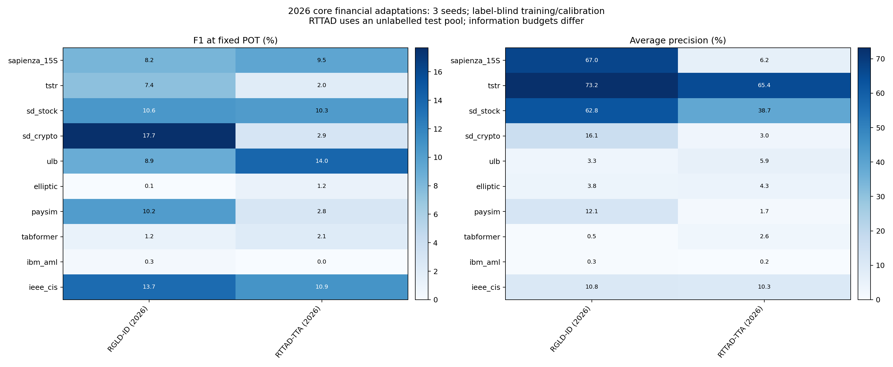

# 2026 方法金融适配：实验结果

RGLD-ID 使用训练集固定标准化／排名；RTTAD-TTA 先在最多 8192 条无标签测试特征上自适应，再用该最终模型校准和评分。两者分别是归纳和 transductive 实验，后者的测试特征访问必须单独标注。新分数以无损 NPZ 保存。 RTTAD 的 30 次运行中有 14 次没有实际更新，保留基础网络评分；选择／更新状态见 runs.json。

完成 **10 个任务、2 种方法、3 个种子，共 60 次真实运行**，覆盖 9 组源数据。SD-FMM 的股票和加密货币为同一来源的两个任务。本轮是2026 预印本方法核心的金融特征适配，不是原论文数据／网络／数值成绩的逐项复刻。

训练每种子统一最多 8,192 条、校准最多 100,000 条；**测试分区全量、不平衡类别、不做 point adjustment**。标签只在最终评价打开。沿用旧数据划分，但训练上限与统一截断评分不同于此前 Kronos 实验，不能直接混排两轮成绩。

## 留出测试组成

| 任务 | 测试总行数 | 已知标签评价数 | 正例数 | 已知标签正例率 |
| --- | ---: | ---: | ---: | ---: |
| sapienza_15S | 145,550 | 145,550 | 77 | 0.0529% |
| tstr | 194 | 194 | 94 | 48.4536% |
| sd_stock | 960 | 960 | 99 | 10.3125% |
| sd_crypto | 10,880 | 10,880 | 68 | 0.6250% |
| ulb | 92,575 | 92,575 | 115 | 0.1242% |
| elliptic | 67,504 | 16,670 | 1,083 | 6.4967% |
| paysim | 1,248,736 | 1,248,736 | 4,250 | 0.3403% |
| tabformer | 3,782,053 | 3,782,053 | 4,578 | 0.1210% |
| ibm_aml | 1,015,564 | 1,015,564 | 1,797 | 0.1769% |
| ieee_cis | 105,693 | 105,693 | 3,611 | 3.4165% |

AP 的随机排序参照水平与正例率有关；不能把正例率差异当作模型性能差异。所有方法在各任务上的测试对象相同。

## 主结果：固定 POT 的 F1（%）

每格为全部 3 个种子的均值；任一种子 POT 失败时该格明确 N/A，不仅平均成功种子。当前共有 **0 次 POT 拟合失败**，原因见 [POT 失败记录](pot_failures.json)。

| 数据 | RGLD-ID (2026) | RTTAD-TTA (2026) |
| --- | ---: | ---: |
| sapienza_15S | 8.24 | 9.49 |
| tstr | 7.35 | 2.04 |
| sd_stock | 10.62 | 10.27 |
| sd_crypto | 17.68 | 2.91 |
| ulb | 8.92 | 14.02 |
| elliptic | 0.05 | 1.17 |
| paysim | 10.22 | 2.84 |
| tabformer | 1.21 | 2.15 |
| ibm_aml | 0.30 | 0.04 |
| ieee_cis | 13.66 | 10.87 |

## 排序能力：Average Precision（%）

AP 使用完整有真值测试子集，与阈值无关。AP 与梯形 PR-AUC 分列在 CSV，不能混称；不同数据正例率／粒度不同，不作混合平均排行榜。

| 数据 | RGLD-ID (2026) | RTTAD-TTA (2026) |
| --- | ---: | ---: |
| sapienza_15S | 66.98 | 6.21 |
| tstr | 73.18 | 65.37 |
| sd_stock | 62.77 | 38.71 |
| sd_crypto | 16.08 | 3.04 |
| ulb | 3.34 | 5.88 |
| elliptic | 3.76 | 4.34 |
| paysim | 12.10 | 1.71 |
| tabformer | 0.55 | 2.64 |
| ibm_aml | 0.29 | 0.23 |
| ieee_cis | 10.78 | 10.28 |

## 预先指定的 99% 校准分位阈值：F1（%）

这是所有方法都计算的第二套操作点，不是 POT 失败时暗中替换的默认值，也不根据测试结果选择较好的阈值。离散分数的并列值和分布漂移可能导致报警比例明显高于 1%。

| 数据 | RGLD-ID (2026) | RTTAD-TTA (2026) |
| --- | ---: | ---: |
| sapienza_15S | 8.86 | 10.16 |
| tstr | 7.35 | 4.67 |
| sd_stock | 14.68 | 9.71 |
| sd_crypto | 20.35 | 3.02 |
| ulb | 8.99 | 13.88 |
| elliptic | 0.03 | 1.16 |
| paysim | 10.80 | 2.77 |
| tabformer | 1.21 | 2.16 |
| ibm_aml | 0.29 | 0.03 |
| ieee_cis | 13.80 | 10.26 |

## 数据与解释限制

- Sapienza 为操纵起点块，TSTR 为整段序列，SD-FMM 为点级；粒度不同。TSTR 校准约一半为正，POT 的主要正常假设不成立；SD-FMM 已由发布者全段处理且重用公开 test 文件研究划分，不能声称原论文零样本复现。
- Elliptic 未知标签仅在评价屏蔽，绝不当正常；此处使用原节点特征，不含图边。原聚合特征不能保证实时可用。
- PaySim、TabFormer、AML 为合成。时间留出允许账户跨期，不等于未见账户测试。部分完整交易字段属于事后可用信息，不构成支付授权前拦截验证。
- IEEE-CIS 仅评价官方训练表内部时间留出，不是 Kaggle 官方测试成绩。原始文件、模型、逐行分数和缓存没有上传。
- 全部方法训练混合数据，不按标签剔除异常。OCSVM、Deep SVDD 等单类目标在污染训练下可能明显退化。经典方法的适用条件不能由算法名称保证。
- 所有超参数提前固定，没有标签调参或测试最优阈值。三种子标准差反映训练／抽样随机性，不是置信区间；未作统计显著性结论。

## 完整指标与复现证据

- [120 套逐种子操作点及完整混淆矩阵](metrics.csv)：Precision、Recall、F1、FPR、AP、梯形 PR-AUC、ROC-AUC、TP/FP/FN/TN、正例率及两套阈值。
- [均值与标准差](summary.csv) · [全部聚合记录、训练损失、阈值和评分 SHA256](runs.json) · [环境与代码指纹](environment.json)。
- [数据分区与特征定义](splits.json) · [输入缓存文件哈希](cache_files_sha256.json) · [实际执行与耗时解释](execution_notes.json)。耗时受并行任务及共享设备影响，不作方法速度排名。
- [方法来源与适配边界](../../docs/METHODS_CN.md) · [预先固定的协议](../../docs/PROTOCOL_CN.md) · [本地评分／混淆矩阵核验](verification.json)。

- [2026 论文来源、公式映射与适配边界](../../docs/METHODS_2026_CN.md) · [新增实验固定协议](../../docs/PROTOCOL_2026_CN.md)。

- 执行代码提交：`0ff9d9863f27357d5d5c17627de1203f20b603e3`；代码指纹：`ebb08cad9293d67252e67a8cf2ef620c228efcda7475111db26ac0666144906d`；适配神经网络设备 `mps`，传统方法／POT 为 CPU。

公开的是聚合证据；模型、完整逐行分数和预处理保存在本地私有运行目录。原始第三方数据不随本代码的 MIT 许可证重新授权。
