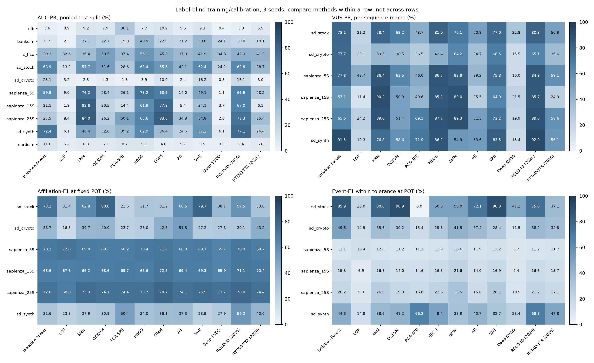

# 仓库 data/ 数据的无监督异常检测实验（现代评价指标）

对本仓库 [`data/raw`](../../data/raw) 中可直接使用的 **10 个任务** 运行全部 **12 种方法**（10 种经典方法 + RGLD-ID、RTTAD-TTA），**3 个种子（42/43/44），共 360 次真实运行**。训练、预处理和阈值校准不读取标签；标签只在最终评价打开。

评价指标分两个视角：

1. **交易级／点级（全量测试集合并）**：AUC-PR（Average Precision）、AUC-ROC、Precision@n（n＝正例数）、固定阈值下的 Precision／Recall／F1／FPR／**MCC**；另给出标签选优的 best-F1 作为上限参照（不是方法的操作点）。
2. **序列视角（TSB-AD 协议，NeurIPS 2024）**：对每条含异常的测试序列单独评价后做宏平均。阈值无关：AUC-PR、AUC-ROC、**VUS-PR／VUS-ROC**（Paparrizos et al., VLDB 2022）、**PATE**（Ghorbani et al., KDD 2024）；固定阈值：标准 F1、PA-F1、**PA%K-F1 面积**（Kim et al., AAAI 2022）、事件级 F1、范围 F1（Tatbul et al., NeurIPS 2018）、**Affiliation P/R/F1**（Huet et al., KDD 2022）、PATE-F1；另有合并的事件召回（事件内／容差内）与报警片段精度。

VUS 的滑动窗口取 2τ（两侧缓冲 0..τ），PATE 的前／后缓冲取 τ；τ 在看标签前按数据说明固定（Sapienza：发布者说明标注块最多早于公告 120 s，即 120 s／块长；SD-FMM：160 步窗口的 5%）。VUS、PATE 与 Affiliation 等由官方实现（TSB-AD 1.5、PATE 0.1.1）计算，PA%K、MCC 与合并事件视角为本仓库实现，见 [`finad/modern_metrics.py`](../../finad/modern_metrics.py) 及其测试。

**主要发现**（详见结果页的逐表说明）：
- **没有通吃的方法**。按 10 个任务的 AUC-PR 平均排名：HBOS 3.1、GMM 4.4、kNN 4.4、RGLD-ID 4.7、VAE 4.7；按 6 个序列任务的 VUS-PR 与 PATE，RGLD-ID 平均排名最好（2.5），其次 HBOS（3.0）、kNN。
- **阈值无关的排序能力远好于固定阈值下的操作点**：Sapienza 上 kNN／GMM 的 VUS-PR 达 85–90%，但 POT 阈值下事件级 F1 仅 15–41%、报警片段精度 6–20%——几乎所有 pump 都被报警覆盖（容差内事件召回约 97–99%），但误报片段多。Affiliation-F1 在 Sapienza 上各方法都在 66–79%，区分度很低，应与其它指标合看。
- **LOF、Deep SVDD 在污染训练数据上整体最弱**；RTTAD-TTA 的测试时自适应未带来稳定收益。s_ffsd 的排序接近随机（AUC-ROC 41–73%），固定阈值下 MCC 全为负。
- 0 次 POT 失败；360 次运行的评分哈希、混淆矩阵、抽样索引与检查点重载全部核验通过（1 处 LOF 重载批次差异已说明，不影响存储结果）。

## 测试组成

| 任务 | 粒度 | 测试总行数 | 已知标签评价数 | 正例数 | 正例率 | 评价序列数 | 容差 τ（行） |
| --- | --- | ---: | ---: | ---: | ---: | ---: | ---: |
| ulb | 交易级 | 92,575 | 92,575 | 115 | 0.1242% | — | — |
| banksim | 交易级 | 118,638 | 118,638 | 1,280 | 1.0789% | — | — |
| s_ffsd | 交易级 | 15,576 | 6,159 | 2,394 | 38.8699% | — | — |
| sd_stock | 序列点级 | 960 | 960 | 99 | 10.3125% | 6 | 8 |
| sd_crypto | 序列点级 | 10,880 | 10,880 | 68 | 0.6250% | 68 | 8 |
| sapienza_5S | 序列点级 | 207,267 | 207,267 | 77 | 0.0372% | 77 | 24 |
| sapienza_15S | 序列点级 | 145,550 | 145,550 | 77 | 0.0529% | 77 | 8 |
| sapienza_25S | 序列点级 | 119,469 | 119,469 | 77 | 0.0645% | 77 | 5 |
| sd_synth | 序列点级 | 32,000 | 32,000 | 1,589 | 4.9656% | 200 | 8 |
| cardsim | 交易级 | 121,982 | 121,982 | 1,230 | 1.0083% | — | — |

ulb、sapienza_15S、sd_stock、sd_crypto 沿用 v1 的划分与特征定义（缓存文件哈希与 v1 记录逐一比对：24 个文件中 23 个字节一致，仅 sd_crypto/train.x.f32 不同；校准／测试文件全部一致）。banksim、s_ffsd、sapienza_5S／25S、sd_synth 为本轮按同一规则新增。S-FFSD 的标签 2 作为未知保留在训练／校准中，仅在评价时屏蔽。sd_synth 是发布者的合成异常序列，不是真实操纵。

## 交易级／点级：AUC-PR（%，全量测试集合并，3 种子均值）

AP 的随机参照水平等于正例率；不同任务的正例率差异不能当作方法差异，只在同一行内比较方法。

| 任务 | Isolation Forest | LOF | kNN | OCSVM | PCA-SPE | HBOS | GMM | AE | VAE | Deep SVDD | RGLD-ID (2026) | RTTAD-TTA (2026) |
| --- | ---: | ---: | ---: | ---: | ---: | ---: | ---: | ---: | ---: | ---: | ---: | ---: |
| ulb | 3.55 | 0.86 | 9.20 | 7.91 | **30.11** | 7.74 | 10.94 | 5.60 | 9.27 | 0.43 | 3.34 | 5.89 |
| banksim | 9.67 | 2.28 | 27.07 | 22.73 | 15.78 | **40.92** | 22.86 | 21.21 | 39.61 | 24.08 | 20.04 | 18.06 |
| s_ffsd | 39.31 | 32.64 | 36.37 | 50.48 | 37.35 | **56.11** | 45.16 | 37.91 | 41.86 | 34.81 | 42.29 | 41.30 |
| sd_stock | **63.85** | 13.20 | 57.67 | 51.56 | 28.59 | 63.41 | 55.58 | 42.07 | 62.36 | 24.18 | 62.77 | 38.70 |
| sd_crypto | **25.12** | 3.20 | 2.46 | 4.33 | 1.65 | 3.89 | 9.97 | 2.36 | 16.23 | 0.48 | 16.08 | 3.04 |
| sapienza_5S | 59.89 | 9.05 | **76.16** | 28.44 | 26.14 | 73.18 | 68.85 | 13.97 | 49.07 | 1.06 | 66.95 | 28.25 |
| sapienza_15S | 21.11 | 1.92 | **82.56** | 20.47 | 14.37 | 61.94 | 77.78 | 5.43 | 34.08 | 3.75 | 66.98 | 6.12 |
| sapienza_25S | 27.48 | 8.40 | **84.01** | 26.17 | 50.08 | 65.57 | 83.59 | 34.81 | 54.78 | 2.62 | 73.26 | 35.44 |
| sd_synth | 72.39 | 6.15 | 48.42 | 32.57 | 39.24 | 62.89 | 36.44 | 24.47 | 57.22 | 6.13 | **77.14** | 26.36 |
| cardsim | **11.00** | 5.18 | 6.35 | 6.27 | 8.68 | 9.11 | 4.02 | 5.72 | 3.49 | 3.34 | 5.40 | 6.56 |

## 交易级／点级：AUC-ROC（%）

| 任务 | Isolation Forest | LOF | kNN | OCSVM | PCA-SPE | HBOS | GMM | AE | VAE | Deep SVDD | RGLD-ID (2026) | RTTAD-TTA (2026) |
| --- | ---: | ---: | ---: | ---: | ---: | ---: | ---: | ---: | ---: | ---: | ---: | ---: |
| ulb | 93.62 | 86.82 | 94.56 | 93.99 | 89.29 | 93.75 | 95.22 | 92.72 | **95.57** | 71.24 | 93.62 | 94.29 |
| banksim | 93.03 | 64.44 | 97.34 | 95.12 | 95.31 | 96.54 | 91.98 | 97.28 | **98.36** | 97.06 | 95.36 | 95.82 |
| s_ffsd | 53.64 | 40.83 | 49.86 | 71.93 | 52.93 | **72.99** | 61.64 | 53.78 | 59.50 | 44.57 | 59.02 | 59.36 |
| sd_stock | 91.64 | 57.78 | 91.92 | 86.26 | 82.85 | 92.37 | 90.55 | 84.52 | 92.55 | 67.18 | **92.69** | 84.83 |
| sd_crypto | **97.50** | 41.39 | 79.55 | 84.80 | 78.63 | 91.68 | 95.93 | 81.48 | 97.29 | 39.41 | 96.66 | 85.00 |
| sapienza_5S | **99.89** | 99.44 | 99.81 | 99.82 | 99.67 | 99.83 | 99.86 | 99.29 | 99.70 | 95.82 | 99.81 | 99.82 |
| sapienza_15S | 99.77 | 98.51 | **99.94** | 99.76 | 99.63 | 99.86 | 99.92 | 99.51 | 99.88 | 98.13 | 99.90 | 99.58 |
| sapienza_25S | 99.82 | 98.61 | 99.89 | 99.78 | 99.87 | 99.75 | **99.94** | 99.77 | 99.75 | 97.32 | 99.82 | 99.83 |
| sd_synth | 96.06 | 53.47 | 94.56 | 82.90 | 92.67 | 96.01 | 92.40 | 88.57 | 95.23 | 52.51 | **96.57** | 89.63 |
| cardsim | **91.37** | 86.91 | 91.00 | 90.42 | 80.32 | 88.78 | 71.41 | 76.57 | 83.32 | 71.23 | 86.45 | 78.20 |

## 固定 POT 阈值：F1（%）与 MCC（×100）

任一种子 POT 失败时该格为 N/A（本轮 **0 次 POT 失败**，见 [pot_failures.json](pot_failures.json)）。

**F1**

| 任务 | Isolation Forest | LOF | kNN | OCSVM | PCA-SPE | HBOS | GMM | AE | VAE | Deep SVDD | RGLD-ID (2026) | RTTAD-TTA (2026) |
| --- | ---: | ---: | ---: | ---: | ---: | ---: | ---: | ---: | ---: | ---: | ---: | ---: |
| ulb | 9.46 | 1.74 | 13.97 | 14.58 | **20.50** | 13.45 | 15.80 | 12.92 | 16.40 | 1.63 | 8.92 | 14.03 |
| banksim | 5.93 | 4.23 | 29.07 | 29.37 | 25.15 | 40.11 | 23.96 | 27.42 | **41.61** | 26.81 | 19.51 | 24.68 |
| s_ffsd | 1.27 | **3.08** | 1.31 | 1.18 | 0.22 | 0.49 | 0.41 | 1.17 | 1.85 | 0.19 | 0.33 | 1.45 |
| sd_stock | 12.05 | 0.00 | 17.09 | **26.23** | 0.00 | 5.83 | 14.97 | 18.95 | 22.59 | 15.25 | 10.62 | 10.27 |
| sd_crypto | **29.57** | 8.33 | 3.87 | 4.55 | 0.00 | 0.57 | 12.66 | 2.49 | 12.34 | 0.00 | 17.68 | 2.91 |
| sapienza_5S | 5.76 | 7.66 | 5.70 | 5.05 | 6.04 | 6.15 | **8.57** | 6.55 | 6.60 | 2.37 | 5.39 | 6.70 |
| sapienza_15S | 8.18 | 3.84 | 8.98 | 7.01 | 9.58 | 9.47 | **11.26** | 9.64 | 8.74 | 4.68 | 8.24 | 9.48 |
| sapienza_25S | 10.95 | 7.04 | 13.81 | 10.22 | 12.63 | 13.47 | **19.51** | 12.03 | 13.58 | 5.63 | 10.93 | 12.94 |
| sd_synth | 13.29 | 2.39 | 9.52 | 11.12 | 13.91 | 15.53 | 13.72 | 7.52 | 8.13 | 4.42 | **20.27** | 8.59 |
| cardsim | **16.71** | 6.56 | 5.94 | 7.25 | 4.00 | 14.72 | 5.28 | 10.83 | 1.98 | 7.01 | 7.34 | 12.66 |

**MCC**

| 任务 | Isolation Forest | LOF | kNN | OCSVM | PCA-SPE | HBOS | GMM | AE | VAE | Deep SVDD | RGLD-ID (2026) | RTTAD-TTA (2026) |
| --- | ---: | ---: | ---: | ---: | ---: | ---: | ---: | ---: | ---: | ---: | ---: | ---: |
| ulb | 15.18 | 2.95 | 21.33 | 23.75 | **28.63** | 20.63 | 23.04 | 18.03 | 24.94 | 2.28 | 13.58 | 20.58 |
| banksim | 7.92 | 3.26 | 28.99 | 28.64 | 24.34 | **43.57** | 25.56 | 26.81 | 41.21 | 26.18 | 20.06 | 23.88 |
| s_ffsd | -2.92 | -26.23 | -5.26 | -5.92 | **-2.12** | -3.57 | -4.63 | -3.39 | -3.59 | -4.38 | -6.37 | -4.60 |
| sd_stock | 18.17 | -2.45 | 20.56 | **30.52** | -2.45 | 13.76 | 21.46 | 23.94 | 27.95 | 17.55 | 18.86 | 16.33 |
| sd_crypto | **29.44** | 7.90 | 3.22 | 3.91 | -0.78 | 0.07 | 12.47 | 1.82 | 12.00 | -0.86 | 18.68 | 2.21 |
| sapienza_5S | 17.00 | 19.21 | 16.73 | 15.71 | 16.98 | 17.41 | **20.39** | 17.63 | 17.86 | 6.48 | 16.35 | 18.07 |
| sapienza_15S | 20.27 | 8.31 | 21.42 | 18.83 | 21.93 | 21.89 | **23.85** | 21.88 | 21.03 | 11.20 | 20.34 | 21.77 |
| sapienza_25S | 23.64 | 13.62 | 26.85 | 22.88 | 25.47 | 26.59 | **32.37** | 24.76 | 26.49 | 11.84 | 23.56 | 25.69 |
| sd_synth | 22.43 | 2.19 | 16.79 | 16.49 | 19.72 | 24.70 | 17.22 | 9.40 | 14.13 | 5.92 | **30.67** | 11.05 |
| cardsim | **15.87** | 5.67 | 4.99 | 6.35 | 4.15 | 13.88 | 4.31 | 9.89 | 0.97 | 6.05 | 6.41 | 11.78 |

## 序列视角（TSB-AD 协议）：VUS-PR（%）

每条含异常测试序列单独评价后宏平均；Sapienza 每个 pump 事件一条序列（测试 79 条，其中 2 条无标注块被跳过），SD-FMM 每个 160 步窗口一条序列。

| 任务 | Isolation Forest | LOF | kNN | OCSVM | PCA-SPE | HBOS | GMM | AE | VAE | Deep SVDD | RGLD-ID (2026) | RTTAD-TTA (2026) |
| --- | ---: | ---: | ---: | ---: | ---: | ---: | ---: | ---: | ---: | ---: | ---: | ---: |
| sd_stock | 78.15 | 21.21 | 78.39 | 69.21 | 43.66 | **81.03** | 70.11 | 50.92 | 76.98 | 32.76 | 80.34 | 50.90 |
| sd_crypto | **77.69** | 23.12 | 39.54 | 38.53 | 26.51 | 42.36 | 64.15 | 34.70 | 68.46 | 15.45 | 65.11 | 36.55 |
| sapienza_5S | 77.81 | 43.74 | 86.36 | 63.53 | 45.99 | **86.75** | 82.77 | 39.16 | 75.28 | 15.99 | 84.89 | 59.10 |
| sapienza_15S | 57.11 | 11.40 | **90.20** | 50.93 | 40.60 | 85.20 | 88.98 | 25.48 | 64.85 | 21.49 | 85.70 | 24.92 |
| sapienza_25S | 65.57 | 24.18 | 89.01 | 51.42 | 69.07 | 87.66 | **89.30** | 51.49 | 73.20 | 19.89 | 88.97 | 58.62 |
| sd_synth | 91.52 | 19.32 | 76.84 | 58.59 | 71.86 | 86.22 | 54.92 | 53.58 | 83.52 | 15.35 | **92.92** | 56.14 |

**VUS-ROC（%）**

| 任务 | Isolation Forest | LOF | kNN | OCSVM | PCA-SPE | HBOS | GMM | AE | VAE | Deep SVDD | RGLD-ID (2026) | RTTAD-TTA (2026) |
| --- | ---: | ---: | ---: | ---: | ---: | ---: | ---: | ---: | ---: | ---: | ---: | ---: |
| sd_stock | 94.30 | 68.87 | 95.19 | 91.17 | 85.04 | 95.20 | 92.56 | 87.08 | 94.90 | 74.38 | **95.21** | 87.73 |
| sd_crypto | 98.59 | 75.78 | 93.86 | 95.24 | 88.58 | 96.01 | 97.63 | 91.95 | **98.60** | 72.72 | 98.20 | 93.31 |
| sapienza_5S | **99.91** | 99.63 | 99.86 | 99.84 | 99.72 | 99.89 | 99.86 | 99.66 | 99.79 | 98.25 | 99.89 | 99.82 |
| sapienza_15S | 99.81 | 98.81 | **99.94** | 99.80 | 99.69 | 99.91 | 99.94 | 99.55 | 99.86 | 98.85 | 99.93 | 99.59 |
| sapienza_25S | 99.84 | 98.90 | 99.91 | 99.79 | 99.81 | 99.87 | **99.93** | 99.73 | 99.82 | 98.03 | 99.88 | 99.77 |
| sd_synth | 98.90 | 71.42 | 97.82 | 91.44 | 96.97 | 98.65 | 95.19 | 94.25 | 98.43 | 67.00 | **99.08** | 94.86 |

**PATE（%）**

| 任务 | Isolation Forest | LOF | kNN | OCSVM | PCA-SPE | HBOS | GMM | AE | VAE | Deep SVDD | RGLD-ID (2026) | RTTAD-TTA (2026) |
| --- | ---: | ---: | ---: | ---: | ---: | ---: | ---: | ---: | ---: | ---: | ---: | ---: |
| sd_stock | 64.58 | 15.00 | 63.96 | 55.41 | 34.25 | **69.79** | 58.50 | 39.52 | 63.65 | 25.20 | 68.40 | 40.26 |
| sd_crypto | **62.11** | 15.03 | 19.71 | 20.94 | 14.99 | 26.83 | 43.62 | 19.44 | 50.41 | 4.79 | 49.78 | 22.08 |
| sapienza_5S | 76.07 | 42.04 | 84.47 | 57.99 | 40.04 | **85.19** | 81.00 | 33.05 | 72.06 | 7.89 | 82.81 | 53.88 |
| sapienza_15S | 55.34 | 7.62 | **88.35** | 44.11 | 35.68 | 82.75 | 87.04 | 18.07 | 62.18 | 16.70 | 83.90 | 17.71 |
| sapienza_25S | 64.34 | 21.08 | 87.66 | 48.15 | 67.85 | 86.47 | **88.32** | 48.16 | 72.30 | 15.47 | 87.25 | 56.83 |
| sd_synth | 82.83 | 12.55 | 65.75 | 49.11 | 59.13 | 77.24 | 45.87 | 42.63 | 72.41 | 10.87 | **84.04** | 44.92 |

**序列级 AUC-PR（%）**

| 任务 | Isolation Forest | LOF | kNN | OCSVM | PCA-SPE | HBOS | GMM | AE | VAE | Deep SVDD | RGLD-ID (2026) | RTTAD-TTA (2026) |
| --- | ---: | ---: | ---: | ---: | ---: | ---: | ---: | ---: | ---: | ---: | ---: | ---: |
| sd_stock | 60.73 | 15.11 | 59.42 | 52.24 | 32.67 | **65.94** | 55.32 | 37.52 | 60.56 | 24.67 | 64.55 | 37.61 |
| sd_crypto | **61.16** | 15.43 | 11.36 | 18.83 | 10.75 | 18.70 | 47.09 | 14.65 | 49.48 | 4.52 | 46.05 | 17.40 |
| sapienza_5S | 79.50 | 49.88 | 86.06 | 63.83 | 45.82 | **87.04** | 83.53 | 38.58 | 75.68 | 10.21 | 84.14 | 60.27 |
| sapienza_15S | 61.20 | 11.91 | **89.87** | 51.62 | 44.11 | 85.58 | 88.91 | 25.73 | 69.11 | 22.24 | 86.32 | 25.72 |
| sapienza_25S | 70.35 | 26.68 | 89.77 | 56.76 | 74.55 | 89.16 | **90.28** | 56.40 | 77.45 | 21.32 | 90.04 | 64.80 |
| sd_synth | 80.42 | 11.57 | 61.32 | 45.12 | 54.68 | 74.20 | 47.90 | 39.74 | 69.60 | 10.52 | **81.41** | 41.53 |

## 序列视角、固定 POT 阈值

**Affiliation-F1（%）**：随机报警的 Affiliation 指标也有不低的基线（约 0.5–0.7），应与 Affiliation-Precision／Recall 及其它指标合看。

| 任务 | Isolation Forest | LOF | kNN | OCSVM | PCA-SPE | HBOS | GMM | AE | VAE | Deep SVDD | RGLD-ID (2026) | RTTAD-TTA (2026) |
| --- | ---: | ---: | ---: | ---: | ---: | ---: | ---: | ---: | ---: | ---: | ---: | ---: |
| sd_stock | 73.17 | 31.42 | 62.85 | **79.98** | 21.56 | 31.68 | 31.17 | 60.64 | 79.74 | 38.74 | 57.48 | 33.05 |
| sd_crypto | 38.71 | 16.53 | 39.65 | 40.04 | 23.67 | 25.98 | 42.60 | **51.79** | 27.18 | 27.83 | 30.06 | 43.16 |
| sapienza_5S | 70.23 | **72.00** | 69.79 | 69.30 | 68.21 | 70.41 | 71.29 | 68.01 | 69.66 | 65.68 | 70.90 | 68.66 |
| sapienza_15S | 68.60 | 67.59 | 69.18 | 68.62 | 69.72 | 68.59 | **72.54** | 69.45 | 69.33 | 65.86 | 71.11 | 70.41 |
| sapienza_25S | 72.77 | 68.79 | 75.90 | 74.15 | 74.45 | 73.66 | **78.70** | 74.09 | 75.86 | 73.71 | 78.03 | 74.43 |
| sd_synth | 31.65 | 23.27 | 27.95 | 30.90 | 50.41 | 33.95 | 36.08 | 37.31 | 23.90 | 27.90 | **56.22** | 40.03 |

**事件级 F1（%，TSB-AD 定义：事件内任一报警即命中，精度按点计）**

| 任务 | Isolation Forest | LOF | kNN | OCSVM | PCA-SPE | HBOS | GMM | AE | VAE | Deep SVDD | RGLD-ID (2026) | RTTAD-TTA (2026) |
| --- | ---: | ---: | ---: | ---: | ---: | ---: | ---: | ---: | ---: | ---: | ---: | ---: |
| sd_stock | 61.38 | 0.00 | 46.79 | **71.30** | 0.00 | 27.78 | 27.28 | 41.15 | 67.80 | 29.27 | 45.77 | 22.64 |
| sd_crypto | **21.07** | 6.11 | 1.74 | 2.53 | 0.00 | 0.49 | 11.43 | 2.53 | 8.00 | 0.00 | 11.65 | 3.43 |
| sapienza_5S | 13.97 | **19.97** | 14.66 | 13.76 | 12.09 | 15.51 | 18.55 | 13.30 | 15.74 | 5.89 | 15.21 | 13.37 |
| sapienza_15S | 24.03 | 7.48 | 21.49 | 17.85 | 20.17 | 25.19 | **28.56** | 18.38 | 21.82 | 12.02 | 23.93 | 18.00 |
| sapienza_25S | 31.75 | 10.67 | 31.71 | 24.66 | 24.28 | 31.64 | **40.59** | 22.40 | 33.99 | 13.38 | 30.71 | 23.38 |
| sd_synth | 27.74 | 4.33 | 20.36 | 21.31 | 36.78 | 29.88 | 24.38 | 15.97 | 16.20 | 13.49 | **54.02** | 19.16 |

**PA%K-F1 面积（%，K=0…100 步长 10）**

| 任务 | Isolation Forest | LOF | kNN | OCSVM | PCA-SPE | HBOS | GMM | AE | VAE | Deep SVDD | RGLD-ID (2026) | RTTAD-TTA (2026) |
| --- | ---: | ---: | ---: | ---: | ---: | ---: | ---: | ---: | ---: | ---: | ---: | ---: |
| sd_stock | 24.18 | 0.00 | 25.48 | **35.41** | 0.00 | 10.22 | 15.78 | 20.01 | 32.35 | 15.62 | 19.69 | 10.51 |
| sd_crypto | **21.07** | 6.11 | 1.74 | 2.53 | 0.00 | 0.49 | 11.43 | 2.53 | 8.00 | 0.00 | 11.65 | 3.43 |
| sapienza_5S | 13.97 | **19.97** | 14.66 | 13.76 | 12.09 | 15.51 | 18.55 | 13.30 | 15.74 | 5.89 | 15.21 | 13.37 |
| sapienza_15S | 24.03 | 7.48 | 21.49 | 17.85 | 20.17 | 25.19 | **28.56** | 18.38 | 21.82 | 12.02 | 23.93 | 18.00 |
| sapienza_25S | 31.75 | 10.67 | 31.71 | 24.66 | 24.28 | 31.64 | **40.59** | 22.40 | 33.99 | 13.38 | 30.71 | 23.38 |
| sd_synth | 12.72 | 2.26 | 8.43 | 9.91 | 17.65 | 14.43 | 14.53 | 7.74 | 8.40 | 5.44 | **25.70** | 9.63 |

**PATE-F1（%）**

| 任务 | Isolation Forest | LOF | kNN | OCSVM | PCA-SPE | HBOS | GMM | AE | VAE | Deep SVDD | RGLD-ID (2026) | RTTAD-TTA (2026) |
| --- | ---: | ---: | ---: | ---: | ---: | ---: | ---: | ---: | ---: | ---: | ---: | ---: |
| sd_stock | 18.12 | 0.00 | 20.15 | **28.89** | 0.00 | 7.82 | 12.99 | 14.95 | 26.04 | 12.51 | 14.78 | 8.35 |
| sd_crypto | **25.80** | 7.00 | 6.49 | 6.67 | 2.04 | 3.90 | 13.49 | 7.61 | 10.11 | 0.21 | 14.68 | 7.27 |
| sapienza_5S | 17.42 | **23.67** | 18.44 | 17.47 | 14.86 | 19.12 | 22.55 | 16.33 | 19.43 | 7.19 | 18.82 | 16.70 |
| sapienza_15S | 26.18 | 8.05 | 23.71 | 19.97 | 22.46 | 27.24 | **31.22** | 20.65 | 23.96 | 13.03 | 26.42 | 20.32 |
| sapienza_25S | 33.46 | 11.04 | 33.65 | 26.44 | 25.95 | 33.49 | **42.73** | 23.81 | 35.62 | 14.36 | 32.91 | 24.90 |
| sd_synth | 10.82 | 2.01 | 7.16 | 8.39 | 15.39 | 12.56 | 12.57 | 7.33 | 7.05 | 4.26 | **21.79** | 8.79 |

**合并事件召回（容差内，%）**：所有测试事件中，事件区间前后 τ 行内至少出现一次报警的比例。

| 任务 | Isolation Forest | LOF | kNN | OCSVM | PCA-SPE | HBOS | GMM | AE | VAE | Deep SVDD | RGLD-ID (2026) | RTTAD-TTA (2026) |
| --- | ---: | ---: | ---: | ---: | ---: | ---: | ---: | ---: | ---: | ---: | ---: | ---: |
| sd_stock | 77.78 | 16.67 | 66.67 | **83.33** | 0.00 | 33.33 | 33.33 | 66.67 | **83.33** | 38.89 | 61.11 | 27.78 |
| sd_crypto | 36.27 | 11.76 | 30.39 | 27.94 | 10.78 | 21.08 | **38.73** | 32.35 | 19.61 | 13.73 | 26.96 | 27.45 |
| sapienza_5S | **98.70** | 94.81 | 96.97 | 96.97 | 96.10 | 96.54 | 95.67 | 96.54 | 96.10 | 66.67 | 97.84 | 96.97 |
| sapienza_15S | 98.27 | 48.48 | 98.70 | **99.13** | 98.27 | 97.84 | 97.40 | 97.84 | 98.27 | 66.67 | 98.27 | 97.84 |
| sapienza_25S | 97.84 | 57.58 | 98.27 | 98.27 | 97.40 | **98.70** | 97.40 | 96.97 | 97.40 | 61.04 | 97.40 | 97.40 |
| sd_synth | 30.33 | 11.50 | 25.50 | 29.17 | 51.33 | 34.17 | 30.67 | 31.33 | 21.50 | 20.00 | **56.50** | 35.83 |

**报警片段精度（容差内，%）**：所有报警片段中落在某真实事件 ±τ 内的比例。

| 任务 | Isolation Forest | LOF | kNN | OCSVM | PCA-SPE | HBOS | GMM | AE | VAE | Deep SVDD | RGLD-ID (2026) | RTTAD-TTA (2026) |
| --- | ---: | ---: | ---: | ---: | ---: | ---: | ---: | ---: | ---: | ---: | ---: | ---: |
| sd_stock | **100.00** | 25.00 | **100.00** | **100.00** | 0.00 | **100.00** | **100.00** | 78.90 | **100.00** | 65.31 | **100.00** | 63.33 |
| sd_crypto | **82.74** | 20.37 | 43.61 | 32.85 | 27.01 | 50.27 | 44.78 | 44.83 | 51.87 | 9.94 | 71.31 | 47.81 |
| sapienza_5S | 5.89 | 7.19 | 6.42 | 5.93 | 5.87 | 6.35 | **9.09** | 6.32 | 7.10 | 4.63 | 5.94 | 6.23 |
| sapienza_15S | 8.27 | 3.72 | 9.19 | 7.52 | 7.88 | 9.01 | **12.16** | 7.51 | 9.25 | 5.08 | 9.05 | 7.35 |
| sapienza_25S | 11.27 | 4.89 | 14.98 | 10.69 | 9.19 | 12.75 | **20.28** | 8.51 | 16.48 | 5.75 | 11.88 | 9.40 |
| sd_synth | 87.74 | 20.92 | 79.89 | 71.31 | 93.46 | 89.32 | 38.57 | 59.78 | 69.11 | 28.25 | **97.80** | 72.29 |

## 预先指定的 99% 校准分位阈值

**F1（%）**

| 任务 | Isolation Forest | LOF | kNN | OCSVM | PCA-SPE | HBOS | GMM | AE | VAE | Deep SVDD | RGLD-ID (2026) | RTTAD-TTA (2026) |
| --- | ---: | ---: | ---: | ---: | ---: | ---: | ---: | ---: | ---: | ---: | ---: | ---: |
| ulb | 9.82 | 1.66 | 14.16 | 15.91 | **17.26** | 14.00 | 15.65 | 12.19 | 17.03 | 1.66 | 8.99 | 13.96 |
| banksim | 11.88 | 4.18 | 31.06 | 27.25 | 20.18 | **48.89** | 29.40 | 25.76 | 38.64 | 26.75 | 24.35 | 22.11 |
| s_ffsd | 1.42 | 0.00 | 1.47 | 1.10 | 0.27 | 0.87 | 1.25 | 1.24 | **1.85** | 0.14 | 0.24 | 1.45 |
| sd_stock | 10.72 | 0.00 | 14.16 | **26.23** | 3.70 | 5.83 | 7.55 | 21.19 | 22.14 | 17.24 | 14.68 | 9.71 |
| sd_crypto | **29.73** | 11.26 | 3.91 | 3.81 | 0.00 | 1.54 | 14.35 | 2.56 | 21.87 | 0.00 | 20.35 | 3.02 |
| sapienza_5S | 6.26 | 6.76 | 6.42 | 6.43 | 6.98 | 6.05 | 6.10 | 7.12 | 6.48 | 2.44 | 5.80 | **7.17** |
| sapienza_15S | 9.65 | 4.31 | 9.84 | 9.73 | 9.89 | 9.88 | 9.01 | 10.10 | 9.44 | 4.83 | 8.86 | **10.13** |
| sapienza_25S | 13.15 | 6.49 | 13.57 | 13.34 | 12.79 | **13.61** | 12.40 | 12.89 | 13.50 | 6.27 | 11.97 | 13.35 |
| sd_synth | 21.75 | 2.68 | 14.69 | 12.01 | 14.55 | 17.93 | 11.88 | 7.45 | 15.09 | 5.11 | **27.03** | 8.51 |
| cardsim | **16.89** | 6.74 | 5.78 | 7.30 | 13.71 | 15.08 | 5.30 | 10.67 | 1.87 | 6.75 | 7.32 | 12.96 |

**Affiliation-F1（%）**

| 任务 | Isolation Forest | LOF | kNN | OCSVM | PCA-SPE | HBOS | GMM | AE | VAE | Deep SVDD | RGLD-ID (2026) | RTTAD-TTA (2026) |
| --- | ---: | ---: | ---: | ---: | ---: | ---: | ---: | ---: | ---: | ---: | ---: | ---: |
| sd_stock | 56.81 | 31.20 | 61.73 | **79.98** | 37.25 | 31.68 | 30.91 | 64.89 | 79.68 | 41.66 | 73.99 | 34.03 |
| sd_crypto | 48.72 | 24.42 | 45.36 | 36.11 | 20.46 | 47.50 | 48.29 | 51.30 | **52.02** | 27.98 | 51.86 | 43.02 |
| sapienza_5S | 70.72 | 71.11 | 70.24 | 70.33 | 68.39 | 70.46 | 70.60 | 68.34 | 69.49 | 65.58 | **71.17** | 68.88 |
| sapienza_15S | 69.34 | 68.11 | 69.42 | 69.40 | 69.81 | 69.00 | 70.85 | 69.83 | 69.31 | 66.09 | **71.74** | 70.63 |
| sapienza_25S | 74.49 | 69.34 | 75.53 | 75.11 | 74.71 | 73.82 | 74.69 | 74.36 | 75.83 | 74.02 | **78.45** | 74.50 |
| sd_synth | 52.57 | 25.28 | 42.19 | 33.76 | 52.36 | 39.38 | 34.06 | 37.99 | 40.92 | 34.96 | **67.69** | 40.13 |

## 解释限制

- 交易级任务（ulb、banksim、s_ffsd）没有序列结构，只报告点级指标；序列视角指标只对 Sapienza 与 SD-FMM 任务定义。
- Sapienza 的行在时间上不是等间距（无成交的块缺失），按行计的容差只是时间容差的近似；每个事件只有一个标注块，PA-F1 与标准 F1 在此几乎等价。
- SD-FMM 加密货币序列的起始点几乎都在第 100 步附近，发布者已对整段序列做过归一化，不能视作可部署的实时实验；股票测试仅 6 条序列，方差大。
- RTTAD-TTA 在最多 8192 条无标签测试特征上自适应，是 transductive 设定；其余方法为归纳设定，信息预算不同。
- 所有超参数预先固定，没有标签调参或测试最优阈值；best-F1 仅作上限参照。三种子标准差反映训练／抽样随机性，不是置信区间。
- 未纳入：SynthAML 只有告警表没有特征；ADMA21 只有异常区间没有行情；CardSim 只有模拟器代码。

## 文件

- [verification.json](verification.json)：360 次运行的结果核验 · [verification_modern.json](verification_modern.json)：30 次运行的现代指标经独立代码路径重算（误差 ≤1e-9）。
- [metrics.csv](metrics.csv)：720 行逐种子、逐阈值策略的全部指标（点级 + 序列视角）。
- [summary.csv](summary.csv)：按任务×方法×阈值策略的均值与标准差。
- [modern_metrics_runs.json](modern_metrics_runs.json)：每次运行的完整现代指标记录（含跳过的序列数、无报警序列数）。
- [runs.json](runs.json)：基准运行记录（训练信息、阈值、评分文件 SHA256）· [environment.json](environment.json)：环境与代码指纹 · [splits.json](splits.json)：数据分区与特征定义 · [cache_files_sha256.json](cache_files_sha256.json)：输入缓存哈希。
- 执行代码提交：`5e3c7aeadca1147b47ebb133cb6df5c70227acd6`；代码指纹：`ebb08cad9293d67252e67a8cf2ef620c228efcda7475111db26ac0666144906d`；Python 3.13.18，Linux-6.18.44-fc-v260-x86_64-with-glibc2.39，CPU。

模型、逐行分数与预处理保存在本地私有运行目录，不随聚合报告上传。原始第三方数据保留各自许可。
