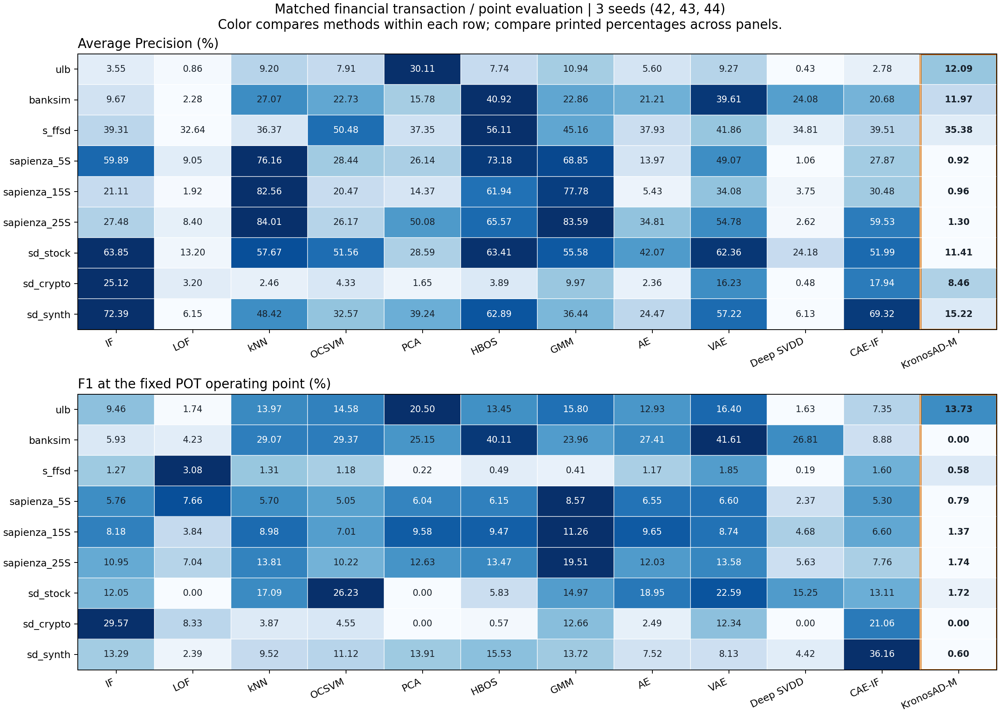

# KronosAD同协议全量对比：27次运行（2026-11-15）

完成9任务×种子42/43/44共27次运行，54条操作点评价。最终标量POT拟合27/27成功；这仅指拟合通过数学有效性检查，不意味着检测有效。所有测试位置均评分，未知标签只在最终评价屏蔽；每个保存预测到标量分数、配对抽样、训练缩放器、阈值及指标独立复算通过。

**方法名KronosAD-M = `kronos_potratio_matched`。** 使用真实冻结Kronos-mini＋Tokenizer-2k，在相同共享工程特征上逐特征预测，逐维标准化平方误差先除以其校准POT标尺，再取最大值合成标量，再用与基线相同的POT和99%校准分位阈值。它保留源方法的逐维POT标尺聚合，最终操作点按共同标准重校准；不是原生OHLCVA或旧小样本成绩。最大误差版在查看本轮金融指标前明确改列消融，全部保留而非按成绩挑选。规则在查看本轮指标前固定，见[预先固定协议](../../docs/kronos_matched_protocol_CN.md)。

完整输入、划分、校准／测试位置、缩放器和指标统一，不意味着预训练语料、历史上下文和计算量完全相同。Kronos使用过去观测及外部冻结预训练，其他基线的访问范围详见综合报告；不作速度或严格同信息预算结论。

## 新增方法结果

数值为百分数，三个种子均值±样本标准差，无点调整、无标签调参。完整表中AP最高的任务数为0/9，POT F1最高为0/9，均为最高均值描述而非统计显著性结论。

异常占比是常数分数的AP参照：AP必须结合它、ROC-AUC和误报率解释，不能把不同数据集的AP直接排成总榜。三个种子的标准差反映本轮固定划分下的随机性，不是独立新时期验证或置信区间。

| 数据集 | 全量已知评价数／异常数（占比） | AP | ROC-AUC | POT F1 | 99%分位F1 | POT FPR |
|---|---:|---:|---:|---:|---:|---:|
| ULB信用卡 | 92575／115（0.12%） | 12.09 ± 0.32 | 91.24 ± 0.64 | 13.73 ± 0.50 | 14.23 ± 0.64 | 0.80 ± 0.02 |
| BankSim | 118638／1280（1.08%） | 11.97 ± 0.41 | 76.73 ± 0.41 | 0.00 ± 0.00 | 14.17 ± 0.00 | 0.00 ± 0.00 |
| S-FFSD | 6159／2394（38.87%） | 35.38 ± 0.14 | 48.60 ± 0.21 | 0.58 ± 0.00 | 0.73 ± 0.00 | 0.53 ± 0.00 |
| Sapienza 5S | 207267／77（0.04%） | 0.92 ± 0.26 | 95.00 ± 1.11 | 0.79 ± 0.00 | 0.74 ± 0.32 | 2.29 ± 0.00 |
| Sapienza 15S | 145550／77（0.05%） | 0.96 ± 0.03 | 94.60 ± 0.59 | 1.37 ± 0.06 | 1.34 ± 0.03 | 2.74 ± 0.13 |
| Sapienza 25S | 119469／77（0.06%） | 1.30 ± 0.08 | 96.18 ± 0.64 | 1.74 ± 0.19 | 1.60 ± 0.00 | 2.63 ± 0.28 |
| SD-FMM股票 | 960／99（10.31%） | 11.41 ± 0.29 | 51.78 ± 1.70 | 1.72 ± 0.00 | 0.00 ± 0.00 | 1.86 ± 0.00 |
| SD-FMM加密货币 | 10880／68（0.62%） | 8.46 ± 0.21 | 94.75 ± 0.36 | 0.00 ± 0.00 | 0.00 ± 0.00 | 1.31 ± 0.00 |
| SD-FMM合成 | 32000／1589（4.97%） | 15.22 ± 0.12 | 78.85 ± 0.35 | 0.60 ± 0.00 | 0.45 ± 0.06 | 1.30 ± 0.00 |



图中数值为实际百分数；颜色只比较同一行，橙框标出KronosAD-M。

## 全部12种交易方法：POT F1

| 数据集 | IF | LOF | kNN | OCSVM | PCA-SPE | HBOS | GMM | AE | VAE | Deep SVDD | CAE-IF | KronosAD-M |
|---|---:|---:|---:|---:|---:|---:|---:|---:|---:|---:|---:|---:|
| ULB信用卡 | 9.46 | 1.74 | 13.97 | 14.58 | **20.50** | 13.45 | 15.80 | 12.93 | 16.40 | 1.63 | 7.35 | 13.73 |
| BankSim | 5.93 | 4.23 | 29.07 | 29.37 | 25.15 | 40.11 | 23.96 | 27.41 | **41.61** | 26.81 | 8.88 | 0.00 |
| S-FFSD | 1.27 | **3.08** | 1.31 | 1.18 | 0.22 | 0.49 | 0.41 | 1.17 | 1.85 | 0.19 | 1.60 | 0.58 |
| Sapienza 5S | 5.76 | 7.66 | 5.70 | 5.05 | 6.04 | 6.15 | **8.57** | 6.55 | 6.60 | 2.37 | 5.30 | 0.79 |
| Sapienza 15S | 8.18 | 3.84 | 8.98 | 7.01 | 9.58 | 9.47 | **11.26** | 9.65 | 8.74 | 4.68 | 6.60 | 1.37 |
| Sapienza 25S | 10.95 | 7.04 | 13.81 | 10.22 | 12.63 | 13.47 | **19.51** | 12.03 | 13.58 | 5.63 | 7.76 | 1.74 |
| SD-FMM股票 | 12.05 | 0.00 | 17.09 | **26.23** | 0.00 | 5.83 | 14.97 | 18.95 | 22.59 | 15.25 | 13.11 | 1.72 |
| SD-FMM加密货币 | **29.57** | 8.33 | 3.87 | 4.55 | 0.00 | 0.57 | 12.66 | 2.49 | 12.34 | 0.00 | 21.06 | 0.00 |
| SD-FMM合成 | 13.29 | 2.39 | 9.52 | 11.12 | 13.91 | 15.53 | 13.72 | 7.52 | 8.13 | 4.42 | **36.16** | 0.60 |

## 全部12种交易方法：AP

| 数据集 | IF | LOF | kNN | OCSVM | PCA-SPE | HBOS | GMM | AE | VAE | Deep SVDD | CAE-IF | KronosAD-M |
|---|---:|---:|---:|---:|---:|---:|---:|---:|---:|---:|---:|---:|
| ULB信用卡 | 3.55 | 0.86 | 9.20 | 7.91 | **30.11** | 7.74 | 10.94 | 5.60 | 9.27 | 0.43 | 2.78 | 12.09 |
| BankSim | 9.67 | 2.28 | 27.07 | 22.73 | 15.78 | **40.92** | 22.86 | 21.21 | 39.61 | 24.08 | 20.68 | 11.97 |
| S-FFSD | 39.31 | 32.64 | 36.37 | 50.48 | 37.35 | **56.11** | 45.16 | 37.93 | 41.86 | 34.81 | 39.51 | 35.38 |
| Sapienza 5S | 59.89 | 9.05 | **76.16** | 28.44 | 26.14 | 73.18 | 68.85 | 13.97 | 49.07 | 1.06 | 27.87 | 0.92 |
| Sapienza 15S | 21.11 | 1.92 | **82.56** | 20.47 | 14.37 | 61.94 | 77.78 | 5.43 | 34.08 | 3.75 | 30.48 | 0.96 |
| Sapienza 25S | 27.48 | 8.40 | **84.01** | 26.17 | 50.08 | 65.57 | 83.59 | 34.81 | 54.78 | 2.62 | 59.53 | 1.30 |
| SD-FMM股票 | **63.85** | 13.20 | 57.67 | 51.56 | 28.59 | 63.41 | 55.58 | 42.07 | 62.36 | 24.18 | 51.99 | 11.41 |
| SD-FMM加密货币 | **25.12** | 3.20 | 2.46 | 4.33 | 1.65 | 3.89 | 9.97 | 2.36 | 16.23 | 0.48 | 17.94 | 8.46 |
| SD-FMM合成 | **72.39** | 6.15 | 48.42 | 32.57 | 39.24 | 62.89 | 36.44 | 24.47 | 57.22 | 6.13 | 69.32 | 15.22 |

## 各数据集最佳方法

| 数据集 | AP最高 | POT F1最高 | 99%分位F1最高 |
|---|---|---|---|
| ULB信用卡 | PCA-SPE：30.11 | PCA-SPE：20.50 | PCA-SPE：17.26 |
| BankSim | HBOS：40.92 | VAE：41.61 | HBOS：48.89 |
| S-FFSD | HBOS：56.11 | LOF：3.08 | VAE：1.85 |
| Sapienza 5S | kNN：76.16 | GMM：8.57 | AE：7.12 |
| Sapienza 15S | kNN：82.56 | GMM：11.26 | AE：10.10 |
| Sapienza 25S | kNN：84.01 | GMM：19.51 | HBOS：13.61 |
| SD-FMM股票 | IF：63.85 | OCSVM：26.23 | OCSVM：26.23 |
| SD-FMM加密货币 | IF：25.12 | IF：29.57 | IF：29.73 |
| SD-FMM合成 | IF：72.39 | CAE-IF：36.16 | CAE-IF：29.12 |

## 逐数据集解释

| 数据集 | 这轮实际观察 | 如何理解 |
|---|---|---|
| ULB信用卡 | AP 12.09%，在12法中排第2；POT召回54.78%、精确率7.85%、F1 13.73%。PCA-SPE的AP／F1为30.11%／20.50%。 | 有排序信号，不能概括成完全无效；但在极低异常占比下，约740个正常误报对应约63个检出异常，报警精确率仍低。这里只是三种子平均计数，不代表单次整数混淆矩阵。 |
| BankSim | AP 11.97%，POT的TP、FP均为0；99%分位F1为14.17%。POT阈值是测试最大分数的321～784倍。 | 此处F1和FPR同时为0的直接原因是完全不报警。GPD尾部外推失效于实用检测，而不是拟合函数报错；也不是单靠换阈值就能追上HBOS的AP 40.92%。 |
| S-FFSD | AP 35.38%低于该已知子集的常数AP参照38.87%，ROC-AUC 48.60%；每种子仅检出7／2394个异常，误报20个。 | 当前分数的整体排序也不理想，不只是阈值太高。9417个未知标签未当正常，结论只针对6159个已知标签样本。 |
| Sapienza 5S | AP 0.92%、ROC-AUC 95.00%；每种子检出19／77个异常，平均约4744个误报，精确率0.40%。 | 大量普通点排在异常后面，所以ROC-AUC很高；但极端高分区有大量正常点，导致AP和报警精确率很低。对应kNN的AP为76.16%，GMM的POT F1为8.57%。 |
| Sapienza 15S | AP 0.96%、ROC-AUC 94.60%；检出28／77，平均约3985个误报，精确率0.70%。 | 共同POT F1仅1.37%，并非可靠检测；该任务的异常占比约0.053%，2.74%的正常误报率已足以淹没正确报警。 |
| Sapienza 25S | AP 1.30%、ROC-AUC 96.18%；检出28／77，平均3136个误报，精确率0.89%。 | 与前两种粒度相同，整体排序和最前端报警质量分离。完整测试有77个正例，不能再用旧小样本仅2个正例的40% F1替代。 |
| SD-FMM股票 | AP 11.41%，异常占比10.31%，ROC-AUC 51.78%；每种子只检出1／99，误报16个。 | 排序接近随机，不能全部归因于POT。测试仅6条序列、960个点，前32步共192点也全部评价；小案例数限制泛化判断。 |
| SD-FMM加密货币 | AP 8.46%、ROC-AUC 94.75%，但每种子POT报警142个，全部为正常，68个异常均漏掉；99%分位也未检出异常。 | 与BankSim的“没有报警”不同，这里是“报警全错”。每种子137／142个POT误报位于冷启动区；这说明最高分位置与任务标签不一致。 |
| SD-FMM合成 | AP 15.22%，低于IF的72.39%；每种子POT检出6／1589，平均396个误报，召回0.38%、F1 0.60%。 | 预设阈值主要选中启动附近的极端残差。固定阈值下热启动部分的TP均为0；不能把预测困难等同于标签异常。 |

上述均为固定协议下的描述，不是显著性检验；均值计数可能非整数。所有逐种子混淆矩阵、Precision／Recall／FPR均在结果CSV中。

## 效果不佳的证据与解释边界

**已确认的数值现象与尚未证明的原因分开：**

1. **BankSim的尾部外推过高，有直接证据。** 三种子的GPD形状参数为15.39～16.04，最终阈值为9.44×10^18～2.01×10^19，而测试最大分数只有2.27×10^16～2.94×10^16。校准／测试的99%分位及最大值相近，因此本轮不能主要归咎于已证明的整体分布漂移。逐维标尺有54～56／61维拟合成功，失败维度和原因全部保留；没有按标签删除特征。
2. **近恒定历史与误报高度关联。** 标准化残差除以`past_std+1e-6`，当历史近恒定时，小变化也可能成为极端分数。S-FFSD、Sapienza三任务和SD股票的共同POT误报中，主导分数维度的历史标准差均≤1e-8；加密货币为98.59%，合成为66.67%，ULB仅0.14%。BankSim的99%分位误报则为100%。这是已保存分数的驱动因素诊断，不是已完成分母下限消融，不能说某个修改一定会改善。
3. **冷启动有影响，但不能解释全部差距。** SD三个任务均有20%测试点不足32步历史；Sapienza约1.2%～2.1%。加密货币的2176个冷启动点全部正常、仍全部纳入主评价。作为事后子集描述，仅看热启动时其AP均值为27.55%，但固定POT F1仍为0；不能把这个新子集的AP拿去与全量IF的25.12%争第一。Sapienza在排除启动子集后仍有大量误报；BankSim完全没有冷启动测试点。完整测试主表始终保留全部位置。
4. **聚合方式的作用并不单向。** 共用相同冻结预测的最大误差消融，在Sapienza的AP为2.55%／4.61%／6.45%，高于主方法0.92%／0.96%／1.30%，但仍低于经典最好；ULB和BankSim则是主方法比最大误差版更高。不能把全部差距归因于一个组件，更不能按数据集选择较好的版本替换主结果。
5. **域与目标不匹配是待验证机制。** 把匿名化、类别哈希或工程统计数值复制成OHLC，并使用人工分钟日历，未获得真实K线的结构；逐特征独立预测也没有学习跨特征、账户或资金关系。可预测性、交易欺诈和事件标签未必一致。这些实现事实支持进一步做表示、日历、联合建模及稳定分母消融，但本轮没有这些因果实验，也没有运行新的JointResidualCalibrator。原始Kronos模型本身是否有效，不能由这一个代理适配直接定论。

## 文件与核验

**保留预先登记的聚合消融**：两版共用完全相同的冻结预测；主方法在查看本轮指标前按源实现保真确定，不挑选下表每行较好的版本参与主表排名。

| 数据集 | 主方法POT比值 AP | 最大误差消融 AP | 主方法POT比值 F1 | 最大误差消融 F1 |
|---|---:|---:|---:|---:|
| ULB信用卡 | 12.09 | 4.44 | 13.73 | 9.72 |
| BankSim | 11.97 | 4.78 | 0.00 | 0.00 |
| S-FFSD | 35.38 | 30.58 | 0.58 | 0.73 |
| Sapienza 5S | 0.92 | 2.55 | 0.79 | 0.79 |
| Sapienza 15S | 0.96 | 4.61 | 1.37 | 1.30 |
| Sapienza 25S | 1.30 | 6.45 | 1.74 | 1.68 |
| SD-FMM股票 | 11.41 | 11.62 | 1.72 | 1.72 |
| SD-FMM加密货币 | 8.46 | 6.41 | 0.00 | 0.00 |
| SD-FMM合成 | 15.22 | 15.35 | 0.60 | 0.67 |

- [54条逐种子指标](metrics.csv)、[18条Kronos汇总](summary.csv)、[216条全部方法汇总](combined_transaction_summary.csv)、[各指标最佳方法](best_methods.csv)。CSV使用0到1比例，POT任一种子失败不以其余成功种子平均冒充完整成绩。
- [原最大误差消融全部逐种子记录](max_error_ablation_per_seed.json)与[54条消融操作点](max_error_ablation_metrics.csv)完整保留；[逐维POT标尺、失败维度及原因](feature_pot.json)记录主方法的额外无标签校准步骤。
- [原逐维OR规则的固定比值阈值1](original_or_metrics.csv)仅作补充，不参与共同POT／99%分位排名，不选择其与共同操作点较好的成绩。
- [校准／测试分数分位、最大值与POT外推](threshold_diagnostics.csv)用于区分数学拟合成功与检测有效；全部评分位置的报警数包含未知标签，不等于已知正常误报数。
- [逐种子配置与指标](per_seed.json)、[阈值及GPD参数](thresholds.json)、[全量预测／指标独立复算](verification.json)、[输入文件哈希](input_files_sha256.json)、[源码及环境](run_manifest.json)、[冻结权重及官方源码哈希](assets.json)。
- [冷启动覆盖](cold_start_counts.csv)：不足32步左填训练中位数，不丢弃序列开头测试点、不跨案例拼接；原模型与全量逐特征预测保存在私有CQ归档，不加入Git。
- [固定阈值下的冷／热启动子集](cold_warm_metrics.csv)、[分数主导特征](dominant_features.csv)、[近恒定历史与误报关联](score_driver_diagnostics.csv)、[事后诊断边界](diagnostics_protocol.json)：只作解释，不重拟合、不剔除难点、不替代完整测试成绩，也不把关联写成已证实因果。
- 科学源码以运行清单为准，报告导出可以在后续提交完成。经典方法来自此前同缓存实验；账户图表保持独立，不将本方法虚构为账户图模型。旧Kronos历史参考不参与本轮排名。
- 汇总CSV的`source_kind`区分来源：既有基线的`source_commit/path`指向已发布汇总；新Kronos行指向实际科学代码提交，结果及复算证据在本目录，避免把后续报告提交冒充实际运行版本。

## 执行与复现证据

每个种子完整评分742915个测试行，未知9417行仅在最终评价排除，已知评价733498行；三个种子重复的是相同测试对象，不是新增三份独立测试集。不同粒度任务可能共享原始事件，不进行跨任务指标混合。

- 推理科学代码固定于[`782ff9d`](https://github.com/SansaZheng/Financial_unsuperviesdAD/commit/782ff9dc4ffd7ac3cabf15817cbabd8f2f5e0575)，原逐维POT主评分声明与代码固定于[`762acfd`](https://github.com/SansaZheng/Financial_unsuperviesdAD/commit/762acfdb4277d54fb618fd93a722d96a4296ff88)。两份源码和环境分别保存，没有将后续报告提交冒充实际运行版本。
- [执行记录](execution_record.json)、[输入压缩归档及源码核验](artifact_verification.json)、[远端原始复算记录](verification_remote.json)、[最大误差本地复算](max_error_ablation_verification.json)及[主方法本地复算](verification.json)。27个成功运行共保存并逐一重放87130386个逐特征预测；两种评分复用同一预测，不计为54次GPU推理。
- [本地初始资格检查](local_qualification.json)、[真实权重GPU资格检查](gpu_qualification.json)、[推理提交CI](ci_inference.json)、[评分提交CI](ci_scoring.json)。评分修订后完整51项测试通过，匹配数值库下的9项新增测试通过；GPU资格检查的重复预测和重新加载最大差均为0。
- [CQ资格作业配置](cq_smoke_spec.json)、[BankSim配置](cq_banksim_spec.json)、[其余8任务配置](cq_other8_spec.json)均禁止付费租赁，单作业美元上限为0。BankSim的3个运行记录使用cuda:0／cuda:1，其余24个实际成功记录均为cuda:1，因此不把最初双GPU吞吐估计冒充全程实际并行度；不比较方法运行速度。
- [最终报告核验](report_validation.json)检查三种子均值和样本标准差、216条统一汇总、各指标最佳方法、主表216个数值单元格及本地文档链接。此前198条基线汇总的数值与来源保持不变；历史结果目录不覆盖。

实际GPU环境为Python3.13.16／Torch2.11.0+cu130；CPU后评分为Python3.12.14／Torch2.6.0，后者不重新运行骨干网络。两阶段均使用NumPy2.1.3、SciPy1.16.3、Pandas2.3.3及scikit-learn1.7.2，具体版本见运行清单。GPU资格检查为T4，正式每条记录保留实际CUDA设备；不承诺更换库、设备或批量大小后逐位相同。

复现输入准备、冻结推理、原评分消融及主评分的完整命令见[固定协议](../../docs/kronos_matched_protocol_CN.md)。在Python3.12及独立环境中固定上述数值库；GPU推理按已记录环境准备。安装`.[kronos,test]`会获得额外模型依赖，真实权重由固定哈希下载到指定外部工作目录。新的结果使用独立目录，保留既有实验。报告导出可运行：

```bash
python scripts/report_kronos_matched.py \
  --runs /data/financial-kronos/potratio \
  --ablation-runs /data/financial-kronos/results \
  --output .local_data/kronos_report
python scripts/diagnose_kronos_matched.py \
  --runs /data/financial-kronos/potratio --data /data/financial-kronos/tabular \
  --output .local_data/kronos_report
python scripts/plot_kronos_matched.py --results .local_data/kronos_report
```

数据缓存、配对索引、缩放器、全部预测与分数保存在已下载的私有CQ归档；Git发布源码、完整聚合指标、逐种子记录与哈希证据，不上传数百MB的预测或预训练权重。账户图六方法仍在[综合报告](../../docs/financial_ad_comparison_CN.md)独立比较。
