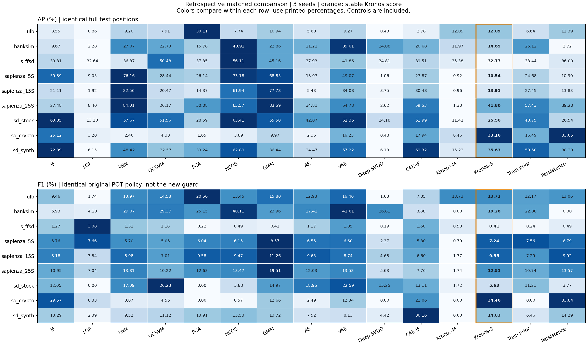
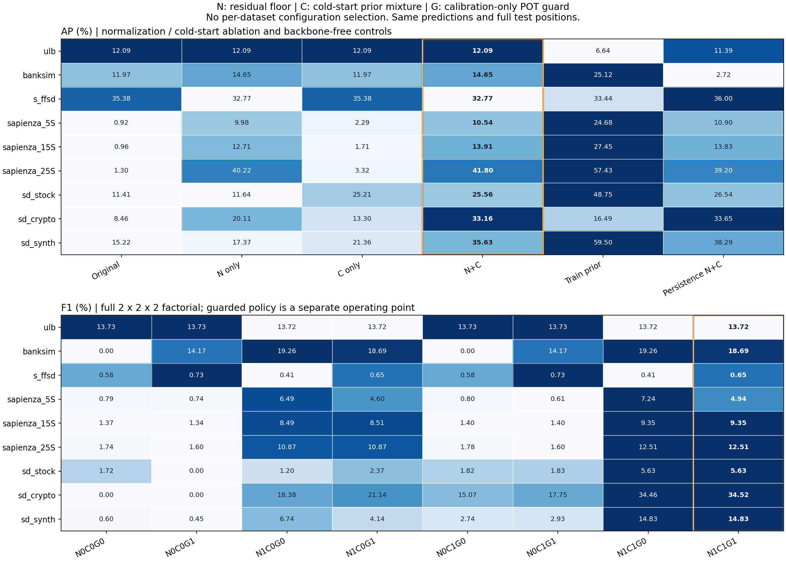

# KronosAD稳定评分、冷启动与POT护栏实验（2026-11-16）

**这是同一已查看测试集上的回顾性开发评估。** 改进来自11月15日的诊断；本轮参数和完整消融先提交后评价，但不能据此称为新的独立验证。九任务来自五种数据来源，三种Sapienza粒度不是三份独立原始数据。

已完成162条评分配置、486条操作点记录及独立复算。沿用相同81个缓存、42/43/44种子、训练／校准抽样和完整测试位置；不删除冷启动点。真实冻结骨干预测来自上一轮27条缓存、共87130386个逐特征预测，不重新推理或随机采样。

完整方案为 **KronosAD-S：N+C评分，加G阈值护栏**。N给局部残差分母加训练尺度下限；C按有效历史数混合训练先验；G只检查校准POT并显式回退分位阈值。固定公式及实验矩阵见[方案](../../docs/kronos_stable_protocol_CN.md)。与经典方法的15法排名使用原共同POT／99%分位，护栏G另列，避免比较不同阈值政策。

相对原KronosAD-M，N+C评分的AP在7/9个任务提高，**相同原POT操作点**F1在7/9个任务提高；这些是均值变化，不是统计显著性结论。在含两个无骨干对照的15法集合中，新评分AP最高0/9、共同POT F1最高1/9。

## 完整改进方案结果

百分数，三个种子均值±样本标准差。护栏改变操作点，不改变AP；CSV另有全部P/R/F1/FPR和混淆矩阵。分位回退是公开规则，不能把它计作原POT拟合成功。

| 数据集 | AP | ROC-AUC | 原POT F1 | 护栏G F1 | 99%分位F1 | 原POT FPR |
|---|---:|---:|---:|---:|---:|---:|
| ULB信用卡 | 12.09 ± 0.32 | 91.24 ± 0.64 | 13.72 ± 0.52 | 13.72 ± 0.52 | 14.23 ± 0.64 | 0.80 ± 0.02 |
| BankSim | 14.65 ± 1.09 | 81.94 ± 0.39 | 19.26 ± 1.30 | 18.69 ± 0.69 | 18.69 ± 0.69 | 0.27 ± 0.05 |
| S-FFSD | 32.77 ± 0.16 | 43.84 ± 0.36 | 0.41 ± 0.08 | 0.65 ± 0.00 | 0.65 ± 0.00 | 0.67 ± 0.16 |
| Sapienza 5S | 10.54 ± 6.66 | 97.20 ± 1.07 | 7.24 ± 1.53 | 4.94 ± 0.64 | 4.94 ± 0.64 | 0.57 ± 0.02 |
| Sapienza 15S | 13.91 ± 4.87 | 97.60 ± 0.09 | 9.35 ± 0.87 | 9.35 ± 0.87 | 7.71 ± 0.55 | 0.67 ± 0.07 |
| Sapienza 25S | 41.80 ± 18.89 | 99.04 ± 0.33 | 12.51 ± 0.96 | 12.51 ± 0.96 | 12.18 ± 0.60 | 0.74 ± 0.03 |
| SD-FMM股票 | 25.56 ± 0.20 | 67.71 ± 0.66 | 5.63 ± 0.03 | 5.63 ± 0.03 | 5.64 ± 0.03 | 0.54 ± 0.07 |
| SD-FMM加密货币 | 33.16 ± 0.94 | 96.65 ± 0.46 | 34.46 ± 1.09 | 34.52 ± 1.55 | 34.52 ± 1.55 | 0.59 ± 0.02 |
| SD-FMM合成 | 35.63 ± 0.18 | 85.44 ± 0.36 | 14.83 ± 0.45 | 14.83 ± 0.45 | 14.71 ± 0.35 | 0.44 ± 0.00 |



图中颜色只比较同一行，橙框为Kronos-S；数值是实际百分数，不以颜色跨任务比较。

## 消融：残差与冷启动对AP的影响

N0C0为原版，N为稳定分母，C为冷启动先验混合。下表为AP均值，标准差和逐种子结果保留在CSV。两个对照均无Kronos骨干。

| 数据集 | 原版 | 仅N | 仅C | N+C | 训练先验 | 持续值N+C |
|---|---:|---:|---:|---:|---:|---:|
| ULB信用卡 | 12.09 | 12.09 | 12.09 | 12.09 | 6.64 | 11.39 |
| BankSim | 11.97 | 14.65 | 11.97 | 14.65 | 25.12 | 2.72 |
| S-FFSD | 35.38 | 32.77 | 35.38 | 32.77 | 33.44 | 36.00 |
| Sapienza 5S | 0.92 | 9.98 | 2.29 | 10.54 | 24.68 | 10.90 |
| Sapienza 15S | 0.96 | 12.71 | 1.71 | 13.91 | 27.45 | 13.83 |
| Sapienza 25S | 1.30 | 40.22 | 3.32 | 41.80 | 57.43 | 39.20 |
| SD-FMM股票 | 11.41 | 11.64 | 25.21 | 25.56 | 48.75 | 26.54 |
| SD-FMM加密货币 | 8.46 | 20.11 | 13.30 | 33.16 | 16.49 | 33.65 |
| SD-FMM合成 | 15.22 | 17.37 | 21.36 | 35.63 | 59.50 | 38.29 |

## 消融：完整2×2×2组合的F1

G0使用共同原POT；G1使用护栏。每行同一N/C的两列完全共用分数。不得把每行最好配置选为方法成绩，主方案固定为N1C1G1。

| 数据集 | N0C0G0 | N0C0G1 | N1C0G0 | N1C0G1 | N0C1G0 | N0C1G1 | N1C1G0 | N1C1G1 |
|---|---:|---:|---:|---:|---:|---:|---:|---:|
| ULB信用卡 | 13.73 | 13.73 | 13.72 | 13.72 | 13.73 | 13.73 | 13.72 | 13.72 |
| BankSim | 0.00 | 14.17 | 19.26 | 18.69 | 0.00 | 14.17 | 19.26 | 18.69 |
| S-FFSD | 0.58 | 0.73 | 0.41 | 0.65 | 0.58 | 0.73 | 0.41 | 0.65 |
| Sapienza 5S | 0.79 | 0.74 | 6.49 | 4.60 | 0.80 | 0.61 | 7.24 | 4.94 |
| Sapienza 15S | 1.37 | 1.34 | 8.49 | 8.51 | 1.40 | 1.40 | 9.35 | 9.35 |
| Sapienza 25S | 1.74 | 1.60 | 10.87 | 10.87 | 1.78 | 1.60 | 12.51 | 12.51 |
| SD-FMM股票 | 1.72 | 0.00 | 1.20 | 2.37 | 1.82 | 1.83 | 5.63 | 5.63 |
| SD-FMM加密货币 | 0.00 | 0.00 | 18.38 | 21.14 | 15.07 | 17.75 | 34.46 | 34.52 |
| SD-FMM合成 | 0.60 | 0.45 | 6.74 | 4.14 | 2.74 | 2.93 | 14.83 | 14.83 |



## 15法共同原POT F1

原Kronos-M、新Kronos-S和两个无骨干对照均使用与经典方法相同的最终原POT；该表没有把护栏成绩混入。粗体仅为该指标最高均值。

| 数据集 | IF | LOF | kNN | OCSVM | PCA-SPE | HBOS | GMM | AE | VAE | Deep SVDD | CAE-IF | Kronos-M | Kronos-S | 训练先验 | 持续值 |
|---|---:|---:|---:|---:|---:|---:|---:|---:|---:|---:|---:|---:|---:|---:|---:|
| ULB信用卡 | 9.46 | 1.74 | 13.97 | 14.58 | **20.50** | 13.45 | 15.80 | 12.93 | 16.40 | 1.63 | 7.35 | 13.73 | 13.72 | 12.17 | 13.06 |
| BankSim | 5.93 | 4.23 | 29.07 | 29.37 | 25.15 | 40.11 | 23.96 | 27.41 | **41.61** | 26.81 | 8.88 | 0.00 | 19.26 | 22.80 | 0.00 |
| S-FFSD | 1.27 | **3.08** | 1.31 | 1.18 | 0.22 | 0.49 | 0.41 | 1.17 | 1.85 | 0.19 | 1.60 | 0.58 | 0.41 | 0.24 | 0.49 |
| Sapienza 5S | 5.76 | 7.66 | 5.70 | 5.05 | 6.04 | 6.15 | **8.57** | 6.55 | 6.60 | 2.37 | 5.30 | 0.79 | 7.24 | 7.56 | 6.79 |
| Sapienza 15S | 8.18 | 3.84 | 8.98 | 7.01 | 9.58 | 9.47 | **11.26** | 9.65 | 8.74 | 4.68 | 6.60 | 1.37 | 9.35 | 7.29 | 9.92 |
| Sapienza 25S | 10.95 | 7.04 | 13.81 | 10.22 | 12.63 | 13.47 | **19.51** | 12.03 | 13.58 | 5.63 | 7.76 | 1.74 | 12.51 | 10.74 | 13.57 |
| SD-FMM股票 | 12.05 | 0.00 | 17.09 | **26.23** | 0.00 | 5.83 | 14.97 | 18.95 | 22.59 | 15.25 | 13.11 | 1.72 | 5.63 | 11.21 | 3.77 |
| SD-FMM加密货币 | 29.57 | 8.33 | 3.87 | 4.55 | 0.00 | 0.57 | 12.66 | 2.49 | 12.34 | 0.00 | 21.06 | 0.00 | **34.46** | 0.00 | 33.84 |
| SD-FMM合成 | 13.29 | 2.39 | 9.52 | 11.12 | 13.91 | 15.53 | 13.72 | 7.52 | 8.13 | 4.42 | **36.16** | 0.60 | 14.83 | 6.46 | 14.29 |

## 15法AP

| 数据集 | IF | LOF | kNN | OCSVM | PCA-SPE | HBOS | GMM | AE | VAE | Deep SVDD | CAE-IF | Kronos-M | Kronos-S | 训练先验 | 持续值 |
|---|---:|---:|---:|---:|---:|---:|---:|---:|---:|---:|---:|---:|---:|---:|---:|
| ULB信用卡 | 3.55 | 0.86 | 9.20 | 7.91 | **30.11** | 7.74 | 10.94 | 5.60 | 9.27 | 0.43 | 2.78 | 12.09 | 12.09 | 6.64 | 11.39 |
| BankSim | 9.67 | 2.28 | 27.07 | 22.73 | 15.78 | **40.92** | 22.86 | 21.21 | 39.61 | 24.08 | 20.68 | 11.97 | 14.65 | 25.12 | 2.72 |
| S-FFSD | 39.31 | 32.64 | 36.37 | 50.48 | 37.35 | **56.11** | 45.16 | 37.93 | 41.86 | 34.81 | 39.51 | 35.38 | 32.77 | 33.44 | 36.00 |
| Sapienza 5S | 59.89 | 9.05 | **76.16** | 28.44 | 26.14 | 73.18 | 68.85 | 13.97 | 49.07 | 1.06 | 27.87 | 0.92 | 10.54 | 24.68 | 10.90 |
| Sapienza 15S | 21.11 | 1.92 | **82.56** | 20.47 | 14.37 | 61.94 | 77.78 | 5.43 | 34.08 | 3.75 | 30.48 | 0.96 | 13.91 | 27.45 | 13.83 |
| Sapienza 25S | 27.48 | 8.40 | **84.01** | 26.17 | 50.08 | 65.57 | 83.59 | 34.81 | 54.78 | 2.62 | 59.53 | 1.30 | 41.80 | 57.43 | 39.20 |
| SD-FMM股票 | **63.85** | 13.20 | 57.67 | 51.56 | 28.59 | 63.41 | 55.58 | 42.07 | 62.36 | 24.18 | 51.99 | 11.41 | 25.56 | 48.75 | 26.54 |
| SD-FMM加密货币 | 25.12 | 3.20 | 2.46 | 4.33 | 1.65 | 3.89 | 9.97 | 2.36 | 16.23 | 0.48 | 17.94 | 8.46 | 33.16 | 16.49 | **33.65** |
| SD-FMM合成 | **72.39** | 6.15 | 48.42 | 32.57 | 39.24 | 62.89 | 36.44 | 24.47 | 57.22 | 6.13 | 69.32 | 15.22 | 35.63 | 59.50 | 38.29 |

## 各数据集最佳方法

候选集合包含10种经典方法、CAE-IF、Kronos-M、Kronos-S及训练先验／持续值两个对照；不同指标分别选最高均值，不做混合总分。

| 数据集 | AP最高 | POT F1最高 | 99%分位F1最高 |
|---|---|---|---|
| ULB信用卡 | PCA-SPE：30.11 | PCA-SPE：20.50 | PCA-SPE：17.26 |
| BankSim | HBOS：40.92 | VAE：41.61 | HBOS：48.89 |
| S-FFSD | HBOS：56.11 | LOF：3.08 | VAE：1.85 |
| Sapienza 5S | kNN：76.16 | GMM：8.57 | AE：7.12 |
| Sapienza 15S | kNN：82.56 | GMM：11.26 | 训练先验：10.37 |
| Sapienza 25S | kNN：84.01 | GMM：19.51 | 训练先验：14.43 |
| SD-FMM股票 | IF：63.85 | OCSVM：26.23 | OCSVM：26.23 |
| SD-FMM加密货币 | 持续值：33.65 | Kronos-S：34.46 | 持续值：34.66 |
| SD-FMM合成 | IF：72.39 | CAE-IF：36.16 | 训练先验：42.20 |

## 如何解释这轮结果

**七个任务的均值改善，不能写成七个独立数据集的显著提升。** “稳定”指分母与阈值的工程处理，不代表跨种子或数据均稳定获益。ULB基本不变：AP差约−0.00032个百分点，POT F1差约−0.0144个百分点；S-FFSD则确实退步。

| 数据集 | 观察与解释 |
|---|---|
| ULB | AP仍约12.09%、POT F1从13.73%到13.72%，不是有效提升。该流的校准／测试没有冷启动，C单独应保持原结果；多数分母本来有充分变化，N基本无收益。不能为了计数把四舍五入相同写成进步。 |
| BankSim | AP 11.97%→14.65%，原POT F1 0→19.26%；平均检出0→170.7个异常，同时新增318.3个正常误报。N缓解了局部零方差导致的分数极端尺度，但仍仅召回13.33%。C在本任务无作用；训练先验AP为25.12%，高于新Kronos，骨干价值尚不充分。 |
| S-FFSD | AP 35.38%→32.77%，POT F1 0.58%→0.41%；检出7→5个，误报20→25.3个。新AP仍低于已知子集常数AP参照38.87%，ROC-AUC降至43.84%。固定尺度下限并非适合所有类别／金额特征，不能以其他任务改善掩盖本例失败；未为此重选0.1或翻转分数。 |
| Sapienza 5S | AP 0.92%→10.54%，POT F1 0.79%→7.24%。N单独AP 9.98%为主要改善，C单独仅2.29%。误报显著减少且检出增加，但新AP标准差6.66个百分点、依然远低于kNN的76.16%；G回退后F1反而降至4.94%。 |
| Sapienza 15S | AP 0.96%→13.91%，POT F1 1.37%→9.35%；N单独AP为12.71%，C单独1.71%，说明分母修正比单独处理开头更重要。仍低于kNN的AP 82.56%和GMM的POT F1 11.26%。 |
| Sapienza 25S | AP 1.30%→41.80%，POT F1 1.74%→12.51%；N单独已到40.22%，C再补充少量提升。AP标准差18.89个百分点，三种子差异较大，不能宣布稳健胜出。训练先验AP 57.43%、kNN 84.01%，都高于新Kronos。 |
| SD-FMM股票 | AP 11.41%→25.56%；C单独即25.21%，N单独11.64%，该任务主要受益于启动处理。POT仍只检出3／99个异常，F1仅5.63%；冷启动误报由12降至0，但并非所有漏报都得到解决。只有6个测试案例。 |
| SD-FMM加密货币 | AP 8.46%→33.16%，原POT F1 0→34.46%，冷启动误报平均137→1.3个，检出0→27.3／68个。单独N、C的F1为18.38%、15.07%，联合效果更好。新评分在15法中取得最高POT F1均值；但持续值对照AP 33.65%略高于Kronos 33.16%，且F1差距与种子波动相近，未做显著性胜出主张。 |
| SD-FMM合成 | AP 15.22%→35.63%，POT F1 0.60%→14.83%；冷启动误报390.7→9.7，暖启动检出0→90个。N与C单独AP仅17.37%、21.36%，显示该固定管线中二者有交互作用。总体召回仍仅8.68%；训练先验AP 59.50%、IF 72.39%，不能认为已达到最好。 |

### 三个因素分别解决了什么

**N修正了分数尺度，并未训练出新的表征。** 在Sapienza与加密货币上，N单独已提高排序和共同POT检出；但在S-FFSD降低AP。在同一冻结预测、同一数据和完整测试上的受控改变，支持将这些管线差异归于N及其随后重拟合的校准标尺；不能进一步推断其他未测数据的收益。

**C降低了大量启动误报，保留全部启动点。** 股票与加密货币的启动误报明显减少；合成数据仍检出启动异常，未通过删除该子集获得高分。C在三个非重置交易流上没有作用，与其校准／测试历史已充足的条件一致。C也会改变自身校准分布及逐维标尺，不能把其全部标量排序变化只归于启动点本身。

**G阻止特定极端外推，但不保证更高F1。** 原版27个标量POT拟合都成功，护栏仍拒绝24个；N+C也27个成功，护栏拒绝12个，全部公开回退到原99%分位。原版BankSim通过G从零报警恢复到F1 14.17%，但在新N+C上，G将BankSim F1从19.26%降至18.69%，将Sapienza 5S从7.24%降至4.94%。G在加密货币只带来34.46%→34.52%的小变化。因此主表继续使用共同原POT，部署用完整N1C1G1如实保留，不能逐数据集选择较好的G0或G1。

**ξ<1是保守工程选择，不是POT数学合法性的必要条件。** ξ≥1的GPD仍可合法定义，高分位也可存在；护栏只是拒绝无有限均值的尾型及校准报警比例偏离，避免把这类外推直接当作可信工作阈值。额外检查未提供有限样本或分布漂移下的FPR保证。[SciPy的GPD定义](https://docs.scipy.org/doc/scipy/reference/generated/scipy.stats.genpareto.html)

### 改善是否确实需要Kronos

训练先验AP在7／9个任务高于新Kronos，持续值AP在5／9个任务高于新Kronos。尤其加密货币的持续值AP成为15法最高，合成数据的先验99%分位F1达到42.20%，高于此前CAE-IF的29.12%。这些对照说明稳定评分与阈值选择可以产生大量收益，不能全部归功于金融预训练模型。

对照比较的是整个预测器与其配套无标签标尺，未单独隔离网络架构和预训练的作用。当前证据支持“修复了若干评分管线问题，取得局部改善”；不足以支持“预训练骨干普遍优于简单方法”或跨时期部署有效。后续若继续优化，应在新时期／独立来源上确认，不能反复利用本次测试集调参后仍称独立验证。

### 原POT下的检出与误报变化

下表是三个种子的平均计数，不是单次整数混淆矩阵。新列固定为N+C，未用护栏或删除启动点替换共同POT。

| 数据集 | TP：原→新 | FP：原→新 | 冷启动FP：原→新 |
|---|---:|---:|---:|
| ULB信用卡 | 63 → 63 | 739.7 → 740.7 | 0 → 0 |
| BankSim | 0 → 170.7 | 0 → 318.3 | 0 → 0 |
| S-FFSD | 7 → 5 | 20 → 25.3 | 0 → 0 |
| Sapienza 5S | 19 → 46.7 | 4743.7 → 1171 | 329 → 29.7 |
| Sapienza 15S | 28 → 51.7 | 3985.3 → 980.7 | 311.3 → 20 |
| Sapienza 25S | 28 → 64.3 | 3136 → 889 | 292.7 → 18.3 |
| SD-FMM股票 | 1 → 3 | 16 → 4.7 | 12 → 0 |
| SD-FMM加密货币 | 0 → 27.3 | 142 → 63.3 | 137 → 1.3 |
| SD-FMM合成 | 6 → 138 | 396 → 134 | 390.7 → 9.7 |

完整数据见[诊断比较CSV](diagnostic_comparison.csv)。

## 文件和评价边界

- [486条逐种子操作点](metrics.csv)、[162条汇总](summary.csv)、[216条完整因素记录](factorial_metrics.csv)、[配对增量及其标准差](paired_deltas.csv)。POT有失败种子时不只平均成功种子。
- [270条共同操作点汇总](combined_transaction_summary.csv)、[全部指标最佳方法](best_methods.csv)、[概览](overview.json)。经典及CAE-IF沿用此前同缓存结果；原Kronos旧成绩在新复算中重现。
- [原拟合／护栏接受与回退审计](threshold_audit.csv)、[全部阈值](thresholds.json)、[逐维标尺和失败维度](feature_pot.json)、[仅训练集先验](training_priors.json)。G不承诺测试FPR或有限样本覆盖，并列分数导致的报警比例偏离如实记录。
- [冷／热启动固定阈值子集](cold_warm_metrics.csv)、[误报驱动](score_driver_diagnostics.csv)。仅用于解释，完整测试仍为主表。先验对照不依赖历史方差，不能将其主导维度恰有近恒定历史误读为该算法使用了局部分母。
- [逐配置原始指标与哈希](per_seed.json)、[输入身份](input_files_sha256.json)、[独立复算](verification.json)、[源码及环境](run_manifest.json)。实际评分代码固定`8b7e5d68764a61cb8afd523f6846be21d99798eb`；报告导出提交可更晚。评分先全部写盘，再单独解码测试标签。
- N+C的AP高于训练先验对照的任务数为2/9，高于持续值对照为4/9；这不等于骨干在所有任务上都有增量价值。对照同样需要校准，不是零校准比较。
- 三种子误差条不代表跨时期独立验证。外部预训练重叠、人工日历、工程特征代理、无监督污染及未知标签覆盖的原有限制继续适用。账户图六方法表保持独立，没有新增Kronos图结果。

## 复现

固定方案及依赖见[协议](../../docs/kronos_stable_protocol_CN.md)。先准备上一轮完整缓存和预测；新输出使用独立目录，不覆盖历史实验。数值库为NumPy2.1.3、SciPy1.16.3、Pandas2.3.3、scikit-learn1.7.2。

```bash
python -m finad_kronos.stable_experiment --raw-runs /data/kronos/old_raw \
  --original-runs /data/kronos/old_ratio --data /data/kronos/tabular \
  --output /data/kronos/stable --stage score
python -m finad_kronos.stable_experiment --raw-runs /data/kronos/old_raw \
  --original-runs /data/kronos/old_ratio --data /data/kronos/tabular \
  --output /data/kronos/stable --stage evaluate
python scripts/verify_kronos_stable.py --runs /data/kronos/stable \
  --raw-runs /data/kronos/old_raw --original-runs /data/kronos/old_ratio \
  --data /data/kronos/tabular
python scripts/report_kronos_stable.py --runs /data/kronos/stable \
  --output .local_data/kronos_stable_report
```

本轮只发布源码、全部配置指标、参数和验证证据；逐点分数及冻结预测仍在私有工作归档，Git不新增大模型权重或原始逐点预测。

## 执行与验证证据

- [固定评分与阈值哈希封存](scoring_seal.json)在新指标评价前提交至[`6233562`](https://github.com/SansaZheng/Financial_unsuperviesdAD/commit/6233562)。独立复算检查封存后所有分数和阈值不变；这不消除上轮已看测试的开发偏差。
- [科学代码CI](ci_scientific.json)：实际数值源`8b7e5d68764a61cb8afd523f6846be21d99798eb`，Python3.10／3.12通过；本地完整62项测试通过。
- [本地合成资格检查](local_qualification.json)、[CQ CPU资格检查](cq_qualification.json)、[CQ新增11项测试](cq_tests.txt)、[实际资格作业配置](cq_spec_verified.json)、[执行记录](execution_record.json)。资格数据是合成的，只检查公式、因果历史、数值和资源，不当作金融实验成绩。
- 初次资格作业`j-1116-182114`在平台完成计算，但产物校验因pytest临时符号链接拒绝取回；同一科学提交的替换资格作业`j-1116-367882`清理这些临时链接后完成、取回并通过验证。没有重启其他项目任务，没有新增GPU作业或付费资源。
- 金融实验为本地CPU缓存复算，Python3.12.14；CQ合成资格为Python3.13.18。相同四个数值库及源码哈希均已核对；骨干推理仍为上一轮实际归档，不用合成资格冒充真实模型重跑。
- [报告数据核验](report_validation.json)检查486条记录、216条因素组合、270条共同汇总、均值／样本标准差、15法最高名单、主表数值、哈希封存及文档链接。原27条Kronos结果完整重现，旧数据和实验目录不覆盖。

从头获取数据与真实冻结预测时，使用[上一轮完整运行命令](../../docs/kronos_matched_protocol_CN.md)；CPU数值栈可使用[固定版本文件](../../requirements-kronos-stable-numeric.txt)。随后执行上面的评分、评价和独立复算命令即可重建本轮表格。绘图入口为`python scripts/plot_kronos_stable.py --results .local_data/kronos_stable_report`。
