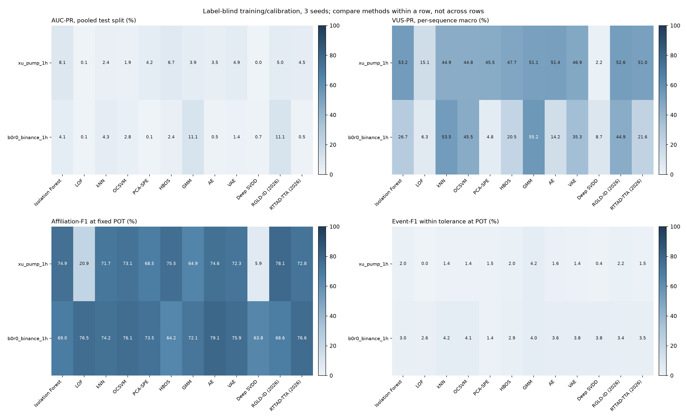

# OHLCVA K线拉盘砸盘（pump-and-dump）实验

在小时级 OHLCVA K线（开、高、低、收、成交量、成交额）上，用 12 种无监督方法、3 个种子（42/43/44）检测拉盘小时。训练、预处理与阈值校准不读取标签；标签只在最终评价打开。共 **72 次真实运行**，POT 阈值失败 **0** 次。

## 结论摘要

- **简单规则不输于任何学习方法。** 在  上，“小时高低价差”和“成交额相对过去 24 小时的放大”两条不训练的规则，VUS-PR 为 66.7%，高于全部 12 种方法（最好的 Isolation Forest 为 53.2%）；合并 AUC-PR 上 Isolation Forest（8.07%）与价差规则（7.86%）接近，约为随机水平（0.0087%）的 900 倍。 上规则同样领先（VUS-PR 65.5% / 59.8%，最好的学习方法 GMM 55.2%）。
- **排序能力强，固定阈值下误报很多。** POT 阈值把约 1% 的小时标为异常，可覆盖 80–90% 的拉盘（±2 小时内），但报警片段中只有约 1–2% 落在拉盘附近，F1 只有 1–3%。拉盘小时是罕见事件（测试期 64／736,800），任何以“少见K线”为目标的无监督检测器都会把大量正常的剧烈波动一起报出。
- **方法排名不稳定。** 两个任务的排名差异很大（如 Isolation Forest 在 Xu 第一、在 B0R0koko 第六），后者只有 10 个测试拉盘，不足以区分方法。LOF 与 Deep SVDD 在两项任务上都接近失效。
- **核验**：72 次运行的评分哈希、混淆矩阵、阈值与检查点重载全部通过；8 次运行的现代指标经独立代码路径重算，误差 ≤1e-9。

## 数据与任务

| 任务 | 说明 | 训练 / 校准 / 测试行数 | 测试正例（拉盘小时） | 测试序列（含拉盘） | 容差 τ |
| --- | --- | --- | ---: | ---: | ---: |
| `xu_pump_1h` | Xu & Livshits: PumpOlymp signals, 921 coin×exchange series (Cryptopia, Yobit, Bittrex, Binance) | 2,212,242 / 736,800 / 736,800 | 64 | 921（57） | ±2 小时 |
| `b0r0_binance_1h` | B0R0koko Binance announcements on the 58 Binance series of the same candles | 139,316 / 46,400 / 46,400 | 10 | 58（9） | ±2 小时 |

- K线来自 Xu & Livshits（USENIX Security 2019）随附的 CryptoCompare 小时数据，2018-05-15 至 2018-10-29 UTC，BTC 计价；CryptoCompare 聚合序列 CCCAGG 与交易所序列重复且无标签，已排除。
- 按全部交易所小时K线的累计条数做时间顺序 60/20/20 划分：训练 < 2018-08-24，校准至 2018-09-26 08:00，测试 2018-09-26 至 2018-10-29。两项任务共用同一边界。
- 特征 14 维，逐序列只用当前与更早的K线：对数收益、高低价差、实体、上下影线、跳空、对数成交额，以及相对过去 24/168 小时的成交额、成交量、价差和收益波动的偏离，是否成交。不使用币种、交易所或时间特征。
- 标签：信号所在小时为 1，其余为 0。0 不代表确认正常（未被 PumpOlymp 或 B0R0koko 记录的拉盘可能存在）。
- **Hu et al. 事件（2019–2022）无对应K线，本次无法运行**：需要 Binance 公开K线，当前运行环境无法访问 data.binance.vision。

## 主要结果

### `xu_pump_1h`

按 VUS-PR 排序；均值 ± 种子标准差。随机排序的 AUC-PR 参照等于正例率 （0.0087%）。规则参照不训练、不调阈值，只给阈值无关指标。

| 方法 | VUS-PR | AUC-PR（合并） | AUC-ROC | Precision@n | VUS-ROC | PATE |
| --- | ---: | ---: | ---: | ---: | ---: | ---: |
| *Rule: hourly high/low range* | 66.74 | 7.855 | 93.12 | 10.94 | 95.14 | 64.84 |
| *Rule: amount spike vs past 24 h* | 66.68 | 1.975 | 93.47 | 4.69 | 95.38 | 65.56 |
| Isolation Forest | 53.24 ± 1.83 | 8.069 ± 1.273 | 92.28 | 14.58 | 94.60 | 51.19 |
| RGLD-ID (2026) | 52.63 ± 6.34 | 4.984 ± 1.668 | 91.82 | 10.42 | 94.21 | 48.65 |
| AE | 51.40 ± 0.77 | 3.484 ± 0.170 | 92.11 | 7.81 | 94.00 | 48.47 |
| GMM | 51.11 ± 7.55 | 3.922 ± 1.799 | 91.39 | 6.77 | 93.99 | 47.63 |
| RTTAD-TTA (2026) | 50.97 ± 5.64 | 4.493 ± 1.058 | 91.87 | 9.90 | 93.93 | 47.81 |
| HBOS | 47.71 ± 0.76 | 6.720 ± 1.478 | 91.41 | 13.02 | 93.73 | 44.41 |
| VAE | 46.89 ± 1.59 | 4.908 ± 0.894 | 91.06 | 10.94 | 93.61 | 44.76 |
| PCA-SPE | 45.47 ± 1.07 | 4.204 ± 0.588 | 92.04 | 10.42 | 94.47 | 41.57 |
| kNN | 44.86 ± 2.71 | 2.384 ± 0.407 | 91.40 | 4.69 | 93.10 | 42.88 |
| OCSVM | 44.82 ± 0.66 | 1.941 ± 0.132 | 92.04 | 3.65 | 93.45 | 42.56 |
| LOF | 15.09 ± 4.32 | 0.095 ± 0.017 | 86.07 | 0.00 | 88.59 | 12.13 |
| Deep SVDD | 2.16 ± 1.74 | 0.011 ± 0.001 | 61.93 | 0.00 | 58.30 | 1.55 |

**固定 POT 阈值（校准集，无标签）**

| 方法 | 报警比例 | Precision | Recall | F1 | MCC×100 | 容差内事件召回 | 报警片段精度（容差内） | Affiliation-F1 |
| --- | ---: | ---: | ---: | ---: | ---: | ---: | ---: | ---: |
| Isolation Forest | 1.061 | 0.66 | 80.73 | 1.31 | 7.25 | 88.02 | 1.00 | 74.94 |
| RGLD-ID (2026) | 0.890 | 0.80 | 82.29 | 1.59 | 8.08 | 90.10 | 1.13 | 78.10 |
| AE | 1.205 | 0.55 | 76.04 | 1.09 | 6.39 | 86.98 | 0.79 | 74.56 |
| GMM | 0.316 | 1.56 | 56.25 | 3.04 | 9.33 | 64.58 | 2.19 | 64.95 |
| RTTAD-TTA (2026) | 1.272 | 0.52 | 76.04 | 1.03 | 6.22 | 86.98 | 0.74 | 72.76 |
| HBOS | 0.933 | 0.70 | 75.52 | 1.39 | 7.23 | 85.94 | 1.03 | 75.53 |
| VAE | 1.403 | 0.48 | 77.60 | 0.96 | 6.06 | 87.50 | 0.70 | 72.30 |
| PCA-SPE | 1.155 | 0.53 | 70.31 | 1.05 | 6.03 | 80.73 | 0.74 | 68.47 |
| kNN | 1.349 | 0.41 | 64.06 | 0.82 | 5.07 | 73.96 | 0.70 | 71.68 |
| OCSVM | 1.385 | 0.44 | 70.83 | 0.88 | 5.54 | 80.21 | 0.73 | 73.08 |
| LOF | 0.478 | 0.00 | 0.00 | 0.00 | -0.06 | 0.00 | 0.00 | 20.88 |
| Deep SVDD | 0.175 | 0.00 | 0.00 | 0.00 | -0.04 | 1.56 | 0.24 | 5.94 |

### `b0r0_binance_1h`

按 VUS-PR 排序；均值 ± 种子标准差。随机排序的 AUC-PR 参照等于正例率 （0.0216%）。规则参照不训练、不调阈值，只给阈值无关指标。

| 方法 | VUS-PR | AUC-PR（合并） | AUC-ROC | Precision@n | VUS-ROC | PATE |
| --- | ---: | ---: | ---: | ---: | ---: | ---: |
| *Rule: amount spike vs past 24 h* | 65.53 | 12.387 | 95.02 | 10.00 | 93.93 | 62.16 |
| *Rule: hourly high/low range* | 59.80 | 24.627 | 90.21 | 40.00 | 91.54 | 54.87 |
| GMM | 55.24 ± 0.00 | 11.121 ± 0.739 | 90.01 | 23.33 | 91.42 | 52.64 |
| kNN | 53.49 ± 0.94 | 4.321 ± 1.800 | 89.87 | 6.67 | 91.44 | 47.06 |
| OCSVM | 45.46 ± 5.07 | 2.843 ± 0.817 | 98.37 | 10.00 | 95.90 | 38.06 |
| RGLD-ID (2026) | 44.92 ± 6.16 | 11.080 ± 2.721 | 92.32 | 13.33 | 92.20 | 39.37 |
| VAE | 35.34 ± 1.53 | 1.423 ± 0.245 | 93.64 | 0.00 | 92.62 | 30.76 |
| Isolation Forest | 26.71 ± 5.65 | 4.066 ± 0.187 | 97.73 | 0.00 | 95.87 | 21.23 |
| RTTAD-TTA (2026) | 21.63 ± 1.60 | 0.534 ± 0.028 | 88.59 | 0.00 | 89.82 | 18.78 |
| HBOS | 20.49 ± 4.02 | 2.380 ± 0.030 | 94.23 | 0.00 | 93.42 | 14.56 |
| AE | 14.17 ± 3.86 | 0.485 ± 0.110 | 88.30 | 0.00 | 89.50 | 9.36 |
| Deep SVDD | 8.66 ± 1.24 | 0.698 ± 0.116 | 82.42 | 0.00 | 84.52 | 6.12 |
| LOF | 6.28 ± 2.02 | 0.139 ± 0.047 | 81.86 | 0.00 | 86.62 | 2.81 |
| PCA-SPE | 4.85 ± 0.17 | 0.147 ± 0.006 | 85.96 | 0.00 | 84.97 | 2.21 |

**固定 POT 阈值（校准集，无标签）**

| 方法 | 报警比例 | Precision | Recall | F1 | MCC×100 | 容差内事件召回 | 报警片段精度（容差内） | Affiliation-F1 |
| --- | ---: | ---: | ---: | ---: | ---: | ---: | ---: | ---: |
| GMM | 1.833 | 1.06 | 90.00 | 2.09 | 9.65 | 90.00 | 2.06 | 72.07 |
| kNN | 1.941 | 1.00 | 90.00 | 1.98 | 9.37 | 90.00 | 2.16 | 74.17 |
| OCSVM | 2.168 | 0.90 | 90.00 | 1.78 | 8.86 | 90.00 | 2.12 | 76.12 |
| RGLD-ID (2026) | 1.484 | 1.26 | 86.67 | 2.48 | 10.34 | 86.67 | 1.72 | 68.65 |
| VAE | 2.088 | 0.83 | 80.00 | 1.64 | 8.02 | 80.00 | 1.94 | 75.91 |
| Isolation Forest | 2.116 | 0.92 | 90.00 | 1.82 | 8.97 | 90.00 | 1.55 | 69.04 |
| RTTAD-TTA (2026) | 2.836 | 0.48 | 63.33 | 0.96 | 5.36 | 76.67 | 1.79 | 76.62 |
| HBOS | 1.607 | 1.07 | 80.00 | 2.12 | 9.15 | 80.00 | 1.49 | 64.20 |
| AE | 2.575 | 0.51 | 60.00 | 1.02 | 5.38 | 76.67 | 1.83 | 79.05 |
| Deep SVDD | 1.228 | 0.82 | 46.67 | 1.61 | 6.05 | 63.33 | 1.97 | 63.80 |
| LOF | 3.404 | 0.15 | 23.33 | 0.29 | 1.61 | 60.00 | 1.35 | 76.49 |
| PCA-SPE | 2.432 | 0.12 | 13.33 | 0.23 | 1.03 | 46.67 | 0.72 | 73.53 |



## 指标

合并视角：在全部测试K线上计算 AUC-PR（Average Precision）、AUC-ROC、Precision@n（n＝拉盘小时数）以及固定阈值下的 Precision／Recall／F1／MCC。序列视角（TSB-AD 协议，NeurIPS 2024）：每个含拉盘的币×交易所测试序列单独计算 VUS-PR／VUS-ROC（滑动窗口 2τ）、PATE（前后缓冲 τ）与 Affiliation-F1 后宏平均；容差内事件召回为 ±τ 小时内至少一次报警的拉盘比例，报警片段精度为落在某拉盘 ±τ 小时内的报警片段比例。实现与验证见 [`finad/modern_metrics.py`](../../finad/modern_metrics.py)。

## 解释限制

- `b0r0_binance_1h` 测试期只有 10 个拉盘小时（58 条序列），种子方差与抽样误差很大，只能作补充参考。
- 2018 年的低流动性币种中，大量K线成交量为 0；拉盘小时与“沉寂后首次成交”在特征上相近，这是主要误报来源之一。
- 标签只到小时粒度；分钟级的拉盘与砸盘被合并进同一根K线。
- RTTAD-TTA 在最多 8192 条无标签测试特征上自适应（transductive），其余方法为归纳设定。三种子标准差反映训练／抽样随机性，不是置信区间。

## 文件

- [metrics.csv](metrics.csv)：逐种子、逐阈值策略的全部指标 · [summary.csv](summary.csv)：均值与标准差 · [references.json](references.json)：规则参照
- [modern_metrics_runs.json](modern_metrics_runs.json) · [runs.json](runs.json) · [splits.json](splits.json) · [environment.json](environment.json) · [verification.json](verification.json)
- 执行代码提交：`9555eeec3d91254dc01d7330de33904e052e780a`；代码指纹：`747f238753a6e33a034880ce157572ea4bcfbcd881c724be592b2c9ab94aa1b6`；Linux-6.18.44-fc-v445-x86_64-with-glibc2.39，CPU。

复现：

```bash
pip install rdata statsmodels==0.15.0 && pip install --no-deps TSB-AD==1.5 PATE==0.1.1
python scripts/prepare_repo_data.py --output .local_data/feature_cache --datasets xu_pump_1h b0r0_binance_1h
python -m finad benchmark --cache .local_data/feature_cache --output .local_data/runs_ohlcva --datasets xu_pump_1h b0r0_binance_1h \
  --methods iforest lof knn ocsvm pca hbos gmm ae vae deep_svdd rgld2026 rttad2026 --device cpu
python scripts/evaluate_ohlcva.py --runs .local_data/runs_ohlcva --cache .local_data/feature_cache --output results/ohlcva_2026
```
