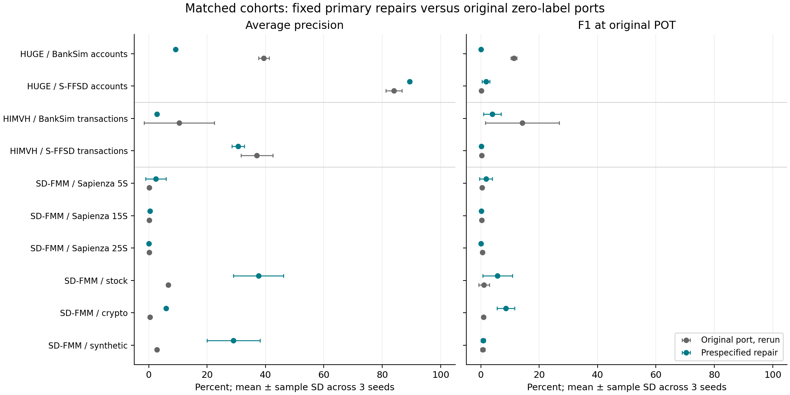

# 三方法实现审计、修正与消融：中文报告

日期：2026-11-17。**最终分析集174组配置、348条操作点，156次实际拟合；旧法复跑30次已包含其中。** 所有预先登记配置都保留；主版本预先固定为HUGE-role、HIMVH-cm、SD-FMM-ge，不按数据集选择最优消融。真实训练／校准标签完全不参与学习或阈值。

怎么看指标：AP看异常是否排在前面，不依赖报警阈值；F1同时考虑报警准确率和漏报。原POT与q99是两种事先固定的无标签阈值，q99取校准分数的99%分位。FPR是正常样本被误报的比例。AP／F1越高越好，FPR越低越好，三者需要一起看。

## 结论先看

| 轨道／任务 | 修正方法 | 旧复跑AP | 修正AP | AP差值（百分点） | 旧原POT F1 | 修正原POT F1 |
|---|---|---:|---:|---:|---:|---:|
| tabular／BankSim | HIMVH | 10.47 ± 12.01 | 2.78 ± 0.23 | -7.68 | 14.16 ± 12.65 | 3.90 ± 3.03 |
| tabular／S-FFSD | HIMVH | 37.06 ± 5.40 | 30.66 ± 2.14 | -6.39 | 0.30 ± 0.05 | 0.16 ± 0.08 |
| graph／BankSim | HUGE | 39.44 ± 1.81 | 9.18 ± 0.04 | -30.26 | 11.33 ± 0.99 | 0.09 ± 0.16 |
| graph／S-FFSD | HUGE | 84.01 ± 2.71 | 89.41 ± 0.57 | +5.40 | 0.21 ± 0.21 | 1.75 ± 1.33 |
| tabular／Sapienza 15S | SD-FMM | 0.10 ± 0.13 | 0.35 ± 0.27 | +0.25 | 0.33 ± 0.57 | 0.22 ± 0.08 |
| tabular／Sapienza 25S | SD-FMM | 0.14 ± 0.09 | 0.09 ± 0.03 | -0.05 | 0.48 ± 0.43 | 0.06 ± 0.11 |
| tabular／Sapienza 5S | SD-FMM | 0.18 ± 0.14 | 2.40 ± 3.54 | +2.21 | 0.43 ± 0.35 | 1.73 ± 2.15 |
| tabular／SD-FMM加密货币 | SD-FMM | 0.44 ± 0.09 | 5.87 ± 0.43 | +5.42 | 0.89 ± 0.08 | 8.55 ± 2.97 |
| tabular／SD-FMM股票 | SD-FMM | 6.68 ± 0.06 | 37.60 ± 8.60 | +30.92 | 1.07 ± 1.85 | 5.72 ± 5.06 |
| tabular／SD-FMM合成 | SD-FMM | 2.85 ± 0.18 | 29.00 ± 9.10 | +26.15 | 0.68 ± 0.79 | 0.78 ± 0.76 |

**HUGE修正版：** 2个适用任务中AP较旧复跑提高1个；在共同方法池中，AP均值最高0个、原POT F1最高0个、q99 F1最高0个。这些是三种子均值排名，不是显著性结论。

**HIMVH修正版：** 2个适用任务中AP较旧复跑提高0个；在共同方法池中，AP均值最高0个、原POT F1最高0个、q99 F1最高0个。这些是三种子均值排名，不是显著性结论。

**SD-FMM修正版：** 6个适用任务中AP较旧复跑提高5个；在共同方法池中，AP均值最高0个、原POT F1最高0个、q99 F1最高0个。这些是三种子均值排名，不是显著性结论。

数值均为百分数，均值±样本标准差；AP差值为百分点。图与交易单位不同，不合并平均。**本轮依赖已查看的旧测试结果提出修正，是回顾性开发，不是新的独立验证。**



## 查到了什么，不能据此声称什么

1. **没有发现评分方向写反或标签／样本错位。** 原评分方向固定；旧代码不变，另做当轮旧法复跑。原源码公式、样本索引、输入摘要、模型重载和保存分数的指标重算都有检查。低于随机参照也不根据测试标签翻转分数。
2. **HUGE主要有角色语义适配风险。** 把付款方出账和收款方入账放在不同列，再让角色one-hot参与HALO，会把正常类型差异算入异配性。修正以对应方向的计数／均值／std／最大值对齐，按角色仅用训练数据标准化；沿用原图的log1p计数与log金额统计，不重算原始金额，原生边及付款账户评价集合不变。它改变了方法内部预处理，不声称与旧40维最终输入完全相同。角色改进、训练预算和自环评分分别有对照。
3. **HIMVH的训练图和遮蔽任务有具体缺陷。** 抽样后重建窗口改变了实际邻域／时间跨度；新的C用完整训练上下文、原8192损失目标及每视图精确3层ego块。干净HCDP又能携带被遮蔽值，新的M先遮蔽再计算辅助量，并采用一致的遮蔽字段预测。这里是自监督目标通路，不是真实标签泄漏。图拓扑仍可编码用于构图的类别键，不能声称所有被遮蔽类别的结构信息也被移除。
4. **SD-FMM旧自产任务与金融特征及末点评价不一致。** 旧逐列扰动破坏时钟单位圆和派生关系；旧全位置BCE把单个末点梯度稀释160倍。新G保留时钟、共同改变金融字段，SD序列从发布值重算衍生量；新E只优化真实评价末点。产生的仍是人工干预分布，不保证等于真实欺诈。无标签源窗口可能本来就异常，自产0不等于已知正常。
5. **阈值与排序分开解释。** AP不依赖阈值，因此低AP不能只归因于POT。校准尾部风险1%也不等于测试FPR必为1%；分布漂移、校准污染及高异常占比都可能影响操作点。保持相同POT/q99，分别报告AP与F1/FPR，不能根据测试标签改风险或翻转分数。
6. **修复不等于复刻原有标签论文或保证SOTA。** HIMVH仍是独立零标签重构适配，SD-FMM仍无真实异常片段或标签验证，HUGE仍为金融归纳迁移。固定预算、信息范围、图假设和源污染仍有限制；具体效果看完整消融，不能只据反例把所有低AP归因于某一项。

诊断为训练特征／合成数据实验：[训练审计](train_only_audit.json)。完整定义及字段映射：[固定协议](../../docs/recent_repair_protocol_CN.md)。

## 后验机制诊断：为什么修正仍未全面奏效

本节在全部模型和分数固定、174配置独立复核通过后分析。字段AP使用测试标签作解释，**不是训练、选模或阈值依据**；不新增获胜方法、不替换预先固定主版本，也不改变370条主榜。字段分数是后验观察，不能解释为欺诈的因果因素。

**本轮不支持直接把三个主修正版整体替换旧适配。** SD-FMM有明显数值改善，但HUGE／HIMVH没有一致收益；三个主修正版在候选池中均未取得最高均值AP或任一F1。修复目标／约束不一致，只是必要的机制检查，不是性能保证。

**HUGE：角色重参数化有数据集代价，增加更新未补回。** BankSim的role主版AP为9.18%，旧复跑为39.44%，1200更新仍为9.14%；S-FFSD则从84.01%升至89.41%。这支持“本角色／缩放组合不具有普遍收益”，不支持“单纯多训练就能解决”。对齐、去角色列和分角色缩放是成组改变，尚不能单独断言哪个子环节抹掉了有用信号。

**HIMVH：字段等权放大了不善于区分欺诈的误差，完整上下文也非必然有益。** BankSim的cm与cm_flat复用同一个检查点和同一批字段误差，仅换评分权重，AP由2.78%变为14.70%；S-FFSD由30.66%变为33.50%。BankSim的cm金额字段在校准平均总分中的贡献由按维数加权的4.14%升至等字段的31.25%，但金额单字段测试AP仅2.29%；交易类别／商户字段的单字段AP更高，却被降权。等语义权重不等于等噪声尺度。

同一新求解器与一致遮蔽下，BankSim由抽样上下文m的14.02%变为完整上下文cm的2.78%；S-FFSD则由29.55%变为30.66%。它测出了上下文效应的方向差异，但没有单独证明“过平滑”或某一种邻居类型是根因。BankSim的m_flat达到22.00%，属于消融证据，**不能事后替换预先指定主版本以宣称成功**。

| 任务／固定检查点 | 字段 | 字段等权时校准贡献 | 按维数加权时校准贡献 | 单字段测试AP（后验） |
|---|---|---:|---:|---:|
| banksim/m | 金额 | 75.22 | 18.64 | 13.81 |
| banksim/m | 年龄 | 11.07 | 21.91 | 6.21 |
| banksim/m | 性别 | 2.98 | 2.88 | 2.58 |
| banksim/m | 交易类别 | 3.71 | 29.11 | 21.11 |
| banksim/m | 商户哈希 | 7.02 | 27.45 | 20.77 |
| banksim/cm | 金额 | 31.25 | 4.14 | 2.29 |
| banksim/cm | 年龄 | 24.05 | 24.72 | 2.32 |
| banksim/cm | 性别 | 22.90 | 11.71 | 0.94 |
| banksim/cm | 交易类别 | 6.71 | 28.23 | 16.95 |
| banksim/cm | 商户哈希 | 15.08 | 31.20 | 16.28 |
| s_ffsd/m | 金额 | 55.81 | 7.33 | 31.84 |
| s_ffsd/m | 地点 | 14.48 | 30.36 | 43.14 |
| s_ffsd/m | 类型 | 11.62 | 24.39 | 31.56 |
| s_ffsd/m | 收款方哈希 | 18.09 | 37.92 | 25.93 |
| s_ffsd/cm | 金额 | 54.10 | 6.95 | 30.28 |
| s_ffsd/cm | 地点 | 18.65 | 37.83 | 42.25 |
| s_ffsd/cm | 类型 | 10.70 | 22.06 | 32.39 |
| s_ffsd/cm | 收款方哈希 | 16.55 | 33.16 | 35.46 |

**SD-FMM：末点目标对齐最关键的证据出现在Sapienza；保持约束不代表人工异常更接近真实操纵。** Sapienza15S的e（在新公共RNG对照上只改末点目标）AP为3.10%，再加入约束生成器ge为0.35%；25S由0.91%变为0.09%。反之股票、加密货币和合成序列的G条件效应为正，说明生成器需要领域匹配，不能把修复时钟约束直接当作操纵语义匹配。

**低F1与低AP需要分别解释。** 0/108条SD-FMM配置出现POT阈值超过概率上界1的情况，本轮没有发现这一类越界问题。合成序列ge的平均测试报警率为0.95%，异常召回率仅0.44%。因此AP提高没有转成好的固定操作点；不能据此把阈值改成测试最优。

**旧法重跑也有波动。** 30条legacy复跑与历史报告的单种子AP最大差为4.41个百分点；输入与原始方法代码已核对，GPU训练不承诺位级确定。本轮修正效应统一对比当轮legacy，不拼接有利历史种子，详见[复跑偏差](legacy_reproduction.csv)。

上述分量表只给3种子均值；完整逐种子字段文件见[后验字段诊断](posthoc_field_diagnostics.csv)，概率支持与报警率见[阈值诊断](bounded_POT_diagnostics.csv)。字段AP未参与任何拟合或主版本选择。下一步若改评分校准／生成器，需要另立方案并用新留出数据验证；本轮不在已查看测试集上继续调到获胜。


## 全部预登记消融

f00是新公共求解器／采样RNG对照；legacy是原代码复跑。HIMVH公共求解器800×128与旧200×512具有相同损失目标次数，但更新次数、BN批大小和遮蔽轨迹不同；SD新因子分离了采样与生成RNG。先看这些对照，再解释C/M或E/G。m_flat/cm_flat、role_noself不额外训练。

### HIMVH／BankSim

| 配置 | AP ↑ | ROC-AUC ↑ | 原POT F1 ↑ | q99 F1 ↑ | 原POT FPR ↓ | q99 FPR ↓ |
|---|---:|---:|---:|---:|---:|---:|
| legacy | 10.47 ± 12.01 | 47.56 ± 41.80 | 14.16 ± 12.65 | 12.85 ± 11.72 | 0.61 ± 0.22 | 0.81 ± 0.12 |
| f00 | 6.09 ± 2.72 | 61.17 ± 18.75 | 10.78 ± 3.77 | 11.16 ± 3.50 | 0.62 ± 0.41 | 0.83 ± 0.06 |
| c | 6.94 ± 4.76 | 52.75 ± 25.12 | 15.11 ± 6.28 | 15.93 ± 6.57 | 0.40 ± 0.14 | 0.79 ± 0.03 |
| m | 14.02 ± 18.21 | 83.58 ± 6.94 | 16.34 ± 22.48 | 16.33 ± 22.25 | 0.98 ± 0.34 | 0.84 ± 0.30 |
| **cm（主）** | 2.78 ± 0.23 | 62.75 ± 7.30 | 3.90 ± 3.03 | 3.47 ± 2.39 | 0.96 ± 0.38 | 0.99 ± 0.08 |
| m_flat | 22.00 ± 2.11 | 94.43 ± 1.98 | 27.27 ± 4.57 | 27.68 ± 4.45 | 0.88 ± 0.22 | 0.70 ± 0.06 |
| cm_flat | 14.70 ± 5.95 | 59.49 ± 7.71 | 29.28 ± 8.46 | 30.01 ± 6.42 | 0.62 ± 0.13 | 0.63 ± 0.05 |

### HIMVH／S-FFSD

| 配置 | AP ↑ | ROC-AUC ↑ | 原POT F1 ↑ | q99 F1 ↑ | 原POT FPR ↓ | q99 FPR ↓ |
|---|---:|---:|---:|---:|---:|---:|
| legacy | 37.06 ± 5.40 | 46.85 ± 12.93 | 0.30 ± 0.05 | 0.30 ± 0.05 | 1.35 ± 0.04 | 1.28 ± 0.06 |
| f00 | 28.44 ± 7.43 | 25.50 ± 24.41 | 0.51 ± 0.40 | 0.41 ± 0.22 | 1.56 ± 0.31 | 1.41 ± 0.14 |
| c | 34.08 ± 2.94 | 46.45 ± 8.78 | 0.40 ± 0.08 | 0.30 ± 0.09 | 1.89 ± 0.04 | 1.51 ± 0.15 |
| m | 29.55 ± 1.99 | 34.87 ± 6.40 | 0.19 ± 0.13 | 0.22 ± 0.13 | 1.06 ± 0.03 | 1.12 ± 0.05 |
| **cm（主）** | 30.66 ± 2.14 | 38.46 ± 5.22 | 0.16 ± 0.08 | 0.19 ± 0.13 | 0.99 ± 0.08 | 0.98 ± 0.03 |
| m_flat | 27.65 ± 0.82 | 27.92 ± 2.74 | 0.60 ± 0.17 | 0.89 ± 0.32 | 1.18 ± 0.10 | 1.71 ± 0.15 |
| cm_flat | 33.50 ± 1.37 | 46.32 ± 3.24 | 0.33 ± 0.21 | 0.43 ± 0.17 | 1.40 ± 0.42 | 1.48 ± 0.04 |

### HUGE／BankSim

| 配置 | AP ↑ | ROC-AUC ↑ | 原POT F1 ↑ | q99 F1 ↑ | 原POT FPR ↓ | q99 FPR ↓ |
|---|---:|---:|---:|---:|---:|---:|
| legacy | 39.44 ± 1.81 | 66.00 ± 1.33 | 11.33 ± 0.99 | 10.33 ± 0.85 | 0.03 ± 0.00 | 0.02 ± 0.02 |
| **role（主）** | 9.18 ± 0.04 | 16.56 ± 0.61 | 0.09 ± 0.16 | 0.09 ± 0.16 | 1.72 ± 0.43 | 1.97 ± 0.43 |
| role_long | 9.14 ± 0.00 | 15.83 ± 0.04 | 0.09 ± 0.16 | 0.09 ± 0.16 | 1.11 ± 0.63 | 1.50 ± 0.42 |
| role_noself | 8.87 ± 0.02 | 10.13 ± 0.49 | 0.18 ± 0.32 | 0.27 ± 0.47 | 1.39 ± 0.74 | 1.54 ± 0.80 |

### HUGE／S-FFSD

| 配置 | AP ↑ | ROC-AUC ↑ | 原POT F1 ↑ | q99 F1 ↑ | 原POT FPR ↓ | q99 FPR ↓ |
|---|---:|---:|---:|---:|---:|---:|
| legacy | 84.01 ± 2.71 | 41.82 ± 7.91 | 0.21 ± 0.21 | 0.21 ± 0.21 | 1.99 ± 0.43 | 1.99 ± 0.43 |
| **role（主）** | 89.41 ± 0.57 | 61.32 ± 4.05 | 1.75 ± 1.33 | 1.75 ± 1.33 | 1.74 ± 0.43 | 1.49 ± 0.75 |
| role_long | 89.30 ± 0.19 | 62.62 ± 1.33 | 0.00 ± 0.00 | 0.00 ± 0.00 | 1.24 ± 0.86 | 1.49 ± 1.29 |
| role_noself | 89.22 ± 0.64 | 59.53 ± 4.03 | 1.76 ± 1.34 | 1.76 ± 1.34 | 0.75 ± 0.00 | 0.50 ± 0.43 |

### SD-FMM／Sapienza 15S

| 配置 | AP ↑ | ROC-AUC ↑ | 原POT F1 ↑ | q99 F1 ↑ | 原POT FPR ↓ | q99 FPR ↓ |
|---|---:|---:|---:|---:|---:|---:|
| legacy | 0.10 ± 0.13 | 31.72 ± 29.25 | 0.33 ± 0.57 | 0.30 ± 0.51 | 1.38 ± 0.49 | 1.27 ± 0.34 |
| f00 | 0.03 ± 0.01 | 19.23 ± 12.33 | 0.00 ± 0.00 | 0.00 ± 0.00 | 1.00 ± 0.18 | 0.91 ± 0.16 |
| e | 3.10 ± 2.28 | 97.91 ± 1.93 | 5.38 ± 1.67 | 5.68 ± 1.94 | 1.41 ± 0.12 | 1.15 ± 0.01 |
| g | 0.03 ± 0.01 | 26.97 ± 15.74 | 0.00 ± 0.00 | 0.00 ± 0.00 | 0.92 ± 0.17 | 1.17 ± 0.24 |
| **ge（主）** | 0.35 ± 0.27 | 83.61 ± 16.30 | 0.22 ± 0.08 | 0.23 ± 0.06 | 1.01 ± 0.06 | 0.94 ± 0.09 |
| ge_nocontrast | 0.33 ± 0.36 | 82.76 ± 10.86 | 0.44 ± 0.53 | 0.34 ± 0.35 | 1.03 ± 0.08 | 0.92 ± 0.05 |

### SD-FMM／Sapienza 25S

| 配置 | AP ↑ | ROC-AUC ↑ | 原POT F1 ↑ | q99 F1 ↑ | 原POT FPR ↓ | q99 FPR ↓ |
|---|---:|---:|---:|---:|---:|---:|
| legacy | 0.14 ± 0.09 | 49.97 ± 23.27 | 0.48 ± 0.43 | 0.51 ± 0.46 | 1.77 ± 0.06 | 1.55 ± 0.05 |
| f00 | 0.10 ± 0.05 | 47.01 ± 34.38 | 0.13 ± 0.06 | 0.15 ± 0.07 | 1.71 ± 0.13 | 1.44 ± 0.07 |
| e | 0.91 ± 0.30 | 94.07 ± 0.93 | 2.00 ± 1.54 | 1.96 ± 1.47 | 1.47 ± 0.08 | 1.25 ± 0.06 |
| g | 0.05 ± 0.02 | 27.97 ± 20.46 | 0.00 ± 0.00 | 0.00 ± 0.00 | 0.90 ± 0.16 | 1.08 ± 0.03 |
| **ge（主）** | 0.09 ± 0.03 | 62.08 ± 15.63 | 0.06 ± 0.11 | 0.05 ± 0.09 | 0.80 ± 0.03 | 1.04 ± 0.08 |
| ge_nocontrast | 0.09 ± 0.02 | 66.75 ± 7.12 | 0.06 ± 0.10 | 0.06 ± 0.11 | 0.97 ± 0.10 | 0.87 ± 0.09 |

### SD-FMM／Sapienza 5S

| 配置 | AP ↑ | ROC-AUC ↑ | 原POT F1 ↑ | q99 F1 ↑ | 原POT FPR ↓ | q99 FPR ↓ |
|---|---:|---:|---:|---:|---:|---:|
| legacy | 0.18 ± 0.14 | 59.19 ± 31.26 | 0.43 ± 0.35 | 0.47 ± 0.37 | 1.02 ± 0.10 | 1.01 ± 0.07 |
| f00 | 0.07 ± 0.05 | 56.77 ± 14.77 | 0.18 ± 0.23 | 0.18 ± 0.19 | 0.96 ± 0.12 | 1.03 ± 0.05 |
| e | 1.43 ± 0.98 | 95.47 ± 2.00 | 2.22 ± 1.27 | 2.64 ± 1.78 | 1.33 ± 0.09 | 1.05 ± 0.02 |
| g | 0.02 ± 0.00 | 21.85 ± 9.92 | 0.00 ± 0.00 | 0.00 ± 0.00 | 1.07 ± 0.37 | 1.20 ± 0.33 |
| **ge（主）** | 2.40 ± 3.54 | 91.84 ± 4.59 | 1.73 ± 2.15 | 1.73 ± 2.00 | 1.03 ± 0.29 | 1.19 ± 0.20 |
| ge_nocontrast | 0.13 ± 0.03 | 78.97 ± 1.26 | 0.29 ± 0.16 | 0.31 ± 0.18 | 0.95 ± 0.03 | 0.87 ± 0.03 |

### SD-FMM／SD-FMM加密货币

| 配置 | AP ↑ | ROC-AUC ↑ | 原POT F1 ↑ | q99 F1 ↑ | 原POT FPR ↓ | q99 FPR ↓ |
|---|---:|---:|---:|---:|---:|---:|
| legacy | 0.44 ± 0.09 | 25.18 ± 10.45 | 0.89 ± 0.08 | 1.01 ± 0.10 | 1.45 ± 0.19 | 1.20 ± 0.17 |
| f00 | 0.47 ± 0.19 | 25.85 ± 14.96 | 0.58 ± 0.50 | 0.29 ± 0.50 | 1.36 ± 0.24 | 1.20 ± 0.28 |
| e | 0.43 ± 0.05 | 31.97 ± 9.36 | 0.00 ± 0.00 | 0.00 ± 0.00 | 0.36 ± 0.15 | 0.60 ± 0.21 |
| g | 2.09 ± 1.23 | 69.52 ± 12.45 | 3.73 ± 3.58 | 2.95 ± 3.45 | 0.96 ± 0.17 | 1.03 ± 0.07 |
| **ge（主）** | 5.87 ± 0.43 | 91.51 ± 0.69 | 8.55 ± 2.97 | 8.97 ± 3.17 | 1.04 ± 0.06 | 1.04 ± 0.22 |
| ge_nocontrast | 2.62 ± 0.66 | 83.35 ± 6.65 | 4.50 ± 2.18 | 4.53 ± 2.13 | 1.72 ± 0.29 | 1.29 ± 0.34 |

### SD-FMM／SD-FMM股票

| 配置 | AP ↑ | ROC-AUC ↑ | 原POT F1 ↑ | q99 F1 ↑ | 原POT FPR ↓ | q99 FPR ↓ |
|---|---:|---:|---:|---:|---:|---:|
| legacy | 6.68 ± 0.06 | 26.77 ± 2.62 | 1.07 ± 1.85 | 1.47 ± 1.57 | 2.86 ± 2.44 | 3.33 ± 2.97 |
| f00 | 6.90 ± 1.13 | 26.74 ± 10.46 | 0.54 ± 0.93 | 0.54 ± 0.93 | 3.10 ± 0.97 | 2.86 ± 0.58 |
| e | 10.30 ± 2.91 | 48.98 ± 11.32 | 1.16 ± 2.01 | 1.19 ± 2.06 | 1.55 ± 0.07 | 1.24 ± 0.18 |
| g | 28.53 ± 17.11 | 64.64 ± 17.84 | 7.93 ± 10.49 | 7.93 ± 10.49 | 0.27 ± 0.37 | 0.27 ± 0.37 |
| **ge（主）** | 37.60 ± 8.60 | 83.54 ± 4.68 | 5.72 ± 5.06 | 12.11 ± 10.79 | 0.23 ± 0.20 | 0.58 ± 0.23 |
| ge_nocontrast | 30.84 ± 9.98 | 84.22 ± 5.33 | 0.61 ± 1.05 | 0.61 ± 1.05 | 0.54 ± 0.58 | 0.54 ± 0.58 |

### SD-FMM／SD-FMM合成

| 配置 | AP ↑ | ROC-AUC ↑ | 原POT F1 ↑ | q99 F1 ↑ | 原POT FPR ↓ | q99 FPR ↓ |
|---|---:|---:|---:|---:|---:|---:|
| legacy | 2.85 ± 0.18 | 16.00 ± 2.61 | 0.68 ± 0.79 | 0.80 ± 0.81 | 0.94 ± 0.25 | 1.02 ± 0.37 |
| f00 | 3.66 ± 1.64 | 22.37 ± 14.11 | 1.99 ± 3.26 | 1.96 ± 3.11 | 1.05 ± 0.47 | 0.93 ± 0.21 |
| e | 15.35 ± 5.68 | 78.40 ± 6.39 | 2.10 ± 1.73 | 2.16 ± 2.04 | 0.85 ± 0.25 | 0.86 ± 0.16 |
| g | 15.36 ± 14.08 | 60.07 ± 22.53 | 10.12 ± 12.30 | 10.54 ± 12.28 | 0.65 ± 0.23 | 0.76 ± 0.30 |
| **ge（主）** | 29.00 ± 9.10 | 92.22 ± 2.03 | 0.78 ± 0.76 | 4.20 ± 5.15 | 0.97 ± 0.57 | 1.10 ± 0.17 |
| ge_nocontrast | 28.30 ± 6.80 | 92.13 ± 1.61 | 1.59 ± 2.58 | 3.13 ± 5.24 | 1.06 ± 0.46 | 1.00 ± 0.25 |

## 配对消融效应

正值表示该指标提高，FPR除外。每个效应先逐种子做差再求均值；2×2平均效应和交互项按固定代数式计算，不能把多个成组修正拆成未测量的独立原因。POT缺失时不只平均有利种子。完整[配对效应CSV](paired_effects.csv)。

| 方法／任务 | 对照 | AP差值（百分点） | 原POT F1差值（百分点） |
|---|---|---:|---:|
| HIMVH／BankSim | 主修正－旧复跑 | -7.68 | -10.26 |
| HIMVH／BankSim | 新公共求解器－旧复跑 | -4.38 | -3.38 |
| HIMVH／BankSim | 一致遮蔽下：完整邻居－抽样重建 | -11.24 | -12.44 |
| HIMVH／BankSim | 完整邻居下：一致遮蔽－旧遮蔽 | -4.16 | -11.22 |
| HIMVH／BankSim | 恢复原生上下文平均效应 | -5.19 | -4.06 |
| HIMVH／BankSim | 一致遮蔽任务平均效应 | 1.88 | -2.83 |
| HIMVH／BankSim | 上下文×遮蔽交互 | -12.09 | -16.77 |
| HIMVH／BankSim | 字段等权－按维数加权 | -11.92 | -25.38 |
| HIMVH／S-FFSD | 主修正－旧复跑 | -6.39 | -0.14 |
| HIMVH／S-FFSD | 新公共求解器－旧复跑 | -8.61 | 0.21 |
| HIMVH／S-FFSD | 一致遮蔽下：完整邻居－抽样重建 | 1.11 | -0.03 |
| HIMVH／S-FFSD | 完整邻居下：一致遮蔽－旧遮蔽 | -3.41 | -0.24 |
| HIMVH／S-FFSD | 恢复原生上下文平均效应 | 3.37 | -0.07 |
| HIMVH／S-FFSD | 一致遮蔽任务平均效应 | -1.15 | -0.28 |
| HIMVH／S-FFSD | 上下文×遮蔽交互 | -4.52 | 0.08 |
| HIMVH／S-FFSD | 字段等权－按维数加权 | -2.84 | -0.16 |
| HUGE／BankSim | 主修正－旧复跑 | -30.26 | -11.24 |
| HUGE／BankSim | 角色对齐及缩放－旧复跑 | -30.26 | -11.24 |
| HUGE／BankSim | 1200更新－300更新 | -0.04 | 0.00 |
| HUGE／BankSim | 去自环－含自环评分 | -0.31 | 0.09 |
| HUGE／S-FFSD | 主修正－旧复跑 | 5.40 | 1.54 |
| HUGE／S-FFSD | 角色对齐及缩放－旧复跑 | 5.40 | 1.54 |
| HUGE／S-FFSD | 1200更新－300更新 | -0.11 | -1.75 |
| HUGE／S-FFSD | 去自环－含自环评分 | -0.19 | 0.00 |
| SD-FMM／Sapienza 15S | 主修正－旧复跑 | 0.25 | -0.11 |
| SD-FMM／Sapienza 15S | 独立RNG公共对照－旧复跑 | -0.07 | -0.33 |
| SD-FMM／Sapienza 15S | 约束生成器下：末点BCE－全位置BCE | 0.32 | 0.22 |
| SD-FMM／Sapienza 15S | 末点BCE下：约束生成器－旧生成器 | -2.74 | -5.16 |
| SD-FMM／Sapienza 15S | 末点损失平均效应 | 1.69 | 2.80 |
| SD-FMM／Sapienza 15S | 约束生成器平均效应 | -1.37 | -2.58 |
| SD-FMM／Sapienza 15S | 损失×生成器交互 | -2.75 | -5.16 |
| SD-FMM／Sapienza 15S | 有对比分支－无对比分支 | 0.02 | -0.22 |
| SD-FMM／Sapienza 25S | 主修正－旧复跑 | -0.05 | -0.41 |
| SD-FMM／Sapienza 25S | 独立RNG公共对照－旧复跑 | -0.04 | -0.35 |
| SD-FMM／Sapienza 25S | 约束生成器下：末点BCE－全位置BCE | 0.04 | 0.06 |
| SD-FMM／Sapienza 25S | 末点BCE下：约束生成器－旧生成器 | -0.83 | -1.94 |
| SD-FMM／Sapienza 25S | 末点损失平均效应 | 0.43 | 0.97 |
| SD-FMM／Sapienza 25S | 约束生成器平均效应 | -0.44 | -1.03 |
| SD-FMM／Sapienza 25S | 损失×生成器交互 | -0.78 | -1.81 |
| SD-FMM／Sapienza 25S | 有对比分支－无对比分支 | -0.00 | 0.00 |
| SD-FMM／Sapienza 5S | 主修正－旧复跑 | 2.21 | 1.30 |
| SD-FMM／Sapienza 5S | 独立RNG公共对照－旧复跑 | -0.11 | -0.25 |
| SD-FMM／Sapienza 5S | 约束生成器下：末点BCE－全位置BCE | 2.37 | 1.73 |
| SD-FMM／Sapienza 5S | 末点BCE下：约束生成器－旧生成器 | 0.96 | -0.49 |
| SD-FMM／Sapienza 5S | 末点损失平均效应 | 1.87 | 1.89 |
| SD-FMM／Sapienza 5S | 约束生成器平均效应 | 0.46 | -0.34 |
| SD-FMM／Sapienza 5S | 损失×生成器交互 | 1.01 | -0.31 |
| SD-FMM／Sapienza 5S | 有对比分支－无对比分支 | 2.26 | 1.44 |
| SD-FMM／SD-FMM加密货币 | 主修正－旧复跑 | 5.42 | 7.66 |
| SD-FMM／SD-FMM加密货币 | 独立RNG公共对照－旧复跑 | 0.02 | -0.31 |
| SD-FMM／SD-FMM加密货币 | 约束生成器下：末点BCE－全位置BCE | 3.78 | 4.82 |
| SD-FMM／SD-FMM加密货币 | 末点BCE下：约束生成器－旧生成器 | 5.44 | 8.55 |
| SD-FMM／SD-FMM加密货币 | 末点损失平均效应 | 1.87 | 2.12 |
| SD-FMM／SD-FMM加密货币 | 约束生成器平均效应 | 3.53 | 5.86 |
| SD-FMM／SD-FMM加密货币 | 损失×生成器交互 | 3.82 | 5.40 |
| SD-FMM／SD-FMM加密货币 | 有对比分支－无对比分支 | 3.25 | 4.05 |
| SD-FMM／SD-FMM股票 | 主修正－旧复跑 | 30.92 | 4.65 |
| SD-FMM／SD-FMM股票 | 独立RNG公共对照－旧复跑 | 0.22 | -0.53 |
| SD-FMM／SD-FMM股票 | 约束生成器下：末点BCE－全位置BCE | 9.07 | -2.21 |
| SD-FMM／SD-FMM股票 | 末点BCE下：约束生成器－旧生成器 | 27.30 | 4.56 |
| SD-FMM／SD-FMM股票 | 末点损失平均效应 | 6.23 | -0.79 |
| SD-FMM／SD-FMM股票 | 约束生成器平均效应 | 24.46 | 5.98 |
| SD-FMM／SD-FMM股票 | 损失×生成器交互 | 5.67 | -2.83 |
| SD-FMM／SD-FMM股票 | 有对比分支－无对比分支 | 6.76 | 5.11 |
| SD-FMM／SD-FMM合成 | 主修正－旧复跑 | 26.15 | 0.10 |
| SD-FMM／SD-FMM合成 | 独立RNG公共对照－旧复跑 | 0.81 | 1.31 |
| SD-FMM／SD-FMM合成 | 约束生成器下：末点BCE－全位置BCE | 13.64 | -9.34 |
| SD-FMM／SD-FMM合成 | 末点BCE下：约束生成器－旧生成器 | 13.64 | -1.32 |
| SD-FMM／SD-FMM合成 | 末点损失平均效应 | 12.67 | -4.62 |
| SD-FMM／SD-FMM合成 | 约束生成器平均效应 | 12.67 | 3.40 |
| SD-FMM／SD-FMM合成 | 损失×生成器交互 | 1.94 | -9.45 |
| SD-FMM／SD-FMM合成 | 有对比分支－无对比分支 | 0.70 | -0.81 |

## 用通俗的话解读消融

以下是逐种子配对的AP变化（百分点，均值±样本SD），正值表示提高。它们描述本设置内的受控对照；三种子不足以自动支持显著性结论。

**HIMVH／BankSim：** 新求解器本身相对旧法变化-4.38 ± 9.81；在一致遮蔽条件下，恢复原生训练邻居变化-11.24 ± 17.98；在完整训练上下文下，一致遮蔽任务变化-4.16 ± 4.97；只把字段评分从按维数加权改为等权变化-11.92 ± 6.11。不能把主版本的全部收益或退步都归因于辅助分支；M同时改了遮蔽、训练目标和评分任务。

**HIMVH／S-FFSD：** 新求解器本身相对旧法变化-8.61 ± 3.36；在一致遮蔽条件下，恢复原生训练邻居变化+1.11 ± 2.62；在完整训练上下文下，一致遮蔽任务变化-3.41 ± 2.96；只把字段评分从按维数加权改为等权变化-2.84 ± 3.33。不能把主版本的全部收益或退步都归因于辅助分支；M同时改了遮蔽、训练目标和评分任务。

**HUGE／BankSim：** 角色对齐加分角色缩放相对旧法变化-30.26 ± 1.84；把训练更新增加到1200相对300变化-0.04 ± 0.04；仅去掉评分自环变化-0.31 ± 0.02。因此角色适配、训练预算与自环作用不能混为一谈；对齐与缩放在本轮仍是成组修正。

**HUGE／S-FFSD：** 角色对齐加分角色缩放相对旧法变化+5.40 ± 2.37；把训练更新增加到1200相对300变化-0.11 ± 0.40；仅去掉评分自环变化-0.19 ± 0.12。因此角色适配、训练预算与自环作用不能混为一谈；对齐与缩放在本轮仍是成组修正。

**SD-FMM／Sapienza 15S：** 仅分离采样与生成随机数的公共对照相对旧法变化-0.07 ± 0.12；在约束生成器下改用末点损失变化+0.32 ± 0.27；在末点损失下改用约束生成器变化-2.74 ± 2.04；启用对比分支相对关闭变化+0.02 ± 0.18。破坏约束的反例已经证实，但它在真实任务上造成多少损失须看本数据集对照，不能从反例直接推出所有AP差值。

**SD-FMM／Sapienza 25S：** 仅分离采样与生成随机数的公共对照相对旧法变化-0.04 ± 0.05；在约束生成器下改用末点损失变化+0.04 ± 0.02；在末点损失下改用约束生成器变化-0.83 ± 0.31；启用对比分支相对关闭变化-0.00 ± 0.01。破坏约束的反例已经证实，但它在真实任务上造成多少损失须看本数据集对照，不能从反例直接推出所有AP差值。

**SD-FMM／Sapienza 5S：** 仅分离采样与生成随机数的公共对照相对旧法变化-0.11 ± 0.18；在约束生成器下改用末点损失变化+2.37 ± 3.54；在末点损失下改用约束生成器变化+0.96 ± 2.56；启用对比分支相对关闭变化+2.26 ± 3.51。破坏约束的反例已经证实，但它在真实任务上造成多少损失须看本数据集对照，不能从反例直接推出所有AP差值。

**SD-FMM／SD-FMM加密货币：** 仅分离采样与生成随机数的公共对照相对旧法变化+0.02 ± 0.11；在约束生成器下改用末点损失变化+3.78 ± 1.50；在末点损失下改用约束生成器变化+5.44 ± 0.44；启用对比分支相对关闭变化+3.25 ± 0.23。破坏约束的反例已经证实，但它在真实任务上造成多少损失须看本数据集对照，不能从反例直接推出所有AP差值。

**SD-FMM／SD-FMM股票：** 仅分离采样与生成随机数的公共对照相对旧法变化+0.22 ± 1.13；在约束生成器下改用末点损失变化+9.07 ± 24.26；在末点损失下改用约束生成器变化+27.30 ± 7.71；启用对比分支相对关闭变化+6.76 ± 5.55。破坏约束的反例已经证实，但它在真实任务上造成多少损失须看本数据集对照，不能从反例直接推出所有AP差值。

**SD-FMM／SD-FMM合成：** 仅分离采样与生成随机数的公共对照相对旧法变化+0.81 ± 1.47；在约束生成器下改用末点损失变化+13.64 ± 5.63；在末点损失下改用约束生成器变化+13.64 ± 13.68；启用对比分支相对关闭变化+0.70 ± 13.76。破坏约束的反例已经证实，但它在真实任务上造成多少损失须看本数据集对照，不能从反例直接推出所有AP差值。

仍未单独证实的原因包括：有限训练预算、真实异常与自产异常不相似、类别哈希丢失信息、图／时间聚合压缩了欺诈证据以及无标签源污染。HUGE有额外预算消融，其余原因没有独立实验就只作假设。监督HIMVH的判别目标和SD-FMM的异常示例被移除后，不再能直接套用原论文高分；新的自监督目标可能学到可重构性或人工干预痕迹，而非真实欺诈含义。提高AP也不保证固定POT操作点的F1同步提高。

## 与现有方法的完整同协议对比

主榜只加入预先指定role/cm/ge，并以当轮legacy替换上轮三个旧适配值；其他消融不参与挑选主榜最优。其余经典、Kronos、CAE-IF、EB-GAD、Audit-HCL及RGLD/RTTAD的已核验同协议成绩复用，不声称本轮重训所有方法。旧轮标准差已统一为样本SD。原生关系、历史长度、预训练和RTTAD测试自适应的信息预算差异仍披露。

### 交易／行情点轨道

#### ULB信用卡

| 方法 | AP ↑ | ROC-AUC ↑ | 原POT F1 ↑ | q99 F1 ↑ | 原POT FPR ↓ | q99 FPR ↓ |
|---|---:|---:|---:|---:|---:|---:|
| Isolation Forest | 3.55 ± 0.84 | 93.62 ± 0.28 | 9.46 ± 1.78 | 9.82 ± 1.90 | 1.01 ± 0.03 | 0.84 ± 0.03 |
| LOF | 0.86 ± 0.20 | 86.82 ± 1.18 | 1.74 ± 0.97 | 1.66 ± 1.19 | 1.81 ± 0.46 | 1.67 ± 0.07 |
| kNN | 9.20 ± 0.15 | 94.56 ± 0.03 | 13.97 ± 0.10 | 14.16 ± 0.51 | 0.85 ± 0.00 | 0.83 ± 0.04 |
| One-Class SVM | 7.91 ± 0.87 | 93.99 ± 0.09 | 14.58 ± 0.52 | 15.91 ± 0.50 | 0.99 ± 0.04 | 0.79 ± 0.02 |
| PCA-SPE | 30.11 ± 14.42 | 89.29 ± 1.03 | 20.50 ± 3.80 | 17.26 ± 1.61 | 0.63 ± 0.07 | 0.80 ± 0.03 |
| HBOS | 7.74 ± 0.42 | 93.75 ± 0.47 | 13.45 ± 0.03 | 14.00 ± 0.49 | 0.86 ± 0.01 | 0.79 ± 0.01 |
| GMM | 10.94 ± 0.20 | 95.22 ± 0.30 | 15.80 ± 1.39 | 15.65 ± 0.74 | 0.74 ± 0.09 | 0.76 ± 0.05 |
| AE | 5.60 ± 1.52 | 92.72 ± 0.22 | 12.93 ± 3.09 | 12.18 ± 2.71 | 0.68 ± 0.09 | 0.76 ± 0.07 |
| VAE | 9.27 ± 1.82 | 95.57 ± 0.09 | 16.40 ± 1.27 | 17.03 ± 0.86 | 0.82 ± 0.06 | 0.76 ± 0.05 |
| Deep SVDD | 0.43 ± 0.12 | 71.24 ± 0.83 | 1.63 ± 0.61 | 1.66 ± 0.55 | 1.02 ± 0.03 | 1.05 ± 0.05 |
| CAE-IF核心适配 | 2.78 ± 0.52 | 93.02 ± 0.26 | 7.35 ± 1.45 | 6.62 ± 2.28 | 1.13 ± 0.07 | 0.90 ± 0.05 |
| KronosAD-M | 12.09 ± 0.32 | 91.24 ± 0.64 | 13.73 ± 0.50 | 14.23 ± 0.64 | 0.80 ± 0.02 | 0.76 ± 0.02 |
| KronosAD-S（N+C） | 12.09 ± 0.32 | 91.24 ± 0.64 | 13.72 ± 0.52 | 14.23 ± 0.64 | 0.80 ± 0.02 | 0.76 ± 0.02 |
| 训练先验对照 | 6.64 ± 0.17 | 93.62 ± 0.01 | 12.17 ± 0.22 | 11.58 ± 0.12 | 0.77 ± 0.02 | 0.83 ± 0.01 |
| 持续值残差对照（N+C） | 11.39 ± 0.39 | 90.32 ± 0.02 | 13.06 ± 0.13 | 13.91 ± 0.12 | 0.80 ± 0.00 | 0.73 ± 0.00 |
| RGLD-ID | 3.34 ± 0.29 | 93.62 ± 0.43 | 8.92 ± 0.37 | 8.99 ± 0.55 | 0.89 ± 0.03 | 0.83 ± 0.05 |
| RTTAD-TTA | 5.89 ± 1.19 | 94.29 ± 0.94 | 14.03 ± 2.30 | 13.96 ± 2.65 | 0.76 ± 0.06 | 0.78 ± 0.03 |

#### BankSim

| 方法 | AP ↑ | ROC-AUC ↑ | 原POT F1 ↑ | q99 F1 ↑ | 原POT FPR ↓ | q99 FPR ↓ |
|---|---:|---:|---:|---:|---:|---:|
| Isolation Forest | 9.67 ± 3.65 | 93.03 ± 0.12 | 5.93 ± 5.95 | 11.88 ± 6.44 | 0.18 ± 0.09 | 0.90 ± 0.10 |
| LOF | 2.28 ± 0.30 | 64.44 ± 3.10 | 4.23 ± 1.44 | 4.18 ± 1.42 | 0.91 ± 0.02 | 0.90 ± 0.04 |
| kNN | 27.07 ± 3.69 | 97.34 ± 0.17 | 29.07 ± 1.69 | 31.06 ± 2.23 | 1.37 ± 0.08 | 0.64 ± 0.01 |
| One-Class SVM | 22.73 ± 1.75 | 95.12 ± 0.84 | 29.37 ± 1.41 | 27.25 ± 2.61 | 0.92 ± 0.10 | 0.66 ± 0.02 |
| PCA-SPE | 15.78 ± 0.67 | 95.31 ± 0.14 | 25.15 ± 2.20 | 20.18 ± 5.79 | 0.91 ± 0.14 | 0.77 ± 0.09 |
| HBOS | 40.92 ± 1.21 | 96.54 ± 0.11 | 40.11 ± 2.01 | 48.89 ± 0.60 | 0.15 ± 0.02 | 0.44 ± 0.01 |
| GMM | 22.86 ± 4.61 | 91.98 ± 3.02 | 23.96 ± 3.80 | 29.40 ± 2.13 | 0.34 ± 0.18 | 0.65 ± 0.03 |
| AE | 21.21 ± 3.74 | 97.28 ± 0.29 | 27.41 ± 4.00 | 25.75 ± 6.80 | 0.83 ± 0.37 | 0.69 ± 0.10 |
| VAE | 39.61 ± 0.37 | 98.36 ± 0.16 | 41.61 ± 0.47 | 38.64 ± 3.96 | 0.85 ± 0.16 | 0.55 ± 0.05 |
| Deep SVDD | 24.08 ± 2.44 | 97.06 ± 0.34 | 26.81 ± 2.09 | 26.75 ± 2.31 | 0.66 ± 0.08 | 0.67 ± 0.06 |
| CAE-IF核心适配 | 20.68 ± 5.35 | 95.79 ± 0.27 | 8.88 ± 7.21 | 29.50 ± 8.99 | 0.27 ± 0.12 | 0.66 ± 0.10 |
| KronosAD-M | 11.97 ± 0.41 | 76.73 ± 0.41 | 0.00 ± 0.00 | 14.17 ± 0.00 | 0.00 ± 0.00 | 0.95 ± 0.00 |
| KronosAD-S（N+C） | 14.65 ± 1.09 | 81.94 ± 0.39 | 19.26 ± 1.30 | 18.69 ± 0.69 | 0.27 ± 0.05 | 0.75 ± 0.04 |
| 训练先验对照 | 25.12 ± 0.76 | 90.45 ± 0.12 | 22.80 ± 0.61 | 22.70 ± 0.63 | 0.85 ± 0.02 | 0.79 ± 0.03 |
| 持续值残差对照（N+C） | 2.72 ± 0.02 | 60.29 ± 0.03 | 0.00 ± 0.00 | 2.67 ± 0.00 | 0.00 ± 0.00 | 0.99 ± 0.00 |
| RGLD-ID | 20.04 ± 3.81 | 95.36 ± 0.26 | 19.51 ± 4.04 | 24.35 ± 3.87 | 0.41 ± 0.11 | 0.76 ± 0.06 |
| RTTAD-TTA | 18.06 ± 1.32 | 95.82 ± 0.79 | 24.68 ± 1.86 | 22.11 ± 1.31 | 0.86 ± 0.10 | 0.76 ± 0.04 |
| HIMVH修正版 | 2.78 ± 0.23 | 62.75 ± 7.30 | 3.90 ± 3.03 | 3.47 ± 2.39 | 0.96 ± 0.38 | 0.99 ± 0.08 |
| HIMVH旧适配（复跑） | 10.47 ± 12.01 | 47.56 ± 41.80 | 14.16 ± 12.65 | 12.85 ± 11.72 | 0.61 ± 0.22 | 0.81 ± 0.12 |

#### S-FFSD

| 方法 | AP ↑ | ROC-AUC ↑ | 原POT F1 ↑ | q99 F1 ↑ | 原POT FPR ↓ | q99 FPR ↓ |
|---|---:|---:|---:|---:|---:|---:|
| Isolation Forest | 39.31 ± 5.39 | 53.64 ± 9.86 | 1.27 ± 1.43 | 1.42 ± 1.58 | 1.22 ± 0.44 | 1.46 ± 0.37 |
| LOF | 32.64 ± 0.41 | 40.83 ± 1.42 | 3.08 ± 4.79 | 0.00 ± 0.00 | 20.18 ± 0.38 | 13.64 ± 4.72 |
| kNN | 36.37 ± 0.41 | 49.86 ± 0.80 | 1.31 ± 0.23 | 1.47 ± 0.05 | 1.98 ± 0.22 | 2.14 ± 0.02 |
| One-Class SVM | 50.48 ± 0.14 | 71.93 ± 0.15 | 1.18 ± 0.09 | 1.10 ± 0.04 | 2.10 ± 0.10 | 1.82 ± 0.14 |
| PCA-SPE | 37.35 ± 0.40 | 52.93 ± 0.82 | 0.22 ± 0.38 | 0.27 ± 0.05 | 0.45 ± 0.74 | 0.84 ± 0.06 |
| HBOS | 56.11 ± 0.04 | 72.99 ± 0.03 | 0.49 ± 0.08 | 0.87 ± 0.59 | 0.81 ± 0.06 | 1.03 ± 0.20 |
| GMM | 45.16 ± 10.69 | 61.64 ± 18.46 | 0.41 ± 0.70 | 1.25 ± 1.31 | 0.92 ± 0.50 | 1.71 ± 1.05 |
| AE | 37.93 ± 0.25 | 53.83 ± 0.45 | 1.17 ± 0.12 | 1.24 ± 0.04 | 1.33 ± 0.46 | 1.51 ± 0.28 |
| VAE | 41.86 ± 0.29 | 59.50 ± 0.35 | 1.85 ± 0.00 | 1.85 ± 0.00 | 1.86 ± 0.07 | 1.75 ± 0.05 |
| Deep SVDD | 34.81 ± 3.50 | 44.57 ± 7.31 | 0.19 ± 0.19 | 0.14 ± 0.09 | 0.72 ± 0.31 | 0.97 ± 0.24 |
| CAE-IF核心适配 | 39.51 ± 2.21 | 55.91 ± 3.85 | 1.60 ± 0.13 | 1.58 ± 0.09 | 2.34 ± 0.36 | 2.09 ± 0.18 |
| KronosAD-M | 35.38 ± 0.14 | 48.60 ± 0.21 | 0.58 ± 0.00 | 0.73 ± 0.00 | 0.53 ± 0.00 | 1.33 ± 0.00 |
| KronosAD-S（N+C） | 32.77 ± 0.16 | 43.84 ± 0.36 | 0.41 ± 0.08 | 0.65 ± 0.00 | 0.67 ± 0.16 | 1.42 ± 0.02 |
| 训练先验对照 | 33.44 ± 0.15 | 41.58 ± 0.43 | 0.24 ± 0.00 | 0.24 ± 0.00 | 1.46 ± 0.00 | 1.46 ± 0.00 |
| 持续值残差对照（N+C） | 36.00 ± 0.00 | 50.96 ± 0.01 | 0.49 ± 0.00 | 0.41 ± 0.00 | 1.19 ± 0.02 | 0.90 ± 0.00 |
| RGLD-ID | 42.29 ± 8.68 | 59.02 ± 13.98 | 0.33 ± 0.08 | 0.24 ± 0.16 | 1.53 ± 1.03 | 1.55 ± 0.69 |
| RTTAD-TTA | 41.30 ± 2.07 | 59.36 ± 3.15 | 1.45 ± 0.20 | 1.45 ± 0.24 | 1.90 ± 0.52 | 1.94 ± 0.31 |
| HIMVH修正版 | 30.66 ± 2.14 | 38.46 ± 5.22 | 0.16 ± 0.08 | 0.19 ± 0.13 | 0.99 ± 0.08 | 0.98 ± 0.03 |
| HIMVH旧适配（复跑） | 37.06 ± 5.40 | 46.85 ± 12.93 | 0.30 ± 0.05 | 0.30 ± 0.05 | 1.35 ± 0.04 | 1.28 ± 0.06 |

#### Sapienza 5S

| 方法 | AP ↑ | ROC-AUC ↑ | 原POT F1 ↑ | q99 F1 ↑ | 原POT FPR ↓ | q99 FPR ↓ |
|---|---:|---:|---:|---:|---:|---:|
| Isolation Forest | 59.89 ± 21.39 | 99.89 ± 0.03 | 5.76 ± 0.17 | 6.26 ± 0.11 | 1.20 ± 0.04 | 1.10 ± 0.02 |
| LOF | 9.05 ± 1.28 | 99.44 ± 0.28 | 7.66 ± 0.64 | 6.76 ± 0.33 | 0.84 ± 0.08 | 0.96 ± 0.05 |
| kNN | 76.16 ± 4.49 | 99.81 ± 0.15 | 5.70 ± 0.31 | 6.42 ± 0.39 | 1.19 ± 0.05 | 1.03 ± 0.04 |
| One-Class SVM | 28.44 ± 11.29 | 99.82 ± 0.08 | 5.05 ± 0.19 | 6.43 ± 0.46 | 1.35 ± 0.02 | 1.03 ± 0.05 |
| PCA-SPE | 26.14 ± 26.56 | 99.67 ± 0.17 | 6.04 ± 0.10 | 6.98 ± 0.21 | 1.08 ± 0.04 | 0.90 ± 0.02 |
| HBOS | 73.18 ± 4.82 | 99.83 ± 0.11 | 6.15 ± 0.19 | 6.05 ± 0.32 | 1.09 ± 0.04 | 1.12 ± 0.06 |
| GMM | 68.85 ± 6.08 | 99.86 ± 0.05 | 8.57 ± 1.45 | 6.10 ± 0.48 | 0.76 ± 0.17 | 1.09 ± 0.08 |
| AE | 13.97 ± 14.18 | 99.29 ± 0.56 | 6.55 ± 0.86 | 7.12 ± 0.17 | 1.00 ± 0.18 | 0.89 ± 0.01 |
| VAE | 49.07 ± 0.53 | 99.70 ± 0.27 | 6.60 ± 0.25 | 6.48 ± 0.72 | 0.99 ± 0.07 | 1.02 ± 0.09 |
| Deep SVDD | 1.06 ± 0.53 | 95.82 ± 4.06 | 2.37 ± 0.72 | 2.44 ± 0.78 | 1.06 ± 0.07 | 1.02 ± 0.02 |
| CAE-IF核心适配 | 27.87 ± 36.15 | 99.23 ± 0.69 | 5.30 ± 0.63 | 6.18 ± 0.59 | 1.26 ± 0.24 | 1.06 ± 0.07 |
| KronosAD-M | 0.92 ± 0.26 | 95.00 ± 1.11 | 0.79 ± 0.00 | 0.74 ± 0.32 | 2.29 ± 0.00 | 0.92 ± 0.01 |
| KronosAD-S（N+C） | 10.54 ± 6.66 | 97.20 ± 1.07 | 7.24 ± 1.53 | 4.94 ± 0.64 | 0.57 ± 0.02 | 0.92 ± 0.02 |
| 训练先验对照 | 24.68 ± 23.40 | 99.78 ± 0.07 | 7.56 ± 4.92 | 6.82 ± 0.26 | 1.12 ± 0.59 | 0.94 ± 0.05 |
| 持续值残差对照（N+C） | 10.90 ± 6.40 | 96.20 ± 0.97 | 6.79 ± 1.22 | 4.79 ± 0.57 | 0.59 ± 0.02 | 0.97 ± 0.03 |
| RGLD-ID | 66.95 ± 4.80 | 99.81 ± 0.11 | 5.39 ± 0.34 | 5.80 ± 0.51 | 1.28 ± 0.09 | 1.19 ± 0.11 |
| RTTAD-TTA | 28.25 ± 6.29 | 99.82 ± 0.09 | 6.70 ± 0.81 | 7.17 ± 0.17 | 0.99 ± 0.14 | 0.92 ± 0.03 |
| SD-FMM修正版 | 2.40 ± 3.54 | 91.84 ± 4.59 | 1.73 ± 2.15 | 1.73 ± 2.00 | 1.03 ± 0.29 | 1.19 ± 0.20 |
| SD-FMM旧适配（复跑） | 0.18 ± 0.14 | 59.19 ± 31.26 | 0.43 ± 0.35 | 0.47 ± 0.37 | 1.02 ± 0.10 | 1.01 ± 0.07 |

#### Sapienza 15S

| 方法 | AP ↑ | ROC-AUC ↑ | 原POT F1 ↑ | q99 F1 ↑ | 原POT FPR ↓ | q99 FPR ↓ |
|---|---:|---:|---:|---:|---:|---:|
| Isolation Forest | 21.11 ± 14.90 | 99.77 ± 0.09 | 8.18 ± 0.09 | 9.65 ± 0.12 | 1.16 ± 0.03 | 0.96 ± 0.02 |
| LOF | 1.92 ± 0.41 | 98.51 ± 0.29 | 3.84 ± 1.16 | 4.31 ± 1.95 | 0.91 ± 0.06 | 1.01 ± 0.03 |
| kNN | 82.56 ± 1.49 | 99.94 ± 0.02 | 8.98 ± 0.84 | 9.84 ± 0.26 | 1.06 ± 0.11 | 0.96 ± 0.03 |
| One-Class SVM | 20.47 ± 18.41 | 99.76 ± 0.09 | 7.01 ± 0.45 | 9.73 ± 0.31 | 1.40 ± 0.10 | 0.97 ± 0.04 |
| PCA-SPE | 14.37 ± 9.89 | 99.63 ± 0.13 | 9.58 ± 0.84 | 9.89 ± 0.40 | 0.97 ± 0.11 | 0.93 ± 0.03 |
| HBOS | 61.94 ± 6.81 | 99.86 ± 0.05 | 9.47 ± 0.65 | 9.88 ± 0.29 | 0.99 ± 0.09 | 0.93 ± 0.04 |
| GMM | 77.78 ± 1.45 | 99.92 ± 0.02 | 11.26 ± 2.69 | 9.01 ± 0.05 | 0.85 ± 0.27 | 1.05 ± 0.01 |
| AE | 5.43 ± 0.72 | 99.51 ± 0.05 | 9.65 ± 0.32 | 10.10 ± 0.17 | 0.94 ± 0.03 | 0.89 ± 0.01 |
| VAE | 34.08 ± 10.15 | 99.88 ± 0.03 | 8.74 ± 0.33 | 9.44 ± 0.26 | 1.08 ± 0.04 | 0.99 ± 0.01 |
| Deep SVDD | 3.75 ± 3.61 | 98.13 ± 0.45 | 4.68 ± 1.95 | 4.83 ± 2.30 | 1.12 ± 0.03 | 1.06 ± 0.07 |
| CAE-IF核心适配 | 30.48 ± 23.41 | 99.68 ± 0.19 | 6.60 ± 0.77 | 9.23 ± 0.41 | 1.48 ± 0.16 | 1.00 ± 0.05 |
| KronosAD-M | 0.96 ± 0.03 | 94.60 ± 0.59 | 1.37 ± 0.06 | 1.34 ± 0.03 | 2.74 ± 0.13 | 0.86 ± 0.02 |
| KronosAD-S（N+C） | 13.91 ± 4.87 | 97.60 ± 0.09 | 9.35 ± 0.87 | 7.71 ± 0.55 | 0.67 ± 0.07 | 0.87 ± 0.05 |
| 训练先验对照 | 27.45 ± 9.67 | 99.87 ± 0.02 | 7.29 ± 0.95 | 10.37 ± 0.44 | 1.36 ± 0.18 | 0.89 ± 0.04 |
| 持续值残差对照（N+C） | 13.83 ± 4.50 | 95.51 ± 1.06 | 9.92 ± 1.13 | 7.51 ± 0.51 | 0.61 ± 0.07 | 0.90 ± 0.08 |
| RGLD-ID | 66.98 ± 9.10 | 99.90 ± 0.02 | 8.24 ± 0.60 | 8.86 ± 0.60 | 1.15 ± 0.08 | 1.06 ± 0.07 |
| RTTAD-TTA | 6.12 ± 1.35 | 99.58 ± 0.12 | 9.48 ± 0.46 | 10.13 ± 0.18 | 0.97 ± 0.04 | 0.90 ± 0.03 |
| SD-FMM修正版 | 0.35 ± 0.27 | 83.61 ± 16.30 | 0.22 ± 0.08 | 0.23 ± 0.06 | 1.01 ± 0.06 | 0.94 ± 0.09 |
| SD-FMM旧适配（复跑） | 0.10 ± 0.13 | 31.72 ± 29.25 | 0.33 ± 0.57 | 0.30 ± 0.51 | 1.38 ± 0.49 | 1.27 ± 0.34 |

#### Sapienza 25S

| 方法 | AP ↑ | ROC-AUC ↑ | 原POT F1 ↑ | q99 F1 ↑ | 原POT FPR ↓ | q99 FPR ↓ |
|---|---:|---:|---:|---:|---:|---:|
| Isolation Forest | 27.48 ± 10.56 | 99.82 ± 0.04 | 10.95 ± 0.24 | 13.15 ± 0.29 | 1.02 ± 0.03 | 0.81 ± 0.01 |
| LOF | 8.40 ± 9.71 | 98.61 ± 0.40 | 7.04 ± 4.78 | 6.49 ± 4.41 | 0.84 ± 0.06 | 0.93 ± 0.04 |
| kNN | 84.01 ± 4.88 | 99.89 ± 0.08 | 13.81 ± 0.53 | 13.57 ± 0.53 | 0.79 ± 0.04 | 0.81 ± 0.03 |
| One-Class SVM | 26.17 ± 17.54 | 99.78 ± 0.08 | 10.22 ± 0.38 | 13.34 ± 0.66 | 1.11 ± 0.05 | 0.82 ± 0.04 |
| PCA-SPE | 50.08 ± 22.94 | 99.87 ± 0.05 | 12.63 ± 0.38 | 12.79 ± 0.70 | 0.86 ± 0.03 | 0.84 ± 0.06 |
| HBOS | 65.57 ± 9.04 | 99.75 ± 0.22 | 13.47 ± 0.59 | 13.61 ± 0.40 | 0.82 ± 0.04 | 0.81 ± 0.03 |
| GMM | 83.59 ± 2.59 | 99.94 ± 0.01 | 19.51 ± 2.58 | 12.40 ± 0.11 | 0.52 ± 0.08 | 0.89 ± 0.01 |
| AE | 34.81 ± 37.51 | 99.77 ± 0.19 | 12.03 ± 0.17 | 12.89 ± 0.58 | 0.91 ± 0.04 | 0.84 ± 0.01 |
| VAE | 54.78 ± 26.56 | 99.75 ± 0.24 | 13.58 ± 0.22 | 13.50 ± 1.04 | 0.79 ± 0.01 | 0.80 ± 0.06 |
| Deep SVDD | 2.62 ± 0.99 | 97.32 ± 0.38 | 5.63 ± 1.50 | 6.27 ± 2.03 | 1.01 ± 0.04 | 1.02 ± 0.05 |
| CAE-IF核心适配 | 59.53 ± 17.16 | 99.49 ± 0.49 | 7.76 ± 0.50 | 10.85 ± 1.07 | 1.46 ± 0.05 | 1.01 ± 0.06 |
| KronosAD-M | 1.30 ± 0.08 | 96.18 ± 0.64 | 1.74 ± 0.19 | 1.60 ± 0.00 | 2.63 ± 0.28 | 0.87 ± 0.00 |
| KronosAD-S（N+C） | 41.80 ± 18.89 | 99.04 ± 0.33 | 12.51 ± 0.96 | 12.18 ± 0.60 | 0.74 ± 0.03 | 0.78 ± 0.01 |
| 训练先验对照 | 57.43 ± 19.53 | 99.93 ± 0.01 | 10.74 ± 0.10 | 14.43 ± 0.06 | 1.06 ± 0.01 | 0.75 ± 0.00 |
| 持续值残差对照（N+C） | 39.20 ± 20.86 | 98.45 ± 0.59 | 13.57 ± 1.58 | 11.90 ± 1.06 | 0.65 ± 0.03 | 0.79 ± 0.02 |
| RGLD-ID | 73.26 ± 6.24 | 99.82 ± 0.11 | 10.93 ± 1.14 | 11.97 ± 1.00 | 1.02 ± 0.10 | 0.92 ± 0.07 |
| RTTAD-TTA | 35.44 ± 16.55 | 99.83 ± 0.03 | 12.94 ± 1.27 | 13.35 ± 0.74 | 0.84 ± 0.08 | 0.80 ± 0.04 |
| SD-FMM修正版 | 0.09 ± 0.03 | 62.08 ± 15.63 | 0.06 ± 0.11 | 0.05 ± 0.09 | 0.80 ± 0.03 | 1.04 ± 0.08 |
| SD-FMM旧适配（复跑） | 0.14 ± 0.09 | 49.97 ± 23.27 | 0.48 ± 0.43 | 0.51 ± 0.46 | 1.77 ± 0.06 | 1.55 ± 0.05 |

#### SD-FMM股票

| 方法 | AP ↑ | ROC-AUC ↑ | 原POT F1 ↑ | q99 F1 ↑ | 原POT FPR ↓ | q99 FPR ↓ |
|---|---:|---:|---:|---:|---:|---:|
| Isolation Forest | 63.85 ± 3.27 | 91.64 ± 0.37 | 12.05 ± 7.84 | 10.72 ± 10.68 | 0.35 ± 0.00 | 0.31 ± 0.07 |
| LOF | 13.20 ± 0.00 | 57.78 ± 0.00 | 0.00 ± 0.00 | 0.00 ± 0.00 | 0.58 ± 0.00 | 0.35 ± 0.00 |
| kNN | 57.67 ± 0.00 | 91.92 ± 0.00 | 17.09 ± 0.00 | 14.16 ± 0.00 | 0.93 ± 0.00 | 0.70 ± 0.00 |
| One-Class SVM | 51.56 ± 0.00 | 86.26 ± 0.00 | 26.23 ± 0.00 | 26.23 ± 0.00 | 0.81 ± 0.00 | 0.81 ± 0.00 |
| PCA-SPE | 28.59 ± 0.00 | 82.85 ± 0.00 | 0.00 ± 0.00 | 3.70 ± 0.00 | 0.58 ± 0.00 | 0.81 ± 0.00 |
| HBOS | 63.41 ± 0.00 | 92.37 ± 0.00 | 5.83 ± 0.00 | 5.83 ± 0.00 | 0.12 ± 0.00 | 0.12 ± 0.00 |
| GMM | 55.58 ± 0.03 | 90.55 ± 0.01 | 14.97 ± 0.96 | 7.55 ± 0.00 | 0.46 ± 0.00 | 0.35 ± 0.00 |
| AE | 42.07 ± 2.58 | 84.52 ± 0.60 | 18.95 ± 3.29 | 21.19 ± 1.34 | 0.70 ± 0.12 | 0.93 ± 0.35 |
| VAE | 62.36 ± 0.68 | 92.55 ± 0.23 | 22.59 ± 2.46 | 22.14 ± 2.66 | 0.66 ± 0.13 | 0.62 ± 0.07 |
| Deep SVDD | 24.18 ± 2.96 | 67.18 ± 2.94 | 15.25 ± 5.95 | 17.24 ± 6.54 | 1.16 ± 0.61 | 1.59 ± 0.35 |
| CAE-IF核心适配 | 51.99 ± 5.75 | 90.30 ± 1.10 | 13.11 ± 2.11 | 13.19 ± 2.17 | 0.58 ± 0.42 | 0.50 ± 0.37 |
| KronosAD-M | 11.41 ± 0.29 | 51.78 ± 1.70 | 1.72 ± 0.00 | 0.00 ± 0.00 | 1.86 ± 0.00 | 1.16 ± 0.00 |
| KronosAD-S（N+C） | 25.56 ± 0.20 | 67.71 ± 0.66 | 5.63 ± 0.03 | 5.64 ± 0.03 | 0.54 ± 0.07 | 0.50 ± 0.07 |
| 训练先验对照 | 48.75 ± 0.00 | 89.23 ± 0.00 | 11.21 ± 0.00 | 11.21 ± 0.00 | 0.23 ± 0.00 | 0.23 ± 0.00 |
| 持续值残差对照（N+C） | 26.54 ± 0.00 | 68.18 ± 0.00 | 3.77 ± 0.00 | 5.61 ± 0.00 | 0.58 ± 0.00 | 0.58 ± 0.00 |
| RGLD-ID | 62.77 ± 2.31 | 92.69 ± 0.15 | 10.62 ± 0.95 | 14.68 ± 3.40 | 0.23 ± 0.12 | 0.19 ± 0.07 |
| RTTAD-TTA | 38.70 ± 9.55 | 84.83 ± 3.29 | 10.27 ± 8.78 | 9.71 ± 8.05 | 0.27 ± 0.13 | 0.39 ± 0.18 |
| SD-FMM修正版 | 37.60 ± 8.60 | 83.54 ± 4.68 | 5.72 ± 5.06 | 12.11 ± 10.79 | 0.23 ± 0.20 | 0.58 ± 0.23 |
| SD-FMM旧适配（复跑） | 6.68 ± 0.06 | 26.77 ± 2.62 | 1.07 ± 1.85 | 1.47 ± 1.57 | 2.86 ± 2.44 | 3.33 ± 2.97 |

#### SD-FMM加密货币

| 方法 | AP ↑ | ROC-AUC ↑ | 原POT F1 ↑ | q99 F1 ↑ | 原POT FPR ↓ | q99 FPR ↓ |
|---|---:|---:|---:|---:|---:|---:|
| Isolation Forest | 25.12 ± 5.90 | 97.50 ± 0.32 | 29.57 ± 9.90 | 29.73 ± 8.45 | 0.34 ± 0.08 | 0.54 ± 0.09 |
| LOF | 3.20 ± 1.62 | 41.39 ± 2.04 | 8.33 ± 7.22 | 11.26 ± 4.25 | 0.38 ± 0.18 | 0.61 ± 0.05 |
| kNN | 2.46 ± 0.65 | 79.55 ± 2.57 | 3.87 ± 1.23 | 3.91 ± 0.77 | 0.77 ± 0.05 | 0.92 ± 0.06 |
| One-Class SVM | 4.33 ± 0.66 | 84.80 ± 2.13 | 4.55 ± 0.09 | 3.81 ± 0.06 | 0.96 ± 0.03 | 0.80 ± 0.02 |
| PCA-SPE | 1.65 ± 0.12 | 78.63 ± 1.00 | 0.00 ± 0.00 | 0.00 ± 0.00 | 0.96 ± 0.06 | 0.84 ± 0.04 |
| HBOS | 3.89 ± 0.28 | 91.68 ± 0.45 | 0.57 ± 0.99 | 1.54 ± 2.67 | 0.41 ± 0.03 | 0.90 ± 0.05 |
| GMM | 9.97 ± 1.07 | 95.93 ± 0.27 | 12.66 ± 1.06 | 14.35 ± 2.01 | 1.01 ± 0.04 | 1.20 ± 0.09 |
| AE | 2.36 ± 0.60 | 81.48 ± 1.01 | 2.49 ± 4.32 | 2.56 ± 4.44 | 1.21 ± 0.06 | 1.25 ± 0.03 |
| VAE | 16.23 ± 4.40 | 97.29 ± 0.49 | 12.34 ± 6.39 | 21.87 ± 8.33 | 0.41 ± 0.06 | 0.68 ± 0.09 |
| Deep SVDD | 0.48 ± 0.02 | 39.41 ± 4.09 | 0.00 ± 0.00 | 0.00 ± 0.00 | 1.16 ± 0.05 | 1.22 ± 0.14 |
| CAE-IF核心适配 | 17.94 ± 9.51 | 95.80 ± 1.14 | 21.06 ± 18.30 | 22.78 ± 18.48 | 0.43 ± 0.16 | 0.50 ± 0.12 |
| KronosAD-M | 8.46 ± 0.21 | 94.75 ± 0.36 | 0.00 ± 0.00 | 0.00 ± 0.00 | 1.31 ± 0.00 | 1.00 ± 0.00 |
| KronosAD-S（N+C） | 33.16 ± 0.94 | 96.65 ± 0.46 | 34.46 ± 1.09 | 34.52 ± 1.55 | 0.59 ± 0.02 | 0.60 ± 0.04 |
| 训练先验对照 | 16.49 ± 0.36 | 96.44 ± 0.27 | 0.00 ± 0.00 | 0.00 ± 0.00 | 0.32 ± 0.05 | 0.41 ± 0.00 |
| 持续值残差对照（N+C） | 33.65 ± 0.08 | 96.70 ± 0.03 | 33.84 ± 1.19 | 34.66 ± 0.12 | 0.55 ± 0.01 | 0.65 ± 0.01 |
| RGLD-ID | 16.08 ± 4.43 | 96.66 ± 0.29 | 17.68 ± 7.28 | 20.35 ± 7.06 | 0.26 ± 0.18 | 0.59 ± 0.07 |
| RTTAD-TTA | 3.04 ± 1.00 | 85.00 ± 6.33 | 2.91 ± 4.14 | 3.02 ± 4.31 | 1.05 ± 0.05 | 1.03 ± 0.09 |
| SD-FMM修正版 | 5.87 ± 0.43 | 91.51 ± 0.69 | 8.55 ± 2.97 | 8.97 ± 3.17 | 1.04 ± 0.06 | 1.04 ± 0.22 |
| SD-FMM旧适配（复跑） | 0.44 ± 0.09 | 25.18 ± 10.45 | 0.89 ± 0.08 | 1.01 ± 0.10 | 1.45 ± 0.19 | 1.20 ± 0.17 |

#### SD-FMM合成

| 方法 | AP ↑ | ROC-AUC ↑ | 原POT F1 ↑ | q99 F1 ↑ | 原POT FPR ↓ | q99 FPR ↓ |
|---|---:|---:|---:|---:|---:|---:|
| Isolation Forest | 72.39 ± 2.09 | 96.06 ± 0.10 | 13.29 ± 2.36 | 21.75 ± 2.01 | 0.12 ± 0.01 | 0.18 ± 0.04 |
| LOF | 6.15 ± 0.67 | 53.47 ± 2.59 | 2.39 ± 0.39 | 2.68 ± 0.50 | 0.56 ± 0.02 | 0.66 ± 0.03 |
| kNN | 48.42 ± 1.04 | 94.56 ± 0.06 | 9.52 ± 0.21 | 14.69 ± 0.38 | 0.17 ± 0.02 | 0.28 ± 0.02 |
| One-Class SVM | 32.57 ± 1.50 | 82.90 ± 1.66 | 11.12 ± 0.89 | 12.01 ± 0.73 | 0.32 ± 0.02 | 0.35 ± 0.02 |
| PCA-SPE | 39.24 ± 1.42 | 92.67 ± 0.23 | 13.91 ± 1.40 | 14.55 ± 0.87 | 0.33 ± 0.02 | 0.35 ± 0.04 |
| HBOS | 62.89 ± 0.77 | 96.01 ± 0.05 | 15.53 ± 0.22 | 17.93 ± 0.52 | 0.14 ± 0.01 | 0.17 ± 0.01 |
| GMM | 36.44 ± 8.06 | 92.40 ± 0.27 | 13.72 ± 10.48 | 11.88 ± 8.12 | 0.42 ± 0.02 | 0.45 ± 0.21 |
| AE | 24.47 ± 2.13 | 88.57 ± 1.39 | 7.52 ± 1.91 | 7.45 ± 2.05 | 0.57 ± 0.07 | 0.57 ± 0.02 |
| VAE | 57.22 ± 2.59 | 95.23 ± 0.13 | 8.13 ± 0.82 | 15.09 ± 1.60 | 0.21 ± 0.02 | 0.28 ± 0.04 |
| Deep SVDD | 6.13 ± 0.97 | 52.51 ± 2.63 | 4.42 ± 1.84 | 5.11 ± 2.04 | 0.44 ± 0.04 | 0.70 ± 0.04 |
| CAE-IF核心适配 | 69.32 ± 4.06 | 95.32 ± 0.78 | 36.16 ± 5.30 | 29.12 ± 1.59 | 0.17 ± 0.01 | 0.12 ± 0.01 |
| KronosAD-M | 15.22 ± 0.12 | 78.85 ± 0.35 | 0.60 ± 0.00 | 0.45 ± 0.06 | 1.30 ± 0.00 | 1.04 ± 0.01 |
| KronosAD-S（N+C） | 35.63 ± 0.18 | 85.44 ± 0.36 | 14.83 ± 0.45 | 14.71 ± 0.35 | 0.44 ± 0.00 | 0.44 ± 0.00 |
| 训练先验对照 | 59.50 ± 0.27 | 93.63 ± 0.12 | 6.46 ± 0.05 | 42.20 ± 0.72 | 0.33 ± 0.01 | 0.43 ± 0.02 |
| 持续值残差对照（N+C） | 38.29 ± 0.06 | 87.30 ± 0.04 | 14.29 ± 0.06 | 14.12 ± 0.17 | 0.44 ± 0.00 | 0.44 ± 0.00 |
| RGLD-ID | 77.14 ± 6.88 | 96.57 ± 0.22 | 20.27 ± 7.24 | 27.03 ± 4.68 | 0.07 ± 0.07 | 0.10 ± 0.10 |
| RTTAD-TTA | 26.36 ± 4.58 | 89.63 ± 1.34 | 8.59 ± 3.46 | 8.51 ± 3.68 | 0.54 ± 0.12 | 0.54 ± 0.10 |
| SD-FMM修正版 | 29.00 ± 9.10 | 92.22 ± 2.03 | 0.78 ± 0.76 | 4.20 ± 5.15 | 0.97 ± 0.57 | 1.10 ± 0.17 |
| SD-FMM旧适配（复跑） | 2.85 ± 0.18 | 16.00 ± 2.61 | 0.68 ± 0.79 | 0.80 ± 0.81 | 0.94 ± 0.25 | 1.02 ± 0.37 |

### 付款账户图轨道

#### BankSim

| 方法 | AP ↑ | ROC-AUC ↑ | 原POT F1 ↑ | q99 F1 ↑ | 原POT FPR ↓ | q99 FPR ↓ |
|---|---:|---:|---:|---:|---:|---:|
| Isolation Forest | 37.05 ± 1.26 | 72.36 ± 1.42 | 3.39 ± 0.73 | 4.16 ± 0.50 | 0.23 ± 0.05 | 0.33 ± 0.04 |
| AE | 55.02 ± 3.42 | 79.80 ± 2.44 | 12.61 ± 0.64 | 13.59 ± 0.95 | 0.03 ± 0.03 | 0.03 ± 0.03 |
| PCA-SPE | 26.73 ± 0.00 | 66.22 ± 0.00 | 7.79 ± 0.00 | 8.55 ± 0.00 | 1.25 ± 0.00 | 1.34 ± 0.00 |
| CAE-IF核心适配 | 37.32 ± 10.90 | 69.02 ± 7.92 | 5.46 ± 1.40 | 6.38 ± 2.25 | 0.41 ± 0.36 | 0.28 ± 0.25 |
| EB-GAD发布版零标签 | 61.25 ± 0.00 | 89.85 ± 0.00 | 49.60 ± 0.00 | 46.96 ± 0.00 | 36.49 ± 0.00 | 41.58 ± 0.00 |
| Audit-HCL零标签适配 | 29.97 ± 1.60 | 61.04 ± 1.31 | 0.00 ± 0.00 | 4.19 ± 1.90 | 0.00 ± 0.00 | 0.52 ± 0.23 |
| HUGE旧适配（复跑） | 39.44 ± 1.81 | 66.00 ± 1.33 | 11.33 ± 0.99 | 10.33 ± 0.85 | 0.03 ± 0.00 | 0.02 ± 0.02 |
| HUGE修正版 | 9.18 ± 0.04 | 16.56 ± 0.61 | 0.09 ± 0.16 | 0.09 ± 0.16 | 1.72 ± 0.43 | 1.97 ± 0.43 |

#### S-FFSD

| 方法 | AP ↑ | ROC-AUC ↑ | 原POT F1 ↑ | q99 F1 ↑ | 原POT FPR ↓ | q99 FPR ↓ |
|---|---:|---:|---:|---:|---:|---:|
| Isolation Forest | 82.75 ± 0.61 | 37.12 ± 1.92 | 3.48 ± 0.43 | 3.21 ± 0.12 | 2.74 ± 0.43 | 1.99 ± 0.43 |
| AE | 86.03 ± 0.19 | 51.29 ± 1.09 | 4.30 ± 0.77 | 4.24 ± 0.47 | 2.49 ± 0.43 | 2.49 ± 0.43 |
| PCA-SPE | 85.86 ± 0.00 | 50.26 ± 0.00 | 3.97 ± 0.00 | 3.97 ± 0.00 | 2.24 ± 0.00 | 2.24 ± 0.00 |
| CAE-IF核心适配 | 84.03 ± 0.46 | 40.73 ± 2.10 | 2.67 ± 0.24 | 3.22 ± 0.31 | 1.24 ± 0.86 | 1.49 ± 0.75 |
| EB-GAD发布版零标签 | 77.59 ± 0.00 | 16.18 ± 0.00 | 8.72 ± 0.00 | 9.26 ± 0.00 | 5.22 ± 0.00 | 8.21 ± 0.00 |
| Audit-HCL零标签适配 | 90.38 ± 2.22 | 58.17 ± 11.76 | 15.63 ± 27.07 | 47.78 ± 0.91 | 3.23 ± 4.37 | 9.95 ± 1.14 |
| HUGE旧适配（复跑） | 84.01 ± 2.71 | 41.82 ± 7.91 | 0.21 ± 0.21 | 0.21 ± 0.21 | 1.99 ± 0.43 | 1.99 ± 0.43 |
| HUGE修正版 | 89.41 ± 0.57 | 61.32 ± 4.05 | 1.75 ± 1.33 | 1.75 ± 1.33 | 1.74 ± 0.43 | 1.49 ± 0.75 |

## 常数与全报警的解析参考

这不是新增训练方法，不进入370条候选主榜。恒定分数的AP等于异常占比；全报警的召回率为100%、FPR也为100%，F1仍可能很高。若测试报警率为a、异常占比为p，则F1上限为2 min(a,p)/(a+p)。下面的1%报警率是解释用的条件，**校准风险1%并不保证测试报警率1%**，这些上限不是实测成绩。

| 轨道 | 任务 | 异常占比／常数AP | 全报警F1（FPR100%） | 若测试报警率1%的F1上限 |
|---|---|---:|---:|---:|
| tabular | ULB信用卡 | 0.12 | 0.25 | 22.10 |
| tabular | BankSim | 1.08 | 2.13 | 96.20 |
| tabular | S-FFSD | 38.87 | 55.98 | 5.02 |
| tabular | Sapienza 5S | 0.04 | 0.07 | 7.16 |
| tabular | Sapienza 15S | 0.05 | 0.11 | 10.05 |
| tabular | Sapienza 25S | 0.06 | 0.13 | 12.11 |
| tabular | SD-FMM股票 | 10.31 | 18.70 | 17.68 |
| tabular | SD-FMM加密货币 | 0.62 | 1.24 | 76.92 |
| tabular | SD-FMM合成 | 4.97 | 9.46 | 33.53 |
| graph | BankSim | 15.87 | 27.40 | 11.85 |
| graph | S-FFSD | 87.48 | 93.32 | 2.26 |

例如S-FFSD账户异常占87.48%时，全报警的F1约93.32%，但正常账户全部误报；如果测试只报警1%，即使报警全对，F1也最多约2.26%。因此不能只用F1高低判断模型优劣，也不能把低AP归因于阈值。完整主表同时给出两操作点的FPR。

## 各任务最佳方法

| 轨道 | 数据集 | AP最高 | 原POT F1最高 | q99 F1最高 |
|---|---|---|---|---|
| tabular | ULB信用卡 | PCA-SPE 30.11 | PCA-SPE 20.50 | PCA-SPE 17.26 |
| tabular | BankSim | HBOS 40.92 | VAE 41.61 | HBOS 48.89 |
| tabular | S-FFSD | HBOS 56.11 | LOF 3.08 | VAE 1.85 |
| tabular | Sapienza 5S | kNN 76.16 | GMM 8.57 | RTTAD-TTA 7.17 |
| tabular | Sapienza 15S | kNN 82.56 | GMM 11.26 | 训练先验对照 10.37 |
| tabular | Sapienza 25S | kNN 84.01 | GMM 19.51 | 训练先验对照 14.43 |
| tabular | SD-FMM股票 | Isolation Forest 63.85 | One-Class SVM 26.23 | One-Class SVM 26.23 |
| tabular | SD-FMM加密货币 | 持续值残差对照（N+C） 33.65 | KronosAD-S（N+C） 34.46 | 持续值残差对照（N+C） 34.66 |
| tabular | SD-FMM合成 | RGLD-ID 77.14 | CAE-IF核心适配 36.16 | 训练先验对照 42.20 |
| graph | BankSim | EB-GAD发布版零标签 61.25 | EB-GAD发布版零标签 49.60 | EB-GAD发布版零标签 46.96 |
| graph | S-FFSD | Audit-HCL零标签适配 90.38 | Audit-HCL零标签适配 15.63 | Audit-HCL零标签适配 47.78 |

HIMVH按各阶段完整关系构建离线超图，允许同阶段邻居上下文；没有跨训练／校准／测试分区的边。它不是严格逐笔因果在线检测。

训练信息量并非完全相同：HUGE所有配置都在完整训练图上拟合，每步排序抽512图节点，正则与对齐作用于完整图；原图最多4096个固定SHA选择的付款账户及其全部对手方保持不变，保存的付款账户参考索引不是其损失节点限制。角色缩放使用完整训练图。HIMVH-C使用完整训练邻居，但只对原8192交易目标施加损失。其余方法的历史、图关系、预训练和TTA预算见历史报告。

9任务来自5来源，3种Sapienza粒度并非3份独立数据。S-FFSD账户已知异常占87.48%，常数AP也达87.48%；交易已知异常占38.87%。账户标签以阶段内是否出现过欺诈事件聚合，衡量的是是否涉诈，与统计上是否罕见不同。这些条件与常见“正常占绝大多数”的无监督假设不同；高AP须结合ROC/F1/FPR解读。ULB无适用原生关系／资产序列，本轮三个修正方法仍不强行应用。

## 复核、环境与文件

- [174条逐种子配置](per_seed.json)、[348条操作点评价](metrics.csv)、[116条消融汇总](summary.csv)、[最佳方法](best_methods.csv)。
- [交易主表CSV](combined_transaction_summary.csv)、[账户主表CSV](combined_account_graph_summary.csv)、[旧法复跑偏差](legacy_reproduction.csv)。
- [训练参数和资源](training_resources.csv)、[独立核验](verification.json)、[三个家族的冻结源与环境](run_manifests.json)、[分片原始清单和摘要](shard_provenance.json)、[执行与归档](execution.json)。
- 真实训练／校准标签不用；测试标签在模型、分数、阈值保存后打开。POT q=.85/risk=.01/min20和独立q99，未经点调整，AP和梯形PR-AUC分开保存；失败N/A。所有156次拟合来自一个科学提交，不拼接挑选有利结果。
- 复核使用完整CQ归档与原AE基线；`PYTHONPATH=. python scripts/verify_repair.py --jobs /path/to/three-families --old-runs /path/to/old/results --output /path/to/merged`。报告：`PYTHONPATH=. python scripts/report_repair.py --runs /path/to/merged --output results/recent_repair_20261117`。模型和逐点分数保留在归档，不将大型权重混入Git。

## 执行中的数值门禁问题

第一批HIMVH在首个模型的重载检查停止，尚未产生该配置的分数／阈值／指标。两次GPU前向约8.7e-6的数值差异触发旧1e-6绝对容差。最终门禁逐张量检查参数及缓冲完全相同，再比较CPU副本前向逐位相等；没有放宽阈值、改变训练或评分。新增回归测试后，全部三家族在新同一提交下从头运行；初批部分输出未查看、未混入最终结果。平台无法即时强制终止，取消请求后旧作业可能继续完成；这些归档仍保留，取消状态不表示其检测指标失败。156次是最终分析集的拟合数，不包含未纳入的旧批次计算。完整过程见[执行记录](execution.json)与[原始失败日志](superseded_reload_gate_failure.txt)。这是一项核验环节修正，不能用来解释旧金融AP低。

## 报告复现顺序

先用merge_repair_shards.py对HIMVH／SD-FMM各自的三个种子目录做无损物化，保留原始清单。然后依次执行以下命令；模型与逐点分数从execution.json列出的CQ归档取得，原始输入由仓库封存归档还原。

```bash
PYTHONPATH=. python scripts/verify_repair.py --jobs /path/to/family_outputs --old-runs /path/to/old/results --output /path/to/verified
PYTHONPATH=. python scripts/diagnose_repair.py --jobs /path/to/family_outputs --verified /path/to/verified --output results/recent_repair_20261117
PYTHONPATH=. python scripts/report_repair.py --runs /path/to/verified --output results/recent_repair_20261117 --update-main
PYTHONPATH=. python scripts/plot_repair.py --results results/recent_repair_20261117
```

## 原始方法来源

[HUGE论文与核心公式](https://arxiv.org/html/2502.13308v3) · [HUGE作者代码](https://github.com/CampanulaBells/HUGE-GAD) · [HIMVH论文](https://arxiv.org/html/2601.11073v3) · [SD-FMM作者训练代码固定提交](https://github.com/ys-Dai/SD-FMM/blob/0d1a2158ee849fdc31a127bd049e622174f5c893/train.py)。作者提交与端口逐项边界见[原固定协议](../../docs/recent_zero_protocol_CN.md)。本轮修改不是作者原始有标签成绩的复刻。

## Plain English

We audited the existing zero-label ports and identified role-semantic mismatch, altered training hypergraph neighborhoods, clean auxiliary paths carrying masked feature values, and incoherent synthetic financial features with endpoint-loss dilution. We froze primary repairs and full controlled ablations before reading newly fitted test results. All 174 configurations use the previous cohorts; the original ports were rerun. Improvements and negative effects are both reported. These retrospective financial adaptations do not reproduce the papers’ original supervised claims, establish global SOTA, or prove each hypothesized cause in isolation.
