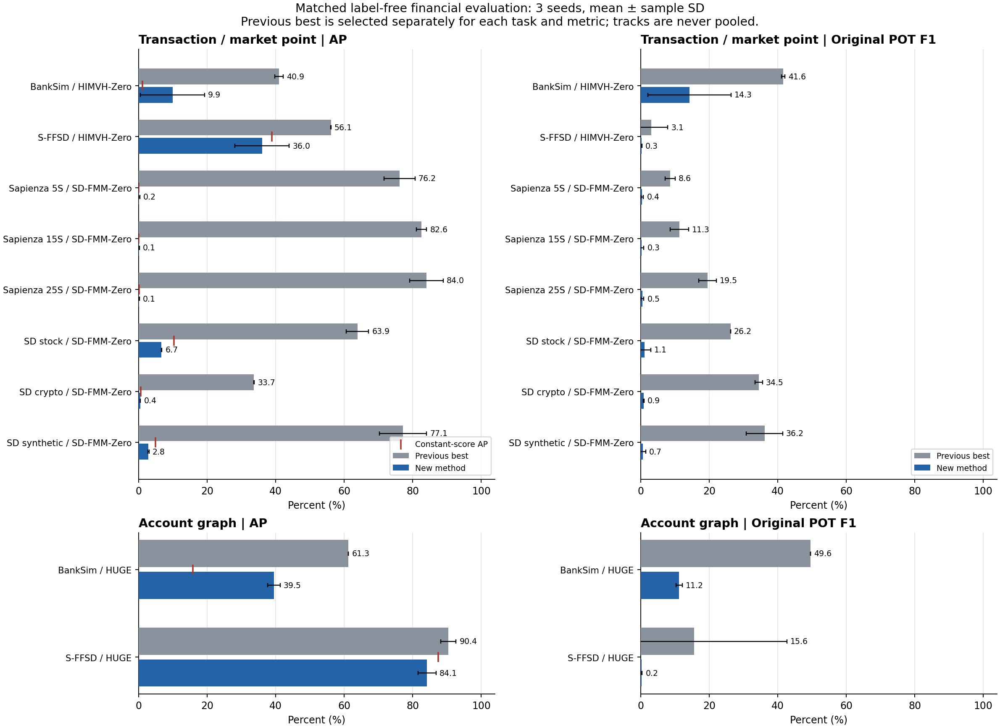

# HUGE、HIMVH-Zero、SD-FMM-Zero：零标签金融公平对比

日期：2026-11-17。全部30次正式运行、60条操作点记录已通过独立核验。数值为百分数，均值±三个种子的样本标准差。**新零标签适配成绩不等于原论文监督成绩，账户图与交易／行情任务分别排名。**

## 先看结论

| 轨道 | 数据集 | 本轮方法 | AP | 上轮最佳AP方法 | 上轮最佳AP | 差值（百分点） |
|---|---|---|---:|---|---:|---:|
| 账户图 | BankSim | HUGE金融归纳端口 | 39.48 | EB-GAD发布版零标签 | 61.25 | -21.77 |
| 账户图 | S-FFSD | HUGE金融归纳端口 | 84.13 | Audit-HCL零标签适配 | 90.38 | -6.25 |
| 交易／行情 | BankSim | HIMVH-Zero | 9.90 | HBOS | 40.92 | -31.02 |
| 交易／行情 | S-FFSD | HIMVH-Zero | 36.03 | HBOS | 56.11 | -20.08 |
| 交易／行情 | Sapienza 15S | SD-FMM-Zero | 0.10 | kNN | 82.56 | -82.46 |
| 交易／行情 | Sapienza 25S | SD-FMM-Zero | 0.14 | kNN | 84.01 | -83.88 |
| 交易／行情 | Sapienza 5S | SD-FMM-Zero | 0.18 | kNN | 76.16 | -75.97 |
| 交易／行情 | SD-FMM加密货币 | SD-FMM-Zero | 0.44 | 持续值残差对照（N+C） | 33.65 | -33.21 |
| 交易／行情 | SD-FMM股票 | SD-FMM-Zero | 6.68 | Isolation Forest | 63.85 | -57.17 |
| 交易／行情 | SD-FMM合成 | SD-FMM-Zero | 2.85 | RGLD-ID | 77.14 | -74.29 |

按全部可比方法的三种子均值分别排名：

- **HUGE金融归纳端口**：2个适用任务中，AP均值最高0个，原POT F1最高0个，q99 F1最高0个；不同指标分别计数。
- **HIMVH-Zero**：2个适用任务中，AP均值最高0个，原POT F1最高0个，q99 F1最高0个；不同指标分别计数。
- **SD-FMM-Zero**：6个适用任务中，AP均值最高0个，原POT F1最高0个，q99 F1最高0个；不同指标分别计数。

**重点看S-FFSD与Sapienza 15S。** S-FFSD交易级HIMVH-Zero：AP 36.03 ± 7.89%，ROC-AUC 48.11 ± 18.15%，原POT F1 0.30 ± 0.05%；Sapienza 15S的SD-FMM-Zero：AP 0.10 ± 0.13%，原POT F1 0.33 ± 0.57%。这些是零标签适配结果，不能与HIMVH原论文的有标签宏平均F1直接比较。

S-FFSD账户图HUGE：AP 84.13 ± 2.63%，ROC-AUC 42.14 ± 7.61%；已知账户异常占比为87.48%，常数分数也能得到同样占比的AP。因此必须同时看ROC-AUC、F1与误报率，不能仅凭较高AP判断分辨能力强。

AP比较说明排序能力，不依赖POT。上表没有将更有利的阈值当作排序改善。只有相同轨道、数据集和操作点才能比较；不跨任务平均，也不声称统计显著。



图中误差线是三个种子的样本标准差，不是置信区间；既有最佳分别按每个任务及指标选择。红色刻线表示常数分数的AP基线（异常占比）。[可导出的PDF图](comparison.pdf)。

## 方法与公平性

- **HUGE金融归纳端口**保留作者HALO、MLP/GCN、排序与非对称对齐及负邻居余弦评分；使用数据原生付款图（BankSim为模拟数据），训练后将权重迁移到校准／测试图。改变了原作者单图转导设定、图特征与归一化；排序抽样512，固定300更新。
- **HIMVH-Zero**独立实现论文多视图超图、新颖度及调制融合；不使用标签差异或标签传播，监督分类改成去噪重构。BankSim、S-FFSD各4个原生视图，window4、hidden256、3层，固定200更新。使用各阶段离线关系上下文，不能解释成在线实时系统。
- **SD-FMM-Zero**保留作者160长patch Transformer与13长对比支路；不使用真实标注异常片段，改用无标签小波扰动自产目标，不以验证F1挑模型。固定400更新，仅评分当前末行；取窗不跨组且不用目标之后的行。这里的因果性仅针对已发布特征数组，SD-FMM来源序列已由发布者处理，不声称原始行情预处理也在线因果。使用160步历史，信息范围大于逐行方法与Kronos32步。
- 沿用原训练抽样、校准抽样、全量测试、共同缩放器及未知标签处理。81个交易缓存文件和20个正式图文件逐一核验，所有新运行与旧AE基线索引／测试目标／缩放器一致。图仅评价原付款账户；不捏造资产序列或账户边。
- 既有共同交易榜单包含11月16日的15种评分／方法，并补入RGLD-ID与RTTAD-TTA的全部54条历史共同任务记录：旧轮81个输入摘要相同，训练／校准抽样规则、3种子、全量测试及阈值参数一致；历史均值／标准差由逐种子记录重算并对照已发布汇总。**这54条是复用已发布成绩，本轮没有重新训练或独立重放其全部旧分数。** RTTAD另读取最多8192条无标签测试特征自适应，RGLD为归纳版本；这些信息差异公开。来源固定为`bd9c5e8`，CardSim不属共同9任务而不纳入。
- 不确定性口径也统一：旧轮7种经典方法及RGLD/RTTAD原汇总采用总体标准差（ddof=0），最新版将三种子波动统一为样本标准差（ddof=1）；均值、分数、阈值、混淆计数和排名不因该换算改变。旧表原样保留，换算过程见审计CSV。
- 原POT（q=.85、risk=.01、至少20峰）和独立q99分别报告，POT失败记N/A，不采用Kronos专用护栏替换共同POT。指标为异常类、未经点调整；AP与梯形PR-AUC分列保存。
- 训练完全不使用真实标签，但源训练窗口可能含真实异常。相同划分不代表上下文、预训练、参数量和FLOPs完全一致。旧测试集已被先前研究查看，属于固定旧测试集上的回顾性扩展，不是新盲测。

9个共同任务来自5种数据来源，Sapienza的3种时间粒度不是3份独立原始数据；SD-FMM的股票、加密货币和合成子集也应分别说明。

ULB缺少原生账户关系与资产序列，本轮三方法均N/A。HUGE不用于逐笔交易排行；HIMVH不用于没有真实交易视图的行情序列；SD-FMM不把ULB/BankSim/S-FFSD全局行序强行当成单资产。N/A表示任务不兼容，不能当作0分或训练失败。完整设计、上游提交、公式歧义与适配见[固定协议](../../docs/recent_zero_protocol_CN.md)。

## 交易／行情轨道：完整对比

### ULB信用卡

已知测试92575行，异常115行，占比0.1242%；未知排除0行。

| 方法 | AP ↑ | ROC-AUC ↑ | 原POT F1 ↑ | q99 F1 ↑ | 原POT FPR ↓ |
|---|---:|---:|---:|---:|---:|
| Isolation Forest | 3.55 ± 0.84 | 93.62 ± 0.28 | 9.46 ± 1.78 | 9.82 ± 1.90 | 1.01 ± 0.03 |
| LOF | 0.86 ± 0.20 | 86.82 ± 1.18 | 1.74 ± 0.97 | 1.66 ± 1.19 | 1.81 ± 0.46 |
| kNN | 9.20 ± 0.15 | 94.56 ± 0.03 | 13.97 ± 0.10 | 14.16 ± 0.51 | 0.85 ± 0.00 |
| One-Class SVM | 7.91 ± 0.87 | 93.99 ± 0.09 | 14.58 ± 0.52 | 15.91 ± 0.50 | 0.99 ± 0.04 |
| PCA-SPE | **30.11 ± 14.42** | 89.29 ± 1.03 | **20.50 ± 3.80** | 17.26 ± 1.61 | 0.63 ± 0.07 |
| HBOS | 7.74 ± 0.42 | 93.75 ± 0.47 | 13.45 ± 0.03 | 14.00 ± 0.49 | 0.86 ± 0.01 |
| GMM | 10.94 ± 0.20 | 95.22 ± 0.30 | 15.80 ± 1.39 | 15.65 ± 0.74 | 0.74 ± 0.09 |
| AE | 5.60 ± 1.52 | 92.72 ± 0.22 | 12.93 ± 3.09 | 12.18 ± 2.71 | 0.68 ± 0.09 |
| VAE | 9.27 ± 1.82 | **95.57 ± 0.09** | 16.40 ± 1.27 | 17.03 ± 0.86 | 0.82 ± 0.06 |
| Deep SVDD | 0.43 ± 0.12 | 71.24 ± 0.83 | 1.63 ± 0.61 | 1.66 ± 0.55 | 1.02 ± 0.03 |
| CAE-IF核心适配 | 2.78 ± 0.52 | 93.02 ± 0.26 | 7.35 ± 1.45 | 6.62 ± 2.28 | 1.13 ± 0.07 |
| KronosAD-M | 12.09 ± 0.32 | 91.24 ± 0.64 | 13.73 ± 0.50 | 14.23 ± 0.64 | 0.80 ± 0.02 |
| KronosAD-S（N+C） | 12.09 ± 0.32 | 91.24 ± 0.64 | 13.72 ± 0.52 | 14.23 ± 0.64 | 0.80 ± 0.02 |
| 训练先验对照 | 6.64 ± 0.17 | 93.62 ± 0.01 | 12.17 ± 0.22 | 11.58 ± 0.12 | 0.77 ± 0.02 |
| 持续值残差对照（N+C） | 11.39 ± 0.39 | 90.32 ± 0.02 | 13.06 ± 0.13 | 13.91 ± 0.12 | 0.80 ± 0.00 |
| RGLD-ID | 3.34 ± 0.29 | 93.62 ± 0.43 | 8.92 ± 0.37 | 8.99 ± 0.55 | 0.89 ± 0.03 |
| RTTAD-TTA | 5.89 ± 1.19 | 94.29 ± 0.94 | 14.03 ± 2.30 | 13.96 ± 2.65 | 0.76 ± 0.06 |

### BankSim

已知测试118638行，异常1280行，占比1.0789%；未知排除0行。

| 方法 | AP ↑ | ROC-AUC ↑ | 原POT F1 ↑ | q99 F1 ↑ | 原POT FPR ↓ |
|---|---:|---:|---:|---:|---:|
| Isolation Forest | 9.67 ± 3.65 | 93.03 ± 0.12 | 5.93 ± 5.95 | 11.88 ± 6.44 | 0.18 ± 0.09 |
| LOF | 2.28 ± 0.30 | 64.44 ± 3.10 | 4.23 ± 1.44 | 4.18 ± 1.42 | 0.91 ± 0.02 |
| kNN | 27.07 ± 3.69 | 97.34 ± 0.17 | 29.07 ± 1.69 | 31.06 ± 2.23 | 1.37 ± 0.08 |
| One-Class SVM | 22.73 ± 1.75 | 95.12 ± 0.84 | 29.37 ± 1.41 | 27.25 ± 2.61 | 0.92 ± 0.10 |
| PCA-SPE | 15.78 ± 0.67 | 95.31 ± 0.14 | 25.15 ± 2.20 | 20.18 ± 5.79 | 0.91 ± 0.14 |
| HBOS | **40.92 ± 1.21** | 96.54 ± 0.11 | 40.11 ± 2.01 | 48.89 ± 0.60 | 0.15 ± 0.02 |
| GMM | 22.86 ± 4.61 | 91.98 ± 3.02 | 23.96 ± 3.80 | 29.40 ± 2.13 | 0.34 ± 0.18 |
| AE | 21.21 ± 3.74 | 97.28 ± 0.29 | 27.41 ± 4.00 | 25.75 ± 6.80 | 0.83 ± 0.37 |
| VAE | 39.61 ± 0.37 | **98.36 ± 0.16** | **41.61 ± 0.47** | 38.64 ± 3.96 | 0.85 ± 0.16 |
| Deep SVDD | 24.08 ± 2.44 | 97.06 ± 0.34 | 26.81 ± 2.09 | 26.75 ± 2.31 | 0.66 ± 0.08 |
| CAE-IF核心适配 | 20.68 ± 5.35 | 95.79 ± 0.27 | 8.88 ± 7.21 | 29.50 ± 8.99 | 0.27 ± 0.12 |
| KronosAD-M | 11.97 ± 0.41 | 76.73 ± 0.41 | 0.00 ± 0.00 | 14.17 ± 0.00 | 0.00 ± 0.00 |
| KronosAD-S（N+C） | 14.65 ± 1.09 | 81.94 ± 0.39 | 19.26 ± 1.30 | 18.69 ± 0.69 | 0.27 ± 0.05 |
| 训练先验对照 | 25.12 ± 0.76 | 90.45 ± 0.12 | 22.80 ± 0.61 | 22.70 ± 0.63 | 0.85 ± 0.02 |
| 持续值残差对照（N+C） | 2.72 ± 0.02 | 60.29 ± 0.03 | 0.00 ± 0.00 | 2.67 ± 0.00 | 0.00 ± 0.00 |
| RGLD-ID | 20.04 ± 3.81 | 95.36 ± 0.26 | 19.51 ± 4.04 | 24.35 ± 3.87 | 0.41 ± 0.11 |
| RTTAD-TTA | 18.06 ± 1.32 | 95.82 ± 0.79 | 24.68 ± 1.86 | 22.11 ± 1.31 | 0.86 ± 0.10 |
| HIMVH-Zero | 9.90 ± 9.36 | 47.55 ± 35.88 | 14.26 ± 12.11 | 14.11 ± 12.23 | 0.67 ± 0.25 |

### S-FFSD

已知测试6159行，异常2394行，占比38.8699%；未知排除9417行。

| 方法 | AP ↑ | ROC-AUC ↑ | 原POT F1 ↑ | q99 F1 ↑ | 原POT FPR ↓ |
|---|---:|---:|---:|---:|---:|
| Isolation Forest | 39.31 ± 5.39 | 53.64 ± 9.86 | 1.27 ± 1.43 | 1.42 ± 1.58 | 1.22 ± 0.44 |
| LOF | 32.64 ± 0.41 | 40.83 ± 1.42 | **3.08 ± 4.79** | 0.00 ± 0.00 | 20.18 ± 0.38 |
| kNN | 36.37 ± 0.41 | 49.86 ± 0.80 | 1.31 ± 0.23 | 1.47 ± 0.05 | 1.98 ± 0.22 |
| One-Class SVM | 50.48 ± 0.14 | 71.93 ± 0.15 | 1.18 ± 0.09 | 1.10 ± 0.04 | 2.10 ± 0.10 |
| PCA-SPE | 37.35 ± 0.40 | 52.93 ± 0.82 | 0.22 ± 0.38 | 0.27 ± 0.05 | 0.45 ± 0.74 |
| HBOS | **56.11 ± 0.04** | **72.99 ± 0.03** | 0.49 ± 0.08 | 0.87 ± 0.59 | 0.81 ± 0.06 |
| GMM | 45.16 ± 10.69 | 61.64 ± 18.46 | 0.41 ± 0.70 | 1.25 ± 1.31 | 0.92 ± 0.50 |
| AE | 37.93 ± 0.25 | 53.83 ± 0.45 | 1.17 ± 0.12 | 1.24 ± 0.04 | 1.33 ± 0.46 |
| VAE | 41.86 ± 0.29 | 59.50 ± 0.35 | 1.85 ± 0.00 | 1.85 ± 0.00 | 1.86 ± 0.07 |
| Deep SVDD | 34.81 ± 3.50 | 44.57 ± 7.31 | 0.19 ± 0.19 | 0.14 ± 0.09 | 0.72 ± 0.31 |
| CAE-IF核心适配 | 39.51 ± 2.21 | 55.91 ± 3.85 | 1.60 ± 0.13 | 1.58 ± 0.09 | 2.34 ± 0.36 |
| KronosAD-M | 35.38 ± 0.14 | 48.60 ± 0.21 | 0.58 ± 0.00 | 0.73 ± 0.00 | 0.53 ± 0.00 |
| KronosAD-S（N+C） | 32.77 ± 0.16 | 43.84 ± 0.36 | 0.41 ± 0.08 | 0.65 ± 0.00 | 0.67 ± 0.16 |
| 训练先验对照 | 33.44 ± 0.15 | 41.58 ± 0.43 | 0.24 ± 0.00 | 0.24 ± 0.00 | 1.46 ± 0.00 |
| 持续值残差对照（N+C） | 36.00 ± 0.00 | 50.96 ± 0.01 | 0.49 ± 0.00 | 0.41 ± 0.00 | 1.19 ± 0.02 |
| RGLD-ID | 42.29 ± 8.68 | 59.02 ± 13.98 | 0.33 ± 0.08 | 0.24 ± 0.16 | 1.53 ± 1.03 |
| RTTAD-TTA | 41.30 ± 2.07 | 59.36 ± 3.15 | 1.45 ± 0.20 | 1.45 ± 0.24 | 1.90 ± 0.52 |
| HIMVH-Zero | 36.03 ± 7.89 | 48.11 ± 18.15 | 0.30 ± 0.05 | 0.49 ± 0.28 | 1.39 ± 0.20 |

### Sapienza 5S

已知测试207267行，异常77行，占比0.0372%；未知排除0行。

| 方法 | AP ↑ | ROC-AUC ↑ | 原POT F1 ↑ | q99 F1 ↑ | 原POT FPR ↓ |
|---|---:|---:|---:|---:|---:|
| Isolation Forest | 59.89 ± 21.39 | **99.89 ± 0.03** | 5.76 ± 0.17 | 6.26 ± 0.11 | 1.20 ± 0.04 |
| LOF | 9.05 ± 1.28 | 99.44 ± 0.28 | 7.66 ± 0.64 | 6.76 ± 0.33 | 0.84 ± 0.08 |
| kNN | **76.16 ± 4.49** | 99.81 ± 0.15 | 5.70 ± 0.31 | 6.42 ± 0.39 | 1.19 ± 0.05 |
| One-Class SVM | 28.44 ± 11.29 | 99.82 ± 0.08 | 5.05 ± 0.19 | 6.43 ± 0.46 | 1.35 ± 0.02 |
| PCA-SPE | 26.14 ± 26.56 | 99.67 ± 0.17 | 6.04 ± 0.10 | 6.98 ± 0.21 | 1.08 ± 0.04 |
| HBOS | 73.18 ± 4.82 | 99.83 ± 0.11 | 6.15 ± 0.19 | 6.05 ± 0.32 | 1.09 ± 0.04 |
| GMM | 68.85 ± 6.08 | 99.86 ± 0.05 | **8.57 ± 1.45** | 6.10 ± 0.48 | 0.76 ± 0.17 |
| AE | 13.97 ± 14.18 | 99.29 ± 0.56 | 6.55 ± 0.86 | 7.12 ± 0.17 | 1.00 ± 0.18 |
| VAE | 49.07 ± 0.53 | 99.70 ± 0.27 | 6.60 ± 0.25 | 6.48 ± 0.72 | 0.99 ± 0.07 |
| Deep SVDD | 1.06 ± 0.53 | 95.82 ± 4.06 | 2.37 ± 0.72 | 2.44 ± 0.78 | 1.06 ± 0.07 |
| CAE-IF核心适配 | 27.87 ± 36.15 | 99.23 ± 0.69 | 5.30 ± 0.63 | 6.18 ± 0.59 | 1.26 ± 0.24 |
| KronosAD-M | 0.92 ± 0.26 | 95.00 ± 1.11 | 0.79 ± 0.00 | 0.74 ± 0.32 | 2.29 ± 0.00 |
| KronosAD-S（N+C） | 10.54 ± 6.66 | 97.20 ± 1.07 | 7.24 ± 1.53 | 4.94 ± 0.64 | 0.57 ± 0.02 |
| 训练先验对照 | 24.68 ± 23.40 | 99.78 ± 0.07 | 7.56 ± 4.92 | 6.82 ± 0.26 | 1.12 ± 0.59 |
| 持续值残差对照（N+C） | 10.90 ± 6.40 | 96.20 ± 0.97 | 6.79 ± 1.22 | 4.79 ± 0.57 | 0.59 ± 0.02 |
| RGLD-ID | 66.95 ± 4.80 | 99.81 ± 0.11 | 5.39 ± 0.34 | 5.80 ± 0.51 | 1.28 ± 0.09 |
| RTTAD-TTA | 28.25 ± 6.29 | 99.82 ± 0.09 | 6.70 ± 0.81 | 7.17 ± 0.17 | 0.99 ± 0.14 |
| SD-FMM-Zero | 0.18 ± 0.14 | 59.19 ± 31.26 | 0.43 ± 0.35 | 0.47 ± 0.37 | 1.02 ± 0.10 |

### Sapienza 15S

已知测试145550行，异常77行，占比0.0529%；未知排除0行。

| 方法 | AP ↑ | ROC-AUC ↑ | 原POT F1 ↑ | q99 F1 ↑ | 原POT FPR ↓ |
|---|---:|---:|---:|---:|---:|
| Isolation Forest | 21.11 ± 14.90 | 99.77 ± 0.09 | 8.18 ± 0.09 | 9.65 ± 0.12 | 1.16 ± 0.03 |
| LOF | 1.92 ± 0.41 | 98.51 ± 0.29 | 3.84 ± 1.16 | 4.31 ± 1.95 | 0.91 ± 0.06 |
| kNN | **82.56 ± 1.49** | **99.94 ± 0.02** | 8.98 ± 0.84 | 9.84 ± 0.26 | 1.06 ± 0.11 |
| One-Class SVM | 20.47 ± 18.41 | 99.76 ± 0.09 | 7.01 ± 0.45 | 9.73 ± 0.31 | 1.40 ± 0.10 |
| PCA-SPE | 14.37 ± 9.89 | 99.63 ± 0.13 | 9.58 ± 0.84 | 9.89 ± 0.40 | 0.97 ± 0.11 |
| HBOS | 61.94 ± 6.81 | 99.86 ± 0.05 | 9.47 ± 0.65 | 9.88 ± 0.29 | 0.99 ± 0.09 |
| GMM | 77.78 ± 1.45 | 99.92 ± 0.02 | **11.26 ± 2.69** | 9.01 ± 0.05 | 0.85 ± 0.27 |
| AE | 5.43 ± 0.72 | 99.51 ± 0.05 | 9.65 ± 0.32 | 10.10 ± 0.17 | 0.94 ± 0.03 |
| VAE | 34.08 ± 10.15 | 99.88 ± 0.03 | 8.74 ± 0.33 | 9.44 ± 0.26 | 1.08 ± 0.04 |
| Deep SVDD | 3.75 ± 3.61 | 98.13 ± 0.45 | 4.68 ± 1.95 | 4.83 ± 2.30 | 1.12 ± 0.03 |
| CAE-IF核心适配 | 30.48 ± 23.41 | 99.68 ± 0.19 | 6.60 ± 0.77 | 9.23 ± 0.41 | 1.48 ± 0.16 |
| KronosAD-M | 0.96 ± 0.03 | 94.60 ± 0.59 | 1.37 ± 0.06 | 1.34 ± 0.03 | 2.74 ± 0.13 |
| KronosAD-S（N+C） | 13.91 ± 4.87 | 97.60 ± 0.09 | 9.35 ± 0.87 | 7.71 ± 0.55 | 0.67 ± 0.07 |
| 训练先验对照 | 27.45 ± 9.67 | 99.87 ± 0.02 | 7.29 ± 0.95 | 10.37 ± 0.44 | 1.36 ± 0.18 |
| 持续值残差对照（N+C） | 13.83 ± 4.50 | 95.51 ± 1.06 | 9.92 ± 1.13 | 7.51 ± 0.51 | 0.61 ± 0.07 |
| RGLD-ID | 66.98 ± 9.10 | 99.90 ± 0.02 | 8.24 ± 0.60 | 8.86 ± 0.60 | 1.15 ± 0.08 |
| RTTAD-TTA | 6.12 ± 1.35 | 99.58 ± 0.12 | 9.48 ± 0.46 | 10.13 ± 0.18 | 0.97 ± 0.04 |
| SD-FMM-Zero | 0.10 ± 0.13 | 31.72 ± 29.25 | 0.33 ± 0.57 | 0.30 ± 0.51 | 1.38 ± 0.49 |

### Sapienza 25S

已知测试119469行，异常77行，占比0.0645%；未知排除0行。

| 方法 | AP ↑ | ROC-AUC ↑ | 原POT F1 ↑ | q99 F1 ↑ | 原POT FPR ↓ |
|---|---:|---:|---:|---:|---:|
| Isolation Forest | 27.48 ± 10.56 | 99.82 ± 0.04 | 10.95 ± 0.24 | 13.15 ± 0.29 | 1.02 ± 0.03 |
| LOF | 8.40 ± 9.71 | 98.61 ± 0.40 | 7.04 ± 4.78 | 6.49 ± 4.41 | 0.84 ± 0.06 |
| kNN | **84.01 ± 4.88** | 99.89 ± 0.08 | 13.81 ± 0.53 | 13.57 ± 0.53 | 0.79 ± 0.04 |
| One-Class SVM | 26.17 ± 17.54 | 99.78 ± 0.08 | 10.22 ± 0.38 | 13.34 ± 0.66 | 1.11 ± 0.05 |
| PCA-SPE | 50.08 ± 22.94 | 99.87 ± 0.05 | 12.63 ± 0.38 | 12.79 ± 0.70 | 0.86 ± 0.03 |
| HBOS | 65.57 ± 9.04 | 99.75 ± 0.22 | 13.47 ± 0.59 | 13.61 ± 0.40 | 0.82 ± 0.04 |
| GMM | 83.59 ± 2.59 | **99.94 ± 0.01** | **19.51 ± 2.58** | 12.40 ± 0.11 | 0.52 ± 0.08 |
| AE | 34.81 ± 37.51 | 99.77 ± 0.19 | 12.03 ± 0.17 | 12.89 ± 0.58 | 0.91 ± 0.04 |
| VAE | 54.78 ± 26.56 | 99.75 ± 0.24 | 13.58 ± 0.22 | 13.50 ± 1.04 | 0.79 ± 0.01 |
| Deep SVDD | 2.62 ± 0.99 | 97.32 ± 0.38 | 5.63 ± 1.50 | 6.27 ± 2.03 | 1.01 ± 0.04 |
| CAE-IF核心适配 | 59.53 ± 17.16 | 99.49 ± 0.49 | 7.76 ± 0.50 | 10.85 ± 1.07 | 1.46 ± 0.05 |
| KronosAD-M | 1.30 ± 0.08 | 96.18 ± 0.64 | 1.74 ± 0.19 | 1.60 ± 0.00 | 2.63 ± 0.28 |
| KronosAD-S（N+C） | 41.80 ± 18.89 | 99.04 ± 0.33 | 12.51 ± 0.96 | 12.18 ± 0.60 | 0.74 ± 0.03 |
| 训练先验对照 | 57.43 ± 19.53 | 99.93 ± 0.01 | 10.74 ± 0.10 | 14.43 ± 0.06 | 1.06 ± 0.01 |
| 持续值残差对照（N+C） | 39.20 ± 20.86 | 98.45 ± 0.59 | 13.57 ± 1.58 | 11.90 ± 1.06 | 0.65 ± 0.03 |
| RGLD-ID | 73.26 ± 6.24 | 99.82 ± 0.11 | 10.93 ± 1.14 | 11.97 ± 1.00 | 1.02 ± 0.10 |
| RTTAD-TTA | 35.44 ± 16.55 | 99.83 ± 0.03 | 12.94 ± 1.27 | 13.35 ± 0.74 | 0.84 ± 0.08 |
| SD-FMM-Zero | 0.14 ± 0.09 | 49.97 ± 23.27 | 0.48 ± 0.43 | 0.51 ± 0.46 | 1.77 ± 0.06 |

### SD-FMM股票

已知测试960行，异常99行，占比10.3125%；未知排除0行。

| 方法 | AP ↑ | ROC-AUC ↑ | 原POT F1 ↑ | q99 F1 ↑ | 原POT FPR ↓ |
|---|---:|---:|---:|---:|---:|
| Isolation Forest | **63.85 ± 3.27** | 91.64 ± 0.37 | 12.05 ± 7.84 | 10.72 ± 10.68 | 0.35 ± 0.00 |
| LOF | 13.20 ± 0.00 | 57.78 ± 0.00 | 0.00 ± 0.00 | 0.00 ± 0.00 | 0.58 ± 0.00 |
| kNN | 57.67 ± 0.00 | 91.92 ± 0.00 | 17.09 ± 0.00 | 14.16 ± 0.00 | 0.93 ± 0.00 |
| One-Class SVM | 51.56 ± 0.00 | 86.26 ± 0.00 | **26.23 ± 0.00** | 26.23 ± 0.00 | 0.81 ± 0.00 |
| PCA-SPE | 28.59 ± 0.00 | 82.85 ± 0.00 | 0.00 ± 0.00 | 3.70 ± 0.00 | 0.58 ± 0.00 |
| HBOS | 63.41 ± 0.00 | 92.37 ± 0.00 | 5.83 ± 0.00 | 5.83 ± 0.00 | 0.12 ± 0.00 |
| GMM | 55.58 ± 0.03 | 90.55 ± 0.01 | 14.97 ± 0.96 | 7.55 ± 0.00 | 0.46 ± 0.00 |
| AE | 42.07 ± 2.58 | 84.52 ± 0.60 | 18.95 ± 3.29 | 21.19 ± 1.34 | 0.70 ± 0.12 |
| VAE | 62.36 ± 0.68 | 92.55 ± 0.23 | 22.59 ± 2.46 | 22.14 ± 2.66 | 0.66 ± 0.13 |
| Deep SVDD | 24.18 ± 2.96 | 67.18 ± 2.94 | 15.25 ± 5.95 | 17.24 ± 6.54 | 1.16 ± 0.61 |
| CAE-IF核心适配 | 51.99 ± 5.75 | 90.30 ± 1.10 | 13.11 ± 2.11 | 13.19 ± 2.17 | 0.58 ± 0.42 |
| KronosAD-M | 11.41 ± 0.29 | 51.78 ± 1.70 | 1.72 ± 0.00 | 0.00 ± 0.00 | 1.86 ± 0.00 |
| KronosAD-S（N+C） | 25.56 ± 0.20 | 67.71 ± 0.66 | 5.63 ± 0.03 | 5.64 ± 0.03 | 0.54 ± 0.07 |
| 训练先验对照 | 48.75 ± 0.00 | 89.23 ± 0.00 | 11.21 ± 0.00 | 11.21 ± 0.00 | 0.23 ± 0.00 |
| 持续值残差对照（N+C） | 26.54 ± 0.00 | 68.18 ± 0.00 | 3.77 ± 0.00 | 5.61 ± 0.00 | 0.58 ± 0.00 |
| RGLD-ID | 62.77 ± 2.31 | **92.69 ± 0.15** | 10.62 ± 0.95 | 14.68 ± 3.40 | 0.23 ± 0.12 |
| RTTAD-TTA | 38.70 ± 9.55 | 84.83 ± 3.29 | 10.27 ± 8.78 | 9.71 ± 8.05 | 0.27 ± 0.13 |
| SD-FMM-Zero | 6.68 ± 0.06 | 26.77 ± 2.62 | 1.07 ± 1.85 | 1.47 ± 1.57 | 2.86 ± 2.44 |

### SD-FMM加密货币

已知测试10880行，异常68行，占比0.6250%；未知排除0行。

| 方法 | AP ↑ | ROC-AUC ↑ | 原POT F1 ↑ | q99 F1 ↑ | 原POT FPR ↓ |
|---|---:|---:|---:|---:|---:|
| Isolation Forest | 25.12 ± 5.90 | **97.50 ± 0.32** | 29.57 ± 9.90 | 29.73 ± 8.45 | 0.34 ± 0.08 |
| LOF | 3.20 ± 1.62 | 41.39 ± 2.04 | 8.33 ± 7.22 | 11.26 ± 4.25 | 0.38 ± 0.18 |
| kNN | 2.46 ± 0.65 | 79.55 ± 2.57 | 3.87 ± 1.23 | 3.91 ± 0.77 | 0.77 ± 0.05 |
| One-Class SVM | 4.33 ± 0.66 | 84.80 ± 2.13 | 4.55 ± 0.09 | 3.81 ± 0.06 | 0.96 ± 0.03 |
| PCA-SPE | 1.65 ± 0.12 | 78.63 ± 1.00 | 0.00 ± 0.00 | 0.00 ± 0.00 | 0.96 ± 0.06 |
| HBOS | 3.89 ± 0.28 | 91.68 ± 0.45 | 0.57 ± 0.99 | 1.54 ± 2.67 | 0.41 ± 0.03 |
| GMM | 9.97 ± 1.07 | 95.93 ± 0.27 | 12.66 ± 1.06 | 14.35 ± 2.01 | 1.01 ± 0.04 |
| AE | 2.36 ± 0.60 | 81.48 ± 1.01 | 2.49 ± 4.32 | 2.56 ± 4.44 | 1.21 ± 0.06 |
| VAE | 16.23 ± 4.40 | 97.29 ± 0.49 | 12.34 ± 6.39 | 21.87 ± 8.33 | 0.41 ± 0.06 |
| Deep SVDD | 0.48 ± 0.02 | 39.41 ± 4.09 | 0.00 ± 0.00 | 0.00 ± 0.00 | 1.16 ± 0.05 |
| CAE-IF核心适配 | 17.94 ± 9.51 | 95.80 ± 1.14 | 21.06 ± 18.30 | 22.78 ± 18.48 | 0.43 ± 0.16 |
| KronosAD-M | 8.46 ± 0.21 | 94.75 ± 0.36 | 0.00 ± 0.00 | 0.00 ± 0.00 | 1.31 ± 0.00 |
| KronosAD-S（N+C） | 33.16 ± 0.94 | 96.65 ± 0.46 | **34.46 ± 1.09** | 34.52 ± 1.55 | 0.59 ± 0.02 |
| 训练先验对照 | 16.49 ± 0.36 | 96.44 ± 0.27 | 0.00 ± 0.00 | 0.00 ± 0.00 | 0.32 ± 0.05 |
| 持续值残差对照（N+C） | **33.65 ± 0.08** | 96.70 ± 0.03 | 33.84 ± 1.19 | 34.66 ± 0.12 | 0.55 ± 0.01 |
| RGLD-ID | 16.08 ± 4.43 | 96.66 ± 0.29 | 17.68 ± 7.28 | 20.35 ± 7.06 | 0.26 ± 0.18 |
| RTTAD-TTA | 3.04 ± 1.00 | 85.00 ± 6.33 | 2.91 ± 4.14 | 3.02 ± 4.31 | 1.05 ± 0.05 |
| SD-FMM-Zero | 0.44 ± 0.09 | 25.18 ± 10.45 | 0.89 ± 0.08 | 1.01 ± 0.10 | 1.45 ± 0.19 |

### SD-FMM合成

已知测试32000行，异常1589行，占比4.9656%；未知排除0行。

| 方法 | AP ↑ | ROC-AUC ↑ | 原POT F1 ↑ | q99 F1 ↑ | 原POT FPR ↓ |
|---|---:|---:|---:|---:|---:|
| Isolation Forest | 72.39 ± 2.09 | 96.06 ± 0.10 | 13.29 ± 2.36 | 21.75 ± 2.01 | 0.12 ± 0.01 |
| LOF | 6.15 ± 0.67 | 53.47 ± 2.59 | 2.39 ± 0.39 | 2.68 ± 0.50 | 0.56 ± 0.02 |
| kNN | 48.42 ± 1.04 | 94.56 ± 0.06 | 9.52 ± 0.21 | 14.69 ± 0.38 | 0.17 ± 0.02 |
| One-Class SVM | 32.57 ± 1.50 | 82.90 ± 1.66 | 11.12 ± 0.89 | 12.01 ± 0.73 | 0.32 ± 0.02 |
| PCA-SPE | 39.24 ± 1.42 | 92.67 ± 0.23 | 13.91 ± 1.40 | 14.55 ± 0.87 | 0.33 ± 0.02 |
| HBOS | 62.89 ± 0.77 | 96.01 ± 0.05 | 15.53 ± 0.22 | 17.93 ± 0.52 | 0.14 ± 0.01 |
| GMM | 36.44 ± 8.06 | 92.40 ± 0.27 | 13.72 ± 10.48 | 11.88 ± 8.12 | 0.42 ± 0.02 |
| AE | 24.47 ± 2.13 | 88.57 ± 1.39 | 7.52 ± 1.91 | 7.45 ± 2.05 | 0.57 ± 0.07 |
| VAE | 57.22 ± 2.59 | 95.23 ± 0.13 | 8.13 ± 0.82 | 15.09 ± 1.60 | 0.21 ± 0.02 |
| Deep SVDD | 6.13 ± 0.97 | 52.51 ± 2.63 | 4.42 ± 1.84 | 5.11 ± 2.04 | 0.44 ± 0.04 |
| CAE-IF核心适配 | 69.32 ± 4.06 | 95.32 ± 0.78 | **36.16 ± 5.30** | 29.12 ± 1.59 | 0.17 ± 0.01 |
| KronosAD-M | 15.22 ± 0.12 | 78.85 ± 0.35 | 0.60 ± 0.00 | 0.45 ± 0.06 | 1.30 ± 0.00 |
| KronosAD-S（N+C） | 35.63 ± 0.18 | 85.44 ± 0.36 | 14.83 ± 0.45 | 14.71 ± 0.35 | 0.44 ± 0.00 |
| 训练先验对照 | 59.50 ± 0.27 | 93.63 ± 0.12 | 6.46 ± 0.05 | 42.20 ± 0.72 | 0.33 ± 0.01 |
| 持续值残差对照（N+C） | 38.29 ± 0.06 | 87.30 ± 0.04 | 14.29 ± 0.06 | 14.12 ± 0.17 | 0.44 ± 0.00 |
| RGLD-ID | **77.14 ± 6.88** | **96.57 ± 0.22** | 20.27 ± 7.24 | 27.03 ± 4.68 | 0.07 ± 0.07 |
| RTTAD-TTA | 26.36 ± 4.58 | 89.63 ± 1.34 | 8.59 ± 3.46 | 8.51 ± 3.68 | 0.54 ± 0.12 |
| SD-FMM-Zero | 2.85 ± 0.18 | 16.00 ± 2.61 | 0.68 ± 0.79 | 0.80 ± 0.81 | 0.94 ± 0.25 |

## 账户图轨道：完整对比

### BankSim账户图

已知测试4082个付款账户，异常占比15.87%；未知排除0。账户标签是阶段内交易聚合代理，不等于司法确认账户。

| 方法 | AP ↑ | ROC-AUC ↑ | 原POT F1 ↑ | q99 F1 ↑ | 原POT FPR ↓ |
|---|---:|---:|---:|---:|---:|
| Isolation Forest | 37.05 ± 1.26 | 72.36 ± 1.42 | 3.39 ± 0.73 | 4.16 ± 0.50 | 0.23 ± 0.05 |
| AE | 55.02 ± 3.42 | 79.80 ± 2.44 | 12.61 ± 0.64 | 13.59 ± 0.95 | 0.03 ± 0.03 |
| PCA-SPE | 26.73 ± 0.00 | 66.22 ± 0.00 | 7.79 ± 0.00 | 8.55 ± 0.00 | 1.25 ± 0.00 |
| CAE-IF核心适配 | 37.32 ± 10.90 | 69.02 ± 7.92 | 5.46 ± 1.40 | 6.38 ± 2.25 | 0.41 ± 0.36 |
| EB-GAD发布版零标签 | **61.25 ± 0.00** | **89.85 ± 0.00** | **49.60 ± 0.00** | 46.96 ± 0.00 | 36.49 ± 0.00 |
| Audit-HCL零标签适配 | 29.97 ± 1.60 | 61.04 ± 1.31 | 0.00 ± 0.00 | 4.19 ± 1.90 | 0.00 ± 0.00 |
| HUGE金融归纳端口 | 39.48 ± 1.82 | 66.03 ± 1.34 | 11.24 ± 0.88 | 10.51 ± 0.97 | 0.03 ± 0.00 |

### S-FFSD账户图

已知测试1070个付款账户，异常占比87.48%；未知排除3026。账户标签是阶段内交易聚合代理，不等于司法确认账户。

| 方法 | AP ↑ | ROC-AUC ↑ | 原POT F1 ↑ | q99 F1 ↑ | 原POT FPR ↓ |
|---|---:|---:|---:|---:|---:|
| Isolation Forest | 82.75 ± 0.61 | 37.12 ± 1.92 | 3.48 ± 0.43 | 3.21 ± 0.12 | 2.74 ± 0.43 |
| AE | 86.03 ± 0.19 | 51.29 ± 1.09 | 4.30 ± 0.77 | 4.24 ± 0.47 | 2.49 ± 0.43 |
| PCA-SPE | 85.86 ± 0.00 | 50.26 ± 0.00 | 3.97 ± 0.00 | 3.97 ± 0.00 | 2.24 ± 0.00 |
| CAE-IF核心适配 | 84.03 ± 0.46 | 40.73 ± 2.10 | 2.67 ± 0.24 | 3.22 ± 0.31 | 1.24 ± 0.86 |
| EB-GAD发布版零标签 | 77.59 ± 0.00 | 16.18 ± 0.00 | 8.72 ± 0.00 | 9.26 ± 0.00 | 5.22 ± 0.00 |
| Audit-HCL零标签适配 | **90.38 ± 2.22** | **58.17 ± 11.76** | **15.63 ± 27.07** | 47.78 ± 0.91 | 3.23 ± 4.37 |
| HUGE金融归纳端口 | 84.13 ± 2.63 | 42.14 ± 7.61 | 0.21 ± 0.21 | 0.21 ± 0.21 | 1.99 ± 0.43 |

## 各任务的最佳方法

| 轨道 | 数据集 | AP最佳 | 原POT F1最佳 | q99 F1最佳 |
|---|---|---|---|---|
| 交易／行情 | ULB信用卡 | PCA-SPE 30.11 | PCA-SPE 20.50 | PCA-SPE 17.26 |
| 交易／行情 | BankSim | HBOS 40.92 | VAE 41.61 | HBOS 48.89 |
| 交易／行情 | S-FFSD | HBOS 56.11 | LOF 3.08 | VAE 1.85 |
| 交易／行情 | Sapienza 5S | kNN 76.16 | GMM 8.57 | RTTAD-TTA 7.17 |
| 交易／行情 | Sapienza 15S | kNN 82.56 | GMM 11.26 | 训练先验对照 10.37 |
| 交易／行情 | Sapienza 25S | kNN 84.01 | GMM 19.51 | 训练先验对照 14.43 |
| 交易／行情 | SD-FMM股票 | Isolation Forest 63.85 | One-Class SVM 26.23 | One-Class SVM 26.23 |
| 交易／行情 | SD-FMM加密货币 | 持续值残差对照（N+C） 33.65 | KronosAD-S（N+C） 34.46 | 持续值残差对照（N+C） 34.66 |
| 交易／行情 | SD-FMM合成 | RGLD-ID 77.14 | CAE-IF核心适配 36.16 | 训练先验对照 42.20 |
| 账户图 | BankSim | EB-GAD发布版零标签 61.25 | EB-GAD发布版零标签 49.60 | EB-GAD发布版零标签 46.96 |
| 账户图 | S-FFSD | Audit-HCL零标签适配 90.38 | Audit-HCL零标签适配 15.63 | Audit-HCL零标签适配 47.78 |

## 如何解释新方法的不足

本轮原POT拟合成功30/30；三种方法在原POT与q99下都未获任务F1第一。差距不能全部归因于POT拟合，阈值无关的排序／适配目标也需要检查。保存分数均为有限且有变化的数值，检查点重载通过，未发现全部输出常数的数值崩溃。

以下是由目标、数据与分数诊断支持的解释或机制假设；本轮没有进行逐项消融，不能当作已证明的因果结论。

1. **零标签目标发生了实质改变。** HIMVH原本依靠分类损失、标签差异／传播学习欺诈，零标签重构更容易关注常见交易特征；异常也可能被准确重构。其原论文监督高分不能预期直接保留。SD-FMM原发布代码使用标注目标和按标签片段训练，本轮只学习泛化小波扰动；合成容易识别不代表真实欺诈也相似。独立扰动所有工程通道还可能破坏时间编码和衍生特征的约束，模型可能识别合成痕迹而非操纵；需保留字段约束的生成器消融进一步验证。
2. **HUGE的图假设可能与角色图不一致。** 图边连接付款方和收款方，两端角色和交易统计天然不同，HALO可能主要反映业务角色而非欺诈。归纳跨阶段还存在分布变化。该机制解释需角色／特征消融验证，不能仅凭一次成绩认定。
3. **异常不是统一的“稀有离群点”。** S-FFSD已知测试交易异常占比约38.87%，已知测试付款账户异常占比约87.48%。这些与原图欺诈方法假定正常占多数的情景不同；未知样本参与无标签训练和校准，但最终只评估已知样本，也会改变被评价子集的分布。
4. **POT与排序能力是两个问题。** 固定1%风险及尾部分布拟合未必对应测试异常比例，校准到测试的分数漂移可造成低召回或误报；AP较高、F1较低并不矛盾。下面公布阈值成功率和实际校准报警率，不能只看拟合成功。
5. **训练预算和适配范围有限。** 200/300/400更新是固定预算，不是原论文完整epoch或超参搜索；本轮不能证明方法经过充分调优仍劣于经典基线，也不会用测试标签补调后再报告同一次实验。

HIMVH还有可量化的上下文差异：BankSim seed42的付款方视图，训练8192个抽样交易仅形成1166个超边（每节点0.142个），完整测试118638行形成106496个超边（每节点0.898个）。同样的训练目标预算使身份视图训练图更稀疏，可能影响跨阶段迁移；本轮未用额外全量训练上下文或邻居采样消融验证这一点。其他视图／种子计数保存在逐种子记录中。

### 阈值与资源诊断

| 任务／方法 | 原POT成功 | 校准POT报警率范围 | 校准q99报警率范围 | 平均运行秒数 | 最大CUDA分配GB |
|---|---:|---:|---:|---:|---:|
| BankSim／HUGE金融归纳端口／graph | 3/3 | 1.105–1.252% | 1.007–1.007% | 15.0 | 0.53 |
| S-FFSD／HUGE金融归纳端口／graph | 3/3 | 1.001–1.074% | 1.001–1.001% | 3.6 | 0.11 |
| BankSim／HIMVH-Zero／tabular | 3/3 | 0.489–1.179% | 1.000–1.000% | 40.2 | 1.85 |
| S-FFSD／HIMVH-Zero／tabular | 3/3 | 0.873–1.181% | 1.002–1.002% | 29.5 | 1.85 |
| Sapienza 15S／SD-FMM-Zero／tabular | 3/3 | 0.956–1.258% | 1.000–1.000% | 10.1 | 0.04 |
| Sapienza 25S／SD-FMM-Zero／tabular | 3/3 | 1.157–1.223% | 1.001–1.001% | 9.5 | 0.04 |
| Sapienza 5S／SD-FMM-Zero／tabular | 3/3 | 0.967–1.063% | 1.000–1.000% | 11.8 | 0.04 |
| SD-FMM加密货币／SD-FMM-Zero／tabular | 3/3 | 1.054–1.343% | 1.007–1.007% | 6.7 | 0.04 |
| SD-FMM股票／SD-FMM-Zero／tabular | 3/3 | 0.875–0.875% | 1.000–1.000% | 6.4 | 0.04 |
| SD-FMM合成／SD-FMM-Zero／tabular | 3/3 | 0.800–1.100% | 1.000–1.000% | 7.3 | 0.04 |

运行秒数包含本轮各自的数据加载、拟合、重载检查和全量评分；不是等硬件、等信息量的速度排行。训练首末损失及分数范围／标准差、GPD形状、阈值见CSV。

## 复核与文件

正式科学源码：`bff38e70725f67092feface4c6f9753cf76f8569`。本轮未按金融测试结果选择任何超参数或分数方向。

- [逐种子完整记录](per_seed.json)、[60条操作点指标](metrics.csv)、[方法汇总](summary.csv)。
- [交易全方法汇总](combined_transaction_summary.csv)、[账户图全方法汇总](combined_account_graph_summary.csv)、[最佳方法](best_methods.csv)。
- [阈值审计](threshold_audit.csv)、[训练与资源](training_resources.csv)、[独立核验](verification.json)、[输入摘要](input_files_sha256.json)、[运行环境](run_manifest.json)。
- [模型及逐点分数索引与SHA256](model_score_index.csv)。完整文件可用 `cq fetch j-1117-527aac` 取回；CQ运行、门禁、测试和归档说明见[执行记录](execution.json)。
- [两种历史近期方法的逐种子记录及来源](historical_recent_reference.json)、[重算汇总](historical_recent_summary.csv)；不把复用历史结果计入本轮30次新运行。
- [旧经典方法标准差口径换算](historical_uncertainty_audit.csv)：只统一不确定性表示，不改任何历史均值。
- 大型模型和分数保存在CQ输出及本地实验归档，不将二进制模型混入Git。复核命令如下；需完整分数／检查点和上一轮正式输出。

```bash
pip install -e ".[recent2026,test]"
PYTHONPATH=. python scripts/verify_recent_zero.py --runs /path/to/new/results \
  --data /path/to/new/inputs/tabular --graphs /path/to/new/inputs/graphs \
  --old-runs /path/to/j-1114-2e8178/results
PYTHONPATH=. python scripts/report_recent_zero.py --runs /path/to/new/results \
  --output results/recent_zero_20261117
```

## Plain English

We evaluated a financial inductive HUGE port and explicit label-free adaptations of HIMVH and SD-FMM. All 30 seeded runs use the previous evaluation cohorts and shared preprocessing. Transaction/market-point and payer-account graph tasks are separate. HIMVH reconstruction and SD-FMM synthetic corruption change the original supervised objectives; these results do not reproduce the papers’ supervised claims. Exact input fingerprints, checkpoints, scores and independently replayed metrics are retained. Different history, graph and pretraining budgets remain disclosed limitations.
