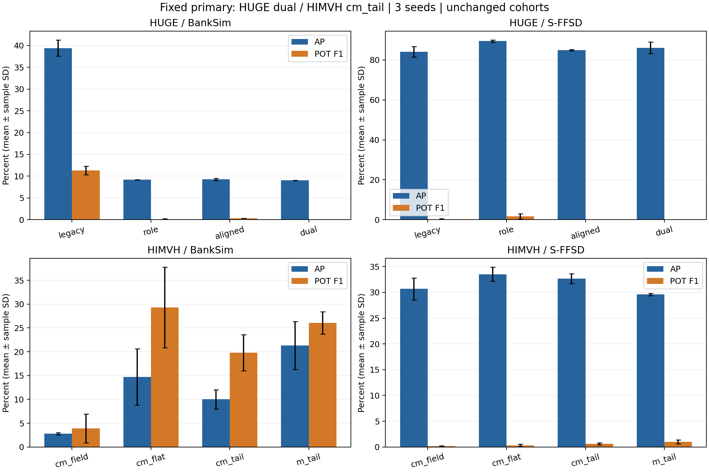

# HUGE 角色适配与 HIMVH 字段评分改进：中文实验报告

本轮48次HUGE新训练、96组HIMVH冻结骨干重评分，共144配置／288条操作点／96条三种子消融汇总。主方案在新成绩产生前固定为 **HUGE-dual** 和 **HIMVH-cm-tail**。训练与字段权重不使用真实标签，POT和q99也不使用标签。沿用相同输入、划分、测试样本和评价标准。**使用旧测试集诊断后继续开发，属于回顾性评估，不是独立盲测。**

## 主结论

百分数，均值±样本标准差；AP差值单位为百分点。AP评价排序，F1/FPR评价既定阈值；不能以高AP替代可用的报警效果。

| 轨道／任务 | 方法 | 上轮对应主版本AP | 新主方案AP | AP差值 | 上轮POT F1 | 新POT F1 | 新q99 F1 |
|---|---|---:|---:|---:|---:|---:|---:|
| graph／BankSim | HUGE | 9.18 ± 0.04 | 9.05 ± 0.04 | -0.13 | 0.09 ± 0.16 | 0.00 ± 0.00 | 0.10 ± 0.17 |
| graph／S-FFSD | HUGE | 89.41 ± 0.57 | 86.10 ± 2.85 | -3.30 | 1.75 ± 1.33 | 0.00 ± 0.00 | 0.00 ± 0.00 |
| tabular／BankSim | HIMVH | 2.78 ± 0.23 | 10.01 ± 2.03 | +7.23 | 3.90 ± 3.03 | 19.79 ± 3.79 | 20.97 ± 1.51 |
| tabular／S-FFSD | HIMVH | 30.66 ± 2.14 | 32.66 ± 0.97 | +2.00 | 0.16 ± 0.08 | 0.62 ± 0.17 | 0.54 ± 0.20 |

**HUGE：** AP较上轮对应主版本改善0/2任务；共同方法池中，AP均值最高0/2，POT F1最高0/2，q99 F1最高0/2。仅为均值排名，不代表显著性。

**HIMVH：** AP较上轮对应主版本改善2/2任务；共同方法池中，AP均值最高0/2，POT F1最高0/2，q99 F1最高0/2。仅为均值排名，不代表显著性。

上表HUGE使用本轮重训role锚点代表上一轮主方案，以控制环境差异；HIMVH使用与上一轮逐项一致的cm_field冻结模型对照。旧法legacy和所有原始锚点差异见下表与anchor_reproduction.csv。



## 改了什么，为什么这样设计

**HUGE角色通道。** 上轮同时改变字段位置、移除角色标识、分角色中心和分角色尺度，BankSim严重退步，无法直接把结果归因于某一个因素。本轮逐步拆开：原40维→去角色标识32维→角色对应方向对齐16维→仅分角色中心→再分角色尺度。主方案dual将原32维与共享尺度对齐16维合并，分别除以维数平方根，保留付款／收款方向及绝对行为信息，同时提供对应角色行为的可比通道。训练统计只从训练图拟合。双通道改变输入维数和参数量，所以该效应不能单独解释为角色对齐的因果收益。网络、损失、300更新和边均不变。

**HIMVH字段误差。** 等权平均原始重构误差，并不代表各字段贡献相同：一个数值字段可能比许多类别字段误差大得多；按维数又会放大宽哈希块。新主评分将每个误差换成“在无标签校准分布中有多罕见”的证据。若校准有n条，p=(1+误差≥当前值的条数)/(n+1)，证据为-log(p)，然后字段等权平均。并列保守处理，常量校准字段证据为0。校准和测试应用同一固定映射，不用测试分布定权。字段异常罕见度仍不等于欺诈相关性。

另外比较均值／中位数归一化、按维数聚合、最大字段、校准正相关冗余逆权重；完整上下文cm与抽样上下文m都保留。HIMVH本轮没有新增模型训练：复用12个已核验的冻结模型及逐字段误差，重新拟合评分校准器和阈值，隔离字段评分的作用。field/flat对照与上一轮分数逐项一致。不能把它描述成重新训练了96个网络。

[新一轮固定协议](../../docs/roleweight_protocol_CN.md) · [旧实现审计和训练消融](../recent_repair_20261117/README_CN.md)。

## 全部消融，含退步结果

### HUGE／BankSim

| 配置 | AP ↑ | ROC-AUC ↑ | POT F1 ↑ | q99 F1 ↑ | POT FPR ↓ | q99 FPR ↓ |
|---|---:|---:|---:|---:|---:|---:|
| legacy | 39.40 ± 1.86 | 65.97 ± 1.35 | 11.33 ± 0.99 | 10.24 ± 0.74 | 0.03 ± 0.00 | 0.02 ± 0.02 |
| role | 9.18 ± 0.04 | 16.56 ± 0.61 | 0.09 ± 0.16 | 0.09 ± 0.16 | 1.71 ± 0.42 | 1.98 ± 0.42 |
| numeric | 37.83 ± 7.46 | 64.89 ± 4.76 | 9.82 ± 2.94 | 9.63 ± 2.95 | 0.07 ± 0.07 | 0.07 ± 0.07 |
| aligned | 9.24 ± 0.25 | 16.74 ± 2.68 | 0.30 ± 0.00 | 0.29 ± 0.00 | 0.83 ± 0.23 | 1.00 ± 0.19 |
| centered | 10.35 ± 0.17 | 26.07 ± 1.33 | 0.60 ± 0.00 | 0.60 ± 0.00 | 0.45 ± 0.04 | 0.48 ± 0.09 |
| **dual（主）** | 9.05 ± 0.04 | 14.73 ± 0.51 | 0.00 ± 0.00 | 0.10 ± 0.17 | 0.95 ± 0.24 | 1.42 ± 0.33 |
| dual_center | 9.21 ± 0.01 | 16.86 ± 0.10 | 0.10 ± 0.17 | 0.10 ± 0.17 | 0.83 ± 0.25 | 1.03 ± 0.12 |
| dual_role | 9.83 ± 0.31 | 22.95 ± 2.73 | 0.37 ± 0.16 | 0.46 ± 0.15 | 1.93 ± 0.14 | 2.28 ± 0.26 |

### HUGE／S-FFSD

| 配置 | AP ↑ | ROC-AUC ↑ | POT F1 ↑ | q99 F1 ↑ | POT FPR ↓ | q99 FPR ↓ |
|---|---:|---:|---:|---:|---:|---:|
| legacy | 84.09 ± 2.66 | 42.09 ± 7.68 | 0.28 ± 0.32 | 0.21 ± 0.21 | 1.99 ± 0.43 | 1.99 ± 0.43 |
| role | 89.41 ± 0.57 | 61.32 ± 4.08 | 1.75 ± 1.33 | 1.75 ± 1.33 | 1.74 ± 0.43 | 1.49 ± 0.75 |
| numeric | 85.82 ± 3.35 | 48.37 ± 7.54 | 5.46 ± 9.28 | 5.94 ± 10.10 | 2.99 ± 1.97 | 2.99 ± 1.97 |
| aligned | 84.86 ± 0.30 | 41.72 ± 0.40 | 0.00 ± 0.00 | 0.00 ± 0.00 | 1.24 ± 0.43 | 1.24 ± 0.43 |
| centered | 84.87 ± 0.30 | 41.75 ± 0.41 | 0.00 ± 0.00 | 0.00 ± 0.00 | 1.24 ± 0.43 | 1.24 ± 0.43 |
| **dual（主）** | 86.10 ± 2.85 | 49.96 ± 12.15 | 0.00 ± 0.00 | 0.00 ± 0.00 | 1.99 ± 0.43 | 1.99 ± 0.43 |
| dual_center | 86.11 ± 2.86 | 49.93 ± 12.21 | 0.00 ± 0.00 | 0.00 ± 0.00 | 1.99 ± 0.43 | 1.99 ± 0.43 |
| dual_role | 90.23 ± 1.07 | 69.45 ± 4.01 | 0.00 ± 0.00 | 0.00 ± 0.00 | 1.74 ± 0.43 | 1.74 ± 0.43 |

### HIMVH／BankSim

| 配置 | AP ↑ | ROC-AUC ↑ | POT F1 ↑ | q99 F1 ↑ | POT FPR ↓ | q99 FPR ↓ |
|---|---:|---:|---:|---:|---:|---:|
| m_field | 14.02 ± 18.21 | 83.58 ± 6.94 | 16.34 ± 22.48 | 16.33 ± 22.25 | 0.98 ± 0.34 | 0.84 ± 0.30 |
| m_flat | 22.00 ± 2.11 | 94.43 ± 1.98 | 27.27 ± 4.57 | 27.68 ± 4.45 | 0.88 ± 0.22 | 0.70 ± 0.06 |
| m_mean_scale | 18.04 ± 3.43 | 93.25 ± 2.93 | 24.80 ± 5.21 | 24.81 ± 5.61 | 0.93 ± 0.16 | 0.73 ± 0.06 |
| m_median_scale | 13.31 ± 8.65 | 90.19 ± 6.41 | 16.25 ± 10.36 | 15.93 ± 10.36 | 0.88 ± 0.21 | 0.83 ± 0.14 |
| m_tail | 21.30 ± 5.00 | 95.32 ± 1.09 | 26.05 ± 2.36 | 24.75 ± 2.49 | 0.78 ± 0.12 | 0.66 ± 0.07 |
| m_tail_flat | 24.88 ± 2.87 | 93.72 ± 1.10 | 30.95 ± 1.13 | 30.55 ± 1.02 | 0.68 ± 0.06 | 0.64 ± 0.04 |
| m_tail_max | 15.63 ± 3.82 | 94.16 ± 1.43 | 22.93 ± 2.72 | 22.67 ± 2.07 | 0.75 ± 0.03 | 0.74 ± 0.02 |
| m_tail_corr | 18.18 ± 6.74 | 94.31 ± 2.06 | 22.68 ± 5.29 | 21.88 ± 5.60 | 0.78 ± 0.11 | 0.69 ± 0.11 |
| cm_field | 2.78 ± 0.23 | 62.75 ± 7.30 | 3.90 ± 3.03 | 3.47 ± 2.39 | 0.96 ± 0.38 | 0.99 ± 0.08 |
| cm_flat | 14.70 ± 5.95 | 59.49 ± 7.71 | 29.28 ± 8.46 | 30.01 ± 6.42 | 0.62 ± 0.13 | 0.63 ± 0.05 |
| cm_mean_scale | 5.72 ± 0.55 | 68.44 ± 11.13 | 10.09 ± 2.47 | 10.01 ± 2.50 | 0.84 ± 0.05 | 0.88 ± 0.03 |
| cm_median_scale | 2.86 ± 0.27 | 71.79 ± 7.07 | 2.04 ± 0.79 | 1.98 ± 0.83 | 1.22 ± 0.04 | 1.04 ± 0.01 |
| **cm_tail（主）** | 10.01 ± 2.03 | 69.90 ± 10.97 | 19.79 ± 3.79 | 20.97 ± 1.51 | 0.64 ± 0.18 | 0.70 ± 0.02 |
| cm_tail_flat | 16.53 ± 4.90 | 72.04 ± 14.03 | 26.13 ± 1.81 | 25.94 ± 1.81 | 0.79 ± 0.04 | 0.68 ± 0.05 |
| cm_tail_max | 10.83 ± 1.64 | 81.01 ± 7.54 | 17.56 ± 9.58 | 17.85 ± 9.30 | 0.76 ± 0.03 | 0.80 ± 0.14 |
| cm_tail_corr | 8.83 ± 2.37 | 68.54 ± 11.67 | 17.21 ± 5.32 | 18.35 ± 3.12 | 0.68 ± 0.12 | 0.73 ± 0.05 |

### HIMVH／S-FFSD

| 配置 | AP ↑ | ROC-AUC ↑ | POT F1 ↑ | q99 F1 ↑ | POT FPR ↓ | q99 FPR ↓ |
|---|---:|---:|---:|---:|---:|---:|
| m_field | 29.55 ± 1.99 | 34.87 ± 6.40 | 0.19 ± 0.13 | 0.22 ± 0.13 | 1.06 ± 0.03 | 1.12 ± 0.05 |
| m_flat | 27.65 ± 0.82 | 27.92 ± 2.74 | 0.60 ± 0.17 | 0.89 ± 0.32 | 1.18 ± 0.10 | 1.71 ± 0.15 |
| m_mean_scale | 29.03 ± 0.70 | 33.03 ± 2.41 | 0.68 ± 0.24 | 0.92 ± 0.37 | 1.22 ± 0.07 | 1.45 ± 0.12 |
| m_median_scale | 29.79 ± 1.31 | 35.67 ± 4.27 | 0.30 ± 0.20 | 0.36 ± 0.09 | 0.77 ± 0.56 | 0.89 ± 0.31 |
| m_tail | 29.59 ± 0.21 | 34.80 ± 0.91 | 1.00 ± 0.36 | 1.08 ± 0.36 | 1.72 ± 0.09 | 1.84 ± 0.06 |
| m_tail_flat | 29.70 ± 1.91 | 34.02 ± 5.64 | 1.41 ± 0.70 | 1.38 ± 0.66 | 2.18 ± 0.47 | 2.27 ± 0.43 |
| m_tail_max | 30.53 ± 1.18 | 37.77 ± 3.23 | 0.49 ± 0.22 | 0.49 ± 0.22 | 1.54 ± 0.21 | 1.54 ± 0.21 |
| m_tail_corr | 29.69 ± 0.32 | 35.29 ± 1.40 | 0.87 ± 0.20 | 0.92 ± 0.25 | 1.32 ± 0.11 | 1.51 ± 0.00 |
| cm_field | 30.66 ± 2.14 | 38.46 ± 5.22 | 0.16 ± 0.08 | 0.19 ± 0.13 | 0.99 ± 0.08 | 0.98 ± 0.03 |
| cm_flat | 33.50 ± 1.37 | 46.32 ± 3.24 | 0.33 ± 0.21 | 0.43 ± 0.17 | 1.40 ± 0.42 | 1.48 ± 0.04 |
| cm_mean_scale | 31.65 ± 0.63 | 41.65 ± 1.80 | 0.51 ± 0.23 | 0.46 ± 0.20 | 1.71 ± 0.15 | 1.59 ± 0.10 |
| cm_median_scale | 31.30 ± 1.15 | 40.60 ± 3.02 | 0.49 ± 0.22 | 0.46 ± 0.21 | 1.45 ± 0.17 | 1.43 ± 0.17 |
| **cm_tail（主）** | 32.66 ± 0.97 | 44.29 ± 2.49 | 0.62 ± 0.17 | 0.54 ± 0.20 | 1.56 ± 0.25 | 1.43 ± 0.23 |
| cm_tail_flat | 35.19 ± 2.32 | 49.95 ± 5.16 | 0.76 ± 0.41 | 0.52 ± 0.23 | 1.66 ± 0.16 | 1.49 ± 0.09 |
| cm_tail_max | 31.09 ± 0.56 | 40.05 ± 1.59 | 0.38 ± 0.19 | 0.38 ± 0.19 | 1.56 ± 0.34 | 1.46 ± 0.35 |
| cm_tail_corr | 31.68 ± 0.14 | 41.84 ± 0.49 | 0.54 ± 0.12 | 0.52 ± 0.09 | 1.35 ± 0.13 | 1.32 ± 0.12 |

## 配对效应及原因分析

每个种子先做差，再计算均值±样本标准差。变化单位为百分点；AP/F1为正表示提高，FPR为正表示误报增加。3种子不足以直接宣称显著性；下列对照只说明本设置中的效果。

| 方法／任务 | 改变 | AP差值 | POT F1差值 | POT FPR差值 |
|---|---|---:|---:|---:|
| HUGE／BankSim | 去角色标识 | -1.57 ± 7.77 | -1.51 ± 3.11 | +0.04 ± 0.07 |
| HUGE／BankSim | 对齐及压缩 | -28.59 ± 7.61 | -9.53 ± 2.94 | +0.77 ± 0.18 |
| HUGE／BankSim | 分角色中心 | +1.10 ± 0.37 | +0.31 ± 0.00 | -0.39 ± 0.26 |
| HUGE／BankSim | 分角色尺度 | -1.16 ± 0.13 | -0.51 ± 0.16 | +1.26 ± 0.44 |
| HUGE／BankSim | 恢复原数值通道 | -0.19 ± 0.22 | -0.30 ± 0.00 | +0.12 ± 0.43 |
| HUGE／BankSim | 主方案对旧legacy | -30.35 ± 1.84 | -11.33 ± 0.99 | +0.92 ± 0.24 |
| HUGE／BankSim | 主方案对上一轮role | -0.13 ± 0.04 | -0.09 ± 0.16 | -0.76 ± 0.57 |
| HUGE／BankSim | 双通道下分角色中心 | +0.16 ± 0.03 | +0.10 ± 0.17 | -0.13 ± 0.10 |
| HUGE／BankSim | 双通道下分角色尺度 | +0.62 ± 0.32 | +0.27 ± 0.29 | +1.11 ± 0.27 |
| HIMVH／BankSim | m：flat－field | +7.98 ± 16.20 | +10.93 ± 26.31 | -0.10 ± 0.42 |
| HIMVH／BankSim | m：mean_scale－field | +4.02 ± 14.79 | +8.46 ± 26.95 | -0.05 ± 0.41 |
| HIMVH／BankSim | m：median_scale－field | -0.71 ± 11.66 | -0.09 ± 20.37 | -0.09 ± 0.41 |
| HIMVH／BankSim | m：tail－field | +7.28 ± 13.98 | +9.71 ± 20.35 | -0.20 ± 0.23 |
| HIMVH／BankSim | m：tail_flat－field | +10.86 ± 20.48 | +14.61 ± 21.36 | -0.30 ± 0.28 |
| HIMVH／BankSim | m：tail_max－field | +1.61 ± 14.43 | +6.59 ± 20.48 | -0.23 ± 0.34 |
| HIMVH／BankSim | m：tail_corr－field | +4.17 ± 13.56 | +6.34 ± 20.00 | -0.20 ± 0.27 |
| HIMVH／BankSim | cm：flat－field | +11.92 ± 6.11 | +25.38 ± 11.41 | -0.34 ± 0.32 |
| HIMVH／BankSim | cm：mean_scale－field | +2.94 ± 0.78 | +6.19 ± 5.02 | -0.12 ± 0.34 |
| HIMVH／BankSim | cm：median_scale－field | +0.08 ± 0.05 | -1.85 ± 3.11 | +0.26 ± 0.42 |
| HIMVH／BankSim | cm：tail－field | +7.23 ± 2.10 | +15.89 ± 6.78 | -0.32 ± 0.23 |
| HIMVH／BankSim | cm：tail_flat－field | +13.75 ± 4.81 | +22.23 ± 4.58 | -0.17 ± 0.36 |
| HIMVH／BankSim | cm：tail_max－field | +8.05 ± 1.87 | +13.66 ± 12.51 | -0.20 ± 0.36 |
| HIMVH／BankSim | cm：tail_corr－field | +6.04 ± 2.44 | +13.31 ± 8.21 | -0.28 ± 0.31 |
| HIMVH／BankSim | tail下完整－抽样上下文 | -11.29 ± 6.52 | -6.26 ± 6.15 | -0.15 ± 0.07 |
| HUGE／S-FFSD | 去角色标识 | +1.73 ± 5.91 | +5.18 ± 9.35 | +1.00 ± 1.88 |
| HUGE／S-FFSD | 对齐及压缩 | -0.95 ± 3.06 | -5.46 ± 9.28 | -1.74 ± 2.40 |
| HUGE／S-FFSD | 分角色中心 | +0.01 ± 0.00 | +0.00 ± 0.00 | +0.00 ± 0.00 |
| HUGE／S-FFSD | 分角色尺度 | +4.53 ± 0.75 | +1.75 ± 1.33 | +0.50 ± 0.43 |
| HUGE／S-FFSD | 恢复原数值通道 | +1.24 ± 2.87 | +0.00 ± 0.00 | +0.75 ± 0.75 |
| HUGE／S-FFSD | 主方案对旧legacy | +2.01 ± 4.53 | -0.28 ± 0.32 | +0.00 ± 0.00 |
| HUGE／S-FFSD | 主方案对上一轮role | -3.30 ± 3.37 | -1.75 ± 1.33 | +0.25 ± 0.86 |
| HUGE／S-FFSD | 双通道下分角色中心 | +0.00 ± 0.02 | +0.00 ± 0.00 | +0.00 ± 0.00 |
| HUGE／S-FFSD | 双通道下分角色尺度 | +4.13 ± 1.80 | +0.00 ± 0.00 | -0.25 ± 0.43 |
| HIMVH／S-FFSD | m：flat－field | -1.90 ± 2.48 | +0.41 ± 0.08 | +0.12 ± 0.10 |
| HIMVH／S-FFSD | m：mean_scale－field | -0.52 ± 1.32 | +0.49 ± 0.16 | +0.16 ± 0.07 |
| HIMVH／S-FFSD | m：median_scale－field | +0.24 ± 0.69 | +0.11 ± 0.26 | -0.29 ± 0.56 |
| HIMVH／S-FFSD | m：tail－field | +0.03 ± 2.15 | +0.81 ± 0.35 | +0.66 ± 0.09 |
| HIMVH／S-FFSD | m：tail_flat－field | +0.15 ± 3.89 | +1.22 ± 0.73 | +1.12 ± 0.49 |
| HIMVH／S-FFSD | m：tail_max－field | +0.97 ± 3.06 | +0.30 ± 0.09 | +0.48 ± 0.21 |
| HIMVH／S-FFSD | m：tail_corr－field | +0.14 ± 1.71 | +0.68 ± 0.19 | +0.26 ± 0.13 |
| HIMVH／S-FFSD | cm：flat－field | +2.84 ± 3.33 | +0.16 ± 0.29 | +0.41 ± 0.35 |
| HIMVH／S-FFSD | cm：mean_scale－field | +0.99 ± 1.88 | +0.35 ± 0.25 | +0.72 ± 0.16 |
| HIMVH／S-FFSD | cm：median_scale－field | +0.64 ± 1.30 | +0.32 ± 0.22 | +0.46 ± 0.11 |
| HIMVH／S-FFSD | cm：tail－field | +2.00 ± 3.04 | +0.46 ± 0.12 | +0.57 ± 0.32 |
| HIMVH／S-FFSD | cm：tail_flat－field | +4.53 ± 4.41 | +0.59 ± 0.38 | +0.66 ± 0.18 |
| HIMVH／S-FFSD | cm：tail_max－field | +0.43 ± 1.60 | +0.21 ± 0.20 | +0.57 ± 0.33 |
| HIMVH／S-FFSD | cm：tail_corr－field | +1.02 ± 2.21 | +0.38 ± 0.12 | +0.35 ± 0.19 |
| HIMVH／S-FFSD | tail下完整－抽样上下文 | +3.08 ± 1.15 | -0.37 ± 0.44 | -0.16 ± 0.23 |

解读时先看HUGE的“去角色标识”“分角色中心”“分角色尺度”三个对照。若单独去标识改善而分角色缩放退步，说明把角色标识与行为统计混合、或把异常绝对幅度标准化掉，可能是适配损失；不能把所有变化都归因于角色异配性。dual与aligned的差异衡量恢复原数值通道的整体作用，含维数变化。

HIMVH的tail对field衡量的是统一字段误差尺度的作用，tail_flat和tail_corr再衡量聚合规则。若尾概率提升但最大值或相关权重退步，说明“最罕见字段”或“最不冗余字段”并非总是最有欺诈信息的字段；无标签校准只能衡量统计罕见度，无法保证分配到欺诈相关性最强的权重。上述结果不用于逐数据集挑选主方法。完整上下文不一定更好：它会改变可重构性与邻域平滑，cm_tail与m_tail的差异保留在表中。

当前仍无法由这些实验单独证实：哈希编码损失、真实欺诈与重构目标不匹配、无标签训练污染，以及时间／图聚合丢失异常证据。它们是待检验假设。AP低不能只归因于POT；尾证据有界且校准变换和POT共用样本，测试分布漂移后仍可能报警过多、过少或出现POT拟合失败。未重新按标签调风险、翻转分数或改用有利阈值。

## 事后诊断：已定位的影响与仍未解决的问题

以下诊断在全部模型、评分、阈值和独立核验完成后进行。测试标签只用于解释逐字段误差与输入几何的关系，不参与拟合、阈值或挑选主版本。不得把以下最高数值当作新增主方法成绩。详见[诊断作用范围](posthoc_scope.json)。

### HUGE：主要损失不是单独的分角色尺度

**BankSim：** 去角色标识AP变化-1.57个百分点；从32维方向数值到16维角色对齐压缩，变化-28.59；再分角色中心为+1.10，再分角色尺度为-1.16。最大的退步发生在“对齐及压缩”这一步，不能简单归咎于分角色标准化；这个对照仍包含维数与方向编码变化。双通道恢复原数值信息之后相对aligned仅变化-0.19，表明保留信息并不保证原损失能正确使用它。

用固定测试图输入重新计算HUGE的HALO几何教师信号，仅作事后诊断：legacy的AP为61.89%、aligned为9.33%、dual为13.81%。输入几何本身已发生大幅改变；训练蒸馏和排序所依据的罕见度与欺诈标签关系弱化，是与消融相符的解释。此处不是训练好的HUGE输出，也不是预先登记的候选检测器，不能拿该诊断AP宣称主榜获胜；更不能在看标签后翻转教师或分数。

**S-FFSD：** 去角色标识+1.73个百分点，对齐压缩-0.95，分角色中心+0.01，分角色尺度+4.53。尺度调整在这个任务反而有益，所以不存在跨数据集统一“删除角色信息一定更好”的结论。dual保留信息但新主方案仍不及上一轮role；双通道下加分角色尺度的消融可以描述，但不能据此事后改换主版本。

目前的HUGE改进尝试不应替换上一轮结果。此次证据支持继续研究不破坏原教师几何的角色条件建模，但还没有完成该后续设计，也没有可发表的稳健收益。

### HIMVH：尺度问题得到缓解，欺诈相关权重仍未解决

**BankSim-cm：** 原始字段均值中amount占校准平均总误差31.25%，gender占22.90%，但它们逐字段重构误差的测试AP分别只有2.29%和0.94%；category只占6.71%，对应AP为16.95%。尾证据校准后这些字段的平均贡献都接近20%，减弱了原始误差单位和量级的支配。这与主方案AP由2.78%提高到10.01%一致，但逐字段AP只是一种事后解释，不用于指定权重。

**S-FFSD-cm：** amount原贡献54.10%，尾证据后约25.00%；location原贡献18.65%，尾证据后约25.00%。对应逐字段误差AP分别为30.28%、42.25%。降低金额字段的量级支配与新主方案32.66%的收益相符，但排序仍低于该任务常数AP参照38.87%，未解决真实欺诈语义匹配。

**不能只报告好看的基线。** cm_tail在BankSim的AP10.01%仍低于已有cm_flat的14.70%；S-FFSD为32.66%对33.50%。cm_tail_flat消融为16.53%／35.19%，高于固定主方案，但它仍只属于消融，不按测试成绩提升为主方法。BankSim抽样上下文m_tail的AP21.30%也优于完整上下文cm_tail，说明字段评分修正不能抵消所有训练上下文问题。

正相关冗余权重不保证识别欺诈价值：相关的类别／交易关系字段可能同时携带有效线索，下调它们会损失检测信息。最大字段法也可能把无害的罕见字段放大。字段尾证据统一的是罕见度而不是标签相关性，零标签条件下这两者仍有距离。经验尾部超过校准最大值时会饱和；本轮逐字段超上界比例极小（详见CSV），不能把主要退步直接归因于饱和。

[54条字段误差诊断](posthoc_field_diagnostics.csv) · [16条输入几何诊断](posthoc_role_geometry.csv)。新的权重或训练目标需先另立协议并用独立留出数据验证，本轮不再按这批测试成绩迭代。


## 与现有方法的完整对比

主榜只加入预先固定dual和cm_tail；其他新消融不进入最佳方法挑选。旧HUGE legacy/role由本轮重训锚点替换，其余已核验经典方法、KronosAD、CAE-IF、EB-GAD、Audit-HCL、RGLD、RTTAD及SD-FMM成绩复用，未声称本轮全部重训。共378条主榜汇总，交易和账户分别评价。

### 交易／行情点轨道

#### ULB信用卡

| 方法 | AP ↑ | ROC-AUC ↑ | POT F1 ↑ | q99 F1 ↑ | POT FPR ↓ | q99 FPR ↓ |
|---|---:|---:|---:|---:|---:|---:|
| Isolation Forest | 3.55 ± 0.84 | 93.62 ± 0.28 | 9.46 ± 1.78 | 9.82 ± 1.90 | 1.01 ± 0.03 | 0.84 ± 0.03 |
| LOF | 0.86 ± 0.20 | 86.82 ± 1.18 | 1.74 ± 0.97 | 1.66 ± 1.19 | 1.81 ± 0.46 | 1.67 ± 0.07 |
| kNN | 9.20 ± 0.15 | 94.56 ± 0.03 | 13.97 ± 0.10 | 14.16 ± 0.51 | 0.85 ± 0.00 | 0.83 ± 0.04 |
| One-Class SVM | 7.91 ± 0.87 | 93.99 ± 0.09 | 14.58 ± 0.52 | 15.91 ± 0.50 | 0.99 ± 0.04 | 0.79 ± 0.02 |
| PCA-SPE | 30.11 ± 14.42 | 89.29 ± 1.03 | 20.50 ± 3.80 | 17.26 ± 1.61 | 0.63 ± 0.07 | 0.80 ± 0.03 |
| HBOS | 7.74 ± 0.42 | 93.75 ± 0.47 | 13.45 ± 0.03 | 14.00 ± 0.49 | 0.86 ± 0.01 | 0.79 ± 0.01 |
| GMM | 10.94 ± 0.20 | 95.22 ± 0.30 | 15.80 ± 1.39 | 15.65 ± 0.74 | 0.74 ± 0.09 | 0.76 ± 0.05 |
| AE | 5.60 ± 1.52 | 92.72 ± 0.22 | 12.93 ± 3.09 | 12.18 ± 2.71 | 0.68 ± 0.09 | 0.76 ± 0.07 |
| VAE | 9.27 ± 1.82 | 95.57 ± 0.09 | 16.40 ± 1.27 | 17.03 ± 0.86 | 0.82 ± 0.06 | 0.76 ± 0.05 |
| Deep SVDD | 0.43 ± 0.12 | 71.24 ± 0.83 | 1.63 ± 0.61 | 1.66 ± 0.55 | 1.02 ± 0.03 | 1.05 ± 0.05 |
| CAE-IF核心适配 | 2.78 ± 0.52 | 93.02 ± 0.26 | 7.35 ± 1.45 | 6.62 ± 2.28 | 1.13 ± 0.07 | 0.90 ± 0.05 |
| KronosAD-M | 12.09 ± 0.32 | 91.24 ± 0.64 | 13.73 ± 0.50 | 14.23 ± 0.64 | 0.80 ± 0.02 | 0.76 ± 0.02 |
| KronosAD-S（N+C） | 12.09 ± 0.32 | 91.24 ± 0.64 | 13.72 ± 0.52 | 14.23 ± 0.64 | 0.80 ± 0.02 | 0.76 ± 0.02 |
| 训练先验对照 | 6.64 ± 0.17 | 93.62 ± 0.01 | 12.17 ± 0.22 | 11.58 ± 0.12 | 0.77 ± 0.02 | 0.83 ± 0.01 |
| 持续值残差对照（N+C） | 11.39 ± 0.39 | 90.32 ± 0.02 | 13.06 ± 0.13 | 13.91 ± 0.12 | 0.80 ± 0.00 | 0.73 ± 0.00 |
| RGLD-ID | 3.34 ± 0.29 | 93.62 ± 0.43 | 8.92 ± 0.37 | 8.99 ± 0.55 | 0.89 ± 0.03 | 0.83 ± 0.05 |
| RTTAD-TTA | 5.89 ± 1.19 | 94.29 ± 0.94 | 14.03 ± 2.30 | 13.96 ± 2.65 | 0.76 ± 0.06 | 0.78 ± 0.03 |

#### BankSim

| 方法 | AP ↑ | ROC-AUC ↑ | POT F1 ↑ | q99 F1 ↑ | POT FPR ↓ | q99 FPR ↓ |
|---|---:|---:|---:|---:|---:|---:|
| Isolation Forest | 9.67 ± 3.65 | 93.03 ± 0.12 | 5.93 ± 5.95 | 11.88 ± 6.44 | 0.18 ± 0.09 | 0.90 ± 0.10 |
| LOF | 2.28 ± 0.30 | 64.44 ± 3.10 | 4.23 ± 1.44 | 4.18 ± 1.42 | 0.91 ± 0.02 | 0.90 ± 0.04 |
| kNN | 27.07 ± 3.69 | 97.34 ± 0.17 | 29.07 ± 1.69 | 31.06 ± 2.23 | 1.37 ± 0.08 | 0.64 ± 0.01 |
| One-Class SVM | 22.73 ± 1.75 | 95.12 ± 0.84 | 29.37 ± 1.41 | 27.25 ± 2.61 | 0.92 ± 0.10 | 0.66 ± 0.02 |
| PCA-SPE | 15.78 ± 0.67 | 95.31 ± 0.14 | 25.15 ± 2.20 | 20.18 ± 5.79 | 0.91 ± 0.14 | 0.77 ± 0.09 |
| HBOS | 40.92 ± 1.21 | 96.54 ± 0.11 | 40.11 ± 2.01 | 48.89 ± 0.60 | 0.15 ± 0.02 | 0.44 ± 0.01 |
| GMM | 22.86 ± 4.61 | 91.98 ± 3.02 | 23.96 ± 3.80 | 29.40 ± 2.13 | 0.34 ± 0.18 | 0.65 ± 0.03 |
| AE | 21.21 ± 3.74 | 97.28 ± 0.29 | 27.41 ± 4.00 | 25.75 ± 6.80 | 0.83 ± 0.37 | 0.69 ± 0.10 |
| VAE | 39.61 ± 0.37 | 98.36 ± 0.16 | 41.61 ± 0.47 | 38.64 ± 3.96 | 0.85 ± 0.16 | 0.55 ± 0.05 |
| Deep SVDD | 24.08 ± 2.44 | 97.06 ± 0.34 | 26.81 ± 2.09 | 26.75 ± 2.31 | 0.66 ± 0.08 | 0.67 ± 0.06 |
| CAE-IF核心适配 | 20.68 ± 5.35 | 95.79 ± 0.27 | 8.88 ± 7.21 | 29.50 ± 8.99 | 0.27 ± 0.12 | 0.66 ± 0.10 |
| KronosAD-M | 11.97 ± 0.41 | 76.73 ± 0.41 | 0.00 ± 0.00 | 14.17 ± 0.00 | 0.00 ± 0.00 | 0.95 ± 0.00 |
| KronosAD-S（N+C） | 14.65 ± 1.09 | 81.94 ± 0.39 | 19.26 ± 1.30 | 18.69 ± 0.69 | 0.27 ± 0.05 | 0.75 ± 0.04 |
| 训练先验对照 | 25.12 ± 0.76 | 90.45 ± 0.12 | 22.80 ± 0.61 | 22.70 ± 0.63 | 0.85 ± 0.02 | 0.79 ± 0.03 |
| 持续值残差对照（N+C） | 2.72 ± 0.02 | 60.29 ± 0.03 | 0.00 ± 0.00 | 2.67 ± 0.00 | 0.00 ± 0.00 | 0.99 ± 0.00 |
| RGLD-ID | 20.04 ± 3.81 | 95.36 ± 0.26 | 19.51 ± 4.04 | 24.35 ± 3.87 | 0.41 ± 0.11 | 0.76 ± 0.06 |
| RTTAD-TTA | 18.06 ± 1.32 | 95.82 ± 0.79 | 24.68 ± 1.86 | 22.11 ± 1.31 | 0.86 ± 0.10 | 0.76 ± 0.04 |
| HIMVH上一轮-cm | 2.78 ± 0.23 | 62.75 ± 7.30 | 3.90 ± 3.03 | 3.47 ± 2.39 | 0.96 ± 0.38 | 0.99 ± 0.08 |
| HIMVH上一轮-legacy | 10.47 ± 12.01 | 47.56 ± 41.80 | 14.16 ± 12.65 | 12.85 ± 11.72 | 0.61 ± 0.22 | 0.81 ± 0.12 |
| HIMVH-cm-tail（本轮主方案） | 10.01 ± 2.03 | 69.90 ± 10.97 | 19.79 ± 3.79 | 20.97 ± 1.51 | 0.64 ± 0.18 | 0.70 ± 0.02 |

#### S-FFSD

| 方法 | AP ↑ | ROC-AUC ↑ | POT F1 ↑ | q99 F1 ↑ | POT FPR ↓ | q99 FPR ↓ |
|---|---:|---:|---:|---:|---:|---:|
| Isolation Forest | 39.31 ± 5.39 | 53.64 ± 9.86 | 1.27 ± 1.43 | 1.42 ± 1.58 | 1.22 ± 0.44 | 1.46 ± 0.37 |
| LOF | 32.64 ± 0.41 | 40.83 ± 1.42 | 3.08 ± 4.79 | 0.00 ± 0.00 | 20.18 ± 0.38 | 13.64 ± 4.72 |
| kNN | 36.37 ± 0.41 | 49.86 ± 0.80 | 1.31 ± 0.23 | 1.47 ± 0.05 | 1.98 ± 0.22 | 2.14 ± 0.02 |
| One-Class SVM | 50.48 ± 0.14 | 71.93 ± 0.15 | 1.18 ± 0.09 | 1.10 ± 0.04 | 2.10 ± 0.10 | 1.82 ± 0.14 |
| PCA-SPE | 37.35 ± 0.40 | 52.93 ± 0.82 | 0.22 ± 0.38 | 0.27 ± 0.05 | 0.45 ± 0.74 | 0.84 ± 0.06 |
| HBOS | 56.11 ± 0.04 | 72.99 ± 0.03 | 0.49 ± 0.08 | 0.87 ± 0.59 | 0.81 ± 0.06 | 1.03 ± 0.20 |
| GMM | 45.16 ± 10.69 | 61.64 ± 18.46 | 0.41 ± 0.70 | 1.25 ± 1.31 | 0.92 ± 0.50 | 1.71 ± 1.05 |
| AE | 37.93 ± 0.25 | 53.83 ± 0.45 | 1.17 ± 0.12 | 1.24 ± 0.04 | 1.33 ± 0.46 | 1.51 ± 0.28 |
| VAE | 41.86 ± 0.29 | 59.50 ± 0.35 | 1.85 ± 0.00 | 1.85 ± 0.00 | 1.86 ± 0.07 | 1.75 ± 0.05 |
| Deep SVDD | 34.81 ± 3.50 | 44.57 ± 7.31 | 0.19 ± 0.19 | 0.14 ± 0.09 | 0.72 ± 0.31 | 0.97 ± 0.24 |
| CAE-IF核心适配 | 39.51 ± 2.21 | 55.91 ± 3.85 | 1.60 ± 0.13 | 1.58 ± 0.09 | 2.34 ± 0.36 | 2.09 ± 0.18 |
| KronosAD-M | 35.38 ± 0.14 | 48.60 ± 0.21 | 0.58 ± 0.00 | 0.73 ± 0.00 | 0.53 ± 0.00 | 1.33 ± 0.00 |
| KronosAD-S（N+C） | 32.77 ± 0.16 | 43.84 ± 0.36 | 0.41 ± 0.08 | 0.65 ± 0.00 | 0.67 ± 0.16 | 1.42 ± 0.02 |
| 训练先验对照 | 33.44 ± 0.15 | 41.58 ± 0.43 | 0.24 ± 0.00 | 0.24 ± 0.00 | 1.46 ± 0.00 | 1.46 ± 0.00 |
| 持续值残差对照（N+C） | 36.00 ± 0.00 | 50.96 ± 0.01 | 0.49 ± 0.00 | 0.41 ± 0.00 | 1.19 ± 0.02 | 0.90 ± 0.00 |
| RGLD-ID | 42.29 ± 8.68 | 59.02 ± 13.98 | 0.33 ± 0.08 | 0.24 ± 0.16 | 1.53 ± 1.03 | 1.55 ± 0.69 |
| RTTAD-TTA | 41.30 ± 2.07 | 59.36 ± 3.15 | 1.45 ± 0.20 | 1.45 ± 0.24 | 1.90 ± 0.52 | 1.94 ± 0.31 |
| HIMVH上一轮-cm | 30.66 ± 2.14 | 38.46 ± 5.22 | 0.16 ± 0.08 | 0.19 ± 0.13 | 0.99 ± 0.08 | 0.98 ± 0.03 |
| HIMVH上一轮-legacy | 37.06 ± 5.40 | 46.85 ± 12.93 | 0.30 ± 0.05 | 0.30 ± 0.05 | 1.35 ± 0.04 | 1.28 ± 0.06 |
| HIMVH-cm-tail（本轮主方案） | 32.66 ± 0.97 | 44.29 ± 2.49 | 0.62 ± 0.17 | 0.54 ± 0.20 | 1.56 ± 0.25 | 1.43 ± 0.23 |

#### Sapienza 5S

| 方法 | AP ↑ | ROC-AUC ↑ | POT F1 ↑ | q99 F1 ↑ | POT FPR ↓ | q99 FPR ↓ |
|---|---:|---:|---:|---:|---:|---:|
| Isolation Forest | 59.89 ± 21.39 | 99.89 ± 0.03 | 5.76 ± 0.17 | 6.26 ± 0.11 | 1.20 ± 0.04 | 1.10 ± 0.02 |
| LOF | 9.05 ± 1.28 | 99.44 ± 0.28 | 7.66 ± 0.64 | 6.76 ± 0.33 | 0.84 ± 0.08 | 0.96 ± 0.05 |
| kNN | 76.16 ± 4.49 | 99.81 ± 0.15 | 5.70 ± 0.31 | 6.42 ± 0.39 | 1.19 ± 0.05 | 1.03 ± 0.04 |
| One-Class SVM | 28.44 ± 11.29 | 99.82 ± 0.08 | 5.05 ± 0.19 | 6.43 ± 0.46 | 1.35 ± 0.02 | 1.03 ± 0.05 |
| PCA-SPE | 26.14 ± 26.56 | 99.67 ± 0.17 | 6.04 ± 0.10 | 6.98 ± 0.21 | 1.08 ± 0.04 | 0.90 ± 0.02 |
| HBOS | 73.18 ± 4.82 | 99.83 ± 0.11 | 6.15 ± 0.19 | 6.05 ± 0.32 | 1.09 ± 0.04 | 1.12 ± 0.06 |
| GMM | 68.85 ± 6.08 | 99.86 ± 0.05 | 8.57 ± 1.45 | 6.10 ± 0.48 | 0.76 ± 0.17 | 1.09 ± 0.08 |
| AE | 13.97 ± 14.18 | 99.29 ± 0.56 | 6.55 ± 0.86 | 7.12 ± 0.17 | 1.00 ± 0.18 | 0.89 ± 0.01 |
| VAE | 49.07 ± 0.53 | 99.70 ± 0.27 | 6.60 ± 0.25 | 6.48 ± 0.72 | 0.99 ± 0.07 | 1.02 ± 0.09 |
| Deep SVDD | 1.06 ± 0.53 | 95.82 ± 4.06 | 2.37 ± 0.72 | 2.44 ± 0.78 | 1.06 ± 0.07 | 1.02 ± 0.02 |
| CAE-IF核心适配 | 27.87 ± 36.15 | 99.23 ± 0.69 | 5.30 ± 0.63 | 6.18 ± 0.59 | 1.26 ± 0.24 | 1.06 ± 0.07 |
| KronosAD-M | 0.92 ± 0.26 | 95.00 ± 1.11 | 0.79 ± 0.00 | 0.74 ± 0.32 | 2.29 ± 0.00 | 0.92 ± 0.01 |
| KronosAD-S（N+C） | 10.54 ± 6.66 | 97.20 ± 1.07 | 7.24 ± 1.53 | 4.94 ± 0.64 | 0.57 ± 0.02 | 0.92 ± 0.02 |
| 训练先验对照 | 24.68 ± 23.40 | 99.78 ± 0.07 | 7.56 ± 4.92 | 6.82 ± 0.26 | 1.12 ± 0.59 | 0.94 ± 0.05 |
| 持续值残差对照（N+C） | 10.90 ± 6.40 | 96.20 ± 0.97 | 6.79 ± 1.22 | 4.79 ± 0.57 | 0.59 ± 0.02 | 0.97 ± 0.03 |
| RGLD-ID | 66.95 ± 4.80 | 99.81 ± 0.11 | 5.39 ± 0.34 | 5.80 ± 0.51 | 1.28 ± 0.09 | 1.19 ± 0.11 |
| RTTAD-TTA | 28.25 ± 6.29 | 99.82 ± 0.09 | 6.70 ± 0.81 | 7.17 ± 0.17 | 0.99 ± 0.14 | 0.92 ± 0.03 |
| SDFMM上一轮-ge | 2.40 ± 3.54 | 91.84 ± 4.59 | 1.73 ± 2.15 | 1.73 ± 2.00 | 1.03 ± 0.29 | 1.19 ± 0.20 |
| SDFMM上一轮-legacy | 0.18 ± 0.14 | 59.19 ± 31.26 | 0.43 ± 0.35 | 0.47 ± 0.37 | 1.02 ± 0.10 | 1.01 ± 0.07 |

#### Sapienza 15S

| 方法 | AP ↑ | ROC-AUC ↑ | POT F1 ↑ | q99 F1 ↑ | POT FPR ↓ | q99 FPR ↓ |
|---|---:|---:|---:|---:|---:|---:|
| Isolation Forest | 21.11 ± 14.90 | 99.77 ± 0.09 | 8.18 ± 0.09 | 9.65 ± 0.12 | 1.16 ± 0.03 | 0.96 ± 0.02 |
| LOF | 1.92 ± 0.41 | 98.51 ± 0.29 | 3.84 ± 1.16 | 4.31 ± 1.95 | 0.91 ± 0.06 | 1.01 ± 0.03 |
| kNN | 82.56 ± 1.49 | 99.94 ± 0.02 | 8.98 ± 0.84 | 9.84 ± 0.26 | 1.06 ± 0.11 | 0.96 ± 0.03 |
| One-Class SVM | 20.47 ± 18.41 | 99.76 ± 0.09 | 7.01 ± 0.45 | 9.73 ± 0.31 | 1.40 ± 0.10 | 0.97 ± 0.04 |
| PCA-SPE | 14.37 ± 9.89 | 99.63 ± 0.13 | 9.58 ± 0.84 | 9.89 ± 0.40 | 0.97 ± 0.11 | 0.93 ± 0.03 |
| HBOS | 61.94 ± 6.81 | 99.86 ± 0.05 | 9.47 ± 0.65 | 9.88 ± 0.29 | 0.99 ± 0.09 | 0.93 ± 0.04 |
| GMM | 77.78 ± 1.45 | 99.92 ± 0.02 | 11.26 ± 2.69 | 9.01 ± 0.05 | 0.85 ± 0.27 | 1.05 ± 0.01 |
| AE | 5.43 ± 0.72 | 99.51 ± 0.05 | 9.65 ± 0.32 | 10.10 ± 0.17 | 0.94 ± 0.03 | 0.89 ± 0.01 |
| VAE | 34.08 ± 10.15 | 99.88 ± 0.03 | 8.74 ± 0.33 | 9.44 ± 0.26 | 1.08 ± 0.04 | 0.99 ± 0.01 |
| Deep SVDD | 3.75 ± 3.61 | 98.13 ± 0.45 | 4.68 ± 1.95 | 4.83 ± 2.30 | 1.12 ± 0.03 | 1.06 ± 0.07 |
| CAE-IF核心适配 | 30.48 ± 23.41 | 99.68 ± 0.19 | 6.60 ± 0.77 | 9.23 ± 0.41 | 1.48 ± 0.16 | 1.00 ± 0.05 |
| KronosAD-M | 0.96 ± 0.03 | 94.60 ± 0.59 | 1.37 ± 0.06 | 1.34 ± 0.03 | 2.74 ± 0.13 | 0.86 ± 0.02 |
| KronosAD-S（N+C） | 13.91 ± 4.87 | 97.60 ± 0.09 | 9.35 ± 0.87 | 7.71 ± 0.55 | 0.67 ± 0.07 | 0.87 ± 0.05 |
| 训练先验对照 | 27.45 ± 9.67 | 99.87 ± 0.02 | 7.29 ± 0.95 | 10.37 ± 0.44 | 1.36 ± 0.18 | 0.89 ± 0.04 |
| 持续值残差对照（N+C） | 13.83 ± 4.50 | 95.51 ± 1.06 | 9.92 ± 1.13 | 7.51 ± 0.51 | 0.61 ± 0.07 | 0.90 ± 0.08 |
| RGLD-ID | 66.98 ± 9.10 | 99.90 ± 0.02 | 8.24 ± 0.60 | 8.86 ± 0.60 | 1.15 ± 0.08 | 1.06 ± 0.07 |
| RTTAD-TTA | 6.12 ± 1.35 | 99.58 ± 0.12 | 9.48 ± 0.46 | 10.13 ± 0.18 | 0.97 ± 0.04 | 0.90 ± 0.03 |
| SDFMM上一轮-ge | 0.35 ± 0.27 | 83.61 ± 16.30 | 0.22 ± 0.08 | 0.23 ± 0.06 | 1.01 ± 0.06 | 0.94 ± 0.09 |
| SDFMM上一轮-legacy | 0.10 ± 0.13 | 31.72 ± 29.25 | 0.33 ± 0.57 | 0.30 ± 0.51 | 1.38 ± 0.49 | 1.27 ± 0.34 |

#### Sapienza 25S

| 方法 | AP ↑ | ROC-AUC ↑ | POT F1 ↑ | q99 F1 ↑ | POT FPR ↓ | q99 FPR ↓ |
|---|---:|---:|---:|---:|---:|---:|
| Isolation Forest | 27.48 ± 10.56 | 99.82 ± 0.04 | 10.95 ± 0.24 | 13.15 ± 0.29 | 1.02 ± 0.03 | 0.81 ± 0.01 |
| LOF | 8.40 ± 9.71 | 98.61 ± 0.40 | 7.04 ± 4.78 | 6.49 ± 4.41 | 0.84 ± 0.06 | 0.93 ± 0.04 |
| kNN | 84.01 ± 4.88 | 99.89 ± 0.08 | 13.81 ± 0.53 | 13.57 ± 0.53 | 0.79 ± 0.04 | 0.81 ± 0.03 |
| One-Class SVM | 26.17 ± 17.54 | 99.78 ± 0.08 | 10.22 ± 0.38 | 13.34 ± 0.66 | 1.11 ± 0.05 | 0.82 ± 0.04 |
| PCA-SPE | 50.08 ± 22.94 | 99.87 ± 0.05 | 12.63 ± 0.38 | 12.79 ± 0.70 | 0.86 ± 0.03 | 0.84 ± 0.06 |
| HBOS | 65.57 ± 9.04 | 99.75 ± 0.22 | 13.47 ± 0.59 | 13.61 ± 0.40 | 0.82 ± 0.04 | 0.81 ± 0.03 |
| GMM | 83.59 ± 2.59 | 99.94 ± 0.01 | 19.51 ± 2.58 | 12.40 ± 0.11 | 0.52 ± 0.08 | 0.89 ± 0.01 |
| AE | 34.81 ± 37.51 | 99.77 ± 0.19 | 12.03 ± 0.17 | 12.89 ± 0.58 | 0.91 ± 0.04 | 0.84 ± 0.01 |
| VAE | 54.78 ± 26.56 | 99.75 ± 0.24 | 13.58 ± 0.22 | 13.50 ± 1.04 | 0.79 ± 0.01 | 0.80 ± 0.06 |
| Deep SVDD | 2.62 ± 0.99 | 97.32 ± 0.38 | 5.63 ± 1.50 | 6.27 ± 2.03 | 1.01 ± 0.04 | 1.02 ± 0.05 |
| CAE-IF核心适配 | 59.53 ± 17.16 | 99.49 ± 0.49 | 7.76 ± 0.50 | 10.85 ± 1.07 | 1.46 ± 0.05 | 1.01 ± 0.06 |
| KronosAD-M | 1.30 ± 0.08 | 96.18 ± 0.64 | 1.74 ± 0.19 | 1.60 ± 0.00 | 2.63 ± 0.28 | 0.87 ± 0.00 |
| KronosAD-S（N+C） | 41.80 ± 18.89 | 99.04 ± 0.33 | 12.51 ± 0.96 | 12.18 ± 0.60 | 0.74 ± 0.03 | 0.78 ± 0.01 |
| 训练先验对照 | 57.43 ± 19.53 | 99.93 ± 0.01 | 10.74 ± 0.10 | 14.43 ± 0.06 | 1.06 ± 0.01 | 0.75 ± 0.00 |
| 持续值残差对照（N+C） | 39.20 ± 20.86 | 98.45 ± 0.59 | 13.57 ± 1.58 | 11.90 ± 1.06 | 0.65 ± 0.03 | 0.79 ± 0.02 |
| RGLD-ID | 73.26 ± 6.24 | 99.82 ± 0.11 | 10.93 ± 1.14 | 11.97 ± 1.00 | 1.02 ± 0.10 | 0.92 ± 0.07 |
| RTTAD-TTA | 35.44 ± 16.55 | 99.83 ± 0.03 | 12.94 ± 1.27 | 13.35 ± 0.74 | 0.84 ± 0.08 | 0.80 ± 0.04 |
| SDFMM上一轮-ge | 0.09 ± 0.03 | 62.08 ± 15.63 | 0.06 ± 0.11 | 0.05 ± 0.09 | 0.80 ± 0.03 | 1.04 ± 0.08 |
| SDFMM上一轮-legacy | 0.14 ± 0.09 | 49.97 ± 23.27 | 0.48 ± 0.43 | 0.51 ± 0.46 | 1.77 ± 0.06 | 1.55 ± 0.05 |

#### SD-FMM股票

| 方法 | AP ↑ | ROC-AUC ↑ | POT F1 ↑ | q99 F1 ↑ | POT FPR ↓ | q99 FPR ↓ |
|---|---:|---:|---:|---:|---:|---:|
| Isolation Forest | 63.85 ± 3.27 | 91.64 ± 0.37 | 12.05 ± 7.84 | 10.72 ± 10.68 | 0.35 ± 0.00 | 0.31 ± 0.07 |
| LOF | 13.20 ± 0.00 | 57.78 ± 0.00 | 0.00 ± 0.00 | 0.00 ± 0.00 | 0.58 ± 0.00 | 0.35 ± 0.00 |
| kNN | 57.67 ± 0.00 | 91.92 ± 0.00 | 17.09 ± 0.00 | 14.16 ± 0.00 | 0.93 ± 0.00 | 0.70 ± 0.00 |
| One-Class SVM | 51.56 ± 0.00 | 86.26 ± 0.00 | 26.23 ± 0.00 | 26.23 ± 0.00 | 0.81 ± 0.00 | 0.81 ± 0.00 |
| PCA-SPE | 28.59 ± 0.00 | 82.85 ± 0.00 | 0.00 ± 0.00 | 3.70 ± 0.00 | 0.58 ± 0.00 | 0.81 ± 0.00 |
| HBOS | 63.41 ± 0.00 | 92.37 ± 0.00 | 5.83 ± 0.00 | 5.83 ± 0.00 | 0.12 ± 0.00 | 0.12 ± 0.00 |
| GMM | 55.58 ± 0.03 | 90.55 ± 0.01 | 14.97 ± 0.96 | 7.55 ± 0.00 | 0.46 ± 0.00 | 0.35 ± 0.00 |
| AE | 42.07 ± 2.58 | 84.52 ± 0.60 | 18.95 ± 3.29 | 21.19 ± 1.34 | 0.70 ± 0.12 | 0.93 ± 0.35 |
| VAE | 62.36 ± 0.68 | 92.55 ± 0.23 | 22.59 ± 2.46 | 22.14 ± 2.66 | 0.66 ± 0.13 | 0.62 ± 0.07 |
| Deep SVDD | 24.18 ± 2.96 | 67.18 ± 2.94 | 15.25 ± 5.95 | 17.24 ± 6.54 | 1.16 ± 0.61 | 1.59 ± 0.35 |
| CAE-IF核心适配 | 51.99 ± 5.75 | 90.30 ± 1.10 | 13.11 ± 2.11 | 13.19 ± 2.17 | 0.58 ± 0.42 | 0.50 ± 0.37 |
| KronosAD-M | 11.41 ± 0.29 | 51.78 ± 1.70 | 1.72 ± 0.00 | 0.00 ± 0.00 | 1.86 ± 0.00 | 1.16 ± 0.00 |
| KronosAD-S（N+C） | 25.56 ± 0.20 | 67.71 ± 0.66 | 5.63 ± 0.03 | 5.64 ± 0.03 | 0.54 ± 0.07 | 0.50 ± 0.07 |
| 训练先验对照 | 48.75 ± 0.00 | 89.23 ± 0.00 | 11.21 ± 0.00 | 11.21 ± 0.00 | 0.23 ± 0.00 | 0.23 ± 0.00 |
| 持续值残差对照（N+C） | 26.54 ± 0.00 | 68.18 ± 0.00 | 3.77 ± 0.00 | 5.61 ± 0.00 | 0.58 ± 0.00 | 0.58 ± 0.00 |
| RGLD-ID | 62.77 ± 2.31 | 92.69 ± 0.15 | 10.62 ± 0.95 | 14.68 ± 3.40 | 0.23 ± 0.12 | 0.19 ± 0.07 |
| RTTAD-TTA | 38.70 ± 9.55 | 84.83 ± 3.29 | 10.27 ± 8.78 | 9.71 ± 8.05 | 0.27 ± 0.13 | 0.39 ± 0.18 |
| SDFMM上一轮-ge | 37.60 ± 8.60 | 83.54 ± 4.68 | 5.72 ± 5.06 | 12.11 ± 10.79 | 0.23 ± 0.20 | 0.58 ± 0.23 |
| SDFMM上一轮-legacy | 6.68 ± 0.06 | 26.77 ± 2.62 | 1.07 ± 1.85 | 1.47 ± 1.57 | 2.86 ± 2.44 | 3.33 ± 2.97 |

#### SD-FMM加密货币

| 方法 | AP ↑ | ROC-AUC ↑ | POT F1 ↑ | q99 F1 ↑ | POT FPR ↓ | q99 FPR ↓ |
|---|---:|---:|---:|---:|---:|---:|
| Isolation Forest | 25.12 ± 5.90 | 97.50 ± 0.32 | 29.57 ± 9.90 | 29.73 ± 8.45 | 0.34 ± 0.08 | 0.54 ± 0.09 |
| LOF | 3.20 ± 1.62 | 41.39 ± 2.04 | 8.33 ± 7.22 | 11.26 ± 4.25 | 0.38 ± 0.18 | 0.61 ± 0.05 |
| kNN | 2.46 ± 0.65 | 79.55 ± 2.57 | 3.87 ± 1.23 | 3.91 ± 0.77 | 0.77 ± 0.05 | 0.92 ± 0.06 |
| One-Class SVM | 4.33 ± 0.66 | 84.80 ± 2.13 | 4.55 ± 0.09 | 3.81 ± 0.06 | 0.96 ± 0.03 | 0.80 ± 0.02 |
| PCA-SPE | 1.65 ± 0.12 | 78.63 ± 1.00 | 0.00 ± 0.00 | 0.00 ± 0.00 | 0.96 ± 0.06 | 0.84 ± 0.04 |
| HBOS | 3.89 ± 0.28 | 91.68 ± 0.45 | 0.57 ± 0.99 | 1.54 ± 2.67 | 0.41 ± 0.03 | 0.90 ± 0.05 |
| GMM | 9.97 ± 1.07 | 95.93 ± 0.27 | 12.66 ± 1.06 | 14.35 ± 2.01 | 1.01 ± 0.04 | 1.20 ± 0.09 |
| AE | 2.36 ± 0.60 | 81.48 ± 1.01 | 2.49 ± 4.32 | 2.56 ± 4.44 | 1.21 ± 0.06 | 1.25 ± 0.03 |
| VAE | 16.23 ± 4.40 | 97.29 ± 0.49 | 12.34 ± 6.39 | 21.87 ± 8.33 | 0.41 ± 0.06 | 0.68 ± 0.09 |
| Deep SVDD | 0.48 ± 0.02 | 39.41 ± 4.09 | 0.00 ± 0.00 | 0.00 ± 0.00 | 1.16 ± 0.05 | 1.22 ± 0.14 |
| CAE-IF核心适配 | 17.94 ± 9.51 | 95.80 ± 1.14 | 21.06 ± 18.30 | 22.78 ± 18.48 | 0.43 ± 0.16 | 0.50 ± 0.12 |
| KronosAD-M | 8.46 ± 0.21 | 94.75 ± 0.36 | 0.00 ± 0.00 | 0.00 ± 0.00 | 1.31 ± 0.00 | 1.00 ± 0.00 |
| KronosAD-S（N+C） | 33.16 ± 0.94 | 96.65 ± 0.46 | 34.46 ± 1.09 | 34.52 ± 1.55 | 0.59 ± 0.02 | 0.60 ± 0.04 |
| 训练先验对照 | 16.49 ± 0.36 | 96.44 ± 0.27 | 0.00 ± 0.00 | 0.00 ± 0.00 | 0.32 ± 0.05 | 0.41 ± 0.00 |
| 持续值残差对照（N+C） | 33.65 ± 0.08 | 96.70 ± 0.03 | 33.84 ± 1.19 | 34.66 ± 0.12 | 0.55 ± 0.01 | 0.65 ± 0.01 |
| RGLD-ID | 16.08 ± 4.43 | 96.66 ± 0.29 | 17.68 ± 7.28 | 20.35 ± 7.06 | 0.26 ± 0.18 | 0.59 ± 0.07 |
| RTTAD-TTA | 3.04 ± 1.00 | 85.00 ± 6.33 | 2.91 ± 4.14 | 3.02 ± 4.31 | 1.05 ± 0.05 | 1.03 ± 0.09 |
| SDFMM上一轮-ge | 5.87 ± 0.43 | 91.51 ± 0.69 | 8.55 ± 2.97 | 8.97 ± 3.17 | 1.04 ± 0.06 | 1.04 ± 0.22 |
| SDFMM上一轮-legacy | 0.44 ± 0.09 | 25.18 ± 10.45 | 0.89 ± 0.08 | 1.01 ± 0.10 | 1.45 ± 0.19 | 1.20 ± 0.17 |

#### SD-FMM合成

| 方法 | AP ↑ | ROC-AUC ↑ | POT F1 ↑ | q99 F1 ↑ | POT FPR ↓ | q99 FPR ↓ |
|---|---:|---:|---:|---:|---:|---:|
| Isolation Forest | 72.39 ± 2.09 | 96.06 ± 0.10 | 13.29 ± 2.36 | 21.75 ± 2.01 | 0.12 ± 0.01 | 0.18 ± 0.04 |
| LOF | 6.15 ± 0.67 | 53.47 ± 2.59 | 2.39 ± 0.39 | 2.68 ± 0.50 | 0.56 ± 0.02 | 0.66 ± 0.03 |
| kNN | 48.42 ± 1.04 | 94.56 ± 0.06 | 9.52 ± 0.21 | 14.69 ± 0.38 | 0.17 ± 0.02 | 0.28 ± 0.02 |
| One-Class SVM | 32.57 ± 1.50 | 82.90 ± 1.66 | 11.12 ± 0.89 | 12.01 ± 0.73 | 0.32 ± 0.02 | 0.35 ± 0.02 |
| PCA-SPE | 39.24 ± 1.42 | 92.67 ± 0.23 | 13.91 ± 1.40 | 14.55 ± 0.87 | 0.33 ± 0.02 | 0.35 ± 0.04 |
| HBOS | 62.89 ± 0.77 | 96.01 ± 0.05 | 15.53 ± 0.22 | 17.93 ± 0.52 | 0.14 ± 0.01 | 0.17 ± 0.01 |
| GMM | 36.44 ± 8.06 | 92.40 ± 0.27 | 13.72 ± 10.48 | 11.88 ± 8.12 | 0.42 ± 0.02 | 0.45 ± 0.21 |
| AE | 24.47 ± 2.13 | 88.57 ± 1.39 | 7.52 ± 1.91 | 7.45 ± 2.05 | 0.57 ± 0.07 | 0.57 ± 0.02 |
| VAE | 57.22 ± 2.59 | 95.23 ± 0.13 | 8.13 ± 0.82 | 15.09 ± 1.60 | 0.21 ± 0.02 | 0.28 ± 0.04 |
| Deep SVDD | 6.13 ± 0.97 | 52.51 ± 2.63 | 4.42 ± 1.84 | 5.11 ± 2.04 | 0.44 ± 0.04 | 0.70 ± 0.04 |
| CAE-IF核心适配 | 69.32 ± 4.06 | 95.32 ± 0.78 | 36.16 ± 5.30 | 29.12 ± 1.59 | 0.17 ± 0.01 | 0.12 ± 0.01 |
| KronosAD-M | 15.22 ± 0.12 | 78.85 ± 0.35 | 0.60 ± 0.00 | 0.45 ± 0.06 | 1.30 ± 0.00 | 1.04 ± 0.01 |
| KronosAD-S（N+C） | 35.63 ± 0.18 | 85.44 ± 0.36 | 14.83 ± 0.45 | 14.71 ± 0.35 | 0.44 ± 0.00 | 0.44 ± 0.00 |
| 训练先验对照 | 59.50 ± 0.27 | 93.63 ± 0.12 | 6.46 ± 0.05 | 42.20 ± 0.72 | 0.33 ± 0.01 | 0.43 ± 0.02 |
| 持续值残差对照（N+C） | 38.29 ± 0.06 | 87.30 ± 0.04 | 14.29 ± 0.06 | 14.12 ± 0.17 | 0.44 ± 0.00 | 0.44 ± 0.00 |
| RGLD-ID | 77.14 ± 6.88 | 96.57 ± 0.22 | 20.27 ± 7.24 | 27.03 ± 4.68 | 0.07 ± 0.07 | 0.10 ± 0.10 |
| RTTAD-TTA | 26.36 ± 4.58 | 89.63 ± 1.34 | 8.59 ± 3.46 | 8.51 ± 3.68 | 0.54 ± 0.12 | 0.54 ± 0.10 |
| SDFMM上一轮-ge | 29.00 ± 9.10 | 92.22 ± 2.03 | 0.78 ± 0.76 | 4.20 ± 5.15 | 0.97 ± 0.57 | 1.10 ± 0.17 |
| SDFMM上一轮-legacy | 2.85 ± 0.18 | 16.00 ± 2.61 | 0.68 ± 0.79 | 0.80 ± 0.81 | 0.94 ± 0.25 | 1.02 ± 0.37 |

### 付款账户图轨道

#### BankSim

| 方法 | AP ↑ | ROC-AUC ↑ | POT F1 ↑ | q99 F1 ↑ | POT FPR ↓ | q99 FPR ↓ |
|---|---:|---:|---:|---:|---:|---:|
| Isolation Forest | 37.05 ± 1.26 | 72.36 ± 1.42 | 3.39 ± 0.73 | 4.16 ± 0.50 | 0.23 ± 0.05 | 0.33 ± 0.04 |
| AE | 55.02 ± 3.42 | 79.80 ± 2.44 | 12.61 ± 0.64 | 13.59 ± 0.95 | 0.03 ± 0.03 | 0.03 ± 0.03 |
| PCA-SPE | 26.73 ± 0.00 | 66.22 ± 0.00 | 7.79 ± 0.00 | 8.55 ± 0.00 | 1.25 ± 0.00 | 1.34 ± 0.00 |
| CAE-IF核心适配 | 37.32 ± 10.90 | 69.02 ± 7.92 | 5.46 ± 1.40 | 6.38 ± 2.25 | 0.41 ± 0.36 | 0.28 ± 0.25 |
| EB-GAD发布版零标签 | 61.25 ± 0.00 | 89.85 ± 0.00 | 49.60 ± 0.00 | 46.96 ± 0.00 | 36.49 ± 0.00 | 41.58 ± 0.00 |
| Audit-HCL零标签适配 | 29.97 ± 1.60 | 61.04 ± 1.31 | 0.00 ± 0.00 | 4.19 ± 1.90 | 0.00 ± 0.00 | 0.52 ± 0.23 |
| HUGE-dual（本轮主方案） | 9.05 ± 0.04 | 14.73 ± 0.51 | 0.00 ± 0.00 | 0.10 ± 0.17 | 0.95 ± 0.24 | 1.42 ± 0.33 |
| HUGE-legacy（本轮锚点） | 39.40 ± 1.86 | 65.97 ± 1.35 | 11.33 ± 0.99 | 10.24 ± 0.74 | 0.03 ± 0.00 | 0.02 ± 0.02 |
| HUGE-role（本轮锚点） | 9.18 ± 0.04 | 16.56 ± 0.61 | 0.09 ± 0.16 | 0.09 ± 0.16 | 1.71 ± 0.42 | 1.98 ± 0.42 |

#### S-FFSD

| 方法 | AP ↑ | ROC-AUC ↑ | POT F1 ↑ | q99 F1 ↑ | POT FPR ↓ | q99 FPR ↓ |
|---|---:|---:|---:|---:|---:|---:|
| Isolation Forest | 82.75 ± 0.61 | 37.12 ± 1.92 | 3.48 ± 0.43 | 3.21 ± 0.12 | 2.74 ± 0.43 | 1.99 ± 0.43 |
| AE | 86.03 ± 0.19 | 51.29 ± 1.09 | 4.30 ± 0.77 | 4.24 ± 0.47 | 2.49 ± 0.43 | 2.49 ± 0.43 |
| PCA-SPE | 85.86 ± 0.00 | 50.26 ± 0.00 | 3.97 ± 0.00 | 3.97 ± 0.00 | 2.24 ± 0.00 | 2.24 ± 0.00 |
| CAE-IF核心适配 | 84.03 ± 0.46 | 40.73 ± 2.10 | 2.67 ± 0.24 | 3.22 ± 0.31 | 1.24 ± 0.86 | 1.49 ± 0.75 |
| EB-GAD发布版零标签 | 77.59 ± 0.00 | 16.18 ± 0.00 | 8.72 ± 0.00 | 9.26 ± 0.00 | 5.22 ± 0.00 | 8.21 ± 0.00 |
| Audit-HCL零标签适配 | 90.38 ± 2.22 | 58.17 ± 11.76 | 15.63 ± 27.07 | 47.78 ± 0.91 | 3.23 ± 4.37 | 9.95 ± 1.14 |
| HUGE-dual（本轮主方案） | 86.10 ± 2.85 | 49.96 ± 12.15 | 0.00 ± 0.00 | 0.00 ± 0.00 | 1.99 ± 0.43 | 1.99 ± 0.43 |
| HUGE-legacy（本轮锚点） | 84.09 ± 2.66 | 42.09 ± 7.68 | 0.28 ± 0.32 | 0.21 ± 0.21 | 1.99 ± 0.43 | 1.99 ± 0.43 |
| HUGE-role（本轮锚点） | 89.41 ± 0.57 | 61.32 ± 4.08 | 1.75 ± 1.33 | 1.75 ± 1.33 | 1.74 ± 0.43 | 1.49 ± 0.75 |

## 各数据集最佳方法

| 轨道 | 任务 | AP最高 | POT F1最高 | q99 F1最高 |
|---|---|---|---|---|
| tabular | ULB信用卡 | PCA-SPE 30.11 | PCA-SPE 20.50 | PCA-SPE 17.26 |
| tabular | BankSim | HBOS 40.92 | VAE 41.61 | HBOS 48.89 |
| tabular | S-FFSD | HBOS 56.11 | LOF 3.08 | VAE 1.85 |
| tabular | Sapienza 5S | kNN 76.16 | GMM 8.57 | RTTAD-TTA 7.17 |
| tabular | Sapienza 15S | kNN 82.56 | GMM 11.26 | 训练先验对照 10.37 |
| tabular | Sapienza 25S | kNN 84.01 | GMM 19.51 | 训练先验对照 14.43 |
| tabular | SD-FMM股票 | Isolation Forest 63.85 | One-Class SVM 26.23 | One-Class SVM 26.23 |
| tabular | SD-FMM加密货币 | 持续值残差对照（N+C） 33.65 | KronosAD-S（N+C） 34.46 | 持续值残差对照（N+C） 34.66 |
| tabular | SD-FMM合成 | RGLD-ID 77.14 | CAE-IF核心适配 36.16 | 训练先验对照 42.20 |
| graph | BankSim | EB-GAD发布版零标签 61.25 | EB-GAD发布版零标签 49.60 | EB-GAD发布版零标签 46.96 |
| graph | S-FFSD | Audit-HCL零标签适配 90.38 | Audit-HCL零标签适配 15.63 | Audit-HCL零标签适配 47.78 |

## 公平条件、局限与复核

101个输入文件SHA256一致；种子42/43/44；原训练8192目标、校准最多100000、测试全集及未知标签排除规则不变。HUGE所有变体拟合完整训练图；保存的8192索引是参考集合，不是其图损失上限。HIMVH沿用原12模型的训练索引、训练预处理和原生分区内离线上下文，不是逐笔因果检测。POT初始分位数0.85／风险0.01／最少20峰，失败标N/A，q99独立报告，不做点调整。AP与梯形PR-AUC分开存储，不能混称。

9个交易任务来自5个来源，Sapienza三个粒度不是三份独立数据。两个图任务并非新增数据来源。S-FFSD账户已知异常占87.48%，常数AP即87.48%，全报警F1约93.32%但FPR100%；只看高AP或F1容易误判。金融涉诈标签与统计稀有性不同。各方法的图关系、预训练、历史和测试自适应信息预算仍有差异，见历史报告。

独立复核包括所有源文件、旧索引、完整输入、训练统计、全图CPU重放、12个HIM模型的稀疏CPU字段误差探针、全量经验尾计数及权重、旧评分bitwise一致、全部POT/q99重拟合和指标混淆计数。GPU散射跨设备存在微小数值差异，沿用既有验证容差，模型持久化张量严格一致；不把重载数值噪声当作金融收益。

[逐种子144配置](per_seed.json) · [288条操作点](metrics.csv) · [全部消融汇总](summary.csv) · [配对效应](paired_effects.csv) · [独立核验](verification.json) · [来源与环境](run_manifests.json) · [锚点复现差异](anchor_reproduction.csv) · [执行和归档](execution.json) · [交易主表](combined_transaction_summary.csv) · [账户主表](combined_account_graph_summary.csv)。

## 复现命令

模型与逐点误差按execution.json记录的CQ归档获取；仓库仅保存审计所需逐种子指标和哈希，不重复上传大量检查点。先按旧归档恢复101个输入文件与12个父模型目录。

```bash
python -m finad_roleweight.experiment --family huge --device cuda --data INPUTS/tabular --graphs INPUTS/graphs --output HUGE_RESULTS
python -m finad_roleweight.experiment --family himvh --parents PARENT_RESULTS --data INPUTS/tabular --graphs INPUTS/graphs --output HIM_RESULTS
PYTHONPATH=. python scripts/verify_roleweight.py --huge HUGE_RESULTS --himvh HIM_RESULTS --parents PARENT_RESULTS --inputs INPUTS --old OLD_AE_RESULTS --output VERIFIED
PYTHONPATH=. python scripts/diagnose_roleweight.py --huge HUGE_RESULTS --himvh HIM_RESULTS --parents PARENT_RESULTS --inputs INPUTS --output results/roleweight_20261117
PYTHONPATH=. python scripts/interpret_roleweight.py --results results/roleweight_20261117
PYTHONPATH=. python scripts/report_roleweight.py --runs VERIFIED --output results/roleweight_20261117 --update-main
PYTHONPATH=. python scripts/plot_roleweight.py --results results/roleweight_20261117
```

CQ固定源版本见run_manifests.json；所有GPU计算通过CQ免费资源执行。已有实验、源数据、其他项目作业保留。

## Plain English

We separated role indicators, semantic alignment, role centering and role scaling for HUGE. The fixed dual-channel primary retains original directional numeric information and adds shared-scale aligned channels. For HIMVH we froze12 verified parent models and recalibrated field errors using unlabeled empirical upper-tail evidence;96 score configurations isolate weighting effects without retraining. All48 new HUGE fits and all96 HIM score configurations are reported on unchanged cohorts and metrics. Improvements and regressions are retained. This is retrospective development using an already examined test set, not a blind validation or reproduction of the original supervised claims.
