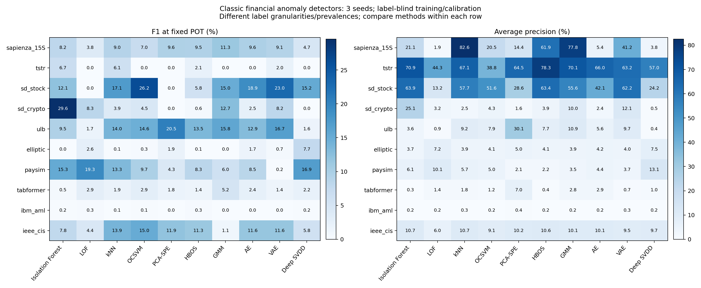

# 经典金融无监督异常检测：实验结果 v1

完成 **10 个任务、10 种方法、3 个种子，共 300 次真实运行**，覆盖 9 组源数据。SD-FMM 的股票和加密货币为同一来源的两个任务。本轮是经典算法核心在金融特征上的复现，不是原论文数据／网络／数值成绩的逐项复刻。

训练每种子统一最多 8,192 条、校准最多 100,000 条；**测试分区全量、不平衡类别、不做 point adjustment**。标签只在最终评价打开。沿用旧数据划分，但训练上限与统一截断评分不同于此前 Kronos 实验，不能直接混排两轮成绩。

## 留出测试组成

| 任务 | 测试总行数 | 已知标签评价数 | 正例数 | 已知标签正例率 |
| --- | ---: | ---: | ---: | ---: |
| sapienza_15S | 145,550 | 145,550 | 77 | 0.0529% |
| tstr | 194 | 194 | 94 | 48.4536% |
| sd_stock | 960 | 960 | 99 | 10.3125% |
| sd_crypto | 10,880 | 10,880 | 68 | 0.6250% |
| ulb | 92,575 | 92,575 | 115 | 0.1242% |
| elliptic | 67,504 | 16,670 | 1,083 | 6.4967% |
| paysim | 1,248,736 | 1,248,736 | 4,250 | 0.3403% |
| tabformer | 3,782,053 | 3,782,053 | 4,578 | 0.1210% |
| ibm_aml | 1,015,564 | 1,015,564 | 1,797 | 0.1769% |
| ieee_cis | 105,693 | 105,693 | 3,611 | 3.4165% |

AP 的随机排序参照水平与正例率有关；不能把正例率差异当作模型性能差异。所有方法在各任务上的测试对象相同。

## 主结果：固定 POT 的 F1（%）

每格为全部 3 个种子的均值；任一种子 POT 失败时该格明确 N/A，不仅平均成功种子。当前共有 **0 次 POT 拟合失败**，原因见 [POT 失败记录](pot_failures.json)。

| 数据 | Isolation Forest | LOF | kNN | OCSVM | PCA-SPE | HBOS | GMM | AE | VAE | Deep SVDD |
| --- | ---: | ---: | ---: | ---: | ---: | ---: | ---: | ---: | ---: | ---: |
| sapienza_15S | 8.18 | 3.84 | 8.98 | 7.01 | 9.58 | 9.47 | 11.26 | 9.65 | 9.09 | 4.69 |
| tstr | 6.71 | 0.00 | 6.06 | 0.00 | 0.00 | 2.08 | 0.00 | 0.00 | 2.04 | 0.00 |
| sd_stock | 12.05 | 0.00 | 17.09 | 26.23 | 0.00 | 5.83 | 14.97 | 18.95 | 23.03 | 15.25 |
| sd_crypto | 29.57 | 8.33 | 3.87 | 4.55 | 0.00 | 0.57 | 12.66 | 2.49 | 8.17 | 0.00 |
| ulb | 9.46 | 1.74 | 13.97 | 14.58 | 20.50 | 13.45 | 15.80 | 12.92 | 16.73 | 1.63 |
| elliptic | 0.05 | 2.57 | 0.12 | 0.34 | 1.87 | 0.05 | 0.00 | 1.67 | 0.69 | 7.72 |
| paysim | 15.33 | 19.34 | 13.26 | 9.74 | 4.32 | 8.34 | 5.96 | 8.53 | 0.23 | 16.94 |
| tabformer | 0.47 | 2.88 | 1.86 | 2.91 | 1.83 | 1.43 | 5.23 | 2.45 | 1.41 | 2.18 |
| ibm_aml | 0.15 | 0.31 | 0.06 | 0.12 | 0.00 | 0.27 | 0.01 | 0.00 | 0.03 | 0.16 |
| ieee_cis | 7.83 | 4.39 | 13.87 | 15.03 | 11.91 | 11.27 | 1.08 | 11.59 | 11.57 | 5.82 |

## 排序能力：Average Precision（%）

AP 使用完整有真值测试子集，与阈值无关。AP 与梯形 PR-AUC 分列在 CSV，不能混称；不同数据正例率／粒度不同，不作混合平均排行榜。

| 数据 | Isolation Forest | LOF | kNN | OCSVM | PCA-SPE | HBOS | GMM | AE | VAE | Deep SVDD |
| --- | ---: | ---: | ---: | ---: | ---: | ---: | ---: | ---: | ---: | ---: |
| sapienza_15S | 21.11 | 1.92 | 82.56 | 20.47 | 14.37 | 61.94 | 77.78 | 5.43 | 41.22 | 3.75 |
| tstr | 70.87 | 44.27 | 67.10 | 38.85 | 64.52 | 78.27 | 70.12 | 65.98 | 63.19 | 56.99 |
| sd_stock | 63.85 | 13.20 | 57.67 | 51.56 | 28.59 | 63.41 | 55.58 | 42.07 | 62.24 | 24.20 |
| sd_crypto | 25.12 | 3.20 | 2.46 | 4.33 | 1.65 | 3.89 | 9.97 | 2.36 | 12.11 | 0.48 |
| ulb | 3.55 | 0.86 | 9.20 | 7.91 | 30.11 | 7.74 | 10.94 | 5.60 | 9.68 | 0.43 |
| elliptic | 3.69 | 7.19 | 3.89 | 4.12 | 4.98 | 4.09 | 3.89 | 4.22 | 4.03 | 7.53 |
| paysim | 6.09 | 10.14 | 5.73 | 4.95 | 2.07 | 2.20 | 3.54 | 4.37 | 3.72 | 13.14 |
| tabformer | 0.32 | 1.39 | 1.79 | 1.18 | 7.04 | 0.44 | 2.81 | 2.86 | 0.71 | 1.02 |
| ibm_aml | 0.23 | 0.24 | 0.31 | 0.22 | 0.44 | 0.23 | 0.23 | 0.23 | 0.26 | 0.24 |
| ieee_cis | 10.66 | 5.99 | 10.69 | 9.06 | 10.22 | 10.59 | 10.08 | 10.07 | 9.49 | 9.69 |

## 预先指定的 99% 校准分位阈值：F1（%）

这是所有方法都计算的第二套操作点，不是 POT 失败时暗中替换的默认值，也不根据测试结果选择较好的阈值。离散分数的并列值和分布漂移可能导致报警比例明显高于 1%。

| 数据 | Isolation Forest | LOF | kNN | OCSVM | PCA-SPE | HBOS | GMM | AE | VAE | Deep SVDD |
| --- | ---: | ---: | ---: | ---: | ---: | ---: | ---: | ---: | ---: | ---: |
| sapienza_15S | 9.65 | 4.31 | 9.84 | 9.73 | 9.89 | 9.88 | 9.01 | 10.10 | 9.77 | 4.84 |
| tstr | 6.71 | 0.00 | 6.06 | 0.00 | 0.00 | 2.08 | 0.68 | 0.69 | 2.03 | 0.00 |
| sd_stock | 10.72 | 0.00 | 14.16 | 26.23 | 3.70 | 5.83 | 7.55 | 21.19 | 21.50 | 17.24 |
| sd_crypto | 29.73 | 11.26 | 3.91 | 3.81 | 0.00 | 1.54 | 14.35 | 2.56 | 13.87 | 0.00 |
| ulb | 9.82 | 1.66 | 14.16 | 15.91 | 17.26 | 14.00 | 15.65 | 12.18 | 17.13 | 1.66 |
| elliptic | 0.03 | 3.32 | 0.12 | 0.44 | 1.86 | 0.05 | 0.06 | 1.68 | 0.92 | 7.55 |
| paysim | 13.50 | 19.82 | 13.34 | 7.37 | 4.52 | 7.77 | 6.44 | 8.54 | 5.40 | 19.83 |
| tabformer | 0.49 | 2.68 | 2.35 | 3.03 | 3.38 | 1.34 | 7.66 | 2.48 | 2.00 | 2.30 |
| ibm_aml | 0.16 | 0.30 | 0.06 | 0.12 | 0.00 | 0.17 | 0.20 | 0.03 | 0.00 | 0.16 |
| ieee_cis | 8.64 | 4.07 | 13.20 | 12.52 | 10.85 | 12.54 | 1.57 | 10.87 | 11.36 | 5.83 |

## 数据与解释限制

- Sapienza 为操纵起点块，TSTR 为整段序列，SD-FMM 为点级；粒度不同。TSTR 校准约一半为正，POT 的主要正常假设不成立；SD-FMM 已由发布者全段处理且重用公开 test 文件研究划分，不能声称原论文零样本复现。
- Elliptic 未知标签仅在评价屏蔽，绝不当正常；此处使用原节点特征，不含图边。原聚合特征不能保证实时可用。
- PaySim、TabFormer、AML 为合成。时间留出允许账户跨期，不等于未见账户测试。部分完整交易字段属于事后可用信息，不构成支付授权前拦截验证。
- IEEE-CIS 仅评价官方训练表内部时间留出，不是 Kaggle 官方测试成绩。原始文件、模型、逐行分数和缓存没有上传。
- 全部方法训练混合数据，不按标签剔除异常。OCSVM、Deep SVDD 等单类目标在污染训练下可能明显退化。经典方法的适用条件不能由算法名称保证。
- 所有超参数提前固定，没有标签调参或测试最优阈值。三种子标准差反映训练／抽样随机性，不是置信区间；未作统计显著性结论。

## 完整指标与复现证据

- [600 套逐种子操作点及完整混淆矩阵](metrics.csv)：Precision、Recall、F1、FPR、AP、梯形 PR-AUC、ROC-AUC、TP/FP/FN/TN、正例率及两套阈值。
- [均值与标准差](summary.csv) · [全部聚合记录、训练损失、阈值和评分 SHA256](runs.json) · [环境与代码指纹](environment.json)。
- [数据分区与特征定义](splits.json) · [输入缓存文件哈希](cache_files_sha256.json) · [实际执行与耗时解释](execution_notes.json)。耗时受并行任务及共享设备影响，不作方法速度排名。
- [方法来源与适配边界](../../docs/METHODS_CN.md) · [预先固定的协议](../../docs/PROTOCOL_CN.md) · [本地评分／混淆矩阵核验](verification.json)。

- 执行代码提交：`18e8a8568e2e045bb849aa1b3c6f52a5ec629409`；代码指纹：`86dd595959b3dcac1f88d34406f7cc7d23951267cfa2d332d771d9db3c2288e1`；适配神经网络设备 `mps`，传统方法／POT 为 CPU。

公开的是聚合证据；模型、完整逐行分数和预处理保存在本地私有运行目录。原始第三方数据不随本代码的 MIT 许可证重新授权。
